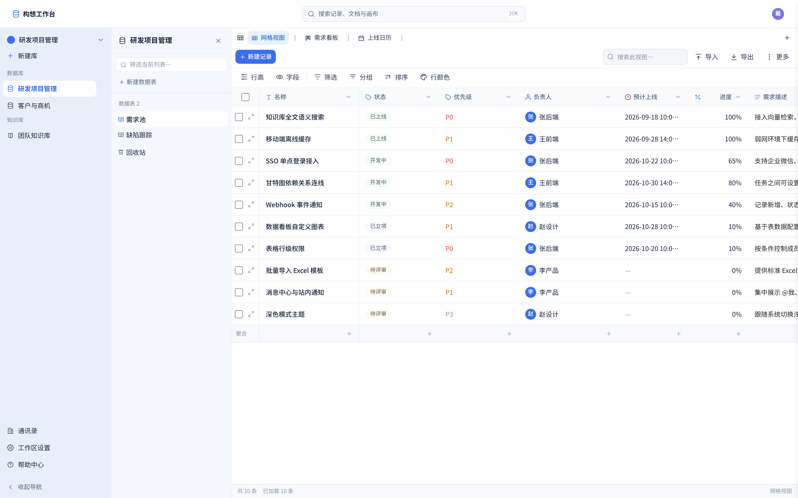
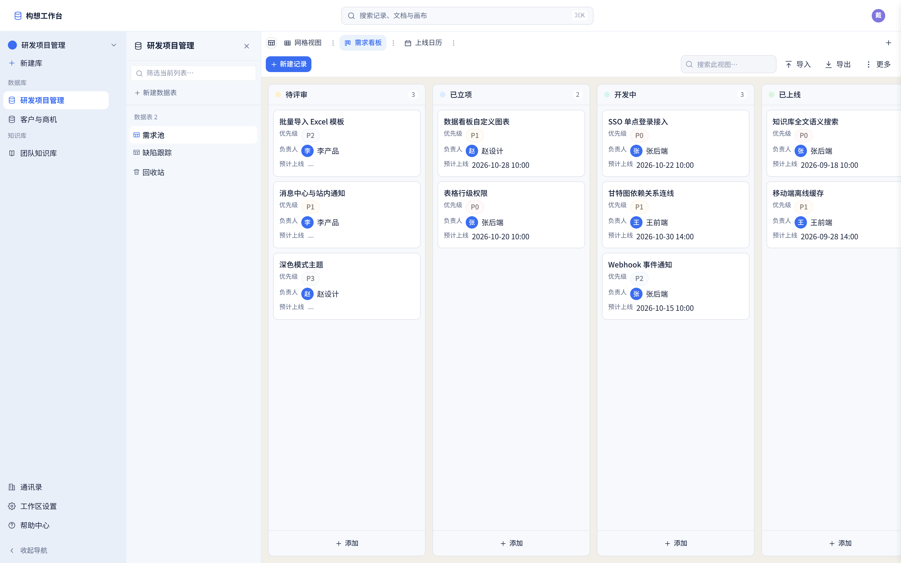
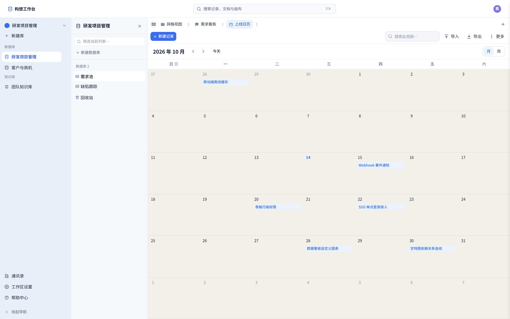
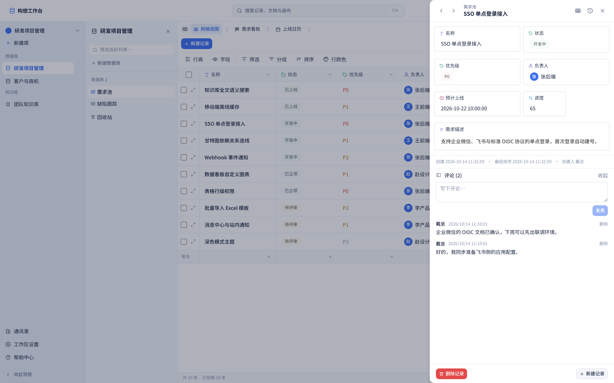
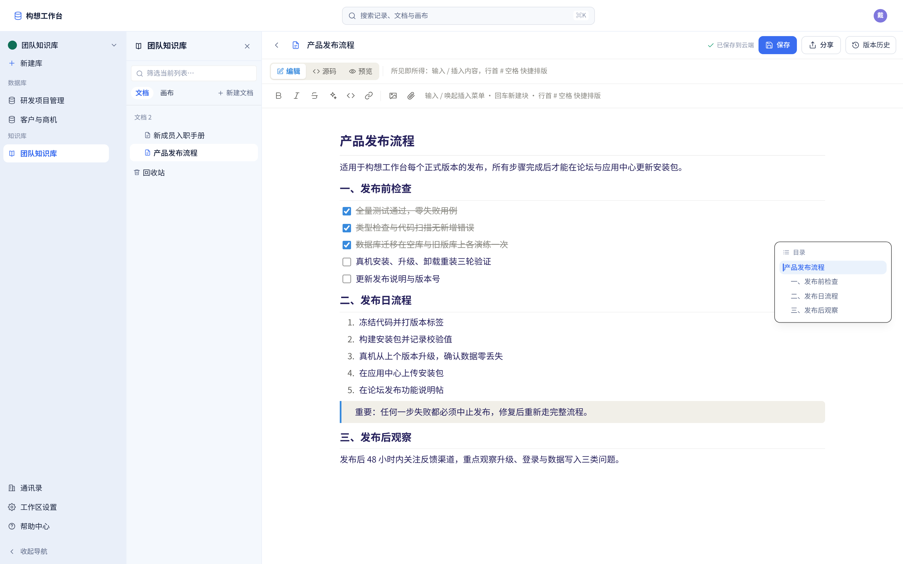
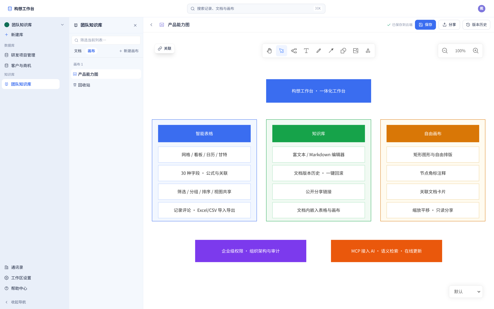
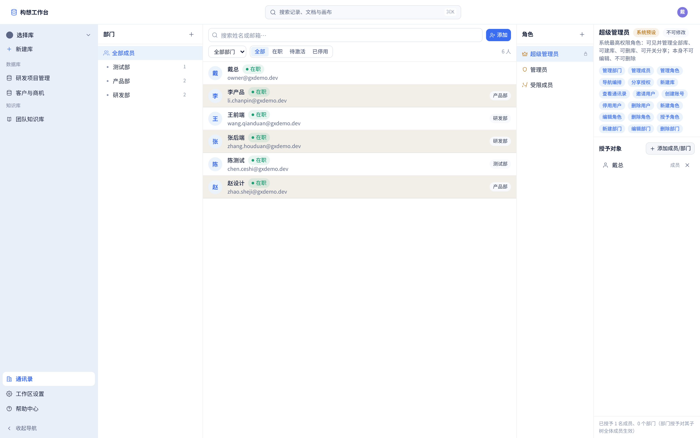

# 构想工作台

> 一款私有化部署的 **智能表格 + 知识库 + 画布** 一体化工作台。数据全部保存在你自己的 NAS / 服务器上，不上云、不订阅、不按人数收费。
>
> 适合想用飞书多维表格 / Airtable / Notion，又希望数据完全自控的个人、家庭与小团队。

- **当前版本**：**`v0.2.7`**（正式版：修好 **macOS 重启电脑后远端连接「失忆」**——桌面壳端口由随机改为固定 `47831`，远端地址与登录态跨重启保留；并收口权限（非超管不能授管理员）、修远端连接用户菜单与详情页编辑。相比 0.2.6 **无数据库迁移、前端/服务端零改动**，仅 Mac 桌面 Rust 壳）
- **测试通道**：**`v0.2.7-beta+775a35c`**（已在 Gitea 标记为预发布：把「本机副本 / 离线同步」接线通电，可添加本机副本、进入 / 断开 / 删除副本，并在同步中心手动立即同步；服务端仍须管理员显式开启 `GX_SYNC_SERVER`，断网与冲突真机 E2E 待实际试用打磨）。稳定日常使用请继续用正式版 **v0.2.7**。
- **产品名**：构想工作台。技术标识（飞牛应用包名 / 目录 / 仓库名）为 `gouxiangdb`，仅用于开发与安装包，界面一律显示「构想工作台」。
- **运行形态**：单进程同时提供 Web 界面与后端接口，内置 SQLite 数据库，**无需外部数据库 / Redis**；浏览器打开即用，电脑、平板、手机自适应。

---

## 功能一览

### 📊 智能表格

一块表就是一个轻量业务系统，每一列都有明确类型，共 **30 种字段**：文本、数字、货币、百分比、时长、日期、单选 / 多选、复选框、人员、评分、邮箱 / 链接 / 电话、附件、自动编号、JSON，以及跨表的**关联 / 查阅 / 聚合 / 计数 / 公式**，外加选项卡、子表格和创建人 / 创建时间等系统字段。

同一份数据可保存多种视图，共 **8 种视图**：**网格、看板、日历、甘特、层级（树形）、画廊、详情、表单**。看板拖动卡片即可推进状态，日历 / 甘特按日期排期，表单用于对外收集。支持筛选、排序、分组、行颜色、字段显隐、底部汇总，并可在记录详情抽屉里讨论评论。

> 应用场景不写死：项目管理、缺陷跟踪、客户与商机（CRM）、库存、书单、家庭记账……建表配字段即可，不需要代码。

### 📚 团队知识库

- 富文本 / Markdown 编辑器：标题、列表、待办、表格、引用块，带悬浮大纲目录；
- **自动保存 + 版本历史**：每次保存形成命名版本，可查看历史并一键回滚；
- **公开分享链接**：文档可只读 / 可编辑分享，数据表、整个库也可生成匿名只读公开链接发给外部成员，无需为其开账号；
- 文档内可**嵌入实时数据表与画布**，数据更新时文档里同步变化。

### 🗂️ 自由画布

基于 Plait 的白板：拖拽矩形、自由排版，用于画产品结构图、流程图、头脑风暴；支持缩放平移、节点注释、关联文档卡片与只读分享。

### 🏢 企业级协作

- **通讯录 + 部门架构**：建立部门、把成员挂到部门下；
- **角色与细粒度权限**：内置所有者 / 管理员 / 成员等角色，权限可精确到库 / 表 / 文档，并支持字段级、行级控制（例如成员只能看到自己负责的记录）；
- **操作审计**：关键操作留痕。

### 🔍 全局检索与 AI 接入

- 顶部搜索框（快捷键 `Ctrl / ⌘ + K`）**跨库、跨文档、跨画布**全局检索，结果分组并高亮关键词；
- 可选开启 **MCP 接口**接入 AI（知识库问答、自动化），支持语义向量检索，提供个人访问令牌（PAT）。不开启也完全不影响日常使用。

### 🔒 数据与更新

- 数据库与上传附件全部保存在你选定的存储空间，**不向任何第三方上传数据**；
- 更新机制（迁移自动备份、卸载重装数据保留）已内置；**0.2.7 在线更新通道暂未接通**，本版升级请手动下载新包（飞牛先 uninstall 再装新 fpk，数据保留；macOS 重新拖入新版 dmg）。

---

## 界面预览

> 截图位于 [`docs/forum-publish/images/`](docs/forum-publish/images/)，配文见 [`docs/forum-publish/论坛帖正文.md`](docs/forum-publish/论坛帖正文.md)。

| 登录 | 智能表格 · 网格 |
| :---: | :---: |
|  |  |
| **看板视图** | **日历视图** |
|  |  |
| **记录详情与评论** | **知识库文档** |
|  |  |
| **自由画布** | **通讯录与权限** |
|  |  |

---

## 快速开始（飞牛 fnOS）

1. 下载与 NAS 架构匹配的安装包（**当前正式发布仅提供 x86_64（x86）包，勿下错**；arm 包暂未发布）；
2. 打开飞牛「应用中心」→「手动安装」→ 选择 `.fpk` → 选择安装存储空间；安装向导的「服务端口」默认 **9527**（可改 1024–65535，独立端口直接服务，不再走旧 CGI 反代）；
3. 从桌面卡片打开应用，**第一个注册的账号自动成为所有者（超级管理员）**，后续成员由管理员创建；
4. 浏览器打开即用，建议 Chrome / Edge / Safari 最新版。

> 也支持预置初始管理员、自定义外部访问地址等，详见 [`docs/deployment/fnos-native.md`](docs/deployment/fnos-native.md) 与 [`docs/deployment/first-admin-init.md`](docs/deployment/first-admin-init.md)。

## 快速开始（macOS 桌面客户端）

1. 在 [Gitea Releases](https://gitea0.hn.takin.cc/GouXiang/gouxiangdb/releases) 下载 `构想工作台_0.2.7_aarch64.dmg`（**仅 Apple 芯片 / arm64、macOS 11+**，Intel 芯片与 Windows/Linux 暂不支持）；
2. 双击打开 dmg，把「构想工作台」拖入「应用程序」；
3. 应用为 ad-hoc 自签名、**未做 Apple 公证**：首次启动在「应用程序」里**右键 → 打开**（直接双击会被 Gatekeeper 拦截），确认后即可；
4. 打开后在启动器选择「本地节点」（本机起服务、空册即用）或「远程节点」（填团队服务器地址 + 账号）。

> 局限：dmg 真机 GUI 两次冷启动冒烟待产品负责人在场（固定口逻辑已由壳 headless 测试覆盖）、附件大文件上传未压测、应用内「检查更新」在本版为占位（请手动下载新版）。详见 [`docs/release-notes/0.2.7.md`](docs/release-notes/0.2.7.md)「诚实缺口」。

其余部署形态（裸机 systemd、Docker）见下方「[部署形态](#部署形态)」。

---
---

> **以下为开发者与运维内容**，普通用户无需关心。

## 技术栈

| 层 | 选型 |
|---|---|
| 后端 | Node.js（**部署统一 v22**）+ **Hono 4** + **Prisma 5** + **SQLite**（WAL 单写者）；esbuild 扁平生产打包 |
| 前端 | React 18 + Vite + Tailwind + TanStack Query；图标单一 `icons.tsx`，色板走 `@gx/design-tokens` |
| 桌面端 | **macOS Apple 芯片客户端**（Tauri v2 壳 + 随包 Node 侧车；arm64、macOS 11+、ad-hoc 签名首次右键打开，bundle id `cc.gouxiang.desktop`，0.2.6 起随正式版发布、0.2.5-beta.1 首测）；Windows / Linux 暂不支持 |
| 共享 | `@gx/shared-types`（类型 + 筛选/关系/权限语义）、`@gx/design-tokens`、`@gx/blocks`、`@gx/canvas` |
| 检索 | 独立 `search.db` + **sqlite-vec（vec0）** + FTS5 trigram；embedding 出厂默认 `off`，仅远端 OpenAI 兼容 API |
| AI 接入 | **MCP**（官方 Streamable HTTP 传输 + PAT 凭据 + 双闸门）——M6 后为唯一 AI 接入核心 |

## 目录结构

```
GouXiangDB/
├── apps/
│   ├── api/              # Hono + Prisma + SQLite 后端
│   │   ├── prisma/{schema.prisma,migrations/}   # 手写 SQL 迁移，生产用 migrate deploy
│   │   ├── scripts/                              # build / backup / init-admin / nav-reconcile
│   │   └── src/
│   └── web/              # React + Vite 前端
├── packages/
│   ├── shared-types/     # 前后端共享 TS 类型与语义（权限/筛选/关系/策略 DTO）
│   ├── design-tokens/    # 跨端设计 token（自 v1 GXTheme 移植）
│   ├── blocks/           # 块模型 mdToBlocks / blocksToMd（服务端消费）
│   └── canvas/           # 画布校验器（Plait 六不变量，服务端 shared 单一规则源）
├── docs/                 # 见下方「文档导航」
├── deploy/               # 裸机 systemd / Caddy / Docker / 飞牛 fpk 部署物
├── scripts/              # dev-up.sh / ci-quality.sh / compare-test.sh / acceptance 等
├── package.json          # pnpm workspace root（version 为版本号唯一真源）
└── pnpm-workspace.yaml
```

## 本地开发

前置：**Node 统一用 v22**（better-sqlite3@13 走 NAPI v10，Node 20 加载原生模块会直接 SIGSEGV，开发机与部署机同理，不是普通报错）、pnpm ≥ 9（`packageManager` 锁定 `pnpm@9.0.0`）。无需外部数据库。

```bash
pnpm install                                   # 安装
cp apps/api/.env.example apps/api/.env         # 已含 DATABASE_URL="file:./dev.db"

pnpm db:migrate                                # 开发（prisma migrate dev）
pnpm --filter @gx/api run db:deploy            # 非交互环境（prisma migrate deploy）
pnpm --filter @gx/api exec prisma generate

bash scripts/dev-up.sh start                   # 推荐：API :3001 + Web :5173（脱离 shell）
bash scripts/dev-up.sh status | restart | stop
# 或分别起：pnpm dev:api / pnpm dev:web；并行：pnpm dev

pnpm test                 # 逐包跑；pnpm typecheck / pnpm lint / pnpm build
bash scripts/ci-quality.sh                     # CI 质量门
```

健康检查：`/healthz`（存活）、`/readyz`（就绪，含迁移对账 / 磁盘 / WAL 探针），见 `docs/runbooks/`。

<details>
<summary><b>测试基线（带日期的历史实测，以实际重跑为准）</b></summary>

| 包 | 实测值 | 记录日期 | 来源 |
|---|---|---|---|
| `apps/web` | **2666 passed / 0 failed**（205 files） | 2026-10-26 | v0.2.7-beta+775a35c 封版全量四门（VM15，`--maxWorkers=2`） |
| `apps/api` | **3678 passed / 0 failed / 14 skipped**（351 files，共 3692） | 2026-10-26 | v0.2.7-beta+775a35c 封版全量四门（VM15，`--maxWorkers=2`） |
| Mac 壳 headless | **35 passed / 0 failed**（含副本路径隔离、远端默认值、规划器 env 与令牌脱敏） | 2026-10-26 | v0.2.7-beta+775a35c 桌面壳（本机增量，clippy `-D warnings` 清零） |
| `apps/web` | **2538 passed / 0 failed**（202 files） | 2026-10-24 | v0.2.7 封版全量四门（VM15） |
| `apps/api` | **3670 passed / 0 failed / 14 skipped**（349 files，共 3684） | 2026-10-24 | v0.2.7 封版全量四门（VM15） |
| `@gx/canvas` | **51 passed / 0 failed**（2 files） | 2026-10-24 | v0.2.7 质量门（VM15） |
| `@gx/shared-types` | **181 passed / 0 failed**（10 files） | 2026-10-24 | v0.2.7 质量门（VM15） |
| Mac 壳 headless | **31 passed / 0 failed**（含 4 个固定口选择用例） | 2026-10-24 | v0.2.7 桌面壳（本机增量） |
| `apps/web` | **2507 passed / 0 failed**（198 files） | 2026-10-23 | v0.2.6 封版全量四门（VM15） |
| `apps/api` | **3666 passed / 0 failed**（350 files） | 2026-10-23 | v0.2.6 封版全量四门（VM15） |
| `@gx/canvas` | **51 passed / 0 failed**（2 files） | 2026-10-23 | v0.2.6 质量门（VM15） |
| `@gx/shared-types` | **181 passed / 0 failed**（10 files） | 2026-10-23 | v0.2.6 质量门（VM15） |
| `apps/api` | **3390 passed / 0 failed / 14 skipped**（324 files passed，2 skipped） | 2026-10-16 | v0.2.5 收口全量四门 gate-025f（VM15） |
| `apps/web` | **1910 passed / 0 failed**（146 files；含 node/ 三个新模块 69 测试） | 2026-10-16 | v0.2.5 收口全量四门 gate-025f（VM15） |
| `@gx/shared-types` | **181 passed / 0 failed**（10 files） | 2026-10-16 | v0.2.5 质量门 gate-025f（VM15） |
| `@gx/canvas` | **51 passed / 0 failed**（2 files） | 2026-10-16 | v0.2.5 质量门 gate-025f（VM15） |
| `apps/api` | 3244 passed / 0 failed / 14 skipped（308 files passed，2 skipped） | 2026-10-14 | v0.2.4 收口全量四门（VM15） |
| `apps/web` | 1836 passed / 0 failed（143 files） | 2026-10-14 | v0.2.4 收口全量四门（VM15） |
| `@gx/shared-types` | 172 passed / 0 failed（9 files） | 2026-10-14 | v0.2.4 质量门 |
| `@gx/canvas` | 51 passed / 0 failed（2 files） | 2026-10-14 | v0.2.4 质量门 |

本表是历史记录、非当前断言。**v0.2.7-beta+775a35c 测试版实数（VM15，2026-10-26，封版 `775a35c`）**：API **351 文件 / 3678 通过 + 14 跳过、0 失败**，Web **205 文件 / 2666 通过、0 失败**（均以默认隔离池 `vitest --maxWorkers=2` 为权威；singleFork 会制造 node/jsdom 串环境假红）；六包 `tsc --noEmit` 0 错误、eslint 0 error；迁移仍 **44 枚**零新增；aws-lc-rs=0；Mac 壳单测 **35/0**、clippy 0 warning/error；stage 真建库 + 随包 Node `/readyz` 五探针通过；dmg deep-strict 通过、gxnode 保苹果官方签 HX7739G8FX、FinderInfo=0。测试包：`gouxiangdb-0.2.7-x86.fpk`（60,836,458 B，sha256 `cb4affdc…ebe0`）与 `构想工作台_0.2.7-beta+775a35c_aarch64.dmg`（106,014,059 B，sha256 `923b3055…39d8`），均已匿名下载复验哈希一致；Gitea Release id=14（prerelease，不传 update-manifest）。**v0.2.7 封版实数（VM15，2026-10-24，封版 `6a45409` ＋ 桌面壳固定口修复）**：四包 `tsc --noEmit` 零错误、`eslint` 0 error；迁移仍 **44 枚**（本版无新增迁移，仅 Mac 桌面 Rust 壳，前端/服务端零改动）；Mac 壳 headless **31** 全绿、clippy 清零、aws-lc-rs=0。双安装包：`gouxiangdb-0.2.7-x86.fpk`（60,831,523 B，sha256 `8cd964c0…5085`）与 `构想工作台_0.2.7_aarch64.dmg`（109,620,131 B，sha256 `c72e8ffe…d66e`，外层完整 ad-hoc 重签、随包 gxnode 保留苹果官方签 HX7739G8FX、deep-strict 通过）；dmg 真机两次冷启动冒烟待产品负责人在场，详见根 `RELEASE.md`。v0.2.6 封版实数（VM15，2026-10-23，基线 `3ea1f65`）：三包 `tsc --noEmit` 零错误、`eslint` 0 error、web build 成功；迁移 **44 枚**（`prisma migrate deploy` 幂等只增；同步面 `GX_SYNC_SERVER` 默认关闭、不触数据）。双安装包已构建并在飞牛真机 192.168.31.183 换装实证（旧 bundle marker=0 → 新 marker=1，JWT 不踢、数据零丢失、P0 匿名公开表真机通过，详见根 `RELEASE.md`）：`gouxiangdb-0.2.6-x86.fpk`（60,822,956 B，sha256 `be4ebea6…d0a`）与 `构想工作台_0.2.6_aarch64.dmg`（108,586,466 B，sha256 `90aabec9…03bc`）。v0.2.5 收口实数 gate-025f（2026-10-16）：迁移 42 枚（只增 1 枚 `sync_server_foundation` 建四张 `sync_*` 表）。v0.2.4 为 41 枚（注册开关复用 `app_settings` KV，零新增迁移）。内存 / 压测 / 全量测试类重活不在本机跑，放预览机 VM15；权威出口数字见 `docs/baseline/`。

</details>

## 部署形态

| 形态 | 说明 | 文档 |
|---|---|---|
| **飞牛 fnOS（fpk）** | 原生应用包，**独立 TCP 端口（默认 9527）根路径同源**部署，桌面卡片以跨源 iframe 打开；应用中心一键装 | `docs/deployment/fnos-native.md` |
| **裸机 systemd** | systemd + Caddy + `deploy.sh`（在线快照 → `migrate deploy` → nav path 重算 → 切换，失败 die 在切换前） | `docs/deployment/README.md`、`docs/runbooks/deploy.md` |
| **Docker** | `node:22-bookworm` 基础镜像，自包含 Dockerfile / entrypoint / compose | `docs/deployment/docker.md` |

其他：`docs/deployment/first-admin-init.md`（首次超管引导）、`docs/deployment/macos-dev.md`（本机开发）。

## 运维硬约束

1. **Node 版本**：任何部署目标一律 **v22**。Node 20 下原生模块（better-sqlite3）会直接 **SIGSEGV**（非普通报错，易误判为数据库损坏），详见 `docs/deployment/README.md` §2.4。
2. **子路径 / 网关鉴权头**：飞牛网关会吞 `Authorization`，Web 用自定义头 **`X-GX-Token`**；服务端先取 `Authorization: Bearer`，再回退 `X-GX-Token`。
3. **SQLite 单写者**：写操作统一走 `withWriteTx` / `runWrite` / `withWriteBatch`（回调体内只用传入 `tx`，不得再入队）；raw SQL 一律参数化。
4. **搜索 / 嵌入**：`GX_M5_SEARCH`、`GX_EMBEDDING_MODE` 出厂默认 `off`（语义检索需管理员显式配置）；`search.db` 可整文件重建，不进业务备份。
5. **MCP**：`/mcp` 独立 body 上限 `GX_MCP_BODY_LIMIT` 默认 11MB（全局 JSON 限 1MB）；`/mcp` 与 `/api/v1/pats` 受 `GX_ENTERPRISE_ORG` 门控（off 即不挂载）。
6. **迁移纪律**：只增不删（不删列、不改列类型），回填幂等可重跑；生产用 `migrate deploy`，`migrate dev` 仅交互环境用。
7. **性能口径**：本 README 不承诺任何跨硬件性能数字；需要请查 `docs/baseline/`，无记录一律标【待补】。

<details>
<summary><b>权限引擎当前状态（M4，唯一执法者，无开关）</b></summary>

实际执法的是统一权限引擎 `apps/api/src/domain/authz/engine.ts` 的 `decide()`，读 **`auth_policies` + `nav_nodes`**（角色 / 部门 / 用户经 nav 节点投影），**永久、无条件生效**：

- 三态开关 `GX_AUTHZ_ENGINE`、READY 阶段门、shadow 对拍 / drift 账本已全部物理删除（2026-10-06，ADR-0057）；
- 引擎抛错 → 503 fail-closed（不回落旧决策）；资源无活 nav 节点 → 403 fail-closed；
- 删库 / 删知识库走 conjunction（只减不增）；字段掩码、行级条件、导航剪枝恒定执行。

`libraryPolicy.ts` 是引擎之上的「能力 / UI 形状层」，与引擎执法正交。第一代旧三表（`members` / `kb_members` / `kb_doc_acls`）不参与放行，仅作台账。详见 ADR-0057、ADR-0056。

</details>

## 数据库说明

ADR-0001 初选 PostgreSQL，落地改用 **SQLite**（以 `apps/api/prisma/schema.prisma` 的 `provider = "sqlite"` 为准）：零外部依赖、本地可直接运行；多用户服务端数据库作为后续演进项（触 ADR-0008 阈值再立项）。

- 开发连接串用相对路径 `DATABASE_URL="file:./dev.db"`（相对 schema 目录）；**生产建议绝对路径**。
- 生产用 `prisma migrate deploy`；`migrate dev` 交互式，非交互环境禁用。

## 与 v1 的关系

v1 为 Swift 实现，与当前版本零代码依赖。核心模型（字段、hydrate、公式 / Lookup / Rollup、Meta、权限、主题）均已移植并增强，另新增看板 / 日历 / 甘特、知识库与画布。

## 文档导航

| 想找什么 | 去哪 |
|---|---|
| **帮助中心（用户向）** | 0.2.5 起改为应用内在线拉取 **Gitea 百科(wiki)**（后端同源代理 `GET /api/help/wiki`、`/api/help/asset`，前端 `apps/web/src/features/help/`）；旧内嵌帮助已退役 |
| **现行规范 / 架构决策** | `docs/adr/`（ADR-0001~0057，唯一权威）；权限专项另见 `docs/decisions/` |
| **部署** | `docs/deployment/` |
| **运维手册** | `docs/runbooks/`（deploy / backup / restore / ci / m5-search / mcp / authz-*） |
| **接口契约** | `docs/api/openapi.yaml`（冻结）+ `docs/api/m4-error-codes.md` |
| **出口证据 / 实测基线** | `docs/baseline/` |
| **发版记录** | 根目录 **`RELEASE.md`**（现行＝v0.2.7，修 macOS 重启远端失忆；历史归档 `docs/release-notes/`，0.2.6、0.2.5-beta.1 等） |
| **已知问题 / Bug 回归清单** | 根目录 **`KNOWN-ISSUES.md`**（发版前按表回归；条数以该文件标题行实时统计为准） |
| **待裁决事项（含瘦身清理）** | 根目录 `PENDING-DECISIONS.md` |
| **历史归档（M0–M6 计划、被取代报告）** | 根目录 `ARCHIVE-LOG.md`（索引摘要）→ 全文副本 `docs/_archive/originals/` |

根目录四份常驻文件：`KNOWN-ISSUES.md`（回归清单 + 踩坑速查）、`ARCHIVE-LOG.md`（归档溯源）、`PENDING-DECISIONS.md`（待裁决）、`RELEASE.md`（发版记录）。架构选型与重大变更走 ADR；悬而未决项登记 `PENDING-DECISIONS.md`，关闭前不擅自实施。
