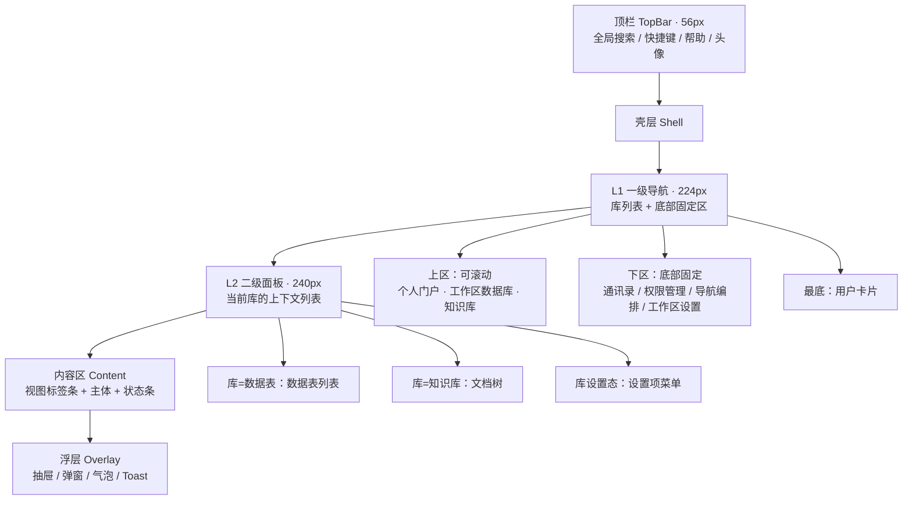
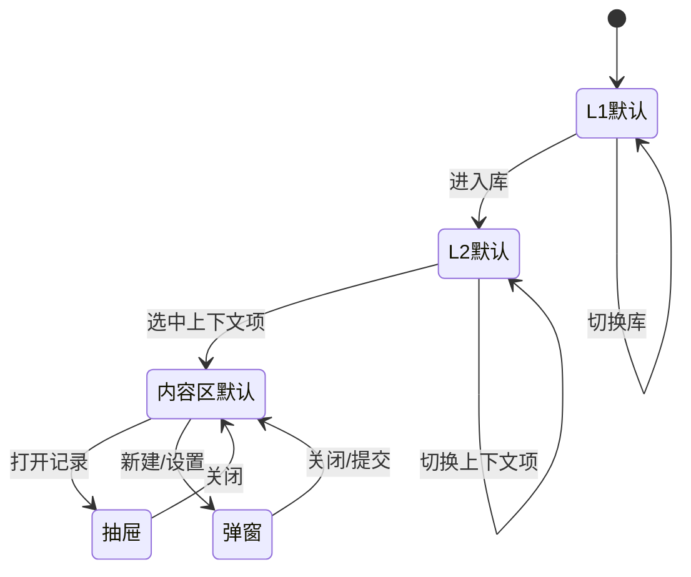
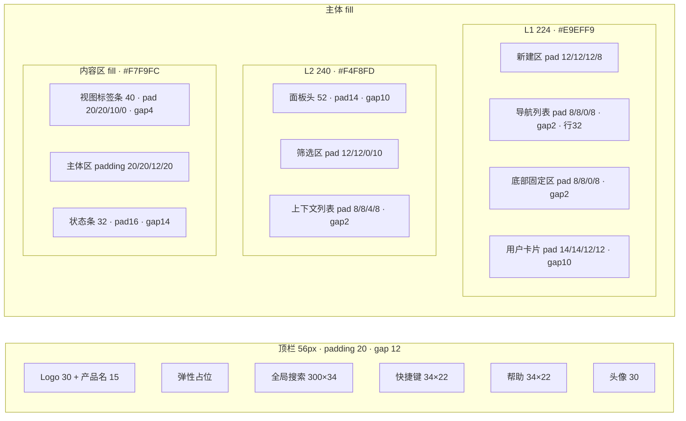
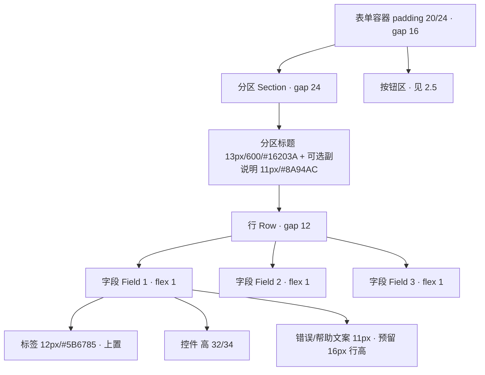
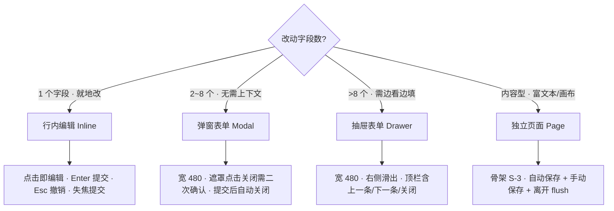
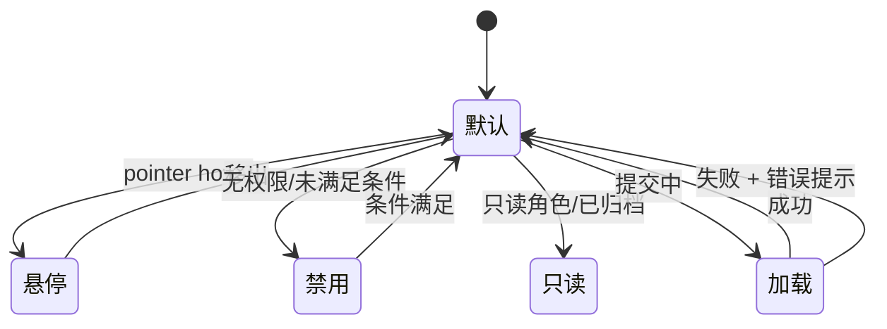
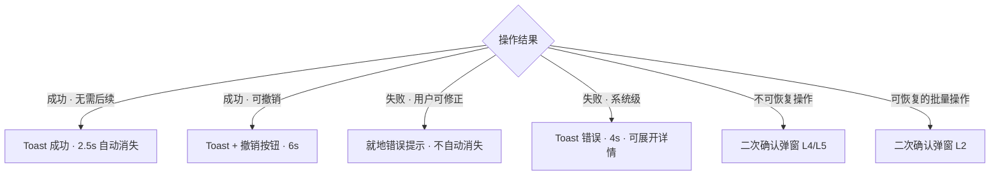
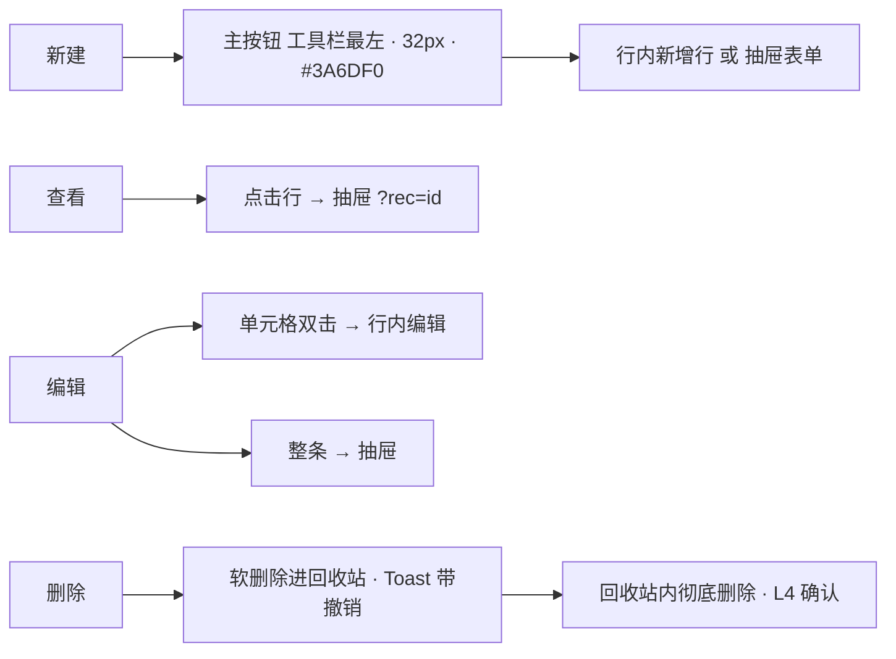

# 构想工作台 · UI 与交互统一重构规范（唯一可执行版本）

> 版本 **v1.0** ｜ 2026-09-19 ｜ 状态：**可执行，开发可直接开工**
> 本文件是 UI 重构的**唯一规范源**。目录内其余历史文档已归档到 `_archive/`，不再作为依据。

---

## 0. 使用方式与最高优先级约束

### 0.1 参考设计唯一源（不可替换）

| 项 | 取值 |
|---|---|
| 参考设计稿 | Ardot 画布 `727230432707133` — Frame「方案A 数据表主界面」1440×900 |
| 本地基准图 | `assets/A-方案A-数据表主界面.png`（2x 导出） |
| 交互外框参考 | Ardot 画布 `727257069214570`（S2/S3/S4/S5 外框与状态示意，**仅作结构与状态参考，不作为色彩基准**） |

**判定顺序**：本规范 → 参考设计稿推导 → 现有 token。**规范与参考设计的取值冲突时，以参考设计为准并回头修订本规范；规范未覆盖的场景，一律从参考设计推导，严禁自行新增样式。**

### 0.2 三条硬约束（违反即视为不合格）

1. **禁止自由发挥**：不得新增参考设计里不存在的颜色、圆角、字号、阴影、间距档位。
2. **禁止在业务代码里写死 hex**：一律走 `gx-*` Tailwind 类（见附录 A）。
3. **禁止新增依赖与裸 fetch**：图标用项目自建 `components/icons.tsx`（缺图标则补 SVG，不用图标库）。

### 0.3 开工前置：令牌迁移（当前代码与参考设计冲突，必须先做）

`packages/design-tokens/src/colors.ts` 目前仍是 **v1 GXTheme 暖灰 + `#378ADD`** 色板，与参考设计的冷灰 + `#3A6DF0` 体系**不一致**。附录 A 的映射表是**第一步必须先落地的改造**：包名与 Tailwind 类名保持不变，只换底层取值并补齐缺失令牌。不完成这一步，后续所有页面写出来都不会与参考设计一致。

---

# 1. 菜单架构

## 1.1 层级模型

**层级上限为三层**：L1（库）→ L2（库内上下文）→ 内容区（视图 / 页面）。**禁止出现 L3 侧边栏**；再深一层用内容区内的分区或抽屉承载。

## 1.2 路由与导航规则

| 编号 | 规则 | 适用场景 |
|---|---|---|
| R-N-01 | 路由形状统一为 `/{scope}/{scopeId}/{context}/{contextId}/{action}`，例如 `/base/:baseId/table/:tableId`、`/kb/:kbId/doc/:docId`、`/base/:baseId/settings/members` | 全部页面 |
| R-N-02 | L1 选中项决定 `scopeId`；L2 选中项决定 `contextId`；二者都写进 URL，**刷新后必须完整还原**（含 L2 选中项与视图 Tab） | 库内所有页 |
| R-N-03 | 切换 L1 时若新库类型不同（数据表 ↔ 知识库），L2 面板整体替换组件（数据表列表 ↔ 文档树），**不复用 DOM 结构** | 跨库切换 |
| R-N-04 | 内容区内的视图切换（表格 / 看板 / 日历 / 画廊 / 表单）用 `?view=` 查询参数，不用子路由，保证返回原视图 | 数据表主体 |
| R-N-05 | 弹窗类操作**不改 URL**；抽屉类操作（记录详情）用 `?rec=<id>` 查询参数，可分享、可刷新还原 | 记录详情 |
| R-N-06 | 无权限路由不跳转、不重定向到登录，而是**停在当前页并就地渲染无权限态**（见 R-D-07） | 越权访问 |

## 1.3 展开 / 收起与选中态

| 编号 | 规则 | 适用场景 |
|---|---|---|
| R-N-07 | L1 支持折叠到 **56px** 图标档；折叠态只留图标 + tooltip，底部固定区与用户卡片保持可点 | 窄屏 / 手动折叠 |
| R-N-08 | 折叠状态写 `localStorage`，跨会话保持，**不写 URL** | 全站 |
| R-N-09 | L1 选中态 = 白底 `#FFFFFF` + 圆角 8 + 文字 `#3A6DF0` 600 字重；**不用左侧色条**（L2 也不用） | L1 导航项 |
| R-N-10 | L2 选中态 = 白底 `#FFFFFF` + 圆角 6/8 + 文字 `#3A6DF0` 600 字重；hover = `#F1F5FB` | L2 列表项 |
| R-N-11 | 行尾「竖向三点」入口**默认隐藏**，仅在**行 hover 或行内获得焦点**时出现；但必须**保留 20×20 占位**防止布局跳动 | 所有列表行（数据表 / 文档 / 成员 / 回收站） |
| R-N-12 | R-N-11 必须同时满足四条护栏：① 20×20 占位常驻；② 菜单打开期间强制可见；③ 触屏设备（`@media (hover:none)`）常驻可见；④ 键盘 focus-within 可见 | 同上 |
| R-N-13 | 树形节点（文档树）展开箭头 16×16，点击箭头只展开不跳转，点击文字才跳转 | 知识库文档树 |
| R-N-14 | 内容区视图 Tab 选中 = 白底 + `#3A6DF0` 文字；未选中无底 + `#5B6785` 文字；Tab 高 28，条高 40 | 视图标签条 |

> **正例**：数据表行 hover 时右侧淡入三点按钮，行高不变、文字不位移。
> **反例**：三点按钮常驻显示（视觉噪音）；或用 `display:none` 导致 hover 时行宽跳动。

## 1.4 权限与可见性

| 编号 | 规则 | 适用场景 |
|---|---|---|
| R-N-15 | 菜单项按权限**隐藏**（不是置灰）。无权限的库不出现在 L1；无权限的表不出现在 L2 | L1 / L2 |
| R-N-16 | 只读角色仍可见全部菜单，但内容区内**写操作入口隐藏**（新建记录、导入、删除、拖拽排序），保留导出与分享 | 只读 / 仅评论角色 |
| R-N-17 | 未实现的规划入口**保留位置**并挂「规划中」徽标（10px / `#F1F3F9` 底 / `#8A94AC` 字 / 圆角 4），点击后不做静默失败，弹出占位提示 | 预留入口 |
| R-N-18 | 回收站按**实际能力**放置：库级有回收站能力才在 L2 设置项里出现；没有则不出现，禁止为了结构完整而放死链 | 回收站 |

## 1.5 面包屑与页面标题

| 编号 | 规则 | 适用场景 |
|---|---|---|
| R-N-19 | **主壳内不渲染面包屑**：L1 + L2 的选中态已经表达了位置，再加面包屑是冗余 | 数据表 / 知识库主体 |
| R-N-20 | 仅在**脱离主壳**的独立页渲染轻标题：编辑器顶栏、设置页页头、回收站页头 | 编辑器 / 设置 / 回收站 |
| R-N-21 | 页头结构固定为「标题 16px/600/`#16203A`」+「副说明 12px/`#8A94AC`」，副说明一句话说清该页能做什么 | 设置类页面 |
| R-N-22 | 文档标题用**可编辑 input**（无边框，hover/focus 才出 `#F7F9FC` 底），不用「标题 + 编辑按钮」双控件 | 文档编辑器 |
| R-N-23 | 浏览器 `document.title` 形如 `「标题」· 库名 · 构想工作台` | 全站 |

> **正例**：库设置页页头 = 「成员」+「管理可以访问这个数据库的人，以及他们各自的角色」。
> **反例**：在数据表上方再叠一条 `工作区 / 产品中心 / 需求池` 面包屑。

## 1.6 可复用页面骨架容器（唯一一套）

**骨架 S-1（数据表主体）** = 顶栏 + L1 + L2 + 内容区；内容区 = 视图标签条 + 表格卡片（工具栏 48 / 表头 36 / 数据行 44 / 汇总条 36）+ 状态条 32。

**骨架 S-2（库设置 / 回收站 / 独立内容页）** = 顶栏 + L1 + **L2 换为「设置项菜单」** + 内容区（页头 + 工具条 + 列表卡）。**S-2 是 S-1 的 L2 变体，顶栏 / L1 / 内容区三段完全复用，不得另写一套壳。**

**骨架 S-3（文档 / 画布编辑器）** = 顶栏 + L1 + L2（文档树）+ 内容区（编辑器顶栏 48 + 编辑区 fill + 大纲 200）。

> **正例**：回收站页 = S-2，L2 选中「回收站」，内容区换成回收项列表；除内容区外与库设置页逐像素一致。
> **反例**：为回收站单独写一个没有 L2 的整页。

---

# 2. 表单架构

## 2.1 统一布局与栅格

| 编号 | 规则 | 适用场景 |
|---|---|---|
| R-F-01 | 栅格统一 **12 栅格 + gap 12**；字段占 12（整行）/ 6（半行）/ 4（三列）/ 8+4（主次）。**禁止 5 / 7 等不规则跨度** | 所有表单 |
| R-F-02 | 字段最小宽度 **200px**；容器窄于 `200×n + 12×(n-1)` 时自动降列（3→2→1），不出现横向滚动 | 响应式 |
| R-F-03 | 分区之间用 **24px** 间距 + 1px 发丝线 `#E9EFF9`；分区内字段间距 **16px** | 分组分区 |
| R-F-04 | 同一行内字段**基线对齐**：标签与标签齐、控件与控件齐；长文本域独占整行 | 多行表单 |
| R-F-05 | 字段高度档位只有三档：**32**（紧凑：表格内/筛选）、**34**（标准：弹窗/抽屉表单）、**自动**（多行文本）。禁止 36/38/40 等自造高度 | 全部输入控件 |

## 2.2 标签位置与必填标识

| 编号 | 规则 | 适用场景 |
|---|---|---|
| R-F-06 | 标签**统一上置**（控件上方 6px），左置仅在「行内编辑 / 表格筛选条」允许 | 弹窗 / 抽屉 / 页面表单 |
| R-F-07 | 必填用标签后 `*` 号，色 `#D64545`，**不加 tooltip 解释**；整表必填时不逐个标 `*`，改在分区标题后标「全部必填」 | 全部 |
| R-F-08 | 选填字段在标签后加灰色「选填」二字（11px / `#8A94AC`），不用占位符代替标签 | 混排表单 |
| R-F-09 | **占位符只能给示例值，不能复述标签**，更不能承载格式要求（格式要求放帮助文案） | 全部输入 |

> **正例**：标签「邮箱」+ 占位符 `name@company.com` + 帮助文案「用于登录与通知」。
> **反例**：占位符写「请输入邮箱」；或用占位符当唯一标签。

## 2.3 校验时机与错误提示

| 编号 | 规则 | 适用场景 |
|---|---|---|
| R-F-10 | 校验时机三段式：**① 失焦即校验单字段**；**② 提交时全量校验并聚焦首个错误**；**③ 已报错字段在输入时实时消错**（不实时报错） | 所有表单 |
| R-F-11 | 错误态 = 边框 `#D64545` + 控件下方 11px `#D64545` 文案 + 图标；**不用 toast 报字段级错误** | 字段校验 |
| R-F-12 | 错误文案写在**控件下方固定预留的 16px 行**内，出现/消失不改变布局高度 | 全部 |
| R-F-13 | 服务端校验错误按字段回落到对应控件；无法归属字段的显示在**表单顶部**横幅（`danger-bg` 底 + `#D64545` 字），并自动滚动到顶部 | 提交失败 |
| R-F-14 | 异步唯一性校验（如字段名重复）期间控件右侧显示 12px spinner，校验完成前**提交按钮保持可用**，由提交时兜底 | 异步校验 |

> **正例**：邮箱失焦 → 边框变红 +「邮箱格式不正确」；开始修改 → 错误立即消失；提交 → 全量校验并聚焦第一个错字段。
> **反例**：一边输入一边飘红；或把字段错误用 toast 弹出后表单无任何标记。

## 2.4 按钮区（提交 / 重置 / 保存草稿）

| 编号 | 规则 | 适用场景 |
|---|---|---|
| R-F-15 | 按钮区固定在**容器底部**：页面表单左对齐、弹窗/抽屉**右对齐**，顺序统一为「次要 → 主要」（主要按钮在最右） | 全部表单 |
| R-F-16 | 主按钮 `#3A6DF0` 底 + 白字 + 高 32 + padding 12 + 圆角 8；次按钮 `#F4F6FA` 底 + `#2A3550` 字 + 同尺寸；危险按钮用文字按钮（`#D64545`，无底） | 全部 |
| R-F-17 | **禁用逻辑**：必填未填全 / 有字段错误 / 提交进行中 → 主按钮禁用（`opacity .5`，**不改底色**）。禁止「点击后才提示」 | 提交按钮 |
| R-F-18 | 「重置」仅在**有改动时可用**，重置后回到**初始值**（不是清空），并 toast 提示 | 编辑类表单 |
| R-F-19 | 「保存草稿」只出现在**内容型编辑器**（文档 / 画布 / 长文本），普通字段表单不提供 | 编辑器 |
| R-F-20 | 表单有未保存改动时，关闭弹窗/抽屉需二次确认；页面表单在离开前拦截 | 全部 |

## 2.5 变体适配规则

| 编号 | 变体 | 适配规则 |
|---|---|---|
| R-F-21 | **行内编辑** | 单元格/字段就地编辑，进入即全选；Enter 提交、Esc 撤销、失焦提交；错误只在单元格下方浮出，不撑开行高 |
| R-F-22 | **弹窗表单** | 宽 480，圆角 12，遮罩 `rgba(22,32,58,.35)`；字段数 > 8 或需参照左侧内容时**升级为抽屉** |
| R-F-23 | **抽屉表单** | 宽 480 贴右侧，与内容区同高；顶部有「上一条 / 下一条 / 关闭」，底部固定按钮区；**不叠第二层抽屉** |
| R-F-24 | **独立页表单** | 走骨架 S-3，顶栏放保存状态与操作按钮，正文区不做卡片化，直接铺满 |
| R-F-25 | **弹窗内再开弹窗** | 禁止三层；第二层用**同弹窗内切换步骤**或用抽屉替代 |

---

# 3. 通用设计规范

## 3.1 设计令牌

> 完整映射表见 **附录 A**（语义令牌 → 参考设计取值 → 当前 v1 值 → Tailwind 类）。

| 编号 | 规则 | 适用场景 |
|---|---|---|
| R-D-01 | 色彩只允许使用附录 A 中列出的令牌；**新增颜色必须先回填进令牌表再使用** | 全站 |
| R-D-02 | 字号档位只有 `11/12/13/14/15/16/18/20/24` 九档，行高按档位绑定（11–14→1.5，16→1.5，18/20→1.4，24→1.3） | 全站 |
| R-D-03 | 字重只用 `400/500/600/700`；中文优先 Noto Sans SC，数字与西文 Inter | 全站 |
| R-D-04 | 间距档位 `2/4/6/8/12/16/20/24/32/40/48`，**禁止 10/14/18/22 等中间值** | 全站 |
| R-D-05 | 圆角档位 `4/6/8/10/12/16/full`；控件 8、卡片 8–10、浮层 12、徽标/芯片 4、头像 full | 全站 |
| R-D-06 | 阴影只有 `sm/md/lg/xl` 四档，且**只有浮层能用**（弹窗 lg/xl、抽屉 lg、气泡 md）；页面内卡片、导航、表格一律无阴影，靠 1px 发丝线分层 | 全站 |

## 3.2 组件五态

| 编号 | 状态 | 规则 | 适用场景 |
|---|---|---|---|
| R-D-07 | **默认** | 主按钮 `#3A6DF0`/白字；次按钮 `#F4F6FA`/`#2A3550`；文字按钮无底/`#5B6785` | 全部控件 |
| R-D-08 | **悬停** | 主按钮 `brightness-95`（**不换色号**）；次按钮与行 hover 换 `#F1F5FB`；过渡 120ms | 全部可交互控件 |
| R-D-09 | **禁用** | `opacity .5` + `cursor: not-allowed`，**保持原色号**；必须带 `title` 说明禁用原因 | 按钮 / 输入 |
| R-D-10 | **加载** | 按钮内文案换成 12px spinner + 保留按钮宽度；**整页加载用骨架屏，不用全屏遮罩** | 提交 / 异步 |
| R-D-11 | **只读** | 输入框去边框、去底色、文字用 `#5B6785`；**不可用 disabled 表现只读**（disabled 无法选中复制） | 只读字段 |
| R-D-12 | **无权限态** | 就地卡片：图标 + 标题「无访问权限」+ 说明 + 「返回 / 申请权限」按钮；**不跳登录页、不弹 toast** | 越权访问 |

> **正例**：禁用按钮 = 主按钮原色 + 50% 透明 + tooltip「请先填写必填项」。
> **反例**：禁用按钮改成灰色底；或只读字段用 disabled 导致用户无法复制内容。

## 3.3 空态 / 异常态 / 无权限态

| 编号 | 状态 | 规则 | 适用场景 |
|---|---|---|---|
| R-D-13 | **首次空态** | 容器居中：24px 图标（`#8A94AC`）+ 14px/500 主文案 + 12px `#8A94AC` 说明 + **一个主按钮**（新建/导入）。**必须有行动入口** | 列表 / 库 / 回收站 |
| R-D-14 | **筛选空态** | 文案改为「没有匹配的内容」+ 12px「换个关键词试试」+「清除筛选」文字按钮；**不显示新建按钮** | 搜索 / 筛选无结果 |
| R-D-15 | **加载态** | ≥300ms 才显示；短列表用 22px spinner 居中，长列表/表格用骨架屏 | 全部异步区域 |
| R-D-16 | **错误态** | 卡片：图标 + 「加载失败」+ 原因 + 「重试」主按钮 + 「返回」次按钮；**不使用全屏错误页**（除非整页路由级失败） | 区域加载失败 |
| R-D-17 | **会话过期（401）** | 顶部横幅 + 保留当前页内容，点击「重新登录」弹登录层，登录后**回到原页与原滚动位置** | Token 过期 |
| R-D-18 | **冲突（409）** | 就地提示「内容已被他人更新」+ 「查看最新版本 / 保留我的版本」二选一，禁止静默覆盖 | 保存冲突 |
| R-D-19 | **离线** | 顶部 12px 横幅「网络已断开，改动已本地保存」；恢复后自动同步并 toast | 断网 |

## 3.4 反馈机制

| 编号 | 规则 | 适用场景 |
|---|---|---|
| R-D-20 | Toast 统一右下角（桌面）/ 底部居中（移动），圆角 8，最大宽度 360，**同时最多 3 条**，超出堆叠折叠 | 全局 |
| R-D-21 | 成功 toast **默认不带标题**，只说结果且带对象名：「已删除「接口规范 v2」」 | 增删改 |
| R-D-22 | 删除/归档类成功 toast **必须带「撤销」**，保留 6 秒 | 可恢复操作 |
| R-D-23 | 危险操作分级：**L1 无确认**（如切换视图）、**L2 普通确认弹窗**、**L3 需输入名称确认**、**L4 不可恢复红色确认**、**L5 需二次勾选 + 输入**。彻底删除、清空回收站 = L4 | 危险操作 |
| R-D-24 | 确认弹窗主按钮文案必须是**具体动词**（「彻底删除」「清空回收站」），禁止用「确定 / OK」 | 确认弹窗 |

## 3.5 加载与骨架屏

| 编号 | 规则 | 适用场景 |
|---|---|---|
| R-D-25 | 骨架屏形状必须**与目标内容同构**：表格用等高分行、卡片用等高卡、列表用等高行；底色 `#F1F5FB`，微光动画 1.2s | 首屏 / 切换库 |
| R-D-26 | 骨架屏**不少于 3 行、不超过 8 行**，不铺满整屏 | 列表 / 表格 |
| R-D-27 | 局部刷新（翻页、筛选）**不用骨架屏**，保留旧内容 + 顶部 2px 进度条 + 内容区 `opacity .6` | 分页 / 筛选 |
| R-D-28 | 长任务（导入、导出、批量）用**可关闭的进度浮层**，显示「已完成 23/120」，允许后台继续 | 导入导出 / 批量 |

## 3.6 响应式断点与可读性

| 编号 | 断点 | 规则 |
|---|---|---|
| R-D-29 | `≥1440` | 完整三栏；内容区最大宽度不限，表格列按内容自适应 |
| R-D-30 | `1280–1439` | L1 保持 224，L2 压到 208，表格启用横向滚动 |
| R-D-31 | `1024–1279` | L2 可折叠；折叠后以「浮出面板」形式覆盖内容区左侧 |
| R-D-32 | `768–1023` | L1 折叠到 56 图标档；L2 改为浮出面板；表格转卡片列表 |
| R-D-33 | `<768` | 单栏；L1/L2 全部改为抽屉；顶栏搜索折叠为图标 |
| R-D-34 | 可读性 | 正文最小 12px；可点击区域最小 **32×32**（图标按钮可 28×28 但需 8px 外扩热区）；文本对比度 ≥ 4.5:1；**只用颜色不足以表达状态**，必须配图标或文案 |

---

# 4. 交互规范

## 4.1 列表：分页 / 筛选 / 排序

| 编号 | 规则 | 适用场景 |
|---|---|---|
| R-I-01 | 筛选 / 分组 / 排序统一走**工具栏按钮 + 气泡面板**，面板内可叠加多条规则并显示规则条；**规则条可单条删除、一键清空** | 数据表列表 |
| R-I-02 | 分页默认**无限滚动 + 底部「已加载 N 条」**；记录数 > 5000 或用户切换过页码时改用分页器 | 大数据量列表 |
| R-I-03 | 搜索框在工具栏右侧（宽 170），输入防抖 300ms，**搜索期间保留旧结果并置灰** | 列表搜索 |
| R-I-04 | 筛选生效后，空结果走 R-D-14（筛选空态），并在工具栏显示「筛选中」徽标 | 全部列表 |
| R-I-05 | 列宽拖拽最小 80px，双击列分隔线自适应内容；列宽记忆到视图配置 | 表格 |

## 4.2 增 / 删 / 改 / 查

| 编号 | 规则 | 适用场景 |
|---|---|---|
| R-I-06 | 新建入口唯一：工具栏最左主按钮「新建记录」；表格底部另有「+ 新建」行；**不在行内塞「新增」按钮** | 数据表 |
| R-I-07 | 新建后**自动滚动并聚焦到新行**，且不关闭视图 | 新建 |
| R-I-08 | 删除一律**软删除进回收站**（保留 30 天），toast 带撤销；**彻底删除只在回收站内进行** | 全部删除 |
| R-I-09 | 行操作菜单顺序固定：复制 → 重命名/编辑 → … → 分隔线 → 删除（红色，永远最后） | 所有行菜单 |
| R-I-10 | 右键菜单与行尾三点菜单**共用同一份菜单定义**，不得两套实现 | 列表行 |
| R-I-11 | 详情抽屉支持「上一条 / 下一条」并在到达首尾时禁用按钮（不用 toast 提示） | 记录抽屉 |

## 4.3 批量操作

| 编号 | 规则 | 适用场景 |
|---|---|---|
| R-I-12 | 多选通过行首复选框；勾选后表格工具栏**切换为批量条**（显示「已选 N 条」+ 操作按钮 + 取消选择），原工具栏隐藏 | 表格 / 列表 |
| R-I-13 | 表头复选框三态：未选 / 部分选（横线）/ 全选；「全选」只作用于**当前页**，并提供「选择全部 N 条」文字链接 | 批量选择 |
| R-I-14 | 批量操作前展示**影响条数**；部分成功时结果弹窗逐条列出失败原因，不做「全部失败」一刀切 | 批量执行 |
| R-I-15 | 批量删除 = L2 确认 + 可撤销；批量彻底删除 = L4 确认 | 批量危险操作 |

## 4.4 导入 / 导出

| 编号 | 规则 | 适用场景 |
|---|---|---|
| R-I-16 | 导入 / 导出是**表级**能力，放在 **L2 表级操作行**（一行三格：导入 ｜ 导出 ｜ 分享数据），**不放顶栏、不放表格工具栏** | 数据表 |
| R-I-17 | 导入流程固定四步：上传 → 字段映射预览 → 确认 → 进度与结果；任一步可返回上一步 | 导入 |
| R-I-18 | 导入结果必须给出**成功 / 失败分行数**与可下载的错误明细；失败行不静默丢弃 | 导入 |
| R-I-19 | 导出必须让用户先选：范围（当前视图 / 全部）、格式（CSV / Excel）、是否含附件 | 导出 |
| R-I-20 | 「分享」是**数据级**能力（分享某一条记录），不是表级；无分享接口时按 R-N-17 挂「规划中」占位 | 分享 |

## 4.5 审批流转

| 编号 | 规则 | 适用场景 |
|---|---|---|
| R-I-21 | 状态类字段用**胶囊标签**（圆角 9999 / 11px / 语义色底 + 深一档字），不用色块方块 | 状态列 |
| R-I-22 | 状态流转在记录抽屉内用**横向步骤条**（当前态高亮 `#3A6DF0`，已完成打勾，未开始 `#8A94AC`） | 审批 |
| R-I-23 | 流转动作按钮按当前用户权限显示；**无权限时隐藏而非置灰** | 审批操作 |
| R-I-24 | 每次流转写入评论流（时间 + 操作人 + 从 X 到 Y），**不写在字段历史里** | 审批留痕 |
| R-I-25 | 驳回必须填写原因（必填 + 最小 5 字），否则不可提交 | 审批驳回 |

## 4.6 通用边界处理

| 编号 | 规则 | 适用场景 |
|---|---|---|
| R-I-26 | 所有写操作按钮**点击后立即禁用**并显示 spinner，防止双击重复提交 | 全部写操作 |
| R-I-27 | 网络超时（>15s）提示「请求超时，请重试」，**不自动重试写操作**（避免重复创建） | 写操作 |
| R-I-28 | 前端乐观更新只在**高成功率操作**（切换状态、勾选）使用，失败即回滚并 toast | 轻量写操作 |
| R-I-29 | 长文本一律截断 + `title` 全文，**禁止 `overflow: hidden` 无提示截断** | 列表 / 表格 |
| R-I-30 | 快捷键：`⌘K` 全局搜索、`⌘S` 保存、`Esc` 关闭浮层、`Enter` 提交表单；**冲突时以输入焦点优先** | 全站 |

---

# 5. 开发总览清单

> 另一组开发拿到本文件即可开工，无需反复确认。按顺序打勾。

## 阶段 0 · 令牌迁移（前置，必须最先完成）

- [ ] 按**附录 A** 改写 `packages/design-tokens/src/colors.ts`：主色 `#378ADD → #3A6DF0`，中性色迁到冷灰体系
- [ ] 补齐缺失令牌：`gx-nav1 / gx-nav2 / gx-control / gx-selected / gx-hairline / gx-divider-v / gx-text-faint`
- [ ] 在 `tailwind.ts` 注册新令牌与 `boxShadow`（`shadow-gx-sm/md/lg/xl`）
- [ ] 确认**无 `rounded-gx-pill`**（不存在，胶囊一律用 `rounded-full`）
- [ ] 跑 `pnpm -w typecheck` + 三包 tsc 全绿

## 阶段 1 · 壳层

- [ ] `WorkspaceShell` 三段：L1 224 / L2 240 / 内容区（R-N-01~06）
- [ ] L1 折叠 56 档 + `localStorage` 记忆（R-N-07/08）
- [ ] L1/L2 选中态与 hover 态（R-N-09/10）
- [ ] 竖向三点 hover 显示 + 四条护栏（R-N-11/12）
- [ ] 规划入口「规划中」徽标（R-N-17）
- [ ] 逐像素比对 `assets/A-方案A-数据表主界面.png`（附录 C 第 1 组）

## 阶段 2 · 表单体系

- [ ] 抽出 `<FormSection> / <FormRow> / <FormField>`，落实 12 栅格 + gap 12（R-F-01~05）
- [ ] 校验三段式 + 错误行固定 16px 预留（R-F-10~13）
- [ ] 按钮区位置与禁用逻辑（R-F-15~17）
- [ ] 行内 / 弹窗 / 抽屉三变体统一（R-F-21~25）

## 阶段 3 · 组件与状态

- [ ] 组件五态落到 Button / Input / Select / Menu（R-D-07~12）
- [ ] 空态、错误态、401、409、离线五类状态组件（R-D-13~19）
- [ ] Toast 与确认弹窗分级 L1~L5（R-D-20~24）
- [ ] 骨架屏与进度浮层（R-D-25~28）

## 阶段 4 · 交互路径

- [ ] 列表筛选 / 排序 / 分页 / 搜索（R-I-01~05）
- [ ] CRUD + 软删除 + 撤销（R-I-06~11）
- [ ] 批量条与批量结果（R-I-12~15）
- [ ] 导入导出四步与分享占位（R-I-16~20）
- [ ] 审批步骤条与留痕（R-I-21~25）
- [ ] 通用边界：防重复提交、超时、乐观更新、截断（R-I-26~30）

## 阶段 5 · 验收

- [ ] 按**附录 C** 逐项实测（间距 / 色彩 / 字号 / 圆角 / 五态）
- [ ] 与参考设计并排截图比对，差异逐条记录并归零
- [ ] 响应式五个断点走查（R-D-29~34）

---

# 附录 A · 设计令牌 → 参考设计取值映射表

> 「参考设计值」来自画布 `727230432707133` 的实测取色/尺寸。「当前值」为 `packages/design-tokens` 现存值（v1 GXTheme）。**迁移即把「当前值」替换为「参考设计值」，Tailwind 类名保持不变。**

## A.1 色彩

> ⚠️ **R1 已改板（2026-10 v6 重构）——以下旧表（#3A6DF0/#F7F9FC/#E9EFF9 体系）整板作废，仅留作历史对照。**
> 现行真源是 v6 底板 `docs/design/2026-10-ui-redesign/actual/v6/src/shared.css` 的 `:root`，
> 落值在 `packages/design-tokens/src/colors.ts`。凡冲突，以 **v6 + 本表 A.1-v6** 为准
> （见 `docs/design/2026-10-ui-redesign/actual/v6/HANDOFF.md` R1 裁决）。
> 键名 / Tailwind 类名一律不变，只换底层取值；含红黄绿状态色在内整套跟随 v6；
> `FIELD_TYPE_COLOR`（字段分类色板）与 `features/kb/kb.css` 编辑器内核色板不在本次改板范围。

**A.1-v6 现行落值（2026-10 起）**

| 语义令牌 | Tailwind 类 | v6 落值 | v6 底板变量 |
|---|---|---|---|
| `gx-accent` | `bg/text-gx-accent` | **#2c7be5** | `--brand` |
| `gx-accent-hover` | `hover:bg-gx-accent-hover` | **#1f5fbf** | `--brand-ink` |
| `gx-accent-bg` / `gx-selected` | `bg-gx-accent-bg` / `bg-gx-selected` | **#eaf2fe** | `--brand-soft` |
| `gx-text-primary` | `text-gx-text-primary` | **#101828** | `--ink-1` |
| `gx-text-secondary` | `text-gx-text-secondary` | **#475467** | `--ink-2` |
| `gx-text-tertiary` | `text-gx-text-tertiary` | **#667085** | `--ink-3` |
| `gx-text-hint` | `text-gx-text-hint` | **#8b95a7** | `--ink-4` |
| `gx-text-faint` | `text-gx-text-faint` | **#a7b0c0** | ink-4 再柔一档（延伸） |
| `gx-bg` | `bg-gx-bg` | **#f4f6fa** | `--bg` |
| `gx-nav1`（L1 轨底） | `bg-gx-nav1` | **#f7f9fd**（阶段1叠白→#eef2f8 渐变） | 底板 `.rail` 渐变基色 |
| `gx-nav2`（L2 面板底） | `bg-gx-nav2` | **#ffffff** | `.l2-inner`=`--card` |
| `gx-surface` | `bg-gx-surface` | **#FFFFFF** | `--card` |
| `gx-table-header` | `bg-gx-table-header` | **#f7f9fc** | `--sub` |
| `gx-control` | `bg-gx-control` | **#f7f9fc**（平面，不做凹槽） | `--sub` |
| `gx-hover` / `gx-row-hover` | `bg-gx-row-hover` | **#f5f8fd** | `--hover` |
| `gx-hairline` | `border-gx-hairline` | **#e7eaf0** | `--line` |
| `gx-border` | `border-gx-border` | **#d6dce8** | hover 边线 `#d6dce8` |
| `gx-border-strong` | `border-gx-border-strong` | **#c6ceda** | 滚动条 thumb hover（延伸） |
| `gx-divider-v` | `bg-gx-divider-v` | **#e7eaf0** | `--line` |
| `gx-logo-block` | — | **#eaf2fe** | `--brand-soft` |
| `gx-avatar-sample` | — | **#f5a623** | `--warm` |
| `gx-success` / `-bg` | `text/bg-gx-success(-bg)` | **#0e9f6e / #e6f6ef** | `--ok` / `--ok-soft` |
| `gx-warning` / `-bg` | `text/bg-gx-warning(-bg)` | **#f5a623 / #fef4e4** | `--warm` / `--warm-soft` |
| `gx-danger` / `-bg` | `text/bg-gx-danger(-bg)` | **#d92d20 / #fdecea** | `--danger` / `--danger-soft` |
| `gx-secondary-alt` / `-bg` | `text/bg-gx-secondary-alt(-bg)` | **#7b4cd8 / #f2ecfe** | `--violet` / `--violet-soft` |
| v1 暖灰遗留 `card-bg`/`zebra` | `bg-gx-card-bg` / `bg-gx-zebra` | **#f7f9fc**（暖灰收编冷灰） | `--sub` |

**A.1-v6 阴影新增档**（`packages/design-tokens/src/layout.ts`，Tailwind 类 `shadow-gx-*`）：
`gx-card`（`--sh-card`）、`gx-pop`（`--sh-pop`）、拟物三态
`gx-raise`（凸起）/`gx-raise-hi`（悬停上浮）/`gx-press`（选中凹槽）。
旧 `gx-sm/md/lg/xl` 四档黑灰投影保留不动，旧类零回归。

---

旧表（#3A6DF0 体系，已作废，仅历史对照）

| 语义令牌 | Tailwind 类 | 参考设计值 | 当前值（须替换） | 用途基准（参考设计节点） |
|---|---|---|---|---|
| `gx-accent` | `bg-gx-accent` / `text-gx-accent` | **#3A6DF0** | #378ADD | 主按钮「新建记录」底、选中 Tab 文字、L1/L2 选中文字、分享数据格文字 |
| `gx-accent-hover` | `hover:bg-gx-accent-hover` | **#2F5FD6** | rgba(55,138,221,.20) | 主按钮 hover（实现用 `brightness-95` 亦可，取其一） |
| `gx-accent-bg` / `gx-selected` | `bg-gx-accent-bg` / `bg-gx-selected` | **#EAF2FC** | rgba(55,138,221,.12) | 数据行 4-选中 底色 |
| `gx-text-primary` | `text-gx-text-primary` | **#16203A** | #26215C | 顶栏产品名 15px |
| `gx-text-secondary` | `text-gx-text-secondary` | **#2A3550** | #534AB7 | 内容区正文、L2 未选中项文字 |
| `gx-text-tertiary` | `text-gx-text-tertiary` | **#5B6785** | #5F5E5A | 表头文字 12px、未选中 Tab、次按钮文字 |
| `gx-text-hint` | `text-gx-text-hint` | **#8A94AC** | #888780 | 搜索占位、统计项、空态说明 |
| `gx-text-faint` | `text-gx-text-faint` | **#A6AFC6** | —（新增） | 状态条「视图名」 |
| `gx-bg`（页面/内容区底） | `bg-gx-bg` | **#F7F9FC** | #F1EFE8 | 内容区底 |
| `gx-nav1`（L1 底） | `bg-gx-nav1` | **#E9EFF9** | —（新增，原与 bg 同值） | L1 一级导航底 |
| `gx-nav2`（L2 底） | `bg-gx-nav2` | **#F4F8FD** | —（新增） | L2 二级面板底 |
| `gx-surface` | `bg-gx-surface` | **#FFFFFF** | #FFFFFF（不变） | 顶栏、表格卡片、选中 Tab、弹窗 |
| `gx-surface-alt` | `bg-gx-table-header` | **#F9FAFC** | #F1EFE8 | 表头 36、汇总条 36 |
| `gx-control` | `bg-gx-control` | **#F4F6FA** | —（新增） | 全局搜索 300×34、次按钮、搜索框 170×32 |
| `gx-hover` / `gx-row-hover` | `bg-gx-row-hover` | **#F1F5FB** | rgba(0,0,0,.05) | 行/项 hover、骨架屏底 |
| `gx-hairline` | `border-gx-hairline` | **#E9EFF9** | —（新增） | 发丝分隔线 |
| `gx-border` | `border-gx-border` | **#DFE3EA** | rgba(0,0,0,.10) | 输入框、次按钮、卡片边框 |
| `gx-border-strong` | `border-gx-border-strong` | **#C3CAD6** | rgba(0,0,0,.20) | 强分隔 |
| `gx-divider-v` | `bg-gx-divider-v` | **#E1E7F1** | —（新增） | L2 操作行竖分隔 1×16 |
| `gx-logo-block` | — | **#E6EDFF** | —（新增） | 顶栏 Logo 标识块 30×30 |
| `gx-avatar-sample` | — | **#E08A34** | —（新增） | 头像（实际按 `AVATAR_PALETTE` 取色） |
| `gx-success` / `gx-warning` / `gx-danger` | `text-gx-*` | **沿用当前值** #1D9E75 / #BA7517 / #E24B4A | 不变 | 参考设计未覆盖 → 沿用现有令牌，禁止新增 |
| `gx-danger-bg` 等 | `bg-gx-*-bg` | 沿用当前值 | 不变 | 同上 |

## A.2 尺寸 / 字号 / 圆角 / 阴影

| 类别 | 档位（参考设计基准） | Tailwind 类 |
|---|---|---|
| 字号 | 11 / 12 / 13 / 14 / 15 / 16 / 18 / 20 / 24 | `text-gx-11` … `text-gx-24` |
| 行高 | 11–16→1.5；18/20→1.4；24→1.3 | 随字号绑定 |
| 字重 | 400 / 500 / 600 / 700 | `font-regular/medium/semibold/bold` |
| 间距 | 2 / 4 / 6 / 8 / 12 / 16 / 20 / 24 / 32 / 40 / 48 | `p-gx-xs`(4) … `p-gx-6xl`(48) |
| 圆角 | 4 / 6 / 8 / 10 / 12 / 16 / full | `rounded-gx-sm`(4) … `rounded-gx-3xl`(16)、`rounded-full` |
| 阴影 | sm `0 1px 2px rgba(0,0,0,.04)`；md `0 2px 6px rgba(0,0,0,.08)`；lg `0 4px 12px rgba(0,0,0,.10)`；xl `0 8px 24px rgba(0,0,0,.12)` | `shadow-gx-sm/md/lg/xl`（**待注册**） |
| 层级 z | drawer 400 / modal 800 / canvasModal 820 / popover 900 / toast 1000 | `.gx-z-drawer` 等（已有，禁裸 `z-[数字]`） |

## A.3 骨架尺寸常量（参考设计实测）

| 区域 | 尺寸 | padding | gap |
|---|---|---|---|
| 顶栏 | 高 56 | 20 / 20 | 12 |
| Logo 标识块 | 30×30 | — | 10 |
| 全局搜索 | 300×34 | 12 / 12 | 8 |
| 顶栏图标按钮 | 34×22 | 0 | — |
| 头像 | 30×30 圆 | — | — |
| L1 | 宽 224 | 见下 | — |
| L1 新建区 | hug | 12/12/12/8 | — |
| L1 导航列表 | fill | 8/8/0/8 | 2（行高 32） |
| L1 底部固定区 | hug | 8/8/0/8 | 2 |
| L1 用户卡片 | hug | 14/14/12/12 | 10 |
| L2 | 宽 240 | — | — |
| L2 面板头 | 高 52 | 14 / 14 | 10 |
| L2 筛选区 | hug | 12/12/0/10 | — |
| L2 表级操作行 | 高 40 | 8/8/0/10 | 0（格内 gap 5，格高 28，竖分隔 1×16） |
| L2 上下文列表 | fill | 8/8/4/8 | 2 |
| 视图标签条 | 高 40 | 20/20/10/0 | 4（Tab 高 28，padding 10/10，gap 6） |
| 表格外框 | fill | 20/20/12/20 | 0 |
| 表格工具栏 | 高 48 | 12 / 12 | 8（按钮高 32，主按钮 padding 12，次按钮 padding 10） |
| 表头 | 高 36 | 16 / 16 | 6（12px / `#5B6785`） |
| 数据行 | 高 44 | 16 / 16 | 6 |
| 汇总条 | 高 36 | 16 / 16 | 20（11px） |
| 状态条 | 高 32 | 16 / 16 | 14（11px） |
| 抽屉 | 宽 480 | — | — |
| 大纲面板 | 宽 200 | 16 | 8 |

---

# 附录 B · 组件 → 参考设计基准对照表

| 组件 | 基准节点（参考设计） | 关键取值 | 对应规则 |
|---|---|---|---|
| 主按钮 | 「主按钮-新建记录」 | 高 32、padding 12、gap 6、底 `#3A6DF0`、白字 12/500、圆角 8 | R-F-16 / R-D-07 |
| 次按钮 | 「按钮-筛选 / 分组 / 排序」 | 高 32、padding 10、底 `#F4F6FA`、字 `#2A3550`、圆角 8 | R-D-07 |
| 搜索框 | 「搜索框」170×32 | 底 `#F4F6FA`、图标 14、占位 12 `#8A94AC` | R-I-03 |
| 视图 Tab | 「Tab-表格视图-选中」 | 高 28、padding 10、选中底 `#FFFFFF` + 字 `#3A6DF0`；未选无底 + `#5B6785` | R-N-14 |
| 表头 | 「表头」 | 高 36、底 `#F9FAFC`、字 12 `#5B6785`、padding 16 | A.3 |
| 数据行 | 「数据行1」「数据行4-选中」 | 高 44、padding 16、gap 6、选中底 `#EAF2FC` | R-N-10 |
| 汇总条 | 「汇总条」 | 高 36、底 `#F9FAFC`、gap 20、标题 11 `#8A94AC`、值 11 `#5B6785` | A.3 |
| 状态条 | 「状态条」 | 高 32、gap 14、11px（`#8A94AC` / 强调 `#3A6DF0` / 视图名 `#A6AFC6`） | A.3 |
| L1 导航项 | L1 导航列表 | 行高 32、圆角 8、选中白底 + `#3A6DF0` 600 | R-N-09 |
| L2 列表项 | L2 上下文列表 | 行高 32、圆角 6/8、选中白底 + `#3A6DF0` 600 | R-N-10 |
| 三点菜单 | 「视图三点菜单」16×16 | 三个 2.6 圆点，色 `#5B6785`，默认隐藏 hover 显示 | R-N-11 |
| L2 操作行 | 「格-导入 / 竖分隔 / 格-导出 / 竖分隔 / 格-分享数据」 | 一行三列、格高 28、gap 5、竖分隔 1×16 `#E1E7F1`、分享格用 accent 色文字 | R-I-16 |
| 用户卡片 | L1「用户卡片」 | padding 14/14/12/12、gap 10 | A.3 |
| 面板头 | L2「面板头」 | 高 52、padding 14、gap 10（类型图标 + 库名 + 库级三点） | A.3 |
| 弹窗 / 抽屉 | 参照骨架 S-2/S-3 | 圆角 12、宽 480、遮罩 `rgba(22,32,58,.35)`、阴影 lg | R-F-22/23 |
| 骨架屏 | — | 底 `#F1F5FB`、与目标同构、3–8 行 | R-D-25/26 |

---

# 附录 C · 逐项验收比对清单

> 与 `assets/A-方案A-数据表主界面.png` 并排 2x 截图比对，逐项打勾。任一项不符即视为未通过。

## C.1 尺寸与间距

- [ ] 顶栏高度 = 56；左右 padding = 20；元素间距 = 12
- [ ] Logo 标识块 30×30；产品名字号 15
- [ ] 全局搜索 300×34；顶栏图标按钮 34×22；头像 30×30
- [ ] L1 宽 = 224；L2 宽 = 240
- [ ] L1 导航列表 padding 8/8/0/8、gap 2、行高 32
- [ ] L1 底部固定区 padding 8/8/0/8、gap 2
- [ ] 用户卡片 padding 14/14/12/12、gap 10
- [ ] L2 面板头高 52、padding 14、gap 10
- [ ] L2 筛选区 padding 12/12/0/10
- [ ] L2 表级操作行高 40、padding 8/8/0/10、格高 28、竖分隔 1×16
- [ ] L2 上下文列表 padding 8/8/4/8、gap 2
- [ ] 视图标签条高 40、padding 20/20/10/0、gap 4；Tab 高 28、padding 10、gap 6
- [ ] 表格外框 padding 20/20/12/20
- [ ] 工具栏高 48、padding 12、gap 8；按钮高 32（主 padding 12 / 次 padding 10）
- [ ] 表头高 36、padding 16、gap 6；数据行高 44、padding 16、gap 6
- [ ] 汇总条高 36、gap 20；状态条高 32、gap 14
- [ ] 抽屉宽 480；大纲面板宽 200

## C.2 色彩

- [ ] 主按钮底 `#3A6DF0`（**不是** #378ADD）
- [ ] 次按钮 / 搜索框 / 全局搜索底 `#F4F6FA`
- [ ] L1 底 `#E9EFF9`；L2 底 `#F4F8FD`；内容区底 `#F7F9FC`
- [ ] 表头 / 汇总条底 `#F9FAFC`
- [ ] 选中行 / 选中底 `#EAF2FC`；hover 底 `#F1F5FB`
- [ ] 选中 Tab 底 `#FFFFFF` + 文字 `#3A6DF0`
- [ ] 主文本 `#16203A`；次级 `#2A3550`；三级 `#5B6785`；hint `#8A94AC`；faint `#A6AFC6`
- [ ] 发丝线 `#E9EFF9`；边框 `#DFE3EA`；竖分隔 `#E1E7F1`

## C.3 字号与字重

- [ ] 产品名 15/600；顶栏图标按钮 11–12；搜索占位 12
- [ ] 表头 12；数据行 13；汇总/状态条 11
- [ ] Tab 12（选中 600，未选 400）
- [ ] 页头标题 16/600；副说明 12/400
- [ ] 全站不出现 11–24 之外的字号

## C.4 圆角与阴影

- [ ] L1/L2 导航项圆角 8；L2 列表项圆角 6–8
- [ ] 按钮圆角 8；卡片圆角 8–10；浮层圆角 12；徽标圆角 4
- [ ] 页面内卡片 / 导航 / 表格**无阴影**；仅浮层有阴影（`shadow-gx-md/lg`）

## C.5 五态

- [ ] 默认：主按钮 `#3A6DF0` + 白字；次按钮 `#F4F6FA` + `#2A3550`
- [ ] 悬停：主按钮 `brightness-95`（不换色号）；行/项 `#F1F5FB`
- [ ] 禁用：`opacity .5` + 原色号 + `title` 说明
- [ ] 加载：按钮内 spinner 且宽度不变；列表用骨架屏
- [ ] 只读：去边框去底色、`#5B6785`、可复制（不用 disabled）

## C.6 特有交互

- [ ] 行尾三点默认隐藏、hover 显示、有 20×20 占位不跳动
- [ ] 行尾三点与右键菜单是同一份菜单定义
- [ ] 规划入口挂「规划中」徽标，点击有占位提示（非静默）
- [ ] 导入 / 导出 / 分享数据位于 **L2 表级操作行**，不在顶栏或工具栏
- [ ] 主壳内**无面包屑**
- [ ] 文档编辑器有「编辑 / 源码 / 预览」三态切换；只读时隐藏前两者

---

## 修订记录

- [2026-09-19 v1.0] 改为「规范 + 架构图」单文件交付；逐页页面稿方案废弃；`01`–`10` 归档至 `_archive/`；令牌取值以参考设计 `727230432707133` 实测为准，明确 `packages/design-tokens` 现存 v1 值与参考设计冲突，须先行迁移。
