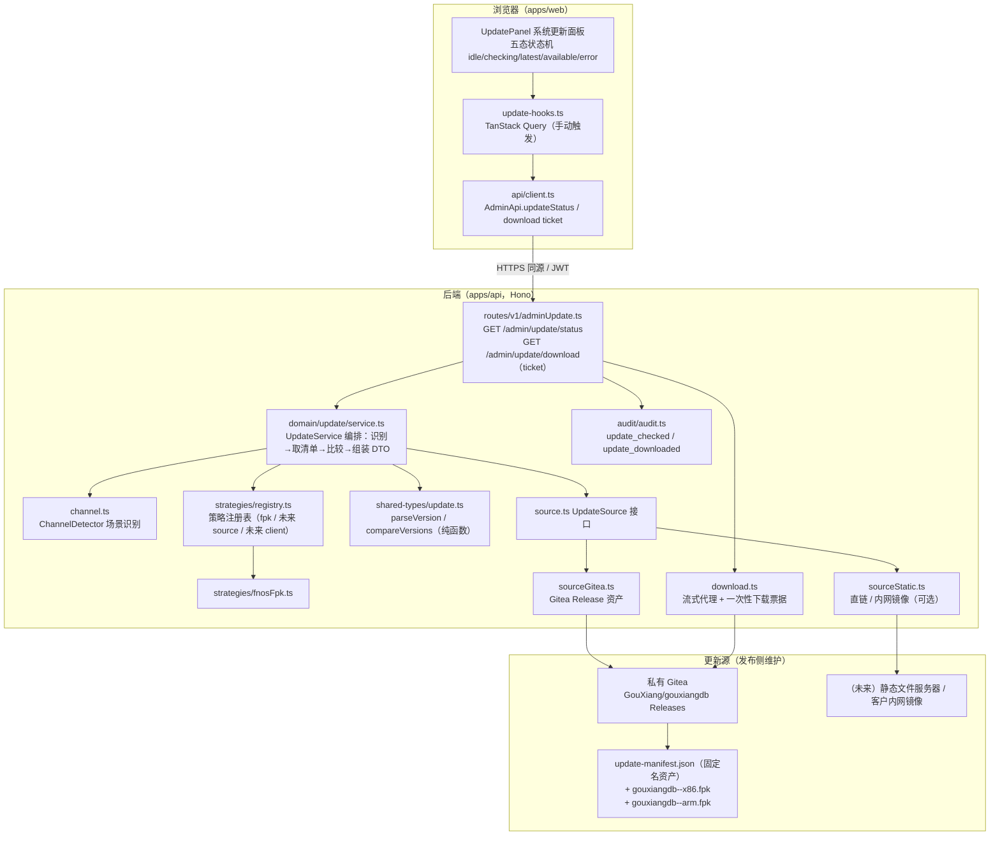
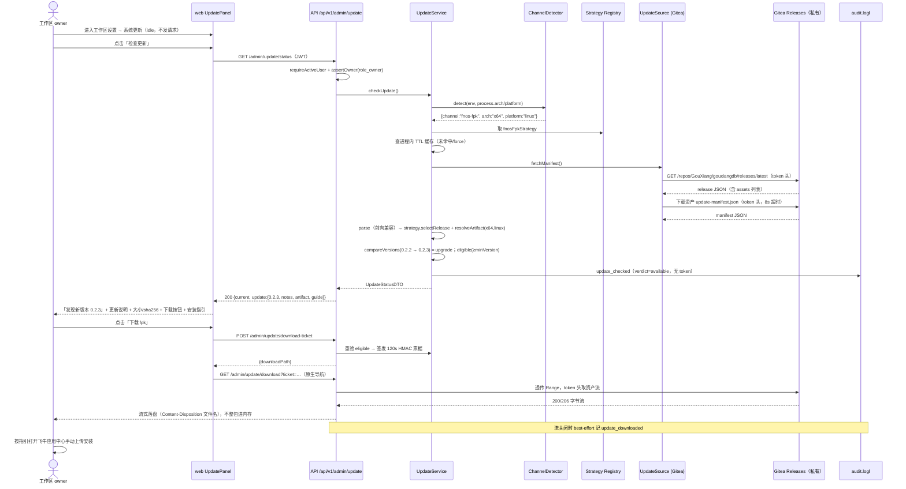

# 构想工作台（GouXiangDB）应用版本更新机制设计

- 文档日期：2026-10
- 状态：设计定稿（纯设计，不含代码改动）。**2026-10-11 戴总已拍板四项关键决策并经真实 PAT 实测封板**：①D1 走方案 a（专用只读服务账号 + 经典只读 PAT 随 fpk 注入，真实令牌已通过 8 项实测，见第 8.1 节）；②更新功能默认 on（`GX_UPDATE_ENABLED`）；③本期不做 ARM（S6 仅 x86 真机、manifest 禁伪造 arm 条目）；④不考虑无公网客户（连不上即「检测失败」，离线客户另行人工给包）。待戴总整体开工批准后按 S1–S6 实施
- 作者：高见远（架构）；2026-10-11 项目总监按拍板与实测结果修订
- 适用版本基线：根 `package.json` version `0.2.2`（fpk 产物 `deploy/fnos/dist/gouxiangdb-0.2.2-x86.fpk`，63,074,943 字节，约 60.15 MiB）
- 配套示例：同目录 `manifest.example.json`
- 【0.2.6 现状】本设计应用更新侧已落地；飞牛现行独立 TCP 端口 9527（0.2.5 起，index.cgi/CGI 已删）；0.2.6 正式包仍只发 x86 fpk 与 macOS arm64 dmg，不出飞牛 arm 包（D8 原决策措辞见 §11，保留不动）。
- 需求来源：产品负责人戴总——「可扩展的应用版本更新机制」，当前只做检查 / 展示 / 下载，不做自动安装

---

## 1. 目标与非目标

### 1.1 目标（本设计当前阶段必须交付的能力）

1. 管理员在【工作区设置】中手动点击「检查更新」，系统识别当前部署通道，基于统一版本清单判断是否存在新版本。
2. 发现新版本时展示：新版本号、发布时间、更新说明（release notes，支持中文 markdown / 纯文本）、与当前 CPU 架构匹配的成品包信息（文件名、大小、sha256）、下载按钮、手动安装指引。
3. 下载由后端持更新源凭证做流式代理转发（浏览器不接触 Gitea 账号 / token），下载后用户自行通过飞牛应用中心上传安装。
4. 机制与飞牛 fpk **不强耦合**：通道识别、清单格式、编排主流程全部通道中立；fpk 只是第一个注册的策略。未来新增「源码包部署」「Tauri 客户端部署」时只加文件、不改主流程。
5. 更新检查**无状态、零数据库迁移**：不建表、不写业务数据；仅在既有审计 JSONL 中追加两类事件。
6. 更新源不可达（纯内网 NAS 无法出网是常态而非异常）时静默降级：面板给出「暂时无法连接更新源，可稍后重试」，不弹错误、不轮询、不扰民、不影响任何既有功能。

### 1.2 非目标（明确不做，防止范围蔓延）

| 不做项              | 说明                                                                            | 预留方式                                                                  |
| ---------------- | ----------------------------------------------------------------------------- | --------------------------------------------------------------------- |
| 自动安装 / 一键升级      | fpk 通道下应用代码目录由 fnOS 框架整体替换并受 ACL 管控，应用进程没有自更新能力；安装动作只能由用户在飞牛应用中心完成，这是平台决定的    | `UpdateStrategy` 接口保留 `apply?()` 可选方法签名，当前所有策略均不实现；API 不暴露任何 apply 端点 |
| 自动轮询 / 后台定时检查    | 只在管理员手动点击时发一次请求                                                               | 无定时器代码；未来加轮询是独立决策（见第 11 章）                                            |
| 强制升级 / 阻断使用      | 更新发现与否都不改变应用任何功能                                                              | 无阻断钩子                                                                 |
| 增量更新 / 差分包 / 热补丁 | 当前整包约 60 MiB，MVP 只提供整包                                                        | manifest 的 artifact 是数组，未来可加 `kind:"patch"`                           |
| 写入更新历史到数据库       | 检查结果不持久化，仅进程内短 TTL 缓存                                                         | 第 5.4 节给出「默认不建」的可选退路表                                                 |
| 改造飞牛生命周期脚本的升级序列  | `upgrade_callback` 的「备份→migrate→nav-reconcile」行为只被引用为指引文案依据，不被修改              | ——                                                                    |
| 更新源自身的高可用 / CDN  | 更新源是团队私有 Gitea（`https://gitea0.hn.takin.cc`，组织 `GouXiang`，仓库 `gouxiangdb`，私有） | 源可换（static URL / 内网镜像），见 5.3                                          |

**机制只读边界（一句话给产品负责人）**：这套机制在应用运行期间只做三件事——读自己的版本号、向外部更新源发只读请求、把安装包流式转发给管理员的浏览器；它不碰数据库、不碰用户数据、不改任何本地文件，下载完成后的安装完全由飞牛平台和用户手动完成。

---

## 2. 总体架构与概念模型

### 2.1 组件关系图



### 2.2 概念定义与职责

| 概念                | 文件落点                                                                      | 职责                                                                                                                           | 不做什么                     |
| ----------------- | ------------------------------------------------------------------------- | ---------------------------------------------------------------------------------------------------------------------------- | ------------------------ |
| `ChannelDetector` | `apps/api/src/domain/update/channel.ts`                                   | 按「显式覆盖 > 部署标记 > 环境证据」顺序识别当前部署通道，输出 `{ channelId, arch, platform, evidence }`                                                 | 不做版本比较、不出网               |
| `UpdateStrategy`  | `apps/api/src/domain/update/strategies/types.ts`                          | 单通道策略接口：`channelId`、`remoteDeclarable`、`detect()`、`selectRelease()`、`resolveArtifact()`、`renderInstallGuide()`、保留 `apply?()` | 当前不实现 apply              |
| `UpdateSource`    | `apps/api/src/domain/update/source.ts`                                    | 版本清单从哪来、artifact 字节从哪来。两个实现：Gitea Release 资产、直链（静态/镜像）                                                                       | 不懂版本语义                   |
| `UpdateManifest`  | 类型在 `packages/shared-types/src/update.ts`，解析在 `domain/update/manifest.ts` | 全通道共用一份 JSON 清单（带 `schemaVersion`），策略只从中挑自己认识的通道段                                                                            | 未知通道/字段一律忽略（前向兼容）        |
| `Artifact`        | manifest 内 `artifacts[]`                                                  | 一个可下载成品：版本、arch、platform、文件名、sizeBytes、sha256、下载描述、可选签名                                                                      | ——                       |
| `UpdateService`   | `domain/update/service.ts`                                                | 唯一编排者：探测通道 → 取清单（带 TTL 缓存）→ 策略选 release/artifact → 纯函数比较版本 → 组装 `UpdateStatusDTO`                                            | 不解析 HTTP、不读 Hono Context |
| 下载票据 + 代理         | `domain/update/download.ts` + `routes/v1/adminUpdate.ts`                  | 发 120 秒 HMAC 一次性语义票据；浏览器凭票发起原生导航下载；后端流式转发 artifact                                                                           | 票据无状态、不落库                |
| 审计                | `apps/api/src/audit/audit.ts` 联合类型新增两枚                                    | `update_checked`、`update_downloaded`，载荷只含脱敏元数据                                                                               | 绝不记 token / 完整带凭证 URL    |

**依赖方向（单向，不允许反向）**：

```
web → HTTP → routes/v1/adminUpdate → domain/update/service
                                         ├─ channel（识别）
                                         ├─ strategies/registry → strategies/fnosFpk
                                         ├─ manifest（解析）
                                         ├─ source（Gitea / static）
                                         └─ @gx/shared-types/update（类型 + 版本比较纯函数）
routes 与 service 都可写 audit；domain 层不 import Hono、不 import routes、不 import db。
```

策略「注册即接入」：`registry.ts` 导出一个有序数组，fpk 排首位；未来新通道 = 新增一个 strategy 文件 + 在数组里追加一行 + manifest 发布侧增加对应通道段。编排主流程 `service.ts` 只依赖 `UpdateStrategy` 接口，对具体通道零感知。

---

## 3. 场景识别与策略扩展

### 3.1 ChannelDetector 识别顺序

从上到下，第一条命中的证据生效（高优先级覆盖低优先级）：

| 优先级 | 证据                                                                                                                             | 判定通道              | 说明                                                                                                                          |
| --- | ------------------------------------------------------------------------------------------------------------------------------ | ----------------- | --------------------------------------------------------------------------------------------------------------------------- |
| 1   | 环境变量 `GX_UPDATE_CHANNEL` 显式指定合法通道 id                                                                                           | 该通道               | 运维强制覆盖；只接受注册表内的 channelId，非法值告警并忽略，绝不让进程退出                                                                                  |
| 2   | 请求显式声明（query `channel=desktop-client`）且该策略 `remoteDeclarable=true`                                                             | 声明通道              | 仅给 Tauri 桌面端用：桌面端安装的是 App 不是服务端，服务端无法自证，必须由客户端在请求中带 `channel`/`arch`/`platform`。服务端对声明值做白名单与取值校验，非 remoteDeclarable 通道传了也忽略 |
| 3   | 环境变量 `GX_DEPLOY_CHANNEL=fnos-fpk`                                                                                              | `fnos-fpk`        | 由飞牛生命周期脚本 `cmd/main` 在启动 node 前 export（见 3.4，一处一行的部署脚本改动）                                                                   |
| 4   | 启发式证据：`TRIM_APPDEST`、`TRIM_DATA_SHARE_PATHS` 任一存在（字符串包含 `/@appshare/` 或 `/appcenter`）                                          | `fnos-fpk`        | 兜底：老版本 fpk 没有导出 `GX_DEPLOY_CHANNEL` 时仍可识别                                                                                   |
| 5   | 启发式证据：存在 `/srv/gouxiangdb/current` 风格环境或配置文件标记 `/etc/gouxiangdb/env.conf`（通过新增只读 env `GX_DEPLOY_CHANNEL_FILE` 指认，禁止服务端扫宿主文件系统） | `source-bare`（未来） | 源码 / tar 裸机通道，当前只留识别位，不注册策略时无效果                                                                                             |
| 6   | 都不命中                                                                                                                           | `unknown`         | 不是错误：status 正常返回 `current.channel="unknown"`，`update=null`，不提示更新                                                            |

CPU 架构映射（fpk 包内架构词汇与 Node 词汇不同，必须显式映射，不能猜）：

| 来源                      | 取值      | 统一值（manifest/artifact 用） |
| ----------------------- | ------- | ------------------------ |
| Node `process.arch`     | `x64`   | `x64`                    |
| Node `process.arch`     | `arm64` | `arm64`                  |
| 飞牛 manifest `platform=` | `x86`   | `x64`                    |
| 飞牛 manifest `platform=` | `arm`   | `arm64`                  |

`platform` 统一用 Node 的 `process.platform`（`linux` / `darwin` / `win32`）。当前 fpk 只可能是 `linux`。

### 3.2 策略注册表组织

```
apps/api/src/domain/update/
├── types.ts                  # 领域内部类型（ChannelEvidence、UpdateSourceError 等）
├── channel.ts                # ChannelDetector.detect(env, nodePlatform, nodeArch)
├── manifest.ts               # parseUpdateManifest(json)：schemaVersion 门禁 + 前向兼容裁剪
├── source.ts                 # UpdateSource 接口 + ManifestFetchResult
├── sourceGitea.ts            # Gitea Release 资产实现（默认源）
├── sourceStatic.ts           # 直链实现（GX_UPDATE_MANIFEST_URL，可指内网镜像）
├── service.ts                # UpdateService（编排 + 进程内 TTL 缓存）
├── download.ts               # 票据签发/校验（HMAC）+ 代理流转发
├── installGuide.ts           # 通道指引文案装配（中文人话，集中一处）
└── strategies/
    ├── types.ts              # UpdateStrategy 接口
    ├── fnosFpk.ts            # 当前唯一实现
    ├── sourceGit.ts          # 未来占位（文件存在但不注册；或干脆不存在，第 10 章演示时再加）
    ├── desktopClient.ts      # 未来占位（同上）
    ├── registry.ts           # 注册即接入的唯一登记表
    └── __tests__/
```

`registry.ts` 形态：

```ts
// 顺序即识别兜底顺序；remoteDeclarable 的通道（desktop-client）不在此数组里参与本地识别，
// 只在请求显式声明时被按 channelId 取出。
const registered: readonly UpdateStrategy[] = [fnosFpkStrategy];
const byId = new Map(registered.map((s) => [s.channelId, s]));
export function localStrategies(): readonly UpdateStrategy[] { return registered; }
export function declarableStrategy(id: string): UpdateStrategy | null {
  const s = byId.get(id);
  return s && s.remoteDeclarable ? s : null;
}
```

### 3.3 三通道差异对照（证明同一主流程可承载三者）

| 维度                | fnos-fpk（当前）                                                                  | source-bare（未来 git/tar）                               | desktop-client（未来 Tauri）                                         |
| ----------------- | ----------------------------------------------------------------------------- | ----------------------------------------------------- | ---------------------------------------------------------------- |
| 识别方               | 服务端自识别（env/证据）                                                                | 服务端自识别（部署标记文件）                                        | **前端自识别**，请求声明 `channel=desktop-client`                          |
| 识别证据              | `GX_UPDATE_CHANNEL` > `GX_DEPLOY_CHANNEL=fnos-fpk` > `TRIM_*`                 | `GX_UPDATE_CHANNEL` > `GX_DEPLOY_CHANNEL=source-bare` | Tauri 运行时 `__TAURI__` / 打包注入的 channel 常量                         |
| remoteDeclarable  | false                                                                         | false                                                 | **true**                                                         |
| manifest 通道段 key  | `fnos-fpk`                                                                    | `source-bare`                                         | `desktop-client`                                                 |
| artifact 形态       | `.fpk`，arch=x64/arm64，platform=linux，约 60 MiB                                 | `.tar.gz` 源码/生产产物包，arch 可选 `any`（Node 无关原生模块时）        | `.dmg` / `.msi` / `.AppImage`，platform=darwin/win32/linux + arch |
| 架构匹配维度            | arch 必须严格相等（fpk 内含 better-sqlite3/Prisma/vec0 原生二进制，platform 禁 `all` 是飞牛硬性要求） | arch 不匹配则不提示；`any` 通吃                                 | platform + arch 双键匹配                                             |
| 版本比较              | 同一纯函数 `compareVersions`                                                       | 同一纯函数                                                 | 同一纯函数                                                            |
| 检查方式              | 手动点按钮，后端拉清单                                                                   | 同左                                                    | 同左（桌面端请求自己的同源/可配后端）                                              |
| 安装方式（当前）          | 手动：飞牛应用中心上传 fpk                                                               | 手动：scp + `deploy.sh --release`                        | 手动：下载安装包后自行运行                                                    |
| 安装方式（未来）          | 仍不可自动（平台限制）                                                                   | `apply?()` 复用 `deploy/bin/deploy.sh` 安全序列             | `apply?()` 接 Tauri updater                                       |
| installGuide kind | `fnos-upload`                                                                 | `bash-deploy`                                         | `desktop-installer`                                              |
| 需要改主流程？           | ——                                                                            | **不需要**                                               | **不需要**                                                          |

### 3.4 一个必须点明的实施事实（复核代码发现）

飞牛 `deploy/fnos/gouxiangdb/cmd/main` 启动 node 时只 export 了 `GX_WEB_DIST/GX_DATA_DIR/UPLOAD_ROOT/BACKUP_DIR/GX_AUDIT_DIR/GX_MIGRATIONS_DIR`（第 49-54 行），**没有把 `TRIM_APPDEST`、`TRIM_DATA_SHARE_PATHS` 传给 node 进程**。因此：

- 主流程不能直接依赖 `TRIM_APPDEST` 做识别（进程内读不到）；
- S1 切片需要在 `cmd/main` 的 `start_app()` 内增加一行 `export GX_DEPLOY_CHANNEL=fnos-fpk`（这是部署打包脚本，不是业务代码；`install_callback` 无需改，通道是运行期事实而非配置）。在该行落地前，第 3.1 节优先级 4 的启发式（`TRIM_*`，经手工 source env 的场景）与显式 `GX_UPDATE_CHANNEL` 已可兜底，不构成上线阻塞。

---

## 4. 版本比较规则

### 4.1 规则（逐字明确，测试必须逐条覆盖）

1. 版本号格式：语义化版本 `x.y.z`，允许可选前导 `v`（如 `v0.2.3`，比较前剥离），允许预发布后缀 `-prerelease.N`（连字符后内容）。
2. 比较顺序：`x`、`y`、`z` 三段逐段**数值**比较（不是字符串比较：`0.10.0 > 0.9.0`）。
3. 预发布后缀：同一 `x.y.z` 下，**带预发布后缀 < 不带后缀**（`0.2.3-rc1 < 0.2.3`，正式版优先提示）。后缀之间按 semver 经典规则比较：标识符按 `.` 拆分，纯数字段按数值比，数字段 < 非数字段，段数少的 < 段数多的（公共前缀相同时）。
4. 同版本（比较结果相等）= 已是最新，不提示，即使 release notes 更新也不提示。
5. 候选版本 < 当前版本（降级）= 不提示。
6. **当前版本无法解析**（例如兜底值 `0.0.0-dev`、或被改坏的注入值）：不提示更新（fail-safe，避免把任何发布都误判成可升级），但 status 响应里带 `current.versionUnparseable: true`，面板在「当前版本」位置以客服排障口径展示原始字符串，不吓唬用户。
7. **清单中的版本无法解析**：该条 release 视为非法条目跳过；整个通道没有合法条目时返回源错误码 `UPDATE_MANIFEST_INVALID`（见 6.1）。
8. `minVersion`（最低支持版本）：当 `compareVersions(current, release.minVersion) < 0` 时，**仍展示新版本存在**（让客户知道有新版），但 `eligible=false`、不给下载按钮/下载票据，代之以「当前版本过旧，无法通过此方式升级，请联系支持获取整包迁移方案」。理由：跨度过大的版本可能伴随数据格式/迁移前提变化，不能承诺一条 fpk 可达。
9. 预发布版本：默认不纳入候选（`GX_UPDATE_ALLOW_PRERELEASE=on` 时才纳入，且仅精确小写 `on`，与项目既有 flag 纪律一致）。
10. 通道缺失（`unknown`）或当前 arch/platform 在该 release 的 `artifacts[]` 中找不到匹配项：视为**无更新**（`update=null`），不是错误。
11. 当前版本值来源优先级与 `/healthz` 完全一致：构建注入 `GX_VERSION` → 上溯根 `package.json`（name 必须为 `gouxiangdb-v2`）→ `0.0.0-dev` 兜底。复用 `apps/api/src/version.ts` 的 `VERSION` 常量，**禁止**新增第二处版本读取。


### 4.2 纯函数签名与落点

**落点选择：`packages/shared-types/src/update.ts`（前后端共用），不放 `apps/api`。**

理由：

1. 仓库已有先例——`packages/shared-types/src/` 下不止有类型，`filter.ts`、`authz.ts`、`embeddingMultimodal.ts` 等文件都导出纯函数并有表驱动单测（`src/__tests__/`）；版本比较是同一性质的「零 IO 纯逻辑」。
2. 构建链已验证可复用：api 的 esbuild 把 `@gx/shared-types` 源码内化进 `dist/index.js`（`apps/api/scripts/build.mjs` 第 84-86 行注释明确），web 的 Vite 直接吃 TS 源码，无需新增构建步骤。
3. 未来 Tauri 客户端通道、发布侧脚本都可能需要同一套比较语义，单一真源避免三份实现漂移。
4. 注意区分：**比较逻辑**放 shared；**当前版本值**（`GX_VERSION`/文件系统上溯）仍留在 `apps/api/src/version.ts`，shared 包不读 env、不读文件。

```ts
// packages/shared-types/src/update.ts（草案）

export type KnownChannelId = "fnos-fpk" | "source-bare" | "desktop-client";
/** 通道 id 允许未来扩展：注册表外的 id 一律按 unknown 处理。 */
export type ChannelId = KnownChannelId | (string & {});

export interface ParsedVersion {
  major: number;
  minor: number;
  patch: number;
  /** 预发布标识符段，如 ["rc",1]；正式版为 []。 */
  prerelease: ReadonlyArray<string | number>;
  /** 原始入参字符串（排障展示用）。 */
  raw: string;
  /** "0.0.0-dev" 这类兜底值 / 非法值解析失败。 */
  valid: boolean;
}

/** 宽松解析：剥离前导 v；非法返回 { valid:false, raw }，不抛异常。 */
export function parseVersion(input: string): ParsedVersion;

/** -1=a<b，0 相等，1=a>b；任一非法版本返回 null（调用方按第 4.1 节规则处理）。 */
export function compareVersions(a: string, b: string): -1 | 0 | 1 | null;

export type UpdateVerdict = "latest" | "upgrade" | "downgrade" | "incomparable";

/**
 * 表驱动友好：给定当前版本与候选 release，返回提示决策。
 * belowMin 单独由调用方结合 minVersion 计算并透传展示，不在本函数内吞掉。
 */
export function decideUpdate(args: {
  currentVersion: string;
  candidateVersion: string;
  allowPrerelease: boolean;
  candidatePrerelease: boolean;
}): UpdateVerdict;
```

**单测要求（强制表驱动）**：`packages/shared-types/src/__tests__/update.test.ts`，至少覆盖：三段数值边界（含 `0.10.0 > 0.9.0`）、前导 v、相等、降级、正式版 > rc、rc 之间数字/非数字/段数比较、非法输入双侧、预发布开关、`0.0.0-dev` 兜底值不产生升级提示、minVersion 临界（等于/低一版）。

---

## 5. 数据结构

### 5.1 UpdateManifest JSON Schema（全通道统一清单）

发布侧固定资产名：**`update-manifest.json`**（每个 release 都挂一份；后端永远取「最新正式 release」上的那份）。完整真实示例见同目录 `manifest.example.json`。

```json
{
  "schemaVersion": 1,
  "product": "gouxiangdb",
  "generatedAt": "2026-10-15T08:00:00Z",
  "channels": {
    "fnos-fpk": {
      "releases": [
        {
          "version": "0.2.3",
          "publishedAt": "2026-10-15T08:00:00Z",
          "prerelease": false,
          "minVersion": "0.1.0",
          "releaseNotes": {
            "format": "markdown",
            "zh": "## 0.2.3 更新说明\n\n- 修复……\n- 优化……\n\n升级不会影响您的数据。",
            "en": "## 0.2.3\n\n- fix ..."
          },
          "artifacts": [
            {
              "arch": "x64",
              "platform": "linux",
              "filename": "gouxiangdb-0.2.3-x86.fpk",
              "sizeBytes": 63074943,
              "sha256": "9f2c…（64 位十六进制）",
              "download": { "kind": "release-asset", "asset": "gouxiangdb-0.2.3-x86.fpk" },
              "signature": null
            }
          ]
        }
      ]
    }
  }
}
```

字段规约：

| 字段              | 层级       | 必填 | 规则                                                                                          |
| --------------- | -------- | -- | ------------------------------------------------------------------------------------------- |
| `schemaVersion` | 根        | 是  | 当前固定 `1`。解析器只接受 `===1`；遇到更大值时取「认识的字段」尽力解析并在响应标记 `manifest.newerSchema:true`（不报错，前向兼容）       |
| `product`       | 根        | 是  | 必须等于 `gouxiangdb`，否则整单拒绝（防止配错源拉到别的产品清单）                                                     |
| `generatedAt`   | 根        | 是  | ISO 时间，仅展示/排障                                                                               |
| `channels`      | 根        | 是  | 对象，key=通道 id；**客户端只挑自己通道的段，其余全部忽略**                                                         |
| `releases[]`    | 通道       | 是  | 按发布时间倒序；解析器只取第一个「版本更高且正式（或允许预发布）」的条目，不要求服务端排序，但发布脚本保证倒序                                     |
| `version`       | release  | 是  | 第 4 章语义化版本                                                                                  |
| `publishedAt`   | release  | 是  | ISO 时间，直接展示                                                                                 |
| `prerelease`    | release  | 是  | 布尔                                                                                          |
| `minVersion`    | release  | 否  | 缺省视为 `0.0.0`（不设限）                                                                           |
| `releaseNotes`  | release  | 是  | 对象形态：`format` 为 `markdown` 或 `text`，`zh` 必填（当前产品只展示中文；`en` 可选）。解析器同时兼容历史字符串形态（按 text/zh 处理） |
| `artifacts[]`   | release  | 是  | 至少 1 个；同 release 内 `(arch,platform)` 唯一                                                     |
| `arch`          | artifact | 是  | `x64` / `arm64` / `any`                                                                     |
| `platform`      | artifact | 是  | `linux` / `darwin` / `win32` / `any`                                                        |
| `filename`      | artifact | 是  | 仅允许 `[A-Za-z0-9._-]`，禁止路径分隔符；直接用于 Content-Disposition                                       |
| `sizeBytes`     | artifact | 是  | 非负整数；与 Gitea 资产 size 不一致时以 Gitea 实际响应头为准做展示，不因此失败                                           |
| `sha256`        | artifact | 是  | 64 位十六进制小写；面板展示供客户核对，**当前不做下载后校验**（浏览器端无法高效校验 60 MiB，且飞牛平台自身有包校验）                           |
| `download.kind` | artifact | 是  | `release-asset`（从同一 release 的资产名取）或 `url`（绝对/相对直链，仍走后端代理）                                   |
| `signature`     | artifact | 否  | 当前固定 `null`；预留 `{ "alg":"minisign", "value":"..." }`，见第 11 章                                |

解析与前向兼容铁律（`manifest.ts`）：

- 丢弃不认识的通道段、不认识的 artifact 字段、不认识的 release 字段——不报错。
- 结构级非法（`product` 不符、`schemaVersion` 不是数字、`channels` 不是对象、必填缺失/类型错）→ 抛 `UpdateSourceError("UPDATE_MANIFEST_INVALID")`。
- 单条 release 非法（版本不可解析、artifact 数组空、sha256 形状错）→ 跳过该条并记脱敏 warn；通道内无一条可用时该通道视为「无更新」，不向用户报错。

### 5.2 后端 / 共享 TS 类型（`packages/shared-types/src/update.ts` 增补）

```ts
export interface ArtifactManifest {
  arch: "x64" | "arm64" | "any";
  platform: "linux" | "darwin" | "win32" | "any";
  filename: string;
  sizeBytes: number;
  sha256: string;
  download: { kind: "release-asset"; asset: string } | { kind: "url"; url: string };
  signature: { alg: "minisign" | "gpg"; value: string } | null;
}

export interface ReleaseManifest {
  version: string;
  publishedAt: string;
  prerelease: boolean;
  minVersion: string | null;
  releaseNotes: { format: "markdown" | "text"; zh: string; en: string | null };
  artifacts: ArtifactManifest[];
}

export interface UpdateManifest {
  schemaVersion: 1;
  product: "gouxiangdb";
  generatedAt: string;
  channels: Partial<Record<ChannelId, { releases: ReleaseManifest[] }>>;
}

// —— HTTP DTO（GET /api/v1/admin/update/status 响应）——

export interface CurrentIdentityDTO {
  version: string;
  versionUnparseable: boolean;
  channel: ChannelId | "unknown";
  arch: string;
  platform: string;
}

export type InstallGuideKind = "fnos-upload" | "bash-deploy" | "desktop-installer";

export interface ManualInstallGuideDTO {
  kind: InstallGuideKind;
  /** 有序步骤，前端按 ol 渲染，不允许嵌入 HTML。 */
  steps: string[];
  /** 升级前提示（备份/数据保留口径），单独一块展示。 */
  preUpgradeNote: string;
}

export interface UpdateInfoDTO {
  version: string;
  publishedAt: string;
  releaseNotes: { format: "markdown" | "text"; zh: string };
  minVersion: string | null;
  /** false = 低于 minVersion，只告知联系支持，不提供下载。 */
  eligible: boolean;
  ineligibleReason: "below_min_version" | null;
  /** eligible=false 时 artifact 为 null。 */
  artifact: {
    arch: string;
    platform: string;
    filename: string;
    sizeBytes: number;
    sha256: string;
  } | null;
  manualInstallGuide: ManualInstallGuideDTO;
}

export interface UpdateStatusDTO {
  enabled: true;
  current: CurrentIdentityDTO;
  update: UpdateInfoDTO | null;
  checkedAt: string;
  /** 清单 schemaVersion 高于本端认识值时 true（面板可弱提示「新版本检查机制可升级」，不报错）。 */
  newerSchema: boolean;
}

export interface UpdateDisabledDTO {
  enabled: false;
  current: CurrentIdentityDTO;
}
```

### 5.3 配置项表（统一在 `apps/api/src/config.ts` 用 env 读取）

新增 `apps/api/src/configUpdate.ts`（仿 `configM5Search.ts`/`configSignup.ts`：把解析纯函数独立成文件，`config.ts` re-export 并在 `AppConfig`/`buildConfig` 加字段）。全部为**可选部署适配**，不进生产 fail-closed 必填校验（与 socketPath/basePath/webDist 同纪律，见 config.ts 第 281-289 行）。

| env 名                                | 默认值                          | 含义                                                                                                                                  |
| ------------------------------------ | ---------------------------- | ----------------------------------------------------------------------------------------------------------------------------------- |
| `GX_UPDATE_ENABLED`                  | `on`（置精确小写 `off` 关闭）         | 更新检查总开关。**【戴总 2026-10-11 拍板：默认 on】** 本机制零轮询、零定时器、零后台出网，唯一的出网请求发生在 owner 手动点击的瞬间；关闭只影响一个面板分区，不影响任何既有功能。off 时两端口返回 404（与未升级同口径，fail-closed 隐入口），前端分区隐藏 |
| `GX_UPDATE_SOURCE`                   | `gitea`                      | `gitea`=从 Gitea Release 资产取清单；`static`=直链取清单（可指客户内网镜像）                                                                              |
| `GX_UPDATE_GITEA_BASE_URL`           | `https://gitea0.hn.takin.cc` | Gitea 站点根。**不带尾斜杠**；非法 URL 回退默认并 warn                                                                                               |
| `GX_UPDATE_REPO`                     | `GouXiang/gouxiangdb`        | owner/repo                                                                                                                          |
| `GX_UPDATE_MANIFEST_URL`             | 空                            | static 源的清单直链，或 gitea 源下对清单地址的强制覆盖（用于内网镜像）                                                                                          |
| `GX_UPDATE_TOKEN`                    | 空                            | 更新源只读凭证，**仅服务端持有，永不下发浏览器、不写审计明文、不进日志**。空且源为私有仓时，检查返回 `UPDATE_SOURCE_UNCONFIGURED`（见第 7 章），面板显示「未配置更新源」而非网络错误                        |
| `GX_UPDATE_CHANNEL`                  | 空                            | 通道识别显式覆盖（第 3.1 节优先级 1），非法值忽略并 warn                                                                                                  |
| `GX_UPDATE_ALLOW_PRERELEASE`         | `off`                        | 精确小写 `on` 才纳入预发布 release                                                                                                            |
| `GX_UPDATE_TIMEOUT_MS`               | `8000`                       | 清单/元数据请求超时（正整数毫秒，非法回退默认）。8 秒覆盖内网正常延迟，又不至于让管理员干等                                                                                     |
| `GX_UPDATE_DOWNLOAD_IDLE_TIMEOUT_MS` | `30000`                      | 下载代理**空闲**超时（注意不是总时长：60 MiB 弱网下总时长不可预测，连续 30 秒收不到字节才断开）                                                                             |
| `GX_UPDATE_CACHE_TTL_MS`             | `300000`                     | 清单进程内缓存 TTL（默认 5 分钟）。避免管理员反复点击时每次打源；`status` 支持 `?force=1` 旁路缓存（仅 owner）                                                            |
| `GX_UPDATE_TICKET_TTL_MS`            | `120000`                     | 下载票据有效期（2 分钟）                                                                                                                       |

注入路径：

- 飞牛 fpk：S1 在 `deploy/fnos/gouxiangdb/cmd/main` 增加 `GX_DEPLOY_CHANNEL`；**更新令牌随包交付（D1 方案 a 已拍板）**：install_callback env 模板内置占位符行 `GX_UPDATE_TOKEN=__GX_UPDATE_TOKEN__`，build-fpk.mjs 组装期用构建机 env `GX_READER_TOKEN`（gouxiang-reader 服务账号只读 PAT）替换 packDir 副本中的占位符，首装写入 `$TRIM_PKGETC/gouxiangdb.env`；升级时由 upgrade_callback 按重叠窗口策略刷新（细节与轮换流程见 S1「令牌注入与轮换」）。也支持运维事后改 env 文件（重启生效）。
- 裸机 / Docker：追加进 `deploy/env.conf.example` 与 `deploy/docker/` env 示例的注释段（默认全注释）。

### 5.4 是否落库的结论

**结论：零数据库迁移，不建任何表。**

- 检查结果天然无状态：同版本同清单下任何时刻重算结果一致；进程内一个带 TTL 的 Map（key=`channel:arch:platform`，最多十余条）足以抗重复点击。
- 检查与下载的合规留痕由审计 JSONL 承担（下节），它不需要 schema、不随备份恢复、不参与任何业务查询，符合「增量、旁路、默认关闭、不动旧数据」硬约束。

可选退路（**当前不实施**，仅在未来确有运营需求时启用）：若要在管理后台展示「最近检查记录」，再新增独立表 `update_check_logs`（只增）：

```
id TEXT PK; channel TEXT; from_version TEXT; to_version TEXT NULL;
result TEXT;            -- latest | available | below_min | source_error:<code>
created_at DATETIME;    -- 只增不更新、不软删、不挂外键
```

启用条件与退路：该表随一个独立 flag（未来再议）默认关闭；不建表对本机制功能零影响。本设计不产出该迁移。

### 5.5 审计事件

在 `apps/api/src/audit/audit.ts` 的 `AuditEventName` 联合（第 9-75 行）尾部追加两枚，注册方式与既有 40+ 枚完全相同（writeAudit 自动按 `SENSITIVE_PARTS` 脱敏，`token` 键命中即 `[REDACTED]`）：

| event               | 触发点                     | status 取值                      | detail 载荷（禁止出现其他字段）                                                                           |
| ------------------- | ----------------------- | ------------------------------ | --------------------------------------------------------------------------------------------- |
| `update_checked`    | status 端点完成（无论有无更新/源错误） | 200（业务完成）/502/504（源错误）         | `{ channel, currentVersion, candidateVersion?, verdict, sourceKind, durationMs, errorCode? }` |
| `update_downloaded` | 下载代理响应关闭时（best-effort）  | 200（正常结束）/499（客户端中断）/502（上游中断） | `{ channel, version, arch, platform, filename, bytes?, errorCode? }`                          |

铁律：detail 里禁止出现 `url`（可能含 token query）、`GX_UPDATE_TOKEN`、任何响应头鉴权信息；上游错误体不原样入日志（Gitea 反代错误体会泄漏内网地址，见第 11 章 D5 与第 12 章意外事实）。

---

## 6. 接口抽象

### 6.1 检查接口

**`GET /api/v1/admin/update/status`**

挂载选择理由：项目后端有两代路由族——无版本 `/api/*`（业务老路由）与 `/api/v1/*`（企业管理面，统一登录链 `v1.use("*", requireActiveUser)`，owner 限定的 `adminSearchRoutes` 就挂在 `/api/v1/admin` 下，其 `assertOwner` 通过 `resolveSubject(userId).isWorkspaceOwner`（role_owner）裁决）。更新检查是**管理员运维动作**，与 M5 检索管理面同族同口径，因此挂 `/api/v1/admin/update/*`，复用：登录+ACTIVE 链、`resolveSubject` owner 裁决、`{error,code}` 错误信封（v1 不使用 `{code,data,message}` 信封，见 `routes/v1/index.ts` 第 11-12 行注释，保持现网一致）。


代价（已评估可接受）：`/api/v1` 仅在 `GX_ENTERPRISE_ORG` 或 `GX_ENTERPRISE_NAV` 任一 on（均默认 on，飞牛 env 不设置即为 on）时由 `app.ts` 第 178 行挂载；两个 flag 全 off 的部署里更新入口同为 404——这与「未升级/功能关闭」的既有口径一致。`GX_UPDATE_ENABLED=off` 时子路由不注册，请求落 v1 自身 404。

鉴权：登录且 ACTIVE + **工作区 owner**（role_owner，同 adminSearch 的 `assertOwner`），非 owner → 403 `FORBIDDEN`。

Query（全部可选）：

| 参数         | 允许值                                                          | 用途                          |
| ---------- | ------------------------------------------------------------ | --------------------------- |
| `channel`  | 注册表中 `remoteDeclarable=true` 的通道 id（当前仅未来的 `desktop-client`） | 桌面端声明自身通道；传非声明式通道或未知值 → 400 |
| `arch`     | `x64`/`arm64`                                                | 配合声明通道，非法值 400              |
| `platform` | `linux`/`darwin`/`win32`                                     | 同上                          |
| `force`    | `1`                                                          | 旁路 TTL 缓存立即拉源（审计里可见，不另限流）   |

成功响应 `200`：`UpdateStatusDTO`（结构见 5.2）。

错误态（全部经 `HttpError(status, 中文 message, code)` → 全局 `errorResponse` 输出 `{error,code}`）：

| HTTP | code                         | 触发条件                             | 面板可展示文案                       |
| ---- | ---------------------------- | -------------------------------- | ----------------------------- |
| 400  | `BAD_REQUEST`                | channel/arch/platform 声明值非法      | 「请求参数有误」（正常用户不会遇到）            |
| 401  | `UNAUTHORIZED`               | 未登录 / token 失效                   | 全局登录过期处理（client.ts 既有逻辑）      |
| 403  | `FORBIDDEN`                  | 非 owner                          | 「仅工作区所有者可检查更新」                |
| 404  | `NOT_FOUND`                  | `GX_UPDATE_ENABLED=off` 或 v1 未挂载 | 入口本就不渲染，正常用户不可见               |
| 502  | `UPDATE_SOURCE_UNCONFIGURED` | 私有源但服务端未配置 token                 | 「更新源尚未配置，请联系部署人员」             |
| 502  | `UPDATE_SOURCE_AUTH`         | 上游 401/403（token 失效/被吊销）         | 「更新源凭证无效，请联系部署人员」（运维侧日志记脱敏详情） |
| 502  | `UPDATE_SOURCE_UNREACHABLE`  | DNS/连接失败/5xx/反代异常                | 「暂时无法连接更新服务，您可以稍后重试」          |
| 504  | `UPDATE_SOURCE_TIMEOUT`      | 超过 `GX_UPDATE_TIMEOUT_MS`        | 「连接更新服务超时，请稍后重试」              |
| 502  | `UPDATE_MANIFEST_INVALID`    | 清单结构级非法或通道内无合法 release           | 「更新清单暂时不可用，请联系支持」             |

错误响应不回传上游状态体（Gitea 错误体会泄漏内网地址与版本细节），只回本表的 code/message；详情（上游 status、脱敏后的 host、耗时）进服务端日志。

### 6.2 下载接口（票据 + 流式代理，两段式）

浏览器对原生文件下载（`<a>`/`window.location`）**无法携带 Authorization/X-GX-Token 头**，项目已有同类先例：协同 WebSocket 用一次性票据（`getCollabTicket`，query 携带，见 client.ts 第 328-339 行）。更新下载沿用同一模式：

**第一段：换票 `POST /api/v1/admin/update/download-ticket`**

- 鉴权：同 status（owner）。
- 请求体：`{ "channel"?: string, "arch"?: string, "platform"?: string }`（声明参数语义同 status；不传=服务端自识别通道）。
- 服务端现场重算一次「有更新且 eligible 且 artifact 存在」，否则 409 `UPDATE_NOT_AVAILABLE`（防止拿旧 DTO 长期反复换票）。
- `200` 响应：`{ "ticket": "<base64url(HMAC payload)>", "expiresAt": "<ISO>", "downloadPath": "/api/v1/admin/update/download?ticket=…" }`。
- 票据为**无状态 HMAC**（用既有 `config.jwtSecret` 签名，不引新依赖、不落库、不建表），payload=`{ uid, channel, arch, platform, version, filename, exp }`，TTL=`GX_UPDATE_TICKET_TTL_MS`（120 秒）。无状态故不做服务端单次核销；防滥用靠：120 秒短 TTL + owner 绑定 + 下载端点本身的审计 + 全局限流中间件。票据不对应任何可改写资源，泄漏窗口内的最坏后果是替该 owner 下载一次 60 MiB 公开级别资产。

**第二段：下载 `GET /api/v1/admin/update/download?ticket=<t>`**

- 鉴权：**仅验票**（有效签名、未过期、payload 字段形状合法）。不接受 Authorization 头鉴权（原生导航不带）；两种鉴权二选一，票优先。
- 行为：
  1. 依据票据 payload 重新解析 manifest（同样吃 5 分钟缓存）定位 artifact 与上游真实 URL；拿不到则 409。
  2. 以上游凭证（`Authorization: token <GX_UPDATE_TOKEN>`，绝不转发给浏览器）发起 GET；支持把浏览器的 `Range` 头**透传**给上游，并把上游的 `206/200`、`Content-Length`、`Content-Range`、`Accept-Ranges`、`ETag` 透传回来——弱网中断后浏览器可续传。
  3. 响应头：`Content-Type: application/octet-stream`；`Content-Disposition: attachment; filename="gouxiangdb-0.2.3-x86.fpk"`（filename 取自 manifest 白名单字符，不经用户输入拼接）；`Cache-Control: no-store`；`X-Content-Type-Options: nosniff`。
  4. 流式：Node 22 全局 `fetch` 返回的 web ReadableStream 直接作为 Hono/Response body 透传，**禁止 arrayBuffer() 整包进内存**（60 MiB × 并发会压垮小内存 NAS）。
  5. 空闲超时（`GX_UPDATE_DOWNLOAD_IDLE_TIMEOUT_MS`）：监听流 chunk 时间戳，连续 30 秒无字节则中止上游并结束响应。
  6. 中断记账：响应 `close`/`error` 时 best-effort 写 `update_downloaded` 审计（完成 / 客户端中断 499 / 上游中断 502，已转发字节数若可从计数器取得则记录）。
- 错误：票据非法/过期 → 401 `UPDATE_TICKET_INVALID`（中文「下载链接已失效，请返回重新点击下载」）；上游不可达/401 → 同 6.1 错误码表（此时响应已可能开始发送则直接中断流，不承诺错误页）。
- 日志纪律：只记 host 与资源名，**任何日志/错误/审计都不得打印带 token 的完整 URL 或 Authorization 头**；Gitea 支持 header 鉴权（见第 8 章），所以我们从一开始就不把 token 放进 URL query。

**为什么不让浏览器直连 Gitea**：

1. 仓库私有，匿名 API/资产请求 404（实测）；客户没有也不应有团队 Gitea 账号。
2. token 一旦下发浏览器即脱离管控：会进浏览器历史、代理日志、客户 DevTools，无法轮换前保密。
3. 后端代理天然支撑未来「换静态源 / 内网镜像」而前端零改动，且能统一审计下载行为。

### 6.3 前端接口契约（apps/web，零新增第三方依赖）

`apps/web/src/api/client.ts` 增加：

```ts
// 走既有 apiFetch（JSON + JWT 注入 + 统一 401/超时处理），禁止裸 fetch。
export const AdminUpdateApi = {
  status: (params?: { channel?: string; arch?: string; platform?: string; force?: boolean }) =>
    apiFetch<UpdateStatusDTO>(`/api/v1/admin/update/status${qs(params)}`, { timeoutMs: 15_000 }),
  createDownloadTicket: (body: { channel?: string; arch?: string; platform?: string }) =>
    apiFetch<{ ticket: string; expiresAt: string; downloadPath: string }>(
      "/api/v1/admin/update/download-ticket",
      { method: "POST", body: JSON.stringify(body), timeoutMs: WRITE_TIMEOUT_MS },
    ),
};
// 实际下载地址用 withBase(downloadPath) 拼同源前缀（子路径部署亦正确），
// 交给 <a href>/window.open 原生导航，不走 apiFetch。
```

TanStack hooks（新增 `apps/web/src/features/update/update-hooks.ts`，风格对齐 `features/settings/pat-hooks.ts`）：

- `useUpdateStatus()`：`useQuery({ queryKey: ["admin","update","status"], queryFn: () => AdminUpdateApi.status(), enabled: false })`——**手动触发**，面板挂载不请求；`refetch()` 即检查；用 `staleTime` 配合后端 TTL。
- `useUpdateDownload()`：`useMutation` 调 createDownloadTicket，成功后 `window.location.assign(withBase(downloadPath))`（浏览器接收 Content-Disposition 不会跳走页面）；失败走统一 toast。
- 分区显隐：复用 `useIsWorkspaceOwner()`（ownerOnly，与「权限管理」分区同口径）；`GX_UPDATE_ENABLED=off` 时 status 端点 404，分区按「未注册功能」处理（不渲染，不是报错）。

面板组件 props 与状态机（新增文件，均 ≤300 行）：

```
apps/web/src/features/update/
├── update-copy.ts            # 全部中文文案/错误码映射（含安装指引兜底文案）
├── update-hooks.ts           # useUpdateStatus / useUpdateDownload
├── UpdatePanel.tsx           # 主面板（五态状态机 + 当前版本/通道/架构展示）
├── UpdateInstallGuide.tsx    # 手动安装指引（按 guide.kind 分支渲染 steps）
└── __tests__/UpdatePanel.test.tsx
```

```ts
type UpdateUiState =
  | { phase: "idle" }
  | { phase: "checking" }
  | { phase: "latest"; current: CurrentIdentityDTO; checkedAt: string }
  | { phase: "available"; current: CurrentIdentityDTO; info: UpdateInfoDTO; checkedAt: string }
  | { phase: "error"; code: string; message: string };
// 注：available 内部再按 info.eligible 决定「下载按钮 + 指引」还是「联系支持」；
// 低于 minVersion 不新增第六态，避免状态组合爆炸。
```

图标：当前 `IconName` 集（`apps/web/src/components/icons.tsx`）已有 `download`、`refresh`、`alertCircle`、`check`、`history`，可直接覆盖按钮与状态图标；如需「安装包」语义图标，在 icons.tsx 追加一个自绘 24x24 stroke SVG（建议名 `packageBox`），与既有图标同规范，禁止第三方图标库、禁止 emoji。

---

## 7. 后台检查与展示流程

### 7.1 时序图



### 7.2 面板信息布局（产品可读）

面板始终展示「当前环境」一块（客服排障用，owner 可见即可，非敏感）：

- 当前版本：`0.2.2`（版本无法解析时原样显示字符串并加「版本标识异常」弱提示）
- 部署通道：`飞牛 fpk 成品包`（unknown 时显示「未识别的部署方式」）
- 运行架构：`linux / x64`
- 上次检查时间：未检查显示「尚未检查」

三态主区：

1. **已是最新**：「当前已是最新版本（0.2.2）」+ 检查时间 + 「重新检查」按钮。
2. **发现新版本 0.2.3**：版本号 + 发布时间 + 更新说明（`format:"markdown"` 时复用现有 `apps/web/src/components/MdContent.tsx` 的 `variant="block"`——内部走 `@gx/blocks` 的 `renderMarkdown`，自带渲染失败回落纯文本，帮助中心/知识库已在用；`format:"text"` 时 `whitespace-pre-line` 纯文本展示。零新增依赖）+ 包大小（MiB）+ sha256（等宽折行，旁置复制按钮复用 `copy` 图标）+「下载 gouxiangdb-0.2.3-x86.fpk」主按钮 + 折叠的「手动安装指引」。
3. **检查失败**：第 6.1 错误码表的中文文案 + 「重试」按钮；不弹 toast 风暴、不阻断页面其余功能。

**手动安装指引（fnos-upload，固定中文文案，由后端 `installGuide.ts` 下发、前端原样渲染有序步骤）：**

> 升级前请注意：飞牛在安装升级包前会自动对当前数据做一次在线备份（备份失败会中止升级）；您的数据库与上传文件保存在共享存储中，升级应用不会删除它们。
>
> 1. 点击上方按钮，将 `gouxiangdb-0.2.3-x86.fpk` 下载到本机；
> 2. 打开飞牛 fnOS 的「应用中心」；
> 3. 选择「手动安装 / 上传安装包」（不同 fnOS 版本文案可能略有差异）；
> 4. 选中刚下载的 `.fpk` 文件并确认安装，平台将自动完成升级（包含数据库迁移，期间服务会短暂重启）；
> 5. 安装完成后重新打开构想工作台，在本页面确认版本号已变为 0.2.3。
>
> 若安装过程中平台提示失败，请不要重复强制安装，携带本页面显示的当前版本与架构信息联系支持。

文案依据（与真实行为对齐，已复核脚本）：`cmd/upgrade_callback` 第 19-22 行先跑 `scripts/backup/online-backup.mjs`，失败即 `exit 1` 中止升级；随后 `prisma migrate deploy`（只增）与 `nav-reconcile --apply`；`install_callback` 注释与 fnOS 共享目录机制保证 `TRIM_PKGETC` 配置与 data-share 数据保留。

### 7.3 边界处理表

| 边界场景                        | 后端行为                                                                          | 前端表现                                                              |
| --------------------------- | ----------------------------------------------------------------------------- | ----------------------------------------------------------------- |
| 源不可达（纯内网无外网）                | 502 `UPDATE_SOURCE_UNREACHABLE`，审计记结果，不重试不轮询                                  | error 态：「暂时无法连接更新服务，您可以稍后重试」+ 重试按钮；无弹窗骚扰                          |
| 上游 401/403（token 失效）        | 502 `UPDATE_SOURCE_AUTH`；服务端日志记脱敏详情                                           | 「更新源凭证无效，请联系部署人员」                                                 |
| 未配置 token 且源私有              | 502 `UPDATE_SOURCE_UNCONFIGURED`                                              | 「更新源尚未配置，请联系部署人员」；不显示为网络故障                                        |
| 请求超时（>8s）                   | AbortController 中止，504 `UPDATE_SOURCE_TIMEOUT`                                | 「连接更新服务超时，请稍后重试」                                                  |
| manifest 非法（结构错/product 不符） | 502 `UPDATE_MANIFEST_INVALID`                                                 | 「更新清单暂时不可用，请联系支持」                                                 |
| 单条 release 非法               | 跳过该条；无可用条目则 update=null                                                       | latest 态（不当错误处理）                                                  |
| 当前版本无法解析                    | 不提示升级，`versionUnparseable:true`，审计照记                                          | 当前版本处弱提示「版本标识异常」，主区 latest 态                                      |
| 清单版本无法解析                    | 该 release 跳过                                                                  | 同上                                                                |
| 当前架构无匹配 artifact            | `update=null`（不报错），审计 verdict=no_artifact                                     | latest 态；环境区照常显示架构（便于发现「arm 机只发了 x86 包」这类发布事故）                    |
| 当前版本 < minVersion           | 返回 update 但 `eligible=false`、artifact=null、ineligibleReason=below_min_version | 仍显示「有新版本 0.2.3」，但下载按钮替换为「当前版本过旧，请联系支持获取升级方案」+ 不展示 sha256          |
| 通道 unknown                  | `update=null`                                                                 | 显示通道「未识别」，latest 态，检查按钮可用（便于客服引导配 `GX_UPDATE_CHANNEL`）            |
| 管理员重复点击                     | 查询进行中按钮禁用（checking 态）；完成后 5 分钟内命中进程内缓存，不打源；`force=1` 可旁路                      | 同一 mutation/query in-flight 去重（TanStack 既有行为）                     |
| 下载中断（弱网）                    | 透传 Range/206；空闲 30s 中止；审计记 499/字节数                                            | 浏览器原生续传（重新点下载若服务端支持 Range 可断点续传；不做自绘下载进度条，MVP 用浏览器自带下载管理）         |
| sha256 核对                   | 面板展示 manifest 声称的 sha256                                                      | 提供复制；不做端上自动校验（第 5.1 节）                                            |
| 下载中按钮态                      | 换票中按钮 disabled +「正在准备下载…」；票据返回后按钮恢复（下载由浏览器接管）                                 | 防重复连点；票据失败回 error toast                                           |
| 非 owner 访问                  | 403；分区对非 owner 根本不渲染（ownerOnly）                                               | 直戳 API 403，直戳设置 URL 落「通用」分区（设置页既有门控纪律）                            |
| `GX_UPDATE_ENABLED=off`     | 路由不注册 → 404                                                                   | SECTIONS 中该分区经状态码/探针隐藏（沿用 mcp 分区 enterpriseOnly 的 fail-closed 模式） |
| 上游响应体含内网地址泄漏                | 错误体不转发、不入审计，只记 code 与 host                                                    | 用户只见中性文案                                                          |
| 并发下载                        | 不限并发（流式转发内存开销近似每连接几十 KB 缓冲）；受全局限流中间件约束；若未来成问题再加单 owner 并发闸                    | ——                                                                |

---

## 8. 发布流程

### 8.1 Gitea API 依据与真实实测结论（2026-10-11，真实只读 PAT 实测封板）

测试令牌＝戴总在 Gitea 1.27.3 上创建的服务账号只读 PAT（scope: `read:activitypub,read:misc,read:notification,read:organization,read:package,read:issue,read:repository`，无任何 write、无 `read:user`），账号仅被授权 `GouXiang/gouxiangdb` 一个仓。8 项实测结论：

| # | 测试 | 结果 | 对设计的硬约束 |
|---|---|---|---|
| 1 | `GET /api/v1/user` | **403**（令牌无 `read:user` scope） | sourceGitea 禁止调用 `/user` 端点做令牌校验/身份识别；只用 `/repos/*` 端点 |
| 2 | `GET /repos/GouXiang/gouxiangdb` | **200**，返回仓库元数据 | 读仓正常 |
| 3 | `GET /repos/search?limit=50`（带令牌） | **恰好 1 个仓** `GouXiang/gouxiangdb`，`private=true`，`permissions={admin:false,push:false,pull:true}` | 方案 a 的单仓收窄生效：该令牌物理上看不到任何其他仓 |
| 4 | 匿名 `GET /repos/GouXiang/gouxiangdb` | **404** | 私有仓匿名不可见，令牌不是摆设 |
| 5 | `POST /repos/.../releases`（写尝试） | **403**（缺 `write:repository`） | 只读令牌无法挂/改/删 release，写令牌必须分离 |
| 6 | `GET /releases` | **200**，v0.2.2（release id=5）等正常返回 | 取最新 release 的主链路可用 |
| 7 | 读源码 `GET /raw/package.json` | **200**，拿到真实根 package.json（version 0.2.2） | **已知残余风险**：只读 PAT 能读仓库源码，不仅 release 资产——令牌运营定位为「防匿名爬取」而非「保密凭证」，戴总 2026-10-11 已接受（D1） |
| 8 | **私有资产下载**：公网域名 `https://gitea0.hn.takin.cc/GouXiang/gouxiangdb/releases/download/v0.2.2/gouxiangdb-0.2.2-x86.fpk` + `Authorization: token` 头 + `Range: bytes=0-1023` | **HTTP 206**，`content-range: bytes 0-1023/63074943`，`content-length: 1024`，`content-type: application/octet-stream` | ① 私有资产下载**吃 Authorization 请求头**、无需 cookie/session，代理直接透传即可，不需要 `/api/v1/repos/{id}/assets/{aid}` 退路；② Range/206 续传链路成立；③ 资产真实大小 63,074,943 字节与 dist 一致 |

**★ 一个必须写死的坑（实测 #8 同时发现）**：API 返回的 `browser_download_url`（release/asset 对象里）字段值是**内网地址** `http://192.168.31.88:21350/...`，不是公网域名；错误响应体里的 `url` 字段同样泄露内网 swagger 地址。因此：

- **代码严禁直接使用任何 API 返回的 URL 字段拼下载地址**；一律用配置的 `GX_UPDATE_GITEA_BASE_URL`（默认 `https://gitea0.hn.takin.cc`）按固定路径自行拼：`<base>/<owner>/<repo>/releases/download/<tag>/<assetName>`。
- 上游错误体绝不透传/入日志（第 6.1/7.3 节铁律），只记 code + host。

鉴权方式：请求头 `Authorization: token <GX_UPDATE_TOKEN>`（Gitea 1.27 AuthorizationHeaderToken 方案；query 里带 `access_token` 的旧方案已废弃，不用——token 进 query 会进日志/浏览器历史）。

### 8.2 发布脚本职责划分（新增 `scripts/release/`，纯新增不改 build-fpk 主流程）

| 脚本 | 职责 |
|---|---|
| `scripts/release/lib-gitea.mjs` | Gitea API 薄封装（Node 22 全局 fetch，零新依赖）：createRelease/getByTag/listAssets/createAsset/deleteAsset；令牌只从发布机 env `GX_GITEA_TOKEN`（发布人**写**令牌）读取；所有错误净化后再打印（不回显响应体中的内网 URL） |
| `scripts/release/build-manifest.mjs` | 读根 package.json version；扫描给定 fpk 产物 → 文件名正则解析 arch/platform、`fs.statSync` 大小、`crypto.createHash("sha256")` 摘要；release notes 从 `docs/release-notes/<version>.md` 读 zh 正文；**拉取上一 release 的 update-manifest.json，在其 channels 段前面 prepend 新 release（保留最近 10 条）**，校验 schemaVersion=1 后输出新 manifest。**artifact 条目只按 dist 中实际存在的 fpk 生成，严禁为不存在的 arch 补占位条目**（本期只有 x86） |
| `scripts/release/publish-gitea-release.mjs` | 主编排（伪代码如下） |
| `scripts/release/__tests__/build-manifest.test.mjs` | 表驱动：文件名解析、sha256 形状、minVersion 透传、旧 manifest 合并/裁剪、缺 arch 时不得出现占位条目、非法字段拒绝 |

`publish-gitea-release.mjs` 伪代码：

```text
输入：--tag v0.2.3 [--prerelease] [--draft] [--fpk-glob "deploy/fnos/dist/gouxiangdb-0.2.3-*.fpk"]
前置断言：
  - 根 package.json version === tag 去掉前导 v（不一致即 fail，杜绝手工改版本双版本事故）
  - 至少存在 1 个 fpk（本期 x86；不要求 arm，不为缺失 arch 补条目）
  - GX_GITEA_TOKEN 存在（发布机写令牌，缺失即用法错误退出，不提示内容）
流程：
  1. 对每个实际存在的 fpk：解析 arch（文件名 -x86/-arm → x64/arm64）、stat size、算 sha256
  2. build-manifest：合并旧清单 → 新 update-manifest.json（artifact 与实际 fpk 一一对应 + notes + minVersion）
  3. createRelease(tag, { name:`构想工作台 ${ver}`, body: notes.zh, prerelease, draft:false })
     若已存在（重复执行）→ getByTag 幂等复用，不报错
  4. 资产清单：实际 fpk（本期 gouxiangdb-<ver>-x86.fpk 一个）+ update-manifest.json
     逐个：同名资产先删后传（octet-stream，?name=），保证幂等
  5. 回读校验：getByTag → 资产齐全且 size 一致；GET 资产头 200
  6. 打印发布摘要（不含令牌、不打印 API 返回的 browser_download_url 内网地址）
```

标准发布节奏（人工触发，CI 化是以后的事）：

1. 更新根 `package.json` version（单一真源）→ 写 `docs/release-notes/<version>.md`；顺手核对 RELEASE.md 标题版本（第 12 章意外事实 #1）；
2. 打 tag `v0.2.3`；
3. x86 Linux 机构建：`GX_READER_TOKEN=<gouxiang-reader 只读 PAT> node deploy/fnos/build-fpk.mjs --arch x86`（令牌在组装期注入 fpk 副本，见 S1「令牌注入与轮换」；本期不构建 arm）；
4. 收集 fpk 到发布机 `deploy/fnos/dist/`；
5. 发布：`GX_GITEA_TOKEN=<发布人写令牌> node scripts/release/publish-gitea-release.mjs --tag v0.2.3`；**写令牌（发布人账号）与 fpk 内置只读令牌（gouxiang-reader）严格分离**；
6. 用内置只读令牌的 fpk 在一台隔离测试 NAS 上走一遍「检查→下载→飞牛手动安装」（S6 验收）。

### 8.3 manifest 演进与前向兼容

- `schemaVersion` 是唯一的结构代际号；additive 变更（新通道、新字段、新 artifact 下载方式）**不升 schemaVersion**——老客户端按第 5.1 节铁律忽略不认识的部分。
- 只有当「老客户端按旧语义处理会出错」时才升 `schemaVersion=2`；届时老客户端行为已在解析器中定义：不报错，按 1 能认识的字段尽力解析 + `newerSchema:true` 弱提示。
- 每次发布的 manifest 自带**完整最近 10 个 release**（不是只含最新）：老版本客户端跳过若干版升级时仍能读到自己关心版本的 notes，minVersion 判定取「最新版」声明，不需要遍历历史。

---

## 9. 当前 fpk 方案实施切片（文件级，可直接排期）

纪律（每片都必须满足，写进各片验收）：不新增第三方依赖；默认行为对存量部署零变化（不配置即「面板里没有/点了才出网」）；不写数据库、不加迁移；不改既有端点契约；每片独立可回退（纯新增文件 + 末尾挂载）。

### S1 通道探测 + 版本比较纯函数（带表驱动单测）

| 动作  | 文件                                                                                              |
| --- | ----------------------------------------------------------------------------------------------- |
| 新增  | `packages/shared-types/src/update.ts`（类型 + `parseVersion/compareVersions/decideUpdate`）         |
| 修改  | `packages/shared-types/src/index.ts`（末尾 `export * from "./update.js"`）                          |
| 新增  | `packages/shared-types/src/__tests__/update.test.ts`（表驱动，第 4.2 节清单全量）                           |
| 新增  | `apps/api/src/domain/update/channel.ts`、`strategies/types.ts`（仅接口）                              |
| 修改  | `deploy/fnos/gouxiangdb/cmd/main`（`start_app()` 加一行 `export GX_DEPLOY_CHANNEL=fnos-fpk`，注释说明用途） |
| 修改（D1 令牌交付） | `deploy/fnos/gouxiangdb/cmd/install_callback` 的 env heredoc（现 23-30 行）末尾加占位符行 `GX_UPDATE_TOKEN=__GX_UPDATE_TOKEN__`（首装写入 `$TRIM_PKGETC/gouxiangdb.env`，heredoc 外已有 `umask 077`，仅 package/root 可读） |
| 修改（D1 令牌交付） | `deploy/fnos/gouxiangdb/cmd/upgrade_callback` 增加「令牌刷新」一步（须在 cmd/main start 前）：从新包自带的 `cmd/install_callback` 模板中正则提取 `GX_UPDATE_TOKEN=` 后的值，若**非占位符、非空且与现 env 该行不同**，则先 cp 到临时文件、逐行重建、原子 mv，只更新这一行，JWT_SECRET 等其他行原样保留；模板值为空/仍是占位符时一律不动现 env |
| 修改（D1 令牌交付） | `deploy/fnos/build-fpk.mjs`：组装期（第 2 步 manifest 重写之后、fnpack build 之前）读构建机 env `GX_READER_TOKEN`，对 packDir 副本内 `cmd/install_callback` 做**一次字符串替换** `__GX_UPDATE_TOKEN__` → 实际令牌；未设置时替换为空串（该包面板显示「更新源尚未配置」，不阻断本地/内测构建）。**只改 packDir 副本，严禁回写仓库源模板**；日志只打印「更新令牌已注入/留空」，绝不回显令牌值 |
| 文档新增 | `docs/ops/update-token-runbook.md`（S6 交付）：建服务账号（独立强密码、不加入任何团队）→ owner 在仓库「协作者」加为 **Read**（1.27.3 上单仓可见性收窄的唯一机制）→ 该账号生成经典 PAT（只勾 read scope，与 2026-10-11 实测 scope 集一致）→ 构建机 `export GX_READER_TOKEN` → 轮换/吊销步骤；强调发布机**写**令牌 `GX_GITEA_TOKEN`（发布人账号）与内置只读令牌分离 |
| 不接线 | 此时不挂路由、不建策略实现，对运行零影响（install/upgrade_callback 的令牌行为可先用 bash 静态/容器演练验证，不依赖 Node 侧功能） |

**令牌注入与轮换（方案 a 落地细节，戴总 2026-10-11 拍板）**：

1. **注入链路**：构建机 env `GX_READER_TOKEN` → build-fpk.mjs 替换 packDir 副本占位符 → fnpack 封进 fpk → 客户首装时 install_callback 把 `GX_UPDATE_TOKEN=<值>` 写进 `$TRIM_PKGETC/gouxiangdb.env` → cmd/main `set -a; source` 注入 node 进程 → 后端代理时使用，**浏览器全程不可见**。
2. **为什么不用安装向导**：install_callback 只模板化替换 `${external_origin}` 一个向导变量，新增向导变量要动 manifest 表单且客户无从知道令牌；构建期注入零客户操作。
3. **轮换走「新旧 PAT 重叠窗口」，客户零操作不断档**：新建第二枚只读 PAT（旧的暂不删）→ 新 PAT 打进新 fpk → 客户用**仍有效**的旧令牌检查更新、下载新 fpk、飞牛手动升级 → upgrade_callback 把 env 的令牌行刷新为新值 → 观察一个版本周期后在 Gitea 后台删除旧 PAT。期间没升级的客户继续用旧 PAT，不受影响。
4. **紧急吊销**：怀疑泄漏时 Gitea 后台立刻删 PAT，所有旧 fpk 即刻失去访问权，客户侧仅见中性「更新源凭证无效/检测失败」，应用与已有数据完全不受影响；事后用携带新令牌的 fpk 经人工渠道补发。
5. **占位符安全性**：`__GX_UPDATE_TOKEN__` 是 shell 脚本里的普通文本，不触发 fnpack 对 `${...}` 形态的向导变量替换，S6 真机演练须实证一次；构建脚本第 5 节禁带扫描只拦实体 `.env`/`.db` 等，shell 脚本中的令牌行不受影响。

验收：shared 包全量测试绿；表驱动用例逐条可追溯第 4.1 规则；`channel.ts` 单测用注入 env 对象覆盖 6 级优先级（不读真实 process.env）；fpk 试装后 `node -e` 可见 `GX_DEPLOY_CHANNEL`（随 S6 真机验证，S1 只做脚本静态检查）；令牌行为在 S6 真机首装 + 升级两次演练中验证三条路径——新 env 写入、轮换时仅刷新令牌行而 JWT_SECRET 不动、占位符/空值不覆盖现 env。

### S2 配置项 + manifest 解析 + UpdateSource（Gitea）

| 动作 | 文件                                                                                                                                               |
| -- | ------------------------------------------------------------------------------------------------------------------------------------------------ |
| 新增 | `apps/api/src/configUpdate.ts`（`parseUpdateConfig(env): UpdateConfig` 纯函数 + 非法回退单测）                                                              |
| 修改 | `apps/api/src/config.ts`（AppConfig 加 `update` 字段；`buildConfig` 组装；re-export；不进 validateEnv 必填项）                                                  |
| 新增 | `domain/update/types.ts`、`manifest.ts`（解析/裁剪/拒绝，纯函数单测：未知通道忽略、product 不符拒绝、坏 release 跳过）                                                          |
| 新增 | `domain/update/source.ts`、`sourceGitea.ts`、`sourceStatic.ts`（sourceGitea 内聚：latest release → 找 `update-manifest.json` 资产 → 带 token 头下载；超时与错误码映射） |
| 新增 | `domain/update/__tests__/manifest.test.ts`、`sourceGitea.test.ts`（用本地起的 stub HTTP 服务模拟 Gitea，不打真实站点）                                              |

验收：零 token 时返回 `UPDATE_SOURCE_UNCONFIGURED` 而非网络错误；stub 模拟 401/超时/坏 JSON/反代 5xx 全部映射正确码；stub 返回的错误体永不透出；config 缺省值全部就位且不影响现有启动闸门（生产 env 不加任何新变量也能正常启动）。

### S3 UpdateService + 检查 API + 审计

| 动作 | 文件                                                                                                                                                                                    |
| -- | ------------------------------------------------------------------------------------------------------------------------------------------------------------------------------------- |
| 新增 | `strategies/fnosFpk.ts`（channelId=`fnos-fpk`；selectRelease 取通道段最高新版本；resolveArtifact 按 arch/platform；renderInstallGuide 返回 7.2 文案）、`strategies/registry.ts`、`installGuide.ts`         |
| 新增 | `domain/update/service.ts`（编排 + TTL 缓存：有界 Map，单键刷新互斥防击穿；`force` 旁路）                                                                                                                   |
| 修改 | `apps/api/src/audit/audit.ts`（联合类型加 `update_checked`、`update_downloaded`；无逻辑改动）                                                                                                       |
| 新增 | `apps/api/src/routes/v1/adminUpdate.ts`（`GET /status`：owner 闸 + 参数校验 + 调 service + 写审计；总开关 off 时不注册）                                                                                  |
| 修改 | `apps/api/src/routes/v1/index.ts`（末尾 `if (config.update.enabled) v1.route("/admin", adminUpdateRoutes);`——与既有 `v1.route("/admin", adminSearchRoutes)` 叠加，Hono 支持同前缀不同路径分路由器挂载，项目已有先例） |
| 新增 | `routes/v1/__tests__/admin-update.test.ts`（真 app：owner 200/非 owner 403/off 态 404/通道 unknown/各源错误码/force 缓存旁路/审计落行）                                                                    |

验收：复用现有 harness 起真实 Hono app + 临时库；断言响应字节形状与 `UpdateStatusDTO` 一致；审计 JSONL 新增行被采集且不含 token/url 键；`GX_UPDATE_ENABLED=off` 时 404 且无出网请求（stub 计数为 0）。

### S4 下载票据 + 流式代理

| 动作     | 文件                                                                                                                    |
| ------ | --------------------------------------------------------------------------------------------------------------------- |
| 新增     | `domain/update/download.ts`（HMAC 签发/校验，用 `node:crypto` + `config.jwtSecret`；票据 base64url；字段白名单）                       |
| 修改     | `routes/v1/adminUpdate.ts`（`POST /download-ticket`、`GET /download`：透传 Range 与 206/Content-* 头；流式 body；空闲超时；close 时审计） |
| 修改（文档） | `apps/api/src/middleware/rateLimit.ts` 无需改（既有 /api 桶覆盖）；如该路径被 bodyLimit 误伤则在既有 dispatcher 加豁免（按实测，预期不需要：GET 无请求体）     |
| 新增     | 测试：票据过期/伪造/绑定他人/filename 白名单；stub 上游发送 60 MiB 级随机流断言服务端 RSS 增量有界（不整包缓存）；Range 往返；客户端中断记 499                           |

验收：内存证据（压一个 200 MiB 假资产，进程 RSS 增量 < 10 MiB）；日志扫描证明无 token/完整 URL；`Content-Disposition` 文件名正确且无法注入路径。

### S5 前端「系统更新」设置分区 + 五态面板

| 动作 | 文件                                                                                                                                                                                                                                                                                                            |
| -- | ------------------------------------------------------------------------------------------------------------------------------------------------------------------------------------------------------------------------------------------------------------------------------------------------------------- |
| 修改 | `apps/web/src/api/client.ts`（`AdminUpdateApi` 两段，第 6.3 节；import `UpdateStatusDTO` 类型）                                                                                                                                                                                                                         |
| 新增 | `features/update/update-copy.ts`、`update-hooks.ts`、`UpdatePanel.tsx`、`UpdateInstallGuide.tsx`（每文件 ≤300 行；gx-* token，无硬编码色值；无 emoji）                                                                                                                                                                           |
| 修改 | `apps/web/src/components/icons.tsx`（如需要则加 `packageBox`，不需要则不动）                                                                                                                                                                                                                                                |
| 修改 | `features/workspace/WorkspaceSettingsPage.tsx`：`Section` 联合加 `"update"`；`SECTIONS` 加 `{ key:"update", label:"系统更新", icon:"packageBox"(或 refresh), desc:"检查新版本与下载安装包", ownerOnly:true }`；右内容区加 `{effectiveSection === "update" && <UpdatePanel />}`；visibleSections/effectiveSection 既有机制自动接管门控，**无需新写权限三元判断** |
| 新增 | `UpdatePanel.test.tsx`（五态渲染、非 owner 不可见、下载按钮禁用态、below-min 联系支持态、错误码→文案映射）                                                                                                                                                                                                                                     |

挂载分区结论：**新增独立「系统更新」分区，不并入「通用」也不新建顶级页面。**&#x7406;由：

1. 这是 owner 专属运维动作（ownerOnly），「通用」分区当前承载的上传限制是 manage 级可见，混在一起会破坏现有分区权限粒度。
2. 设置页 SECTIONS 机制（ownerOnly/manageOnly/enterpriseOnly + visibleSections 反查 effectiveSection）就是为这类增量准备的，加一项的改动是两行声明加一块内容，零新机制。
3. 不独立成页：它只有一屏内容，不值得占一级导航；「帮助中心/关于」类信息未来也可并入此分区（可改名「系统更新与关于」，本次不做）。

验收：四门（typecheck/lint/单测/build）绿；emoji 与硬编码色值扫描零命中；≤300 行/文件；非 owner 直戳 `/workspace/settings/update` 自动回落「通用」（现有 WorkspaceSettingsSectionGating 测试模式补一条）。

### S6 发布脚本 + 一次真实 Release 演练

| 动作       | 文件                                                                                                                                                                                                                                                       |
| -------- | -------------------------------------------------------------------------------------------------------------------------------------------------------------------------------------------------------------------------------------------------------- |
| 新增       | `scripts/release/lib-gitea.mjs`、`build-manifest.mjs`、`publish-gitea-release.mjs` + 测试（第 8.2 节）                                                                                                                                                           |
| 修改（文档注释） | `deploy/env.conf.example` 增加「应用更新（可选）」注释段（默认全注释）；`deploy/docker/` env 示例同步                                                                                                                                                                               |
| 演练       | 用 `v0.2.3-rc1` 预发布 tag（prerelease=true）走全链路：**仅 x86** 构建（D8 已拍板本期不做 arm，构建命令带 `GX_READER_TOKEN` 注入真实只读 PAT，manifest 不挂 arm 条目）→ 发布 → 隔离测试 NAS 装旧版 0.2.2（fpk 已内置只读令牌，无需手工配 token）→ 面板检查到 rc（需 `GX_UPDATE_ALLOW_PRERELEASE=on`，并验证默认不可见）→ 下载后 sha256 本地核对一致 → **飞牛应用中心手动上传演练**，确认 upgrade_callback 备份/迁移序列与令牌刷新（S1 第 3 点）真实跑通；额外演练「吊销 PAT 后面板中性提示、应用正常」 |
| 回滚       | 演练 release 用 API 删除；正式 v0.2.3 发布后删除 rc 资产                                                                                                                                                                                                                |

验收：演练在隔离 NAS 进行，严禁碰真实客户设备；发布脚本幂等（连跑两次不产生重复资产/报错）；私有资产下载鉴权方式**已在 2026-10-11 用真实 PAT 实测封板**（第 8.1 节：吃 Authorization 头、206/Range 正常），本片改为回归确认；**CGI 反代流式下载实测仍是本片第一项未知**（飞牛入口 `/cgi/ThirdParty/gouxiangdb/index.cgi/...`，确认 60 MiB 经 CGI 不被整体缓冲、不被限时，若被缓冲则按 D7 退路处理）。

### 回归测试要求

- api：定向新增 vitest（domain 纯函数 + 路由真 app 对抗），全量 `pnpm --filter @gx/api test` 不新增 skip；四门 `typecheck/eslint/build`。
- web：组件测试随片；全量 `pnpm --filter @gx/web test` + build。
- shared：新增表驱动测试，`packages/shared-types` 全量绿。
- 「四门不受影响」确认方式：(1) 不配置任何 `GX_UPDATE_*` 时启动日志、/healthz、/readyz 输出逐字节不变（readyz 迁移对账仍 200）；(2) grep 确认迁移目录文件数无新增；(3) 现有 v1 路由挂载快照测试（如 enterprise-flag-off.test.ts）保持绿——off 态下新路由同样不存在；(4) S6 演练后旧版 0.2.2 直接升级（不卸载）验证数据零损坏（呼应 AC-UPG-1）。

---

## 10. 未来扩展演示（证明可扩展性）

### 10.1 接入源码包部署通道（source-bare）

需要做的（全部是加法）：

1. 新增 `apps/api/src/domain/update/strategies/sourceGit.ts`，实现：
   - `channelId="source-bare"`、`remoteDeclarable=false`；
   - `detect(env)`：认 `GX_UPDATE_CHANNEL` 与 `GX_DEPLOY_CHANNEL=source-bare`（裸机部署时由 `deploy/bin/deploy.sh` 或 systemd env 注入；本次不改 deploy.sh，未来接入时加一行）；
   - `selectRelease/resolveArtifact`：从 manifest 的 `channels["source-bare"]` 取 `tar.gz` artifact（arch 可为 `any`，匹配时 any 通吃）；
   - `renderInstallGuide`：kind=`bash-deploy`，steps 为「下载 tar.gz → 上传服务器 → `sudo bash deploy/bin/deploy.sh --release gouxiangdb-release-<ver>.tar.gz`」，preUpgradeNote 引用 deploy.sh 已有的强制备份与自动回滚说明。
2. `registry.ts` 数组追加一行。
3. 发布侧 `build-manifest.mjs` 增加 source-bare 段构建（复用 `deploy/bin/package-release.mjs` 产物 + sha256）。
4. 前端：`UpdateInstallGuide.tsx` 增加一个 `kind === "bash-deploy"` 分支（有序步骤 + 一条可复制命令行，命令用等宽 gx token 展示）；文案放 `update-copy.ts`。
5. 未来自动安装：实现可选的 `apply()`——在策略内部调用/复刻 `deploy/bin/deploy.sh` 安全序列（强制 online-backup → sha256 校验 → migrate deploy 白名单 → nav-reconcile → 软链原子切换 → restart → readyz 30s 轮询 → 失败自动回滚软链），需要新增独立的高危权限端点、二次确认与 Feature Flag，**那是另一个项目的设计范围**，本机制只保证接口位置已留好，且 apply 永不与 check/download 共用端点。


主流程完全不用改的文件：`adminUpdate.ts`（路由）、`service.ts`（编排）、`packages/shared-types/update.ts` 的比较函数、`UpdatePanel.tsx` 五态状态机、`channel.ts`（只多认一个 env 值，若走显式 GX_UPDATE_CHANNEL 甚至不用改）。

### 10.2 接入 Tauri 客户端通道（desktop-client）

需要做的（全部是加法）：

1. 新增 `strategies/desktopClient.ts`：`channelId="desktop-client"`、`remoteDeclarable=true`；`detect()` 返回 null（服务端本地永远不是该通道）；`resolveArtifact` 按请求声明的 platform+arch 双键匹配（.dmg/.msi/.AppImage）；guide kind=`desktop-installer`（「下载后关闭应用 → 运行安装包 → 重新打开」，未来替换为 Tauri updater 提示）。
2. `registry.ts`：注册到 byId 映射供 `declarableStrategy()` 取用，不进本地识别数组。
3. 桌面端（当前仓库还没有 apps/desktop，未来建仓时）：启动时从自身打包元数据取版本（同一套「版本单源」原则，构建注入），调 `GET /api/v1/admin/update/status?channel=desktop-client&platform=darwin&arch=arm64`（后端可以是该客户端连接的任意一个 GouXiangDB 服务端，或未来的专用更新服务——接口不变）。
4. 发布侧 manifest 增加 desktop-client 段（多 platform/arch artifact 数组）。
5. 前端（桌面端设置面板复用同一 web 包或独立壳）：guide 增加 `desktop-installer` 分支。

同样不用改：检查 API 形状、版本比较、五态状态机、下载票据/代理（桌面端未来也可让其配置的后端代理下载，凭证不下发客户端）。

---

## 11. 风险与待定决策清单

| # | 决策点 | 选项分析 | 倾向建议 |
|---|---|---|---|
| D1 | 服务端 `GX_UPDATE_TOKEN` 如何交付到客户 NAS | A. 构建期把只读 PAT 写进 fpk 的 env 模板：零交付成本，但拿到 fpk 的人即可提取（fpk 内 JS 本来就全部可读，token 只保护 Gitea 资产，资产敏感度≈产品安装包本身）；B. 部署时由运维逐台配置：安全但 fpk 客户基本拿不到运维；C. 不发 token，仅在有能力的现场配置。**能力约束（已实测）**：Gitea 1.27.3 的经典 PAT 只能按 scope 授权、无法限定单仓；仓库级 deploy token/bot 账号是 28.0 才有的能力 | **【戴总 2026-10-11 拍板：方案 a】** 建专用只读服务账号（仅授权 gouxiangdb 单仓 Read、不加入任何团队），其经典只读 PAT（实测 scope 集：read:repository 等、无 write、无 read:user）由构建机 env `GX_READER_TOKEN` 经 build-fpk 替换占位符注入 fpk（文件级细节见 S1）；Gitea 后台可随时吊销/重建，轮换走新旧 PAT 重叠窗口、客户零操作（S1 第 3 点）。真实令牌已于 2026-10-11 通过 8 项实测（第 8.1 节）。**已知残余风险：该 PAT 可读仓库源码**（实测 #7），令牌定位为「防匿名爬资源」而非「保密凭证」，戴总已知悉接受。方案 b（升 Gitea 28 用官方 deploy token/bot 账号）、方案 c（D2 公开 manifest）作为后续收紧路线保留，不进本期；B（运维逐台配置 env）作为私有化部署客户标配长期保留 |
| D2 | 是否把 manifest 放到公开镜像免除凭证 | 公开 manifest（不含资产本体）可以让所有客户零配置检查更新；资产仍走私有+代理或单独签名分发 | **中期演进，MVP 不做**：先跑通私有 Gitea 全链路；待更新机制被真实验证后，把 `update-manifest.json` 放公开仓/静态站（`GX_UPDATE_SOURCE=static` 已为此预留），资产保持私有。D1 因此只是过渡方案，降低 token 泄漏的长期风险 |
| D3 | 是否记录检查/下载历史到数据库 | 运营想看「多少客户检查过/升级到哪版」 | **默认不做**（5.4 节）：审计 JSONL 满足现场排障；跨客户统计在客户不出网的前提下本就收不上来，不要为此建表。未来若做「主动上报遥测」必须单独过产品与合规，与本机制解耦 |
| D4 | 何时允许自动轮询 | 自动检查能提高新版本触达率 | **不在本机制做**：轮询意味着所有客户 NAS 定时出网（哪怕内网失败也有连接尝试日志），且会让「更新服务挂了」变成全员可见的错误噪音。待 D2 公开清单落地后，再以独立 flag（默认关）、低频（如每 24 小时 + 随机抖动）、仅有网时静默失败的方式单独立项；缓存层已为轮询准备好了结构 |
| D5 | Gitea 域名变更；**无公网客户怎么办**；内网镜像 | 现域名反代到内网 `192.168.31.88:21350`，匿名错误体/API 的 `browser_download_url` 字段都会泄漏该地址（2026-10-11 实测，见 8.1）；客户现场可能有自己的镜像 | **【戴总 2026-10-11 拍板：本期不考虑无公网/内网镜像环境】** 连不上更新源即直接走前端 error 态「检测失败」，不投入 static 源/内网镜像的出厂适配（`GX_UPDATE_SOURCE=static` 与 `GX_UPDATE_GITEA_BASE_URL`/`GX_UPDATE_MANIFEST_URL` 仅保留扩展位，不写交付文档、不做演练）；无公网客户由我们**单独另行人工提供安装包**。下载地址严禁使用 API 返回的 `browser_download_url`（内网值），必须以 base URL 自行拼公网路径（8.1 节硬约束）；错误体不透传。fpk 出厂默认沿用现域名 |
| D6 | fpk 签名机制 | 当前安全链条＝飞牛平台对 fpk 的自有校验 + 我们展示 sha256 供人工核对；无密码学签名 | **MVP 不做 GPG/minisign**：manifest 已预留 `signature` 字段与解析兼容；待 D2 公开分发或有合规客户要求时再签（签名公钥需要随客户端分发，又是一套轮换体系，当前投入产出不成立）。sha256 与 Gitea 私有写权限（只有发布人能挂资产）构成现阶段合理防线 |
| D7 | 经 fnOS CGI 反代下载 60 MiB 的缓冲行为 | 三方应用下载入口必经 `/cgi/ThirdParty/gouxiangdb/index.cgi/`，CGI 实现未知是否整体缓冲/限时 | S6 真机演练第一项；若 CGI 整体缓冲导致内存或超时问题，退路：(a) 下载端点在 fpk 通道改走本机 `service_port` 直连提示（需要 fnOS 登录态，复杂）；(b) 分块下载（Range 多段）由前端自拼（代价大，不推荐）；(c) 接受浏览器层超时重试 + 续传。先测后定。**【2026-10 更新】飞牛 0.2.5 起改独立 TCP 端口（默认 9527），index.cgi/CGI 已删并被 build-fpk 禁带，应用更新下载走 `http://NAS:端口` 同源直连，本 CGI 缓冲疑问作废。** |
| D8 | arm64 fpk 的发布频率 | 当前 dist 目录只有 x86 包；飞牛 arm 设备客户是否存在 | **【戴总 2026-10-11 拍板：暂时不考虑 ARM 架构机器】** S6 真机演练只做 x86，本期不构建 arm 包；发布脚本按 dist 中实际存在的 fpk 生成 artifact 条目，**manifest 严禁伪造 arm64 条目**（第 8.2 节断言）。多 artifact 匹配结构保留，将来真有 arm 客户时只加发布产物、不改代码 |
| D9 | 更新说明的 markdown 渲染安全 | release notes 由发布脚本写入，不存在终端用户输入，但仍须走净化渲染 | 直接复用现有 `components/MdContent.tsx`（`@gx/blocks` 的 `renderMarkdown`，帮助中心与知识库在用，渲染异常自动回落转义纯文本），禁止为这个功能引入 marked/dompurify 等任何新依赖；发布脚本侧同时约束 notes 文件不含原始 HTML（构建期扫描，发现 `<script` 等标签直接 fail） |

---

## 12. 复核代码时发现的与本任务相关的意外事实

1. **当前版本实际是 0.2.2 而非 0.2.1**：根 `package.json` 为 `0.2.2`，`deploy/fnos/dist/` 已存在 `gouxiangdb-0.2.2-x86.fpk`（2026-10-10 构建，63,074,943 字节）。RELEASE.md 正文标题仍是 v0.2.1。本设计所有示例按 0.2.2→0.2.3 叙述；发布 v0.2.3 前建议顺手核对 RELEASE.md 与 fpk 产物的版本一致性。
2. **仓库中没有 apps/desktop**：只有 apps/api 与 apps/web，Tauri 桌面端目前没有代码实体，故第 10.2 节是纯接口预留，不含任何当前实施切片。
3. **fpk 的 node 进程读不到 `TRIM_*` 变量**：`cmd/main` 只显式 export 六个 `GX_*/UPLOAD_*/BACKUP_*` 变量，识别通道必须新增 `GX_DEPLOY_CHANNEL` 导出（3.4 节），不能照字面用总监转述的 TRIM_APPDEST 证据直接写实现。
4. **飞牛出厂 env 不含企业开关，而企业开关默认 on**：`install_callback` 生成的 env 文件没有 `GX_ENTERPRISE_ORG/NAV`，按 config.ts 第 345-347 行「!== off」默认，fpk 客户的 `/api/v1` 默认是挂载的——更新端点挂 v1 对 fpk 通道开箱即用，无需修改 install_callback。
5. **v1 管理面已有完全同构的 owner-only 样板**：`routes/v1/adminSearch.ts` 的 `assertOwner`（resolveSubject→role_owner）、审计 recordAudit、404/403 口径可逐行参照，更新面没有发明任何新模式。
6. **审计脱敏已天然覆盖 token**：`SENSITIVE_PARTS` 含 `token`，只要审计 detail 里别把更新源 URL 整体塞进某个非敏感键即可；本设计直接禁止 url 入 detail，双保险。
7. **Gitea 匿名错误体内网地址泄漏属实且影响设计**：更新代理的错误净化是硬要求而非洁癖——已写入 6.1/7.3 和发布脚本日志纪律。
8. **0.1.7/0.2.1/0.2.2 三个 x86 fpk 都在 dist 目录**：manifest 的「最近 10 个 release」合并逻辑第一次运行时没有旧清单可读，build-manifest 必须支持「首次发布冷启动」（旧清单缺失时从空数组合并），已列入 S6 验收。
9. **构建侧已有版本一致性血的教训**：build-fpk.mjs 第 97-108 行记录过手工改 manifest 版本导致应用中心与 /healthz 版本各说各话的事故；发布脚本「tag 必须等于根 package.json version」的断言（8.2 节）就是这条教训的直接收口。
10. **前端设置页门控机制对本需求零成本**：`WorkspaceSettingsPage.tsx` 的 SECTIONS + visibleSections/effectiveSection 机制让新增 ownerOnly 分区不需要新的门控代码，反而是该机制注释里明确预期的扩展方式。

---

## 附：本设计涉及的关键现状文件索引（行号以撰写时 HEAD 为准）

- 版本真源：`apps/api/src/version.ts` 全文件；`apps/api/scripts/build.mjs:88-90`；根 `package.json:3`
- 配置范式：`apps/api/src/config.ts:196-290`（AppConfig）、`:292-360`（buildConfig）、`configM5Search.ts`（分片范式）
- 健康出口：`apps/api/src/routes/health.ts:13-19`；`apps/api/src/ops/readiness.ts`
- v1 挂载与门控：`apps/api/src/app.ts:178-188`；`apps/api/src/routes/v1/index.ts:62-110`；`routes/v1/adminSearch.ts:47-74`
- owner 裁决：`apps/api/src/domain/authz/subjects.ts:46`
- 审计：`apps/api/src/audit/audit.ts:9-75`（事件名联合）、`:163-176`（writeAudit）
- 错误模型：`apps/api/src/httpError.ts`；前端 `apps/web/src/api/client.ts:282-315`（apiFetch）、`:328-347`（票据先例）
- 设置页：`apps/web/src/features/workspace/WorkspaceSettingsPage.tsx:34-58`（Section/SECTIONS）、`:133-146`（visibleSections）
- 图标：`apps/web/src/components/icons.tsx:7-81`
- 飞牛打包/生命周期：`deploy/fnos/build-fpk.mjs`；`deploy/fnos/gouxiangdb/manifest`；`cmd/main:34-57`；`cmd/install_callback`；`cmd/upgrade_callback:18-31`
- 裸机升级安全序列（未来 apply 蓝本，仅引用）：`deploy/bin/deploy.sh` 头部注释；`apps/api/scripts/backup/online-backup.mjs`
