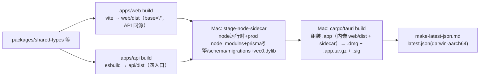
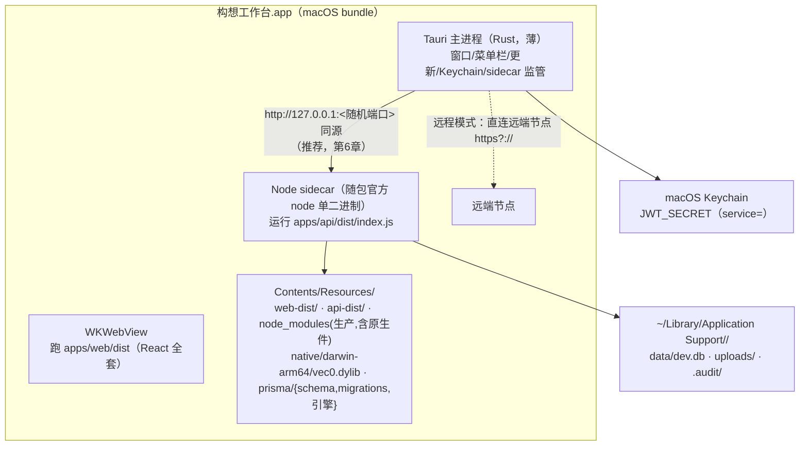
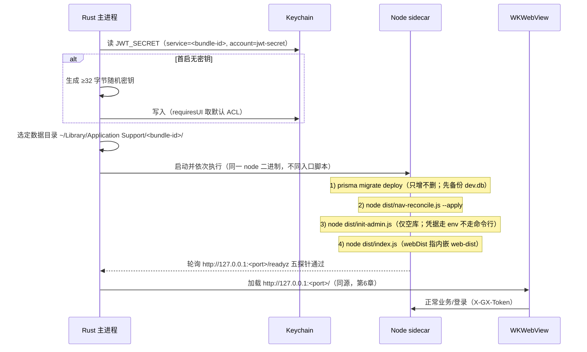
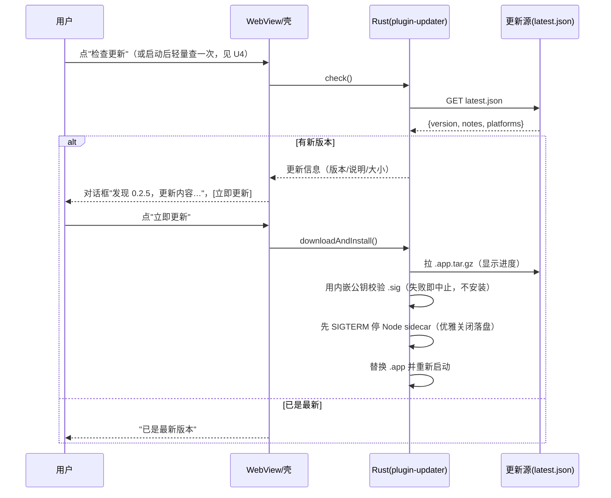

# 构想工作台（GouXiangDB）macOS 独立桌面 App + 一键更新设计

- 文档日期：2026-10
- 状态：设计定稿（纯设计，不含代码/工具链改动）。本文档所有 Tauri/WKWebView/Gatekeeper 行为结论，凡无法仅靠读仓库确认的，均显式标注 **[待 PoC 验证]**；开工必须先做第 15 章三个 PoC
- 作者：高见远（架构）
- 关联文档：同目录 `DESIGN.md`（节点模式主设计，路线 A 数据源抽象，结论继续有效，不改写）；`../2026-10-app-update/DESIGN.md`（fnOS 更新机制）
- 适用版本基线：根 `package.json` version `0.2.4`（单版本源）；monorepo = `apps/api`（Hono + Prisma5 + SQLite）+ `apps/web`（React18 + Vite）+ `packages/*`；`apps/` 下目前无 desktop
- 需求来源：戴总拍板（最高优先）——在节点模式之外顺手做独立桌面 App，**本期只做 macOS、只打 Apple Silicon（aarch64）**，随版本发布，客户端必须有"检测到新版本点一下就更新"的自动更新闭环
- 已拍板边界（不再作为开放项）：① 本期无 Apple Developer 账号，不出 Developer ID 签名/公证，只出自用版；② 目标机主要是 M1/M2/M3/M4（darwin-aarch64 单架构），Intel/universal 仅留一句未来扩展

---

## 0. 给戴总的大白话总览

戴总，这份文档设计的是：把咱们的构想工作台做成一个**可以像普通 Mac 软件一样拖进"应用程序"文件夹、双击就能用的 App**，并且它会**自己提醒升级、您点一下就更新好**。

**它和现在的网页版是什么关系**：

- App 里跑的还是那一套您熟悉的界面和内核，一个功能都不重写。App 相当于一个"**专用浏览器外壳**"（我们选的技术叫 Tauri，用的是 Mac 系统自带的网页内核，所以安装包小、占内存低，很适合您 16GB 的机器）。
- 打开 App，本机就悄悄启动一个"数据内核"（跟 NAS 上跑的是同一份程序），数据存在您 Mac 的用户目录里，**和 NAS、预览机上的库完全互不相干**（这是全新的本地库，预期行为）。
- 在登录界面您可以二选一：**"连本机"**（用这台 Mac 自己的数据）或**"连网络节点"**（填另一台 NAS/服务器的网址和账号，界面就完全变成那台机器的数据）。这正是节点模式主设计里的"壳即浏览器"。本机内核在 App 运行期间会一直开着，切到网络节点也不关它（您已定）。

**首次打开为什么会有个"打不开"的提示，怎么办**：

- 因为咱们这一期**没有花 688 元/年买苹果开发者账号**，App 没有苹果的"签名公证"。Mac 第一次会拦一下。解决很简单：**在"应用程序"里右键点它 → 选"打开" → 再点"打开"**，以后就正常了（也可以用一条命令去掉隔离标记，文档里写了）。适用范围就是您自己和内网少数几个人。
- 等以后您愿意上苹果开发者账号了，本文档专门有一节讲"**怎么平滑切到正规签名+公证，构建和自动更新设计不用返工**"。

**自动更新也能在没签名的情况下用**：

- 我们会给更新包单独加一把"**我们自己的校验密钥**"（这跟苹果签名是两码事，不需要苹果账号），App 每次更新都会校验更新包确实是我们发的、没被篡改，校验不过绝不装。
- 有一个必须实测的坑：没公证的 App，自动更新替换成新版本后，Mac 可能对新文件再拦一次（隔离标记）。文档把这个列为**开工前必做的第三个 PoC**，实测它到底拦不拦、用什么姿势最省事（右键一次/去隔离/随包重签），不拍脑袋假设它一定没事。

**您的 16GB Mac 不会被拖累**：

- 第一次在 Mac 上打包会比较吃资源（编译 Rust、下载依赖，就一次），我们专门安排"**插电、您在场、先关掉占内存大户时手动点一次**"，之后增量打包很轻；日常**不在您机器上跑任何常驻构建**。重活儿（网页/内核构建、测试）依旧在 Ubuntu 构建机上做，Mac 只负责最后"组装成 .app"这一步（因为 Mac 的包基本只能在 Mac 上打）。

**分期**：先花一小段时间做三个"技术验证"（原生模块能跑、外壳能连上内核、无签名能完成一次自动更新），验证通过再正式开工，拆成 D0–D6 七个小阶段，每阶段都能单独测试、单独发版、单独回滚。

---

## 1. 背景与只读勘察基线（带文件:行号证据）

> 全部为只读勘察，未安装任何工具链、未跑构建。

### 1.1 仓库与版本

- 版本单源：根 `package.json:3` `version=0.2.4`，`packageManager=pnpm@9.0.0`（`:6`），workspaces=`apps/*`+`packages/*`（`:7-10`），engines node>=20（`:38`）。
- `apps/` 只有 `api`、`web`；全仓无 Tauri/Electron 痕迹（已采信，本文档不重复全仓扫描）。
- 内核版本由 esbuild `define: process.env.GX_VERSION=<根version>` 注入（`apps/api/scripts/build.mjs:19-25,88-90`）。桌面端版本号在 Tauri 打包时也必须取这个单源（第 11.3 节）。

### 1.2 内核构建产物与原生依赖（决定 sidecar 组装）

- 生产构建是 esbuild 扁平单文件 ESM `dist/index.js`，同批另产三个同级入口：`mcp-stdio.js`、`nav-reconcile.js`、`init-admin.js`（`apps/api/scripts/build.mjs:70-76`，存在性校验 `:93-108`）。
- external 清单（运行时从随包 `node_modules` 解析，**不打进 bundle**）：`@hono/node-server @prisma/client hono jose zod bcryptjs better-sqlite3 sqlite-vec @modelcontextprotocol/sdk ws`（`build.mjs:44-60`）。其中：
  - `better-sqlite3@13` 含 `.node` 原生二进制（`apps/api/package.json:38`）；
  - `@prisma/client@5.22` 自带 query engine（`:36`），prisma CLI 在 **devDependencies**（`:53`）——生产裁剪默认不带，桌面首启迁移必须显式把 CLI + schema-engine 带进包（第 5.2 节）；
  - `sqlite-vec@0.1.9` 在 **optionalDependencies**（`:59-61`），其 `vec0.dylib` 是运行时 `loadExtension` 的独立动态库。
- 已有原生动态库白名单投递脚本 `apps/api/scripts/native/copy-vec-native.mjs`：**已原生支持 darwin-arm64**（`describe()` 里 darwin ext=dylib、支持 x64/arm64，`:42-44`），用 `createRequire` 解析已装 sqlite-vec 的 `getLoadablePath()`（`:47-68`），拷到 `<dest>/native/<triplet>/vec0.dylib`（`:113-118`），并用 `file` 做架构自检（`:72-89`）。桌面组装直接复用此脚本（在 Mac 上跑，triplet=`darwin-arm64`）。
- `appDir`（只读资源目录，vec0 在 `native/<triplet>/`）与 `dataDir`（可写数据）在配置层已分离（`apps/api/src/config.ts:208-212`）。

### 1.3 监听面：TCP 与 Unix socket 双路（决定本地连接面）

- `apps/api/src/index.ts`：`startTcp()` 用 `server.listen(port)`（`:44`），**未显式指定 host，Node 默认绑所有接口（0.0.0.0）**——桌面只应绑回环，需要新增一个可选 bind host（最小增量、默认不变，第 6 章）。
- `startUnixSocket(socketPath)`（`:85-105`）：递归建父目录、启动前删残留 socket（`:87-90`）、`chmod 0660`（`:97`）、打印 `unix:<path>`；优雅关闭先 `flushAllAndClose()` 再 close 并删 socket（`:116-143`）。两路都 `attachCollab(server)`（`:43,:93`）。
- `GX_NO_LISTEN=1` 时不监听（`:147-150`）。

### 1.4 配置与生产闸门（决定桌面首启环境变量）

- 生产 fail-fast：`NODE_ENV=production` 必填；`JWT_SECRET` 必填（≥16 位且非内置开发值，`config.ts:79-89`）；`DATABASE_URL` 必须是 `file:` + **绝对路径**（`:91-98`）；生产下 `CORS_ORIGIN/GX_PUBLIC_ORIGIN` 必填正则白名单（`:100-103`）。
- 缺省值：`dataDir = GX_DATA_DIR || (prod ? /var/lib/gouxiangdb : apiRoot)`（`:304-305`）；`uploadRoot=<dataDir>/uploads`（`:306`）；`auditDir` 生产 `/var/log/gouxiangdb` 否则 `<dataDir>/.audit`（`:353-354`）；`port` 默认 3001（`:38,:322`）；`socketPath=GX_SOCKET_PATH`（`:372`）；`webDist=GX_WEB_DIST`（`:374`，存在且含 index.html 才托管 SPA）。
- CORS 默认白名单（未配 CORS_ORIGIN 时）：`/^http:\/\/localhost(:\d+)?$/` 与 `/^http:\/\/127\.0\.0\.1(:\d+)?$/`（`buildCorsPatterns`，`config.ts:191-198`，接线 `:323`）。

### 1.5 CORS / 安全头（决定自定义协议源的坑，第 7 章）

- CORS 中间件（`apps/api/src/app.ts:119-134`）：**无 `Origin` 头（非浏览器/服务端转发）放行 `*`**；有 Origin 时仅白名单命中才回显该 Origin，否则 `null`（浏览器拦截）；`credentials:true`；`allowHeaders` 含 `X-GX-Token`（`:131`）。
- 安全头（`apps/api/src/middleware/secureHeaders.ts:10-22`）：**CSP 当前关闭**（`:14`）、HSTS 关（`:15`），但 `Cross-Origin-Resource-Policy: same-origin`（`:20`）、`X-Frame-Options: DENY`（`:16`）、`COOP same-origin`（`:21`）。**CORP same-origin 会拦截跨源的无 CORS 资源加载（如 ``）**——这是除 CORS 外第二个必须正面处理的点（第 7.3 节）。
- 内核可同源托管 Web 静态资源（`webDist`，`config.ts:374`；SPA 在最后兜底，`app.ts` createMount 末段），这是"让 WebView 与 API 同源"方案的现成支点。

### 1.6 前端节点模式 S1 已落地（外壳直接复用）

- `apps/web/src/node/resolve.ts`：`LOCAL_NODE_ID="local"`（`:15`）、URL 规范化（`:43`）、nodeId 哈希（`:107-118`）、`toWsOrigin`（`:137`）、本地同源 WS origin 计算（`:153`）。
- `apps/web/src/node/datasource.ts`：`dataSourceResolver` 单例（`:124`），S1 **恒 local、零接线**（`:95`、注释 `:120-123`），接口已含 `current()/baseFor()/headers()/subscribe()`（`:30-39`）。
- `apps/web/src/node/session.ts`：已固化双槽键 `gx-auth`（本地，`:19`）、`gx-node-session`（远端，`:25`）、`gx-node-profiles`（档案，`:32`，**禁止存密码/token**，`:57`）；远端槽 S1 内存占位恒 null（`:100-107`）。
- 桌面外壳不新造数据通道：本地内核就绪后走 local 槽；远端登录走节点模式后续阶段（S2 `connect.ts`）产出的 remote 槽。桌面 D 阶段对节点模式的依赖关系见第 16 章。

### 1.7 后端已有更新子系统（评估复用，第 10 章）

- `apps/api/src/domain/update/`：`manifest.ts`（清单结构门禁）、`source.ts/sourceGitea.ts/sourceStatic.ts/sourceFactory.ts`（源抽象，Gitea Release 资产 / 静态直链）、`download.ts`（票据流式代理）、`prefetch.ts`（预缓存）、`service.ts`（编排+版本比较）、`channel.ts`、`installGuide.ts`、`strategies/{fnosFpk,registry,types}.ts`。
- 清单词表**已包含 darwin/arm64**：`manifest.ts:32-33` `ARCHES={x64,arm64,any}`、`PLATFORMS={linux,darwin,win32,any}`；`packages/shared-types/src/update.ts:153` `ArtifactPlatform` 含 darwin。但**策略注册表当前只有 `fnosFpk` 一种策略**，且测试明确"fnos 通道 platform=darwin 判 no_artifact"（`__tests__/service.test.ts:321-324`）。
- 默认源就是 `https://gitea0.hn.takin.cc` + `GouXiang/gouxiangdb`（`configUpdate.ts:64-65`），支持 static 源/内网镜像覆盖（`GX_UPDATE_SOURCE`/`GX_UPDATE_MANIFEST_URL`，`:17,:29,:82-86`），只读 token 永不下发浏览器（`:31`）。
- **关键裁决**：后端这套是"**NAS 内核对 fpk 的自升级**"（运行中的内核下载 fpk 给人手动装）；桌面"**替换正在运行的 .app**"只能由 **Tauri 自带 updater** 完成（运行中的内核/可执行文件不能替换自己）。两套机制共享"同一 Gitea Release / 版本比较语义"，但**执行器不同，不能混用**（第 10.4 节）。

---

## 2. 目标与非目标

### 2.1 目标

1. 新增 `apps/desktop`（Tauri v2），产出 macOS Apple Silicon 单架构 `.app`（经 `.dmg` 分发），双击即用，首启在用户目录自建全新本地库。
2. App＝承载节点模式的"浏览器式外壳"：登录前可选「连本机 / 连网络节点」；本机模式操作内嵌内核，远程模式界面完全来源于所连节点；本机 sidecar 在 App 运行期常驻（戴总已定，切远程也不停）。
3. 一键更新：App 内"检查更新 → 展示新版本说明 → 点一下 → 校验更新包完整性 → 下载安装并重启"，无 Apple 账号前提下在自用机上闭环可验证。
4. 内嵌内核 = 现有 `apps/api` 生产构建，原生依赖（better-sqlite3 `.node`、Prisma 引擎、sqlite-vec `vec0.dylib`）随包可靠投递；目标机**无网络、无 Node、无 prisma CLI**。
5. 首启启动序列：建/取密钥 → `prisma migrate deploy` → `nav-reconcile --apply` → `init-admin`（仅空库）→ 健康探活通过后再加载界面；升级迁移只增不删、先备份、可回滚。
6. 现有 web/api/fpk 产物与四门测试**零影响**：desktop 是全新隔离工作区，默认不构建、不进默认 `pnpm build`，显式命令才打包。
7. 现在的构建/更新设计在未来拿到 Apple Developer ID 后可平滑加签名+公证，不返工。
8. 不给 16GB 主力机增加常驻负担：重型/一次性构建只在 Mac 上择时手动触发。

### 2.2 非目标

| 不做项 | 说明 |
| --- | --- |
| Apple 公证 / Developer ID 签名（本期） | 无账号；只走 ad-hoc / 无签名自用路径，讲清首次打开与更新隔离 |
| darwin-x86_64 / universal 包 | 本期单架构 aarch64；第 13.3 留一句未来加 Intel 的做法 |
| Windows / Linux 桌面端 | 架构上 Tauri 跨平台，但本期不配置、不测试、不承诺 |
| 在 Linux 构建机交叉出 macOS .app | 不可靠（见第 13 章），Mac 步骤必须在 macOS 做 |
| 桌面端独立的数据同步/多活 | 本地库与远端节点不互相同步；远程模式只是界面数据源切换 |
| 用 Tauri IPC 重写全站请求层 | 禁止；WebView 直接跑现有 React + client.ts（第 7 章） |
| 改造成 Electron | 明确否决（第 3 章） |
| 自动后台静默下载安装（本期） | 本期为"发现+一键"，是否自动下载见待拍板 U4 |
| 把 prisma migrate dev / 重置带进桌面 | 桌面只允许 `migrate deploy`（只增不删） |

---

## 3. 技术选型裁决：Tauri v2（系统 WebView）

### 3.1 对比与结论

| 维度 | Tauri v2（推荐） | Electron |
| --- | --- | --- |
| 渲染内核 | macOS 用系统 WKWebView（WebKit），不随包带浏览器 | 每个 App 捆绑整套 Chromium |
| 安装包体积 | 通常数 MB～十余 MB（另含 Node sidecar 与原生模块后约数十 MB） | 通常 80–150 MB 起 |
| 内存占用 | 系统 WebView，后台/RSS 显著更低，契合 16GB 贴顶机型 | 多进程 Chromium，常驻重 |
| 后端语言 | Rust 主进程（薄：只管窗口/sidecar/updater/Keychain） | Node 主进程（但我们已另有 Node 内核，会重复一套） |
| 自动更新 | 官方 plugin-updater（minisign 校验，无需苹果账号即可保证完整性） | electron-updater（成熟但体量大） |
| 与现有资产关系 | WebView 直接加载 `apps/web/dist`；Node 内核作为外部 sidecar | 同样加载 web/dist，但要再养一个 Electron 主进程 |

**裁决：Tauri v2**。理由：系统 WebView 带来的体积/内存优势对 16GB 主力机是决定性的；我们的"重业务内核"本就是 Node 程序，Tauri 主进程可以做得极薄（拉起/看守 Node sidecar、管窗口、管更新、管密钥），不必把 Hono/Prisma 再用 Rust 重写。Electron 的多进程 Chromium 与常驻内存在此场景纯属浪费。

### 3.2 apps/desktop 目录结构（全新隔离区）

```
apps/desktop/
  package.json              # 独立依赖：@tauri-apps/api、@tauri-apps/plugin-updater、plugin-shell/process、plugin-dialog/...
                            # 仅桌面壳使用；不进入 apps/web 依赖图（不违反 web 依赖冻结）
  tsconfig.json             # 独立 tsc -p；产出纳入四门之"四包 tsc0"
  eslint.config.*           # 独立 lint
  src/                      # 壳的 TS 侧（薄）
    main/                   # 仅类型/常量（真正主进程是 Rust）
    updater.ts              # 检查更新/下载/重装的前端编排与对话框 UI 触发
    sidecarClient.ts        # 查询内核健康/生命周期状态（经 Rust command）
    tray.ts                 # 菜单栏项（默认退出策略，见 8.4）
  src-tauri/
    Cargo.toml
    build.rs
    tauri.conf.json         # 由构建脚本注入 version（单源）、productName、identifier、updater pubkey/endpoints
    capabilities/*.json     # 最小权限集（core、shell/sidecar、updater、dialog、notification）
    icons/                  # 自建图标（不使用 emoji）
    src/
      main.rs               # 入口只装配
      sidecar.rs            # Node sidecar 进程监管（启动/健康等待/日志/SIGTERM 优雅退出）
      boot.rs               # 首启编排：Keychain 取密钥 → migrate → reconcile → init-admin → readyz
      secret.rs             # macOS Keychain 读写 JWT_SECRET（keyring/security-framework）
      localhost.rs          # 回环端口选择 / 健康轮询（如选 loopback 方案）
      update.rs             # updater 插件配置/事件（安装前先优雅停 sidecar）
  scripts/
    stage-node-sidecar.mjs  # 在 Mac 上：组装 node 运行时 + 生产 node_modules + 原生件 + prisma 引擎/schema
    build-desktop.mjs       # 串联：web dist → api dist → stage → tauri build（择时手动跑）
    make-latest-json.mjs    # 读取 tauri 产出的 .app.tar.gz + .sig，生成 updater latest.json
```

- Rust/TS 依赖的**边界说明**（回应"前端禁新依赖"铁律）：冻结范围是 `apps/web`（跑在 WebView 里的业务前端）与现有 `apps/api`。`apps/desktop` 是全新隔离工作区，其 Cargo/TS 依赖（Tauri 生态）不进入 web/api 的依赖图，不改 web/api 的 lockfile 子树之外的解析，**默认也不进根 `pnpm build`**。
- WebView 里跑的业务前端**仍然是 `apps/web/dist` 本身**，不为桌面单独引前端框架/UI 库/图标库；桌面外壳的几个原生对话框沿用系统原生控件 + 自建 SVG（gx-* 令牌仅在 web 侧；壳的原生 UI 走系统风格）。

### 3.3 monorepo 构建顺序（桌面产物）



- Web 构建：桌面走"**API 与界面同源**"，故 `VITE_BASE_PATH=/`、不显式设跨域 `VITE_API_URL`（由 `resolveApiBase` 回落同源，见主设计 §1.5）。
- 该顺序要求 web/api 两个 dist 在 Mac 打包前就绪——这两个 dist 可在 Linux 构建机先产出（跨平台纯 JS，平台无关），再把产物交给 Mac；原生件组装必须在 Mac（第 13 章）。

---

## 4. 进程模型总览（重点）

### 4.1 组件与进程



- **三个执行体**：Rust 主进程（随 Tauri）、WKWebView（系统提供，非独立捆绑进程）、Node sidecar（我们自带的官方 node 二进制跑内核）。
- sidecar 由 Rust 用 Tauri sidecar 机制（externalBin + 目标三元组命名）拉起与监管；App 退出时 Rust 先给 Node 发 SIGTERM，命中内核**已有的优雅关闭**（`index.ts:54-82 / :109-135`，先 `flushAllAndClose` 再断 Prisma，10s 兜底），保证 SQLite/WAL 与协同落盘安全。

### 4.2 Node 运行时随包方式

- **推荐：随包官方 Node 单二进制（darwin-arm64）作为 Tauri sidecar**。在 Mac 构建机一次性下载 `node-v<lts>-darwin-arm64.tar.gz`（缓存到构建缓存，不在日常/CI 临时下载），取其 `bin/node`，按 Tauri sidecar 约定改名放入 `src-tauri/binaries/`（如 `gxnode-aarch64-apple-darwin`），Rust 以 `Command::new_sidecar("gxnode")` 启动并传参 `.../Resources/api-dist/index.js`。
  - 授权：Node 为 MIT，随包分发合规，需在 App 致谢/许可文件中保留 Node 许可声明。
  - 选 LTS（与 engines `node>=20` 对齐，`package.json:38`；esbuild target `node20`，`build.mjs:80`）。
- 不选 SEA/pkg 单文件可执行：better-sqlite3 的 `.node` 与 Prisma query engine、sqlite-vec dylib 都是外部原生件，强行打进单可执行反而增加加载路径风险；"node 二进制 + 生产 node_modules"最直白、与现网部署同构。
- **[待 PoC 验证]** Tauri sidecar 对"带额外参数 + 自定义工作目录/环境变量"的支持细节、node 二进制在 ad-hoc 签名下首次启动是否被 Gatekeeper 干预（预期：对 .app 整体做一次 ad-hoc `codesign --force --deep -s -` 后可运行，PoC-1 验证）。

### 4.3 启动时序（首启与每次启动）



- 环境变量由 Rust 在 spawn 时注入（**不写进 .env、不进命令行参数 ps 列表**）：`NODE_ENV=production`、`GX_DATA_DIR=<app-support>/data`、`UPLOAD_ROOT=<...>/uploads`、`GX_AUDIT_DIR=<...>/.audit`、`DATABASE_URL=file:<绝对路径>/dev.db`、`JWT_SECRET=<Keychain 取到>`、`GX_WEB_DIST=<Resources>/web-dist`、`PORT=<随机端口>`、`GX_BIND_HOST=127.0.0.1`（第 6.2 新增）、`GX_MIGRATIONS_DIR=<Resources>/prisma/migrations`、`GX_APP_VEC` 走 appDir 默认（vec0 在 `native/darwin-arm64/`）、CORS 采用第 7 章方案。
- **健康探活**复用现成 `/readyz`（dbPing/dbWritable/migrations/uploadsWritable/disk）与 `/healthz`（挂载点 `app.ts:149-150`）。探活通过前 WebView 显示壳自带"正在启动本地内核"原生占位，不加载业务页。
- 首个管理员：桌面首启由内核 `init-admin.js` 承担（支持 env 凭据 `GX_INIT_ADMIN_EMAIL/_PASSWORD/_NAME`，见脚本头注释；已存在 owner 则"已初始化跳过 exit 0"）。**推荐**：首启直接加载内核托管的登录/初始化页（无需在 Rust 里另造表单），让 WebView 走完现有首管理员引导；是否由 Rust 预注入凭据见待拍板 U5。

### 4.4 升级期迁移：先备份、只增不删、可回滚

- 迁移只走 `prisma migrate deploy`（与 NAS/容器/飞牛部署同一条迁移路径，`apps/api/package.json:20` `db:deploy`），绝不用 `migrate dev/reset`。
- Rust/启动脚本在 migrate 前对 `<data>/dev.db`（含 `-wal/-shm`）做一次时间戳备份（与现有 `scripts/backup/online-backup.mjs` 的产物形态一致即可，桌面用离线冷备更简单：sidecar 尚未启动时直接拷文件）。
- migrate 失败：不进入业务页，原生对话框提示"本地数据升级失败，已保留旧库与备份"，并**拒绝用新内核打开旧库**（避免半迁移状态）；回滚路径＝重装上一版 .app + 还原备份库。
- nav-reconcile 在 migrate 之后跑 `--apply`（与 build.mjs 注释要求一致，`build.mjs:31-38`）。
- 只增不删：遵守既有 Prisma 迁移纪律（迁移只加表/列），桌面不引入任何专属 schema 变更（零迁移新增）。

---

## 5. 原生依赖与生产 node_modules 的可靠投递（重点 PoC）

### 5.1 组装策略：在 Mac 上构建同构生产依赖树

- **必须在 macOS-arm64 上组装**（`copy-vec-native.mjs:13-14` 已明示原生件按运行平台选取，不做交叉选择）：pnpm 的 optionalDependencies 只取当前平台子包，Linux 上拿不到 darwin-arm64 的 better-sqlite3 prebuild / sqlite-vec dylib / Prisma darwin 引擎。
- 推荐用 **`pnpm deploy --prod`** 把 `@gx/api` 的生产依赖输出成一个扁平化、可重定位的部署目录（避免直接拷贝符号链接密布的 `node_modules/.pnpm` store），随后做白名单补齐：
  1. better-sqlite3 的 `build/Release/better_sqlite3.node`（含在 prod 依赖内，deploy 会带上，但需用 `file` 校验为 arm64）；
  2. `@prisma/client` 运行时 + **query engine darwin-arm64**（`@prisma/engines/libquery_engine-darwin-arm64*`）；
  3. **prisma CLI + schema-engine**：`prisma` 在 devDependencies（`package.json:53`），prod deploy 默认不带，需**显式追加** `prisma` 包与其 `schema-engine-darwin-arm64*`（migrate deploy 依赖），并随包带 `prisma/schema.prisma` 与整个 `prisma/migrations/`；
  4. `vec0.dylib`：组装末跑 `node apps/api/scripts/native/copy-vec-native.mjs --dest <staged-app-root>`，落到 `<staged>/native/darwin-arm64/vec0.dylib`（复用现成脚本与其 `file` 架构自检）；
  5. workspace 内包（`@gx/shared-types/blocks/canvas/design-tokens`）的运行时片段——这些已被 esbuild **内化进 dist/index.js**（`build.mjs:84-86`），生产 node_modules 里通常不需要，但 `pnpm deploy` 若要求 workspace 协议可解析，以 deploy 输出为准，PoC-1 用干净 .app 实跑确认无 `ERR_MODULE_NOT_FOUND`。
- Prisma Client 必须在 Mac 上 **`prisma generate`** 预生成（目标无 prisma CLI、无网）；确认生成产物内置/伴随 darwin-arm64 query engine。
- 组装后用 `file`/`lsof`/`otool -L` 做一次"原生件架构 + 动态库依赖"自检（全部 `arm64`、无指向构建机绝对路径的非系统 dylib 引用），作为打包脚本硬门槛。
- **[待 PoC 验证]** `pnpm deploy` 与 better-sqlite3 预编译二进制、Prisma 引擎在 `.app/Contents/Resources` 深路径+空格/签名场景下的解析；pnpm 是否默认拉取 darwin-arm64 optional 子包（必要时用 `--config.supported-architectures.os=darwin --config.supported-architectures.cpu=arm64` 强制）。这些只能在 Mac 上由 PoC-1 落实，不在 Linux 假设。

### 5.2 目标机零依赖假设

- 目标机**不装 Node、不装 pnpm、不联网、无 prisma CLI**：node 运行时、全部生产 node_modules、原生件、引擎、schema/migrations 均在 `.app` 内。
- 所有运行期路径用 Rust 传入的绝对资源路径/数据路径，不依赖 `process.cwd()`（内核生产校验已要求 DATABASE_URL 绝对路径，`config.ts:96-98`）。

---

## 6. 本地内核连接面：回环 TCP（推荐）vs Unix socket

### 6.1 方案对比

| 方案 | 做法 | 优点 | 缺点 |
| --- | --- | --- | ---|
| **L. 随机回环 TCP 端口（推荐）** | Node 以 `webDist` 托管界面 + API，仅绑 `127.0.0.1:<随机端口>`；WebView 直接加载 `http://127.0.0.1:<port>/` | **界面与 API/WS/上传/图片完全同源**：无 CORS、无自定义协议源问题、无 CORP 拦图、WS 直接 `ws://127.0.0.1:port/ws/...`；改动最小（内核已能同源托管 SPA） | 本地回环暴露一个 TCP 口；本机其他进程可尝试连接（仍需 X-GX-Token/JWT，且仅回环） |
| U. Unix socket + Rust 反代 | Node 监听 `~/Library/Application Support/<id>/gx.sock`（0660），Rust 把 socket 桥接给 WebView | 文件权限隔离最强（`index.ts:97` 0660 + 属主），无 TCP 端口 | WKWebView **不能直接打开 unix socket URL**；必须由 Rust 起一个 HTTP/WS 反代，等于自造网关，**WS 升级隧道复杂**；自定义协议源问题依旧 |

**裁决：本期采用方案 L（仅绑回环的随机 TCP，且同源托管界面）**。

理由：它一次性消除第 7 章自定义协议源的全部摩擦（CORS / CORP / WS / 附件图片），后端**对现有部署面零改动**即可同源；安全上仅绑 `127.0.0.1`、端口每次随机、且所有业务仍受现有 JWT（X-GX-Token）与 RBAC 保护，本机恶意进程要连也得先拿到有效令牌。Unix socket 方案的文件权限优势在单用户桌面场景收益有限，却要在 Rust 侧维护一条 HTTP+WS 反代隧道，风险不划算。**接口预留**：Rust 监管层抽象成 `LocalKernelTransport { httpBase, wsBase, readyz }`，未来要切 unix socket+代理只换该实现，不动上层。

### 6.2 需要的最小后端增量（默认不影响其它部署面）

- 新增可选 env `GX_BIND_HOST`：`startTcp()` 由 `server.listen(port)` 改为 `server.listen(port, bindHost)`。
  - 默认值保持 `0.0.0.0`（与 Node 现状、裸机/容器/飞牛行为逐字节一致）；仅桌面启动脚本显式设 `127.0.0.1`。
  - 这是一行级 additive 改动，进 `config.ts` 的"可选部署适配"区（与 socketPath/basePath/webDist 同纪律，`config.ts:285-293`），不进生产必填校验。
- 端口选择：Rust 让操作系统分配空闲端口（传 0 后读实际端口，或 Rust 先选再传）。**[待 PoC 验证]** 端口如何从 Rust 确定性传给 sidecar 并被 WebView 同源加载（倾向 Rust 选端口→`PORT` env 注入）。
- socket 路径（仅供未来方案 U/排障）：`~/Library/Application Support/<bundle-id>/run/gx.sock`，父目录 0700、socket 0660（内核已 chmod，`index.ts:97`）。

---

## 7. 自定义协议源的坑与解法（重点 PoC）

### 7.1 为什么不能让 WebView 用 tauri:// 直连内核

- Tauri v2 在 macOS 用 WKWebView 承载前端，页面源约为 `tauri://localhost`（Windows 为 `http://tauri.localhost`）。**macOS 上确切的 Origin 字符串 [待 PoC 验证]**（可能是 `tauri://localhost`，也可能某些版本为空）。
- 若界面在 `tauri://localhost`、API 在 `http://127.0.0.1:3001`，则：
  1. **CORS**：这是跨源（scheme+host 都不同）。内核 CORS 对有 Origin 的请求只白名单放行（`app.ts:124-128`），默认白名单只认 `http://localhost/127.0.0.1`（`config.ts:192`），**不认 `tauri://localhost`** → REST 被拦。
  2. **CORP**：`Cross-Origin-Resource-Policy: same-origin`（`secureHeaders.ts:20`）会拦跨源"无 CORS"资源——头像/品牌图/附件若是 `` 这类 no-cors 加载会被拦。
  3. **WS**：协同 `new WebSocket(ws://127.../ws/collab/...)` 从 `tauri://` 发起，短票 REST 先被 CORS 拦；WS upgrade 的 Origin 校验是否放行也需确认。
  4. 附件鉴权下载靠带 `X-GX-Token` 的 fetch（主设计 §9.4），跨源时同样受 CORS 约束。
- 若为此把内核 CORS 调成"允许 tauri 源 + 放宽 CORP"，既污染一套安全姿态，又要照顾多平台源字符串，得不偿失。

### 7.2 推荐解法：同源托管（与第 6 章方案 L 一致），后端零安全改动

- WebView **不加载 `tauri://localhost`**，而是加载 Node 内核同源托管的 `http://127.0.0.1:<随机端口>/`（`GX_WEB_DIST` 指内嵌 web-dist）。
- 此时界面、REST、WS（`ws://127.0.0.1:port/ws/collab/...`，短票同源）、附件、头像、品牌图**全部同源**：
  - REST 同源无 CORS；
  - 图片/附件 no-cors 加载同源，CORP same-origin 不拦；
  - WS 同源，无需特殊 Origin；
  - X-GX-Token 照常（鉴权头逻辑不变，飞牛吞 Authorization 的问题在桌面直连场景本就不存在，但仍统一用 X-GX-Token 保持单一路径）。
- 现有 `collab-provider` 的 origin 推导（`window.location.origin` → ws）与 dataSourceResolver 的 local 槽（同源相对前缀）**天然成立，零特殊分支**。
- Tauri 侧把主窗口 URL 设为该 loopback 地址（而非自定义协议）；`tauri.conf.json` 的前端 devPath/frontendDist 相应退化为"由外部服务提供"，安全策略仍通过 Tauri capability/CSP 与内核既有头约束。**[待 PoC 验证]** Tauri v2 用 `WindowBuilder::new(app, url).load(http://127.0.0.1)` 承载非自定义协议页面时，IPC/capability 是否可用（我们业务不依赖 IPC 做数据，仅 updater/壳功能用，可在该页注入少量 invoke 桥；若受限则保留一个极薄的 tauri:// 启动页负责"启动内核→跳 loopback"）。

### 7.3 若 PoC 证明同源托管受限：最小后端增量（默认关闭，仅桌面）

仅当 7.2 在 WKWebView 上不可行时，退而采用"自定义协议源 + 桌面专用本地放宽"，并把改动严格门控：

- 新增仅桌面启动时设置的 env（如 `GX_DESKTOP_LOCAL=on`），在**绑死回环、单机单用户**的前提下：
  - CORS 白名单追加桌面源（`tauri://localhost` 与 `http://tauri.localhost`，经 `buildCorsPatterns` 字面正则；注意该函数只对 `*` 做通配转换，字面 scheme 可直接命中，`config.ts:191-198`）；
  - CORP 对该内核实例放宽为 `cross-origin`（或对 `/uploads/*` 与附件内容端点单独放宽），不动其它头。
- **默认绝不影响 fnOS/裸机/容器**：该 env 不出现在任何现有部署模板；无此 env 时行为与今天完全一致。
- 但 WS 隧道与 CORP 仍比同源方案琐碎，故只作备选，PoC 后再定。

### 7.4 远程模式（连网络节点）的连接面

- 界面在 `http://127.0.0.1:<port>`（http 源），远程节点为 `http(s)://<node>`，由 dataSourceResolver remote 槽直连：
  - **混合内容**：页面是 `http://127.0.0.1`，连 `https://` 节点是**升级**，允许；连 `http://` 局域网节点也是 http→http，允许（这是选 loopback http 源而非 tauri 类安全源的附带好处——避免 https 类源页面对 http 节点的混合内容硬阻断）。若未来强制 WebView https 源，则只能连 https 节点，需在节点模式主设计 §7.4 基础上再加桌面约束。
  - **CORS（远端）**：浏览器请求带 `Origin: http://127.0.0.1:<随机端口>`。用默认 CORS 的节点（未硬配 CORS_ORIGIN）白名单本就含 `127.0.0.1` 任意端口（`config.ts:192`）可放行；**硬配了 CORS_ORIGIN 的节点会去掉默认白名单**，需管理员把 `http://127.0.0.1:*`（或 `http://localhost:*`）正则加进 `CORS_ORIGIN`。随机端口的问题用通配正则解决（只放行 loopback，不放任公网）。
  - **备选（远端零配置）**：由 Rust 提供一个"出口转发"command，远程请求经 Rust HTTP 客户端发出（**不带 Origin**），内核/远端对无 Origin 一律放行 `*`（`app.ts:126`）。但通用转发要处理 multipart/WS，成本高，本期不默认实现；先按"远端加 loopback 白名单"走，列入 PoC-2 与待拍板 U6。
  - **远程 WS 协同**：浏览器直连远端 `wss://`/`ws://` + 远端短票（同主设计 §9.2）；远端节点需暴露 `/ws/*`（主设计 U6 已提 Caddy matcher 缺口）。
- Tauri 侧连接白名单：若用 Tauri 的 http 插件做任何 Rust 出口请求，需在 capabilities 配 scope；但业务 fetch 在 WKWebView 内不受 http 插件 scope 限制（受同源/CORS 约束）。**[待 PoC 验证]** WKWebView 对任意 http(s) 节点的 ATS（App Transport Security）策略——macOS 对未公证 App 的 http 明文连接默认较宽，但需在 `Info.plist` 按需允许任意本地/局域网 http（自用可接受），记录于 PoC-2。

---

## 8. 数据、密钥与"壳即浏览器"接线

### 8.1 数据目录

- bundle identifier 建议 `cc.gouxiang.workbench`（最终命名待拍板 U7，仅小写反域名）。macOS 应用支持目录为 `~/Library/Application Support/<bundle-id>/`：

```
~/Library/Application Support/cc.gouxiang.workbench/
  data/
    dev.db                # SQLite 主库（DATABASE_URL=file:/Users/<u>/Library/.../data/dev.db）
    dev.db-wal / dev.db-shm
    uploads/              # avatars/ branding/ 附件内容寻址
    .audit/               # JSONL 审计
    update-cache/         # （内核 update 子系统若启用）预缓存，桌面端默认关闭该面
  run/                    # （未来 unix socket 方案）gx.sock
  logs/                   # sidecar stdout/stderr 滚动日志（便于远程协助）
```

- 这是**全新本地库**，与 fnOS（183）、预览 VM（15）库互不干扰（预期行为）；卸载 App 时 macOS 不自动删 Application Support，需在帮助文档说明"删除 App 不会删数据，数据在上述目录"。

### 8.2 JWT_SECRET 存 Keychain

- 首启 Rust 生成 ≥32 字节随机 base64，写入 **macOS Keychain**（service=`<bundle-id>`，account=`jwt-secret`）；之后每次启动读取并经环境变量注入 sidecar（不落配置文件、不进命令行）。
- 实现选型：Rust `keyring` crate（底层 Security framework）或直接 `security-framework`。**[待 PoC 验证]** 未签名 App 访问 Keychain 的 ACL 提示形态（可能弹"允许"或生成一个未签名项），自用可接受；签名后体验更顺。
- 密钥不随更新变化（Keychain 项跨版本保留），保证升级后旧 token 仍可验、自动登录不断。

### 8.3 "壳即浏览器"接线（复用 S1+）

- WebView 加载内核同源页面后，业务前端就是未加桌面特判的 `apps/web`：
  - 本地模式：`dataSourceResolver` local 槽（同源 loopback），登录态走 `gx-auth`（现状）。
  - 远程模式：依赖节点模式 **S2（client 接线+会话切换）/S3（握手+远端登录）** 落地后的 remote 槽（`gx-node-session`/`gx-node-profiles`，`session.ts:25-32`）。桌面 D 阶段只提供"外壳与入口"，远程切换能力随 web 的 S2/S3 解锁（第 16 章依赖）。
- 桌面新增的最小 UI（都在登录/欢迎环节，业务页面零改动）：
  - 欢迎页二选一大按钮：「在这台 Mac 上使用（连本机）」/「连接到网络节点」。后者展开节点 URL + 账号/密码（复用 `normalizeNodeUrl`/握手/远端登录，不新造协议）。
  - 顶栏由 web 侧节点徽标（主设计 §15.1 `NodeBadge`）显示当前源；壳窗口标题可追加节点名（Rust 从页面/健康信息读取，可选）。
- **本机 sidecar 常驻**：切到远程模式也不停止本地内核（戴总已定）。远程会话结束返回本机即恢复本地数据。这也简化了实现（不需要起停内核、不需要处理"远程时本机库释放"）。

### 8.4 关窗口行为（戴总 2026-10-15 拍板）：默认驻留菜单栏 + 显式「彻底退出」

- **默认**：关主窗口＝仅隐藏窗口，App 与 Node sidecar 继续在后台运行（菜单栏保留图标），这样本机可持续当节点、再次打开很快。
- **菜单栏菜单必须提供显式「彻底退出 GouXiangDB」项**：点击后走第 4.1 的 SIGTERM 优雅停 sidecar（flushAllAndClose → 断 Prisma）再终止 App，确保 SQLite/WAL 安全落盘、不残留进程。
- 另提供「显示主窗口」菜单项；可在设置里加"关闭窗口时直接退出"开关（默认关，即默认驻留）。
- 后台驻留期间仍受"仅绑 127.0.0.1 + JWT"保护；不做任何常驻重活/定时构建。

### 8.5 ★ 启动器（Launcher）多节点模型（戴总 2026-10-16 提、10-17 补充定稿；取代固定"模式"与原二选一）

> 本节**取代**原 §8.3 的"连本机/连网络节点二选一 + 本机 sidecar 永远常驻"，并修订第 4 章"首启无条件 boot"。原"壳即浏览器、复用 web S1 数据源抽象、远程能力依赖 web S2/S3、单活会话隔离"的结论继续有效。戴总明确：不做固定三模式，改做"**壳＝节点启动器**"；昨天说的纯本地/纯远端/本地+远端只是这个模型下的三种自然状态，不再单列模式枚举。

**模型（一句话）**：壳管理一个**节点注册表**——本地节点至多 1 个、远端节点可多个；每个节点可单独"连接/关闭"，同一时刻只有一个**活动节点**占据界面；壳上有**悬浮气泡**随时打开节点列表、添加节点、看每个节点的连接状态。

**注册表与生命周期规则：**

1. **新装不启动本地节点（戴总 10-17 补充，硬规则）**：全新安装首次打开，**不**跑第 4 章的 migrate/init-admin、**不**起本地内核，直接进入启动器"添加节点"界面。用户添加什么，才连什么。
2. **本地节点全局唯一**：注册表里最多 1 个 kind=local。首次"添加本地节点并连接"时，壳才首次执行本地 boot（冷备→`migrate deploy`→nav-reconcile→加载界面走现有**初始化管理员/注册**引导）。一旦添加过，本地节点条目永久存在，**不允许再建第二个本地节点**（UI 隐藏入口）。
3. **本地节点"关闭"= 优雅停进程，不是删数据（戴总 10-17 补充）**：已初始化后，手动关闭本地节点只走 §4.1 SIGTERM 优雅退出、释放端口占用；`dev.db` 与数据目录原样保留。再次"连接"只是重新拉起进程、沿用原库，**不重新初始化、不再要求注册管理员**。本地节点的"添加/首次初始化"与"启动/停止进程"是两回事，绝不混为一谈。
4. **远端节点可多个、可增删**：每个 profile＝`{nodeId, baseURL(canonical), label, lastConnectedAt}`，**绝不存密码/明文 token**（沿用主设计 §8.2）。连接远端＝三探针握手→该站登录拿 JWT→成为活动节点；远端 `initialized=false` 时瘦客户端阻止登录（不自举）。可对任一远端"关闭连接"（清其会话，见 §8.3 token 清理）或从注册表删除。
5. **单活会话**：任一时刻只 1 个活动节点经 `dataSourceResolver.current()` 读写；切换＝结束当前会话、`queryClient.clear()`、进入另一隔离会话（主设计第 10 章），不串数据、不留残 token。挂起的其他节点不占活动界面；本地节点进程的"起/停"独立于"是否活动"（见下）。
6. **悬浮气泡 + 状态**：桌面壳常驻一个气泡入口（WebView 内由 web 渲染、经 Tauri command 读本地节点状态），列出每个节点的在线/连接中/离线/未启动状态，支持连接、关闭、添加；当前活动节点有标记（兼用主设计 NodeBadge）。
7. **跨重启记忆（戴总拍板）**：注册表与"上次活动节点"持久化（web localStorage：`gx-node-profiles` 扩为含 local 条目 + 新增 `gx-node-active`；**不存明文密码**，本地 token 走 `gx-auth`、各远端 JWT 走按 nodeId 分键的会话存储，切走保留、切回免登）。下次打开自动尝试恢复上次活动节点；本地节点是否"随启自动拉起进程"由其上次运行状态决定（已添加且上次为运行中→自动拉起；纯远端用户本地节点保持停止）。

**三种旧"模式"＝本模型的自然状态（不再需要模式枚举/三卡片）：**

| 旧叫法 | 在启动器模型里的等价状态 |
| --- | --- |
| 纯本地 | 注册表只有本地节点且连接它；无远端 |
| 纯远端 | 只添加远端并连接；本地节点保持"停止"（进程不起、不初始化） |
| 本地+远端 | 本地节点在跑 + 若干远端，单活切换查看；两库不互相同步 |

**界面承载方式的必要修订（由"新装不启本地"推出，开工前已定，避免返工）：**

- 现状 PoC 壳让**业务内核兼任前端托管**（WebView 跳 `http://127.0.0.1:<内核口>/`，§6/PoC-2 同源）。启动器模型下界面必须在"任何节点连接前"就存在，故改为：**壳自己在回环口开一个极简静态服务，只托管 `web/dist`，不碰任何数据/API**（Rust 侧轻量 HTTP，如 tiny_http/axum，随机口；前端启动时经 command 获知"壳口"与"本地节点口"）。
- 数据源全部走 resolver 跨源：本地节点 `http://127.0.0.1:<内核口>`、远端 `https?://<基址>`。源仍是 **http 回环源**（不是 `tauri://` 安全源），因此保留 PoC-2 的关键收益——连 `http://` 局域网节点是 http→http 不触发混合内容拦截，连 `https://` 是升级允许。**否掉"直接用 tauri:// 内置 frontendDist"**：安全源向 http 局域网节点发 fetch/WS 会被混合内容硬阻断（§7.4 已记录该取舍）。
- 跨端口/跨源＝需要后端 **CORS/WS Origin 白名单**（本就是 S2 要做的 additive env）：本地内核桌面启动时默认允许壳回环源（现有 fnOS/服务器部署面默认值不变）；远端节点由其管理员把桌面源加入白名单（沿用 U6，本期不做壳内 API 转发）。
- **承载 PoC（开工第一项，纯技术验证、不需戴总授权）**：✅ **已通过（2026-10-17，PoC-4，12/12，见 §15 / `apps/desktop/poc/POC4-REPORT.md`）**——壳 std 级回环静态口 + 跨源连内核的 CORS/预检/multipart/WS/公开图全部实测通过，后端零改动、无需放宽 CORP；退路（合口）不需要。远端 http/https ATS 观察留待有远端节点时补。

**与已有阶段的接线（不新增并行大线）：**
- 节点注册表/单活会话/气泡/启动器界面属 **web 节点域 + S2**（纯前端新增为主，默认门控，浏览器/fnOS 部署面零行为变化）；本地节点的"可启停 + 状态 + 首次初始化"Rust command 属 **D2**（把 PoC 壳 `main.rs:107-116` 的无条件 spawn 重构为可 start/stop 的托管服务，是本模型相对旧方案唯一较重的 Rust 改动，同时服务"纯远端不起内核"与"手动关闭本地节点"两个需求）；壳口静态服务属 **D1/D3**。
- 纯远端 / 远端远程能力仍**只随 web S2（client.ts 运行时接线 + 会话切换）/S3（握手 + 远端登录 + 全链路附件/图片/WS-SSE 协同，一次做完整、不收窄只读 MVP）解锁**；未就绪前远端连接入口门控置灰。
- 离线双向同步（`#774`）与本地加密（`#791`）**仍是正交大线、不属本模型首版**。**多节点化不推翻离线设计**：侧车同步表本就按 `nodeId` 分区（`local_outbox.nodeId`、`replica_state @@unique([nodeId, remoteBaseId])`、`id_map.nodeId`），离线文档 §1.4 已写明"支持多远端副本 + 纯本地副本"、"多节点档案、同步会话单活"；从 1+1 扩到 1+N 只是同一套逻辑按 nodeId 多跑几份，冲突/失权擦除/加密匣均按节点各自作用域，无需改结构。

---

## 9. 自动更新（重点）：Tauri v2 updater

### 9.1 两把"签名"必须分清（无苹果账号也要配 updater 密钥）

| | Apple 代码签名/公证 | Tauri 更新包签名 |
| --- | --- | --- |
| 解决什么 | Gatekeeper 信任、首次打开不拦、防恶意软件标识 | **更新包完整性/来源校验**（防更新被篡改/中间人） |
| 是否需要 Apple 账号 | 需要 Developer ID（688/年），本期没有 | **不需要**，`tauri signer generate` 本地生成 minisign 密钥对 |
| 材料 | Developer ID 证书 + notarytool | 私钥（仅构建机）+ 公钥（写进 tauri.conf.json，编译进 App） |

- 本期虽无 Apple 账号，**仍必须生成并配置 updater 密钥对**，否则无法保证"点一下更新"装的是我们发的包。
- 构建机用 `tauri signer generate -w ~/.tauri/gouxiangdb.key`：得私钥（密码保护）+公钥。公钥写入 `tauri.conf.json > bundle > updater > pubkey`（或构建注入）；私钥与密码只存在 Mac 构建侧（建议 macOS Keychain / 离线保存），**绝不入库、不入 CI 明文**。
- 打包时设 `TAURI_SIGNING_PRIVATE_KEY` 与 `TAURI_SIGNING_PRIVATE_KEY_PASSWORD`，Tauri bundler 对 `*.app.tar.gz` 生成 `.sig`（minisign 签名）。

### 9.2 产物与清单（darwin-aarch64 单平台）

- Tauri bundler 产出：`构想工作台.app`、`构想工作台_<version>_aarch64.dmg`（人用分发）、`构想工作台.app.tar.gz` + `构想工作台.app.tar.gz.sig`（updater 用）。
- 更新清单 `latest.json`（由 `scripts/make-latest-json.mjs` 生成，字段对齐 Tauri updater）：

```json
{
  "version": "0.2.5",
  "notes": "本次更新：…（中英/纯文本或简 markdown）",
  "pub_date": "2026-10-20T03:00:00Z",
  "platforms": {
    "darwin-aarch64": {
      "signature": "<.sig 内容 minisign>",
      "url": "https://<更新源>/releases/0.2.5/gouxiangdb-app-0.2.5.app.tar.gz"
    }
  }
}
```

- 版本来自根 `package.json`（单源），`tauri.conf.json` 的 `version` 与 `productName` 由 `build-desktop.mjs` 在打包时以 `--config` 覆盖注入，避免两处维护。
- updater 用 semver 比较 current vs latest（与内核 update 子系统同一版本语义 `parseVersion`，但执行器各自独立）。

### 9.3 端到端流程与 UI



- 安装前**必须先优雅停 sidecar**（否则新 .app 里的内核仍是旧进程，且可能占用 db/文件）。Rust 在 updater 的 install/relaunch 前走第 4.1 的 SIGTERM 序列。
- UI 用 Tauri dialog/notification + 极简自建界面（不引前端组件库，不使用 emoji 图标）；更新说明来自 `notes`（发布时填写，中文）。

### 9.4 更新源：与后端 domain/update 的关系与可达性

- **执行器分开**：`domain/update`（fnosFpk）是"NAS 内核下载 fpk 给人手动装"，**不能**替换正在运行的 `.app`；桌面替换 `.app` 只能由 Tauri updater 做。不把 fpk 策略硬套到桌面。
- **源可复用**：两者都可从同一个私有 Gitea（`gitea0.hn.takin.cc/GouXiang/gouxiangdb`，`configUpdate.ts:64-65`）的 Release 资产取件；Release 同时挂 fpk、dmg、app.tar.gz、latest.json。
- 桌面 updater 的清单格式是 Tauri 专有 `latest.json`，与后端 `update-manifest.json`（schemaVersion/product/channels）不同，**不强行合并**；但由同一份发版流水线产出。
- **可达性是硬问题（待拍板 U1）**：若 gitea0 仅内网可达，外网/家庭网络的自用机检查更新会失败。备选：
  1. Release 资产/`latest.json` 走一个最终用户网络可达的**静态托管**（内网静态服务器、对象存储、或一个带 HTTPS 的简单文件站），updater endpoint 指它；
  2. 保持仅内网：App 在内网时才能更新（与 app-update 设计"内网 NAS 不出网是常态"的降级文案一致，检查失败静默提示，不扰民）；
  3. Gitea 若支持匿名读 Release，则直挂；若私有需 token，Tauri updater 的 endpoint 是否支持自定义 header **[待 PoC 验证]**（倾向不依赖，改走可匿名静态源）。
- updater 失败语义与 app-update 一致：无定时器轰炸，默认手动"检查更新"；不可达给"暂时连不上更新源"，不阻断业务（是否启动时自动查见 U4）。

### 9.5 无签名前提下 updater 的 quarantine 实际影响（PoC-3，必须实测）

事实与不确定性（不假设一定无拦截）：

- 未公证 App 首次启动：从浏览器/局域网下载得到的 `.dmg/.app` 带 `com.apple.quarantine` 扩展属性，Apple Silicon 上未签名/仅 ad-hoc 的 arm64 代码可能被 Gatekeeper 直接终止（右键→打开，或 `xattr -dr com.apple.quarantine "/Applications/构想工作台.app"` 解除）。
- updater 下载的是 `.app.tar.gz` 并在本地解压替换。**替换后的新 .app 是否带 quarantine、是否被再次拦截，取决于 Tauri 的下载/解压路径是否继承隔离属性，不能拍脑袋**。PoC-3 必须实测并记录：
  1. 用 updater 从 0.1.0 升到 0.2.0，relaunch 后新 .app 是否直接运行、是否弹 Gatekeeper、是否被 kill；
  2. 新 .app 与内嵌 node/`.node`/`.dylib` 的签名与 xattr 状态（`codesign -dv`、`xattr -l`、`spctl -a`）。
- 预先准备的缓解（PoC 后选一组合）：
  - **A. 对整个 .app 做 ad-hoc 签名**：打包时 `codesign --force --deep --options runtime -s - "构想工作台.app"`（或至少对 node sidecar 与原生件逐一 ad-hoc 签）。ad-hoc 不通过公证，但让 arm64 代码满足"至少有签名"的本地执行前提；更新包整体替换后仍可能有 quarantine，需配合 B。
  - **B. 首次安装去隔离 + 更新后处理**：首次用 dmg 安装并右键打开/去隔离；updater 替换后若再次被拦，提供"重启后如遇拦截请再右键打开一次"的明确文案，或由带过一次用户确认的壳在安装阶段调用 `xattr -dr com.apple.quarantine <new-app>`（**[待 PoC 验证]** 未签名进程能否对自己替换出的 .app 去隔离、是否触发权限问题；更稳妥是由安装器/首次引导脚本做）。
  - **C. 限定使用姿势**：自用机统一通过一次引导（一条去隔离命令或一个小脚本）安装，之后 updater 走"同路径覆盖"，观察 quarantine 是否重复——以 PoC 实测为准。
- 不允许为图省事关闭 SIP/Gatekeeper 作为产品指引；只在 PoC 记录可选的调试手段。

---

## 10. 与后端更新子系统的复用边界（收口）

| 关注点 | fnOS/服务器（domain/update） | macOS App（Tauri updater） |
| --- | --- | --- |
| 检查版本 | UpdateService + manifest 比较（gitea/static 源） | plugin-updater + latest.json |
| 下载 | 后端票据流式代理（浏览器不接触 token） | WKWebView/Rust 直拉静态 URL |
| 完整性 | manifest 内 sha256/可选 minisign/gpg（`manifest.ts:31,66-80`） | updater 强制 minisign 公钥校验 |
| 安装 | 人在飞牛应用中心手动装 fpk | updater 自动替换 .app + relaunch |
| 平台词表 | linux/fpk（darwin 在该策略 no_artifact，测试已锁） | darwin-aarch64 |
| 发版源 | 同一 Gitea Release | 同一 Gitea Release（或其静态镜像） |

结论：**复用"源与版本号"，不复用"安装执行器"**；两套清单分别由发版流水线生成，互不读取对方协议。

---

## 11. 构建与 CI 的硬现实

### 11.1 macOS .app 基本只能在 macOS 构建

- Tauri 出 `.app/.dmg` 依赖 macOS 工具链（hdiutil、codesign、WebKit 框架、Bundle 布局）；Linux 交叉到 `aarch64-apple-darwin` 需要 osxcross + Apple SDK（许可与稳定性问题），且无法公证/可靠 codesign。
- 更硬的障碍在**原生 Node 模块**：better-sqlite3 prebuild、Prisma query/schema engine、sqlite-vec dylib 都要 darwin-arm64 实物，Linux 上默认只取 linux 件且无法运行校验。`copy-vec-native.mjs` 本身就声明"必须在目标架构运行，不做交叉选择"（`:13-14`）。
- 故正式桌面打包**只在一台 macOS-arm64（戴总主力机或一台专用 Mac）执行**。

### 11.2 Linux（VM15/CI）与 Mac 的分工

| 步骤 | Linux x86_64（VM15/CI） | macOS-arm64（主力机/专用机） |
| --- | --- | --- |
| vitest / 四门测试（web/api/packages） | 是（主阵地） | 否 |
| `apps/web` vite → dist（平台无关纯静态） | 是 | 也可，但可直接消费 Linux 产物 |
| `apps/api` esbuild → dist（平台无关 JS bundle） | 是 | 消费产物即可 |
| eslint / tsc（含 apps/desktop 的 TS 部分） | 是 | 否 |
| Rust `cargo fmt --check` | 可（仅格式，不需系统 GUI 库） | 必跑（发布门） |
| Rust `cargo clippy` | **不假装通过**：Linux 缺 Tauri 所需 WebKit/系统库时不强行绿灯 | **必跑且必须 0 warning（发布门）** |
| 拉取 darwin-arm64 node_modules/原生件、prisma generate(darwin)、vec0.dylib | 否 | 是 |
| node sidecar 运行时下载/缓存 | 否 | 是（一次性，长期缓存） |
| `cargo/tauri build`、出 .app/.dmg、updater 签名、latest.json | 否 | 是 |
| 真机/干净账户冒烟（安装、首启、更新闭环） | 否 | 是 |

- "不许假绿"落地：Linux CI 新增一个**独立的必过 Mac 作业占位**——桌面分支上，发布门明确要求 Mac lane 的 clippy/fmt/桌面 e2e 通过；Linux lane 只负责 TS 侧 tsc/eslint/vitest，**不**用 Linux 的 `cargo check` 结果冒充 Mac clippy。若当期没有 Mac lane，则桌面发布阻塞，不允许带病出包。

### 11.3 首次 cargo 构建对 16GB 机器的影响与策略

- 首次 Tauri/Rust 构建会编译大量 crate，`target/` 可达数 GB，链接期 CPU/内存峰值高。策略：
  1. **择时手动触发**：插电、戴总在场、先关闭占内存大户时跑一次完整 `build-desktop.mjs`（不放任何常驻/定时任务）；
  2. 限制并发：`CARGO_BUILD_JOBS` / `CARGO_BUILD_PARALLEL_CODEGEN_UNITS` 适当调低，必要时临时加 swap；
  3. 首次之后增量很轻（Rust 壳极薄、改动少）；release 打包只在发版时再跑；
  4. node sidecar 依赖树与 node 二进制在本地长期缓存，不重复下载；
  5. 所有重测试/全量四门仍在 Linux，Mac 只做"组装+原生+冒烟"。

### 11.4 打包脚本设计（Mac，手动一键）

- `stage-node-sidecar.mjs`：输入 web/api dist；用 `pnpm deploy --prod`（或显式拷贝清单）产出生产 node_modules；追加 prisma CLI+schema-engine；拷 schema.prisma/migrations；跑 copy-vec-native；`file`/`otool` 架构自检；放入 `Resources/`。
- `build-desktop.mjs`：校验根版本 → 确认 web/api dist 新于源码 → stage → 以版本覆盖 tauri.conf → `tauri build --target aarch64-apple-darwin`（含 ad-hoc 签名）→ 收集 dmg/tar.gz/sig。
- `make-latest-json.mjs`：读 sig 与目标 URL 模板，生成 `latest.json`。
- 这些脚本只存在于 apps/desktop，默认不挂根 `pnpm build`（根 build 仍只 `pnpm -r run build`，通过 workspace 顺序控制——**desktop 的 package.json 不设会被 `-r` 触发的重型 build**，其 build 脚本显式命名如 `build:mac`，默认 `build` 为空或仅 tsc，避免普通构建拉起 cargo）。

---

## 12. 发版与四门质量门衔接

### 12.1 Release 资产新增

每次发版（版本随根 package.json）在同一 Gitea Release 增加：

- `构想工作台_<ver>_aarch64.dmg`（人用安装）
- `gouxiangdb-app-<ver>.app.tar.gz` + `.sig`（updater）
- `latest.json`（覆盖式指针，darwin-aarch64）
- 既有 fpk 与 update-manifest.json 不变。

### 12.2 README / RELEASE 同步项

- README 基线表（部署形态矩阵）新增一行"macOS 桌面 App（Apple Silicon，自用未公证）"，含最低系统版本（PoC 定，建议 macOS 13+）、首次打开右键说明、数据目录、更新源要求。
- RELEASE/发版检查单新增：Mac lane clippy/fmt、干净账户 dmg 安装冒烟、updater 旧→新闭环（含 quarantine 观察）、latest.json 已发布且 URL 可达、版本号＝根版本。

### 12.3 apps/desktop 纳入四门（但不改既有计数真值）

- vitest 计数恒等：新增 apps/desktop 的测试会增加全仓计数。处理纪律＝**在引入 apps/desktop 的那一个变更里，一次性显式刷新 compare-test/golden 基线**（登记新增数量与来源），之后立即冻结，后续与其它包同纪律"计数只减不增需说明"。绝不默默改变基线。
- 四包 tsc0：`tsc -p apps/desktop`（TS 壳）纳入 typecheck 矩阵；Rust 侧由 Mac lane clippy 负责（不与 tsc 混淆）。
- eslint 0 error：apps/desktop 独立 eslint config，同规则。
- golden：本地模式 URL/头等价 golden（主设计 §16）在桌面同源方案下天然成立（都是同源 X-GX-Token），新增"loopback 同源"快照即可，不改 web 既有 golden。
- **旁路保证**：不安装 Tauri 工具链、不在 Mac 上时，web/api/fpk 的四门与产物完全不受影响；apps/desktop 默认不被根 build/test 触发重型步骤。

---

## 13. 签名/公证双路径

### 13.1 本期主线：无 Apple 账号（ad-hoc / 不公证）可走通

1. 打包末对 `.app` 整体 ad-hoc 签名（让 arm64 代码有签名标识）：`codesign --force --deep -s - "/path/构想工作台.app"`（entitlements 是否需要 hardened runtime 在 PoC 定；ad-hoc 不强求 notarization）。
2. 打成 dmg 分发（dmg 本身可不签）。
3. 用户首次：拖入"应用程序" → **右键 → 打开 → 打开**；或终端 `xattr -dr com.apple.quarantine "/Applications/构想工作台.app"`。
4. 适用范围：戴总本人 + 内网少数自用机；明确文档告知"未公证，仅限可信内部分发"。
5. updater：仍配 minisign 更新密钥（第 9.1），更新包完整性受保护；替换后 quarantine 行为按 PoC-3 结论给文案/脚本（第 9.5）。

### 13.2 未来：拿到 Developer ID 后无缝升级签名+公证（设计不返工）

- 现在就做好的准备：构建脚本把"身份"参数化（`GX_APPLE_IDENTITY` 空＝ad-hoc，非空＝Developer ID Application 证书名）；updater 密钥、bundle identifier、版本注入、dmg/tar.gz 流程与签名与否正交。
- 切换步骤（未来）：
  1. 获得 Developer ID Application 证书 + 建 App 专用密码（app-specific password）。
  2. 凭据放 **Mac 构建侧的 Keychain / CI 密钥**：`APPLE_ID`、`APP_PASSWORD`（app-specific）、`APPLE_TEAM_ID`、证书 `.p12` 与解锁密码；不入库。
  3. `tauri build` 启用 `macOS signingIdentity`，出包后 `notarytool submit --wait --apple-id … --team-id …` 公证，再 `xcrun stapler staple` 装订票据；dmg 同样签名+公证。
  4. 公证后 Gatekeeper 首次直接打开、updater 替换的新 .app 因同签名+票据不再被 quarantine 拦（仍以公证后回归测试确认）。
- updater 的 minisign 密钥**继续保留**（它与 Apple 签名是两层防护），配置不变。
- bundle identifier 一旦发布不可随意改（影响 Keychain 项归属与更新通道），需在首个自用版就定稳（待拍板 U7）。

### 13.3 未来加 Intel（x86_64）/ universal（本期只留一句）

- 未来需要时：Mac 构建加 `--target x86_64-apple-darwin` 与 `universal-apple-darwin`，node 运行时与三套原生件（better-sqlite3/prisma/sqlite-vec）都要取 x64（或合并 universal/.dylib），`latest.json.platforms` 增加 `darwin-x86_64` 条目，CI 矩阵加 Intel 冒烟。本期不配置、不下载、不增加首次构建负担。

---

## 14. 风险登记

| 风险 | 等级 | 缓解/验证 |
| --- | --- | --- |
| 原生模块在干净 .app 内加载失败（路径/架构/签名） | 高 | PoC-1 一票否决；`file/otool` 硬自检；与现网同构的 node_modules 组装 |
| WKWebView 自定义源致 CORS/CORP/WS 不通 | 高 | 选 loopback 同源托管规避（第 6/7 章）；备选 env 门控放宽；PoC-2 |
| 未公证 App 的 updater 更新后被 Gatekeeper 拦 | 高 | PoC-3 实测 quarantine；ad-hoc 签名+去隔离预案；文案与脚本 |
| Prisma 迁移引擎漏带致首启失败 | 中高 | 显式追加 prisma CLI+schema-engine；干净机离线冒烟；先冷备再 migrate |
| 更新源最终用户不可达 | 中高 | 静态托管/镜像备选（U1）；失败静默降级不阻断业务 |
| 16GB 机首次 cargo 构建卡死/影响工作 | 中 | 择时、限并发、插电在场、一次性、长期缓存 |
| 随机回环端口被本机其它进程探测 | 中/低 | 仅绑 127.0.0.1；仍需 JWT；随机端口；可选未来切 unix socket |
| sidecar 异常退出/僵尸 | 中 | Rust 监管：健康轮询、崩溃重启（限次）、日志、App 退出必优雅停 |
| 远程模式远端 CORS 硬白名单挡 loopback Origin | 中 | 文档要求加 loopback 正则；备选 Rust 出口转发（U6，PoC-2） |
| Keychain 未签名体验/ACL 弹窗 | 低 | PoC 记录；签名后自然改善；失败回落提示手动排查 |
| 桌面四门计数/基线被污染 | 低 | 引入变更一次性显式刷新基线并冻结 |

---

## 15. 开工前最小 PoC 验证清单（spike，先于 D1）

> 三个 PoC 在独立分支做，可手动/脚本化，不进四门基线；任一不过则回到本设计修正方案再开工。**全部只在 Mac 上做，禁止在 Linux 假设结果，禁止在主力机无节制重跑（择时）。**

### PoC-1：带原生模块的 Node sidecar 在干净 .app 里起来并建库

- 用 Tauri v2 最小工程 + externalBin 跑一个随包 node，加载含 better-sqlite3（`.node`）、@prisma/client（darwin query engine）、sqlite-vec（`vec0.dylib` 经 copy-vec-native 白名单）的 `dist/index.js`。
- 验收（干净 macOS-arm64 账户/机器，不装 Node、断网）：
  1. App 启动后 sidecar 起 HTTP，`/readyz` 五探针全绿；
  2. 自动建库（prisma migrate deploy 用随包 CLI+schema-engine 成功）、nav-reconcile、init-admin 幂等；
  3. 能写入记录、建 sqlite-vec 虚拟表并 `loadExtension` 成功（M5 开关下）；
  4. `file/otool` 确认所有原生件 arm64、无遗留构建机绝对路径；
  5. ad-hoc 签名后首次右键打开可运行，不被立即 kill。

### PoC-2：WebView 自定义源无 CORS 障碍调通本地 API 与 /ws/collab

- 对比两种承载：(a) 加载 `http://127.0.0.1:<port>`（同源托管 webDist）；(b) `tauri://localhost` 直连 127.0.0.1。
- 验收：
  1. 方案 a：登录（X-GX-Token）、列表 CRUD、协同建房间（WS upgrade + query 短票）、头像/附件图显示、附件鉴权下载全部成功，**零 CORS/CORP 报错**；
  2. 记录 macOS WKWebView 实际 Origin 字符串；
  3. 远程模式：从该页面连一个 http 节点与一个 https 节点，记录混合内容/CORS/ATS 表现；硬配 CORS_ORIGIN 的节点加 loopback 正则后可通；
  4. 给出"方案 a 可行 / 必须回退 7.3"的明确结论。

### PoC-3：无 Apple 账号下 Tauri updater 完成旧版→新版闭环

- 本机起一个静态文件服务放 `latest.json` + 两版 `.app.tar.gz/.sig`（模拟更新源）。
- 验收：
  1. `tauri signer generate` 密钥对流程通；装 0.1.0，检查到 0.2.0，下载→公钥校验→安装→relaunch，版本确为 0.2.0；
  2. 篡改 tar.gz 后校验失败且不安装；
  3. **重点记录 quarantine**：更新后新 .app 的 `xattr/codesign/spctl` 状态、是否弹 Gatekeeper/被 kill；右键打开或 `xattr -dr` 后是否恢复；给出自用可接受的标准姿势（A/B/C 选一）写进 runbook；
  4. 安装时确认 sidecar 已被优雅停止、旧库无 WAL 损坏（重启后 readyz 绿）。

### PoC-4：壳独立回环静态口跨源连本地内核口（#816，✅ 2026-10-17 已实测 12/12）

> 报告：`apps/desktop/poc/POC4-REPORT.md`（驱动 `poc/run-poc4.sh`、探针 `poc/poc4.html`，`GX_POC4=1` 门控；复跑的无交互原始日志落 `/tmp/gx-poc4-shell.log`，不入库）。

- 结论：§8.5「壳在独立回环口只托管 web/dist、业务跨源连内核口」**成立，后端零改动、无需 §7.3 的桌面 CORP 放宽**。
- 真实 WKWebView 实测跨端口（壳口 vs 内核口）：CORS 简单请求、application/json 与 X-GX-Token 的预检、CRUD、multipart、带票私有附件 fetch+blob、无票 401、跨源 WS 升级收首帧、坏票 4401 全通过。
- 关键：公开头像/品牌图通道在 `app.ts` 注册早于 CORS/secureHeaders，**本就不发 CORP**，no-cors `` 跨端口天然显示；业务 `/api/*` 的 CORP same-origin 不影响 cors fetch。CORS 靠启动注入的 `http://127.0.0.1:*` 通配白名单命中壳口随机端口；WS（`collab/attach.ts`）不校验 Origin。
- 沉淀：`boot(navigate=false)->port` 已为 D2 可启停 sidecar 备好形状；记录了 updater 插件必带配置段、崩溃恢复弹窗、必须经 `open` 启动等踩坑。远端 http/https 的 ATS 混合内容观察（#91/#92）待有可达远端节点时配 `poc4-node.json` 补测。

---

## 16. 分期实施计划（D0–D6，在节点 S1–S8 之上）

> 每阶段独立可过四门（桌面 TS 侧）、可回滚；默认旁路，不影响 web/api/fpk。带 Rust/原生的阶段以 Mac lane 门为准。

### D0 PoC 攻坚（对应第 15 章）

- 内容：三个 PoC + 记录 WKWebView Origin/quarantine 实测，必要时回写本设计第 6/7/9 章。
- 验收：三份 PoC 报告（命令、截图/日志、结论）。回滚：删 spike 分支。

### D1 骨架与构建接线（无功能，先让 .app 出来）

- 内容：建 `apps/desktop`、最小 Tauri v2 窗口、`package.json`（build 不挂重活到 `-r`）、`stage-node-sidecar.mjs`/`build-desktop.mjs` 雏形、版本注入、icons（自建 SVG 导出）。
- 验收：Mac 上能出一个加载占位页的 ad-hoc 签名 .app/dmg；Linux 四门不触发 cargo 且计数不变。回滚：删 apps/desktop。

### D2 sidecar 监管 + 首启编排（本地内核跑起来）

- 内容：`sidecar.rs/secret.rs/boot.rs`；Keychain 密钥；回环随机端口（含后端 `GX_BIND_HOST` additive 一行）；migrate（冷备）→reconcile→init-admin→readyz；优雅退出。
- 验收：干净机首启建库、重启免重建、kill 侧车能被监管重启、日志落盘；现有部署面回归（bindHost 默认 0.0.0.0 不变）。回滚：desktop 侧移除启动逻辑；后端 env 默认不影响旧面。

### D3 同源承载 + "连本机/连网络节点"欢迎页

- 内容：窗口加载 loopback 同源页面（依 PoC-2 结论）；桌面欢迎页二选一入口（web 侧最小增量，门控，复用 node/ 域）；NodeBadge 显示源。
- 依赖：本地模式立即可用；**远程切换依赖 web 节点模式 S2（client 接线）+ S3（握手/远端登录）**——与 `fe-node-s1`/后续前端阶段排期对齐：若 S2/S3 未就绪，D3 先只放"连本机"，远程入口随 S2/S3 打开。
- 验收：本机 CRUD/协同/附件同源无 CORS；远程入口在 S2/S3 就绪后端到端连一个节点。回滚：远程入口门控关闭。

### D4 updater 集成

- 内容：`updater.ts/update.rs`、检查更新对话框、下载进度、安装前优雅停 sidecar、`make-latest-json.mjs`、minisign 密钥接入。
- 验收：PoC-3 的闭环产品化（本地静态源）；校验失败不安装；版本随根 package.json。回滚：updater 插件不注册（入口隐藏）。

### D5 未签名分发打磨 + runbook

- 内容：dmg 安装引导（右键打开/去隔离）、更新后 quarantine 标准姿势（依 PoC-3）、数据目录与卸载说明、菜单栏驻留开关（默认退出）、出错原生对话框。
- 验收：干净自用机按 runbook 一次走通安装→使用→更新。回滚：仅文档/UI。

### D6 四门/CI 切分 + 发版资产 + 签名就绪

- 内容：desktop TS 入 tsc/eslint/vitest 并一次性刷新计数基线；Mac lane clippy/fmt/桌面冒烟设为发布必过；Release 增 dmg/tar.gz/sig/latest.json；README/RELEASE 同步；签名身份参数化（13.2）。
- 验收：发版检查单全绿、默认安装包（不带桌面）对 web/api/fpk 无感。回滚：Release 资产不带桌面项、desktop 不进默认矩阵。

---

## 17. 戴总拍板记录（2026-10-15）+ 剩余待办

> Apple 账号（本期不办）与芯片（只做 Apple Silicon）此前已收口。下列为 2026-10-15 戴总逐条拍板，正式开发按此执行。

| 项 | 决议 |
| --- | --- |
| U1 更新源可达性 | **已定案（2026-10-15 实测）：直接复用现有私有 Gitea，零新增托管。** 公网域名 `https://gitea0.hn.takin.cc` 解析到公网 IP（43.242.73.20/22），匿名 GET release 资产直链实测 `HTTP 206` + 真包字节（v0.2.3 fpk，`Content-Range: 0-0/63107146`，首字节 gzip `1f`），即**仓库虽私有、release 下载直链外网匿名可拉**。Mac updater 的 `latest.json` 内 URL **必须手填公网域名**（见 17.1 注意事项）。 |
| U3 关窗行为 | **关主窗口默认缩到菜单栏（tray）后台留着、不退出内核**（便于本机继续当节点）；**菜单栏菜单必须提供显式「彻底退出」项**，点击后走 SIGTERM 优雅停 Node sidecar 再终止 App（第 8.4 默认值由"退出"改为"驻留+可彻底退出"）。 |
| U4 检查更新 | **每次打开 App 自动查一次（只查不装）**：发现新版弹更新说明，用户点「立即更新」才下载安装；绝不静默安装。另保留手动「检查更新」菜单。 |
| U5 首启管理员 | 按推荐：首启直接加载现有网页初始化/注册页，与 NAS 版一致，不另做 Mac 原生弹窗。 |
| U6 远程严格 CORS 兜底 | 本期**不做**壳内出口转发；要求所连节点把 `http://127.0.0.1:<随机口>`（或桌面同源口）加进其 CORS 白名单。若 D0/D3 实测证明零配置连远端是硬需求，再单开切片。 |
| U7 名称/标识 | App **显示名 = `GouXiangDB`**（产品中文展示名「构想工作台」继续在网页/品牌层使用，Mac 启动台/菜单栏/DMG 用 GouXiangDB）；bundle identifier = `cc.gouxiang.workbench`；首版发布后不改。 |
| Intel 包 | 本期不做，仅保留第 13.3 的未来扩展。 |

### 17.1 更新源：复用 Gitea（已定，2026-10-15 实测证据）

**结论：不需要任何新托管，Mac 更新源直接用现有 Gitea Release 资产。**

实测（命令与结果，非推测）：

| 探测 | 结果 |
| --- | --- |
| `gitea0.hn.takin.cc` DNS | 解析公网 IP `43.242.73.20 / 43.242.73.22`（非内网保留段） |
| 匿名 GET 根域 | `200`，Gitea `1.27.3`，0.23s |
| 匿名 GET `/api/v1/repos/GouXiang/gouxiangdb/releases` | `200` JSON，`x-total-count: 4`，拿到全部 release 与 assets 清单（含 fpk/update-manifest.json） |
| **匿名 GET 公网域名拼的资产直链**（只 Range 首字节） | `HTTP/2 206`，`Content-Range: bytes 0-0/63107146`，`application/octet-stream`，首字节 `1f`（真 gzip 包） |

即：**仓库主页/代码匿名是 403（私有），但 release 资产下载直链匿名可拉**——正好满足"更新包人人可下、源码仍私有"。Tauri updater 只需匿名 GET `latest.json` 与 `*.app.tar.gz/.sig` 两个静态文件，完全够用，无需任何 token、无需自定义 header（消除了原 9.4 的待 PoC 项）。

**一个必须处理的坑（发布脚本注意，不是阻碍）**：当前 release API 返回的 `browser_download_url` 字段仍是**旧内网地址** `http://192.168.31.88:21350/...`（2026-10-10 从内网切换到 `gitea0.hn.takin.cc` 域名后，Gitea 配置里的对外根 URL 未同步，历史资产记录的是旧基址）。用**公网域名重写同一路径**实测可下（206 真包），说明网关按域名正确路由。因此：

- 我们自己生成的 Mac `latest.json` 里，`platforms.darwin-aarch64.url` **手填/模板固定为 `https://gitea0.hn.takin.cc/GouXiang/gouxiangdb/releases/download/<tag>/<file>`**，绝不采用 API 那个旧内网字段；
- 建议（运维项，可选）：把 Gitea 的 `server.ROOT_URL`/下载基址更新为公网域名，让 `browser_download_url` 今后直接报公网地址，fpk 通道也受益。该项不阻塞 Mac 方案。

**D0 PoC 沿用同一源即可**：PoC-3 的本地静态源只用于验证 updater 机制闭环；最终 endpoint 直接配 Gitea Release 资产的公网 URL，省掉"再找托管商"这一整步。

---

## 18. 结论

- 选型：**Tauri v2 + 随包官方 Node sidecar + loopback 同源托管 + Tauri updater(minisign)**；本机内核即现有 apps/api，原生件按 darwin-arm64 白名单随包；数据入 `~/Library/Application Support/<bundle-id>/`，JWT_SECRET 入 Keychain。
- 用"WebView 直接加载本机内核同源地址"从根上绕开自定义协议源的 CORS/CORP/WS 问题，后端仅需一个默认行为不变的 `GX_BIND_HOST=127.0.0.1` additive。
- 无 Apple 账号不影响更新包完整性（updater 自带密钥对），但 quarantine 对更新后 .app 的影响列为必须实测的 PoC-3；签名/公证留好参数化升级路径。
- 重活留 Linux、Mac 只做一次性的原生组装；所有不确定的 Tauri/WKWebView/Gatekeeper 行为均以 D0 三个 PoC 的实测为准，不把假设带进正式开发。
