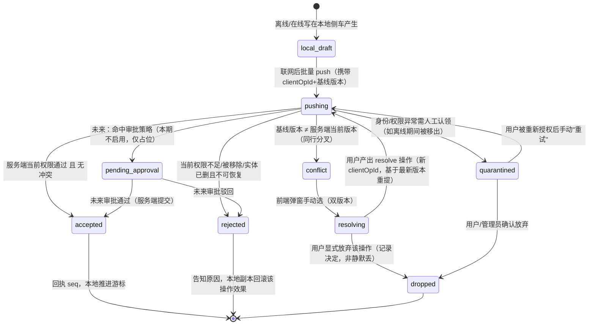
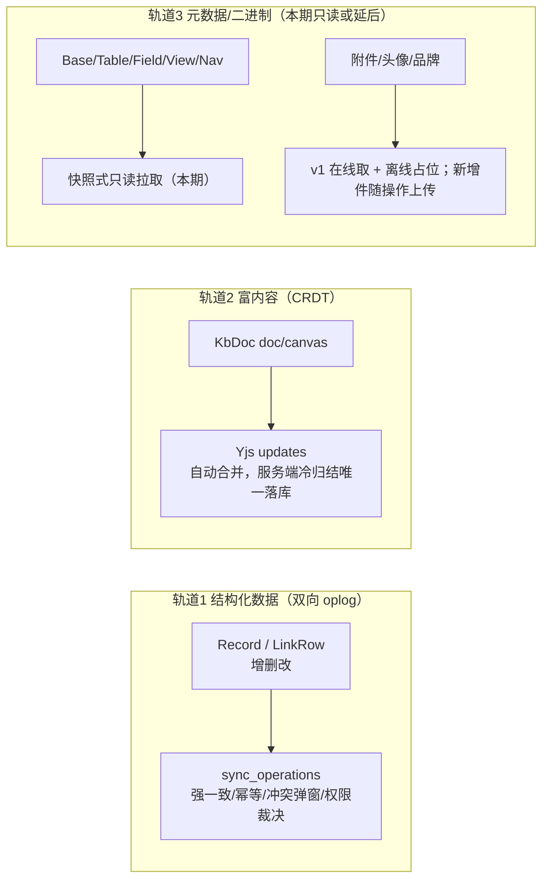
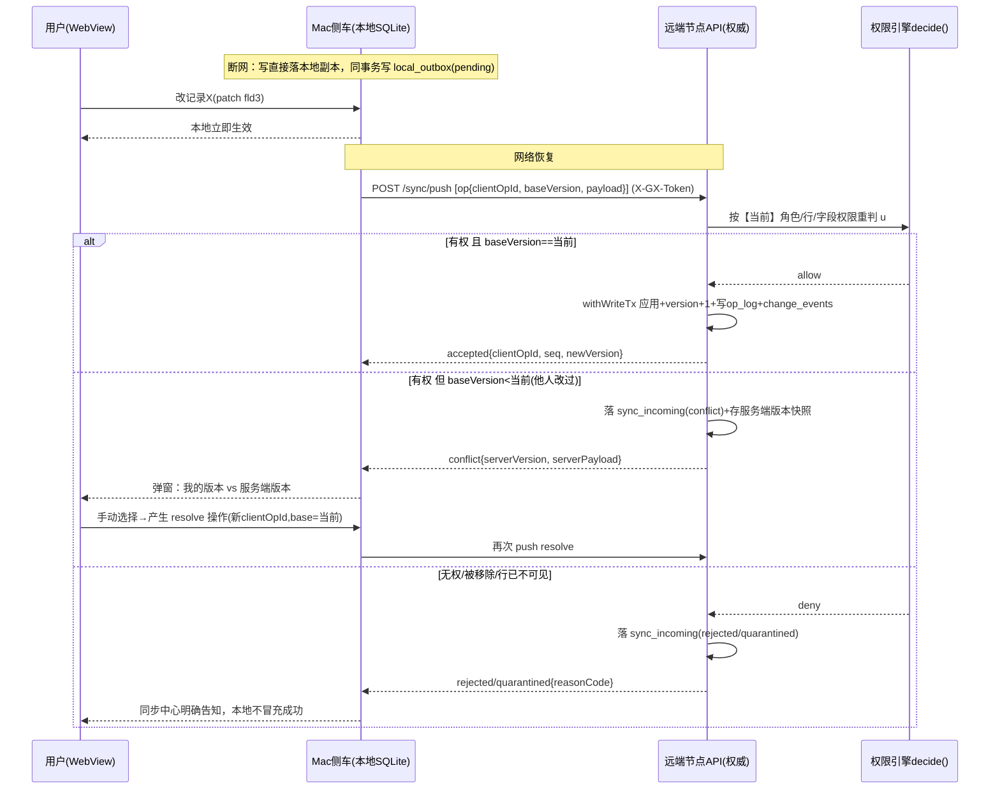
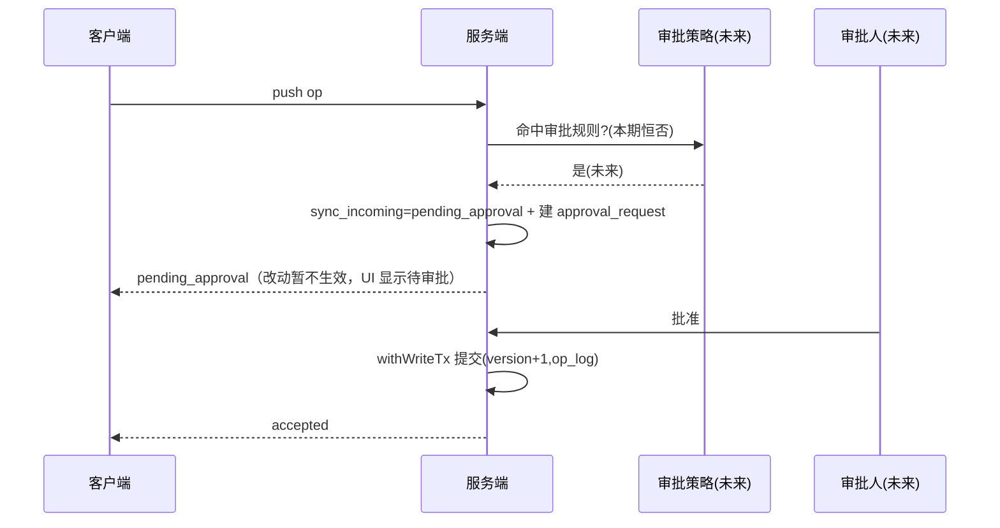

# 构想工作台（GouXiangDB）离线优先 + 操作级双向同步统一架构设计

- 文档日期：2026-10
- 状态：设计定稿（纯只读研究 + 设计，不含代码/迁移改动）。凡涉及 Mac/真机、未在现有代码中证实的运行时行为，均显式标 **[待 PoC]**
- 作者：高见远（架构）
- 关联文档（本设计是叠加在其上的第三块，前两块结论继续有效、不改写）：
  - 同目录 `DESIGN.md`（节点模式：本地/远程数据源，路线 A）
  - 同目录 `DESIGN-MACOS-APP.md`（macOS Tauri v2 App：内嵌 Node 侧车 + 一份本地 SQLite，D0–D6）
- 适用版本基线：根 `package.json` 0.2.4；Prisma5 + SQLite，**已有 41 枚迁移，迁移只增不删**；schema.prisma 33 个 model
- 需求来源：戴总拍板——① 远程模式断网仍可用（缓存/离线），联网后把改动同步上去，**本期就要完整功能**；② 不能只考虑同步，还要正面解决**权限架构冲突**，并为未来**企业数据流程管理（审批/流转）**预留；③ 同一条数据两边都改时**弹窗让用户手动选**，绝不静默丢数据、不自动覆盖

---

## 0. 给戴总的大白话总览

戴总，这份设计解决一件事：**没网的时候也能照常干活，等网一恢复，您在断网期间做的改动会被安全地"上交"给主机，主机核对后再正式生效。**

**它是怎么工作的（一句话）**：把您在断网时做的每一个动作（新增一条记录、改一个格子、删一条、改一篇文档）都记成一张"**待办条**"。没网时这些条子先存在您自己电脑里，您照常用；网一通，电脑把这些条子一张一张交给主机。

**主机不是照单全收，而是"当场重新核对"**：交条子的时候，主机按您**此刻**的权限重新审一遍——

- 您还能改这条 → 接收；
- 您离线期间被降权/被移出了 → 这张条子**不偷偷丢掉也不硬写进去**，而是单独放到一个"**待处理区**"，明确告诉您"这条因为权限变化没有生效"，由您决定怎么办；
- 同一条数据您和别人（或另一台设备）在都离线时改了同一处 → **弹出窗口，两边的版本都摆给您，您手动选保留哪个、怎么合并**，系统绝不替您悄悄覆盖任何一边。

**为什么这样设计能顺带解决"以后的审批流"**：因为"交条子→主机审→接收/拒绝/挂起"本就是一条流水线。以后要做"某些改动需要领导审批"，只是在这条流水线中间加一道"**先挂起、等审批**"的关卡——数据怎么存、怎么传今天就按这条路铺好，将来加审批**不用推倒重来**。

**会不会动到现有数据（您最关心的）**：

- **不删、不改任何一张现有表、一条现有数据**。同步功能全部靠**新增几张表**实现（只增不删，是这个项目 41 枚迁移一贯的纪律）。
- 同步功能**默认关闭、旁路运行**：单机/飞牛/NAS 现有的用法一个字都不变；只有 Mac App 的"离线副本"显式开启时才启用。
- 第一次同步前，本地和主机都先**自动备份**；任何一步不对劲都能整包回滚。
- 文档和白板这类"长内容"走另一套更聪明的机制（CRDT，类似在线文档协作），大多数情况能自动合并、不打扰您；表格里的结构化记录才需要"冲突弹窗"。

**这次（2026-10-15）戴总又把范围往实里推了两步，本期一起做**：

1. **本地副本要上锁（加密）**：您下载到自己 Mac 里的远端数据，落盘就是密文，钥匙存在 macOS 钥匙串里，App 解锁后才能读；一旦您在那台节点上的权限被收回，本地立即擦除、解密句柄立刻丢弃，残留文件读不出来。我们选的是"**给每个节点挂一个加密磁盘匣**"的做法（对现有程序零侵入，连搜索引擎组件都不用改），并对最敏感的内容再加一层内容加密兜底。
2. **断网时连"建表、改字段、挪导航"也能做，联网照样对账**：不只是改数据，表结构、字段、视图、左侧导航树的增删改也能离线进行，上线后按同一道"权限闸 + 冲突弹窗"走。结构冲突比数据冲突影响面大（改个字段类型会牵连整张表的数据），所以规则更保守：**只要检测到这张表的结构在两边分叉了，就弹出来让您手动选**（用我的结构／用主机的结构／逐条挑），选定后挂在这张表上的离线数据改动会按新结构重新核对，绝不悄悄丢。

**分几步做**：先把"记账（待办条）"和"能离线看/改记录"打通，再做冲突弹窗和权限隔离；随后接入**表结构/视图同步**、再做**导航树同步**；文档/白板利用现成协同能力接入；最后收口加密落地、附件与备份/发版。本期"完整功能"＝**表格记录 + 表结构/视图 + 导航树的离线增删改、联网双向同步、当前权限裁决、手动冲突解决，以及本地副本加密落盘**全闭环；审批 UI、oplog 归档清理等仍放后续期。

**这套骨架也是给以后定的规矩（2026-10-15 戴总定为长期框架纪律，详见 §20）**：以后不管再加什么功能（审批流、新业务模块、手机/电脑新端），都在这同一套骨架上"登记"着长，不在核心里打补丁、不另起炉灶；核心只有一套、界面只有一套，各端只换一层"外壳"；每种新数据先讲清它走哪条同步道，不允许半道混搭。这样功能越加越多，底下不乱、不返工。

---

## 1. 只读勘察基线（带文件:行号证据）

### 1.1 数据库与迁移硬约束

- 41 枚迁移（`apps/api/prisma/migrations/`，最新 `20261014010000_comment_threads`）；`schema.prisma` 41 个 model；迁移风格=**手写只增 SQL、列名 camelCase、不加物理外键**（范例 `20261010010000_record_changes/migration.sql`：明确注释"列名一律 camelCase，写成 snake_case 会 deploy 通过但运行时 P2022""SQLite REFERENCES 会让旧库 deploy 失败，悬挂行应用层清理"）。**本设计所有新表照此契约。**
- 结构化记录：`Record{ id, tableId, fields(JSON), createdBy, updatedBy, createdAt, updatedAt, deletedAt }`（`schema.prisma:137-154`）；关联 `LinkRow{ linkFieldId, parentRowId, childRowId, ord, deletedAt }`（`:158-175`）；软删除全仓 13 处 `deletedAt`。
- 文档/画布：`KbDoc{ kind:"doc"|"canvas", content(Markdown / PlaitElement JSON), contentVersion Int 乐观锁, deletedAt, deletedBy, ... }`（`:393-437`），已有 **PUT content 携带 baseVersion 的乐观锁，冲突抛 409**（`domain/kbDocWrite.ts:22-25,52-59`，`VersionConflictError`→HTTP 409 `VERSION_CONFLICT`）。版本快照表 `KbDocVersion`（`:439-456`）。

### 1.2 已有的两类"变更事件/历史"地基（关键：它们都不是同步日志）

- `ChangeEvent`→`change_events`（`:700-719`）：`entityType(record|doc|canvas)/entityId/workspaceId/version BigInt/op(upsert|delete)/status(pending|processing|done|failed|dead)/attempts/...`。它是**全文检索（M5）的索引 outbox**，处理完即 done，不含 actor、不含字段级 payload、不含多端游标——**不能直接当同步 oplog**，但其"业务写事务内登记 + 合并去重"形态可复用。
- `RecordChange`→`record_changes`（`:841-854`）：`tableId/recordId/op/actorId/actorName 快照/changes(JSON 字段级前后值)/changedAt`，是**给人看的修改历史**，追加式、旁路 try/catch 不阻断业务写（`domain/recordChanges/store.ts` 头注释四条铁律）。
- 两个写侧原语的可借鉴形态：
  - `enqueueChangeEventTx(tx, ...)`：**只用传入 tx、挂在调用方主写事务内、与主写共生死、同实体 pending 事件合并去重**（`domain/search/outbox.ts:1-80`）。
  - `appendRecordChangeTx(tx, ...)`：挂主写事务、actorName 落快照；但它是"真旁路"（异常吞掉只告警，不拖垮业务写）。
  - **同步 oplog 与这两者不同**：同步日志是"对外承诺要送达"的事实，**不能旁路吞错**，必须与业务写同事务共生死（否则会丢操作）——采用 outbox 形态而非 recordChanges 形态。

### 1.3 写串行队列（服务端回放必须走同一路径）

- `db/writeQueue.ts`：进程内单 promise 链、并发度恒 1（`:41-93`），导出 `runWrite/withWriteTx/withWriteBatch`（`db.ts:117-142`）。铁律：task 回调内禁止再入队（自死锁），事务回调只用传入 tx（`writeQueue.ts:7`）。
- 含义：**服务端处理 push 回放时，每条/每批 operation 必须经 `withWriteTx` 落库**，与在线写共用同一串行写入口，避免 SQLite 单写者锁竞争与写序错乱。

### 1.4 权限域（裁决器可复用）

- 统一裁决入口 `decide(deps, subject, nodeId, action, ctx)` 与批量 `decideMany`（`domain/authz/engine.ts:82-118`）；动作词表来自 `@gx/shared-types` 的 `RESOURCE_ACTIONS`（`packages/shared-types/src/authz.ts:36`，资源动作含 `r/c/u/d/comment/manage_share`，另有 `enter/base/kb`）。
- 权限围绕导航节点链 + 策略（`authz/{repository,nodes,inheritance,evaluateChainDecision,fieldCapability}`）、库可见性 `libraryVisibility/libraryPolicy`、行过滤 `rowFilter.ts`、字段掩码 `fieldScope.ts`/`runMaskWriteGate`（`domain/recordWrite.ts:31`）。
- 主体：`resolveActiveAuth` 每请求验签 + 查库校验用户状态/tokenVersion（主 DESIGN §1.3），默认零缓存 → **降权/移除在下一次裁决即时生效**，这正是离线 push 必须"按当前权限重判"的落点。
- 审计：`AuditEventName` 联合类型（`audit/audit.ts:9`），现有约 50 个事件名（login_success/member_deleted/share_external_write/...）；写入 `audit(c, input)`（`audit/emit.ts:16`）。**同步裁决要新增若干审计事件并入同一联合类型**（只增）。

### 1.5 协同（文档/白板的第二同步路径）

- `collab/`：Yjs + y-protocols，房间 `store.ts/room.ts`，冷归结 `docFlush.ts` 唯一路径（Y.Doc→Block[]→Markdown→`withWriteTx("collab.flush")` 内 `saveDocContentTx`，自动快照/outbox/contentVersion 全照旧，`docFlush.ts:8-30`）；WS `/ws/collab/` + 60s 短票。
- 含义：doc/canvas 内容天然是 CRDT，**离线编辑→联网自动合并**走 Yjs update 通道（不进结构化 oplog 的冲突弹窗路径）；服务端冷归结仍是唯一落库点，权限按房间当前校验。

### 1.6 前端节点地基与 Mac 侧车

- S1 已落地：`apps/web/src/node/{resolve,datasource,session}.ts`，`dataSourceResolver` 当前恒 local、与现网逐字节等价、零接线；双槽键 `gx-auth/gx-node-session/gx-node-profiles` 已预留。
- Mac App（`DESIGN-MACOS-APP.md`）：随包 Node 侧车跑同一份 `apps/api` + 一份本地 SQLite（Application Support），首启 migrate deploy→nav-reconcile→init-admin→readyz；PoC-1A 已实测 `pnpm deploy --prod` 能在 Mac 组出全 arm64 可重定位生产树（better-sqlite3/Prisma darwin 引擎/vec0.dylib）。
- **离线副本就承载在这份侧车本地 SQLite 里**（它本来就是一个能跑的完整内核），不需要在浏览器里另造存储。

---

## 2. 目标与非目标

### 2.1 目标

1. 远程（连网络节点）模式下**断网可继续读与改**，联网后把离线改动可靠推送、由服务端按当前权限裁决后落库。
2. 把每次写抽象成有生命周期的**操作（operation）**：本地暂存 → 推送 → 服务端裁决（接受 / 拒绝 / 冲突 / 未来需审批）→ 回执。
3. **服务端是唯一裁决者**：push 时按最新角色/权限重判；被降权/移除者的离线操作被**隔离（quarantine）+ 明确告知**，绝不静默落库、也不静默丢弃。
4. 同一记录两边都改：结构化记录按行/字段版本检测冲突，**双版本保留 + 前端弹窗手动解决**（解决动作本身也是一条 operation）。
5. 文档/画布走 Yjs CRDT 通道自动合并，与结构化记录分轨。
6. 数据模型与流水线为**审批/流转**预留"挂起→批准提交/驳回"分支，本期不做审批 UI，但不堵死。
7. 幂等、因果有序、不信客户端时钟；游标式增量 pull/push；初次快照 + 增量。
8. **零破坏红线**：只新增表/列，迁移只增不删、默认兼容旧数据、可回滚；同步默认旁路、按能力开关启用；单机/飞牛/NAS 行为零变化；首次同步前本地/远端先备份。
9. 本地副本复用 Mac 侧车 SQLite，支持多远端 base 副本 + 纯本地 base；cuid 主键多端不撞。
10. **【2026-10-15 戴总拍板扩范围】本地副本静态加密本期落地**：远端副本落盘即密文，主密钥入 macOS Keychain，启动解锁、失权即丢句柄并配合 D2 立即擦除；给出在 better-sqlite3 + Prisma query engine + sqlite-vec 现实约束下可落地的路线（第 18 章）与 PoC-4。
11. **【2026-10-15 戴总拍板扩范围】表结构/视图/导航离线编辑同步本期落地**：Base/Table/Field/View/Nav(MenuItem) 的增删改也操作化进 oplog，走同一 push 裁决状态机；结构分叉按"检测即冲突、手动选"处理，选定后该表上的离线数据操作随之重放或失效（第 19 章）。

### 2.2 非目标（本期不做）

| 不做项 | 说明/预留 |
| --- | --- |
| 审批/流转 UI 与真正的审批引擎 | 只预留状态机分支与表字段（`pending_approval` 等）；审批实体表是否本期建见 §16 |
| 表结构（Field/View/Base 元数据）离线编辑同步 | **2026-10-15 起改为本期目标**，见第 19 章；不再是非目标 |
| 导航树/菜单离线编辑同步 | **2026-10-15 起改为本期目标**，见第 19 章；不再是非目标 |
| 附件二进制的离线同步 v1 | v1：离线可见已缓存缩略图/占位，离线新增附件暂存本地、联网随记录 operation 上传；全量双向附件同步延后（§10） |
| 浏览器纯网页（无侧车）离线 | IndexedDB 全量离线不做；离线能力以 Mac 侧车本地 SQLite 为载体（节点模式纯浏览器仍只在线） |
| 多账号同时在线合并冲突 | 支持多节点档案，但同步会话单活；多账号写同一副本的冲突走同一冲突机制 |
| 自动解决/字段级自动 merge 结构化数据 | 本期冲突一律弹窗人工（戴总定）；不做"智能合并" |
| 服务端到客户端的强制实时推送 | pull 为主（联网/重连/轮询触发）；WS 可作未来通知，不阻塞本期 |
| 删除操作的服务端 GC | 墓碑保留（默认保留期内不物理清），GC 策略后续期 |

---

## 3. 核心思想：操作（operation）流水线上的统一裁决

### 3.1 为什么选操作日志（event-sourcing 风格）而非状态行 diff

| 维度 | 操作日志 oplog（推荐） | 状态行 last-write diff |
| --- | --- | --- |
| 幂等/重试 | 天然：每条带全局唯一 `clientOpId`，重放同一条只生效一次 | 需另造去重键，易重复写 |
| 因果/顺序 | 有 per-entity 版本与序号，可重放、可追补 | 只有最终态，丢失"先改A再改B"过程 |
| 冲突判定 | 可基于"基线版本 vs 服务端当前版本"精确判定字段级分叉 | 只能整行比，粒度粗 |
| 权限按操作判 | 每条操作携带 op 类型/实体，服务端逐条 `decide()` | 一个合并状态难对应到具体权限动作 |
| 审批挂起 | 操作可独立挂起/批准/驳回（天然工单） | 状态无法表达"这批改动待审批" |
| 审计/回放/追溯 | oplog 即事实流，可派生审计、可重放 | 弱 |
| 代价 | 多几张表、需要回放器与保留策略 | 简单但无法满足权限/审批/手动冲突 |

裁决：**操作日志**。一次性把"权限复核、手动冲突、未来审批"收敛为同一状态机上的不同出口，避免二次返工——这是本设计的核心论点。

### 3.2 操作生命周期状态机（含未来审批分支，虚线本期不启用）



要点：

- **只有 `accepted` 才改服务端权威数据**；`conflict/rejected/quarantined/pending_approval` 都不写主数据。
- 任何"丢弃"都是**用户显式动作并留痕**，系统不静默丢数据（戴总红线）。
- `pending_approval` 本期不出现在任何真实分支（无审批策略即永远走不到），但状态、字段、回执枚举今天就定下来。

### 3.3 三条同步轨道（不要混用）



---

## 4. 新增数据模型（可直接落 migration 的程度）

> 全部**新表**，只增不删，列名 camelCase，`@@map` snake_case，**不加物理外键**（沿用 `record_changes` 迁移注释里的 SQLite 旧库兼容纪律）。BigInt 用 `BigInt`（对齐 ChangeEvent.version 的教训）。

### 4.1 服务端（权威节点）新增表

#### 4.1.1 `sync_op_log`：服务端正向操作日志（已接受/历史）

已被服务端接受并应用的操作，按全局顺序排列，是增量 pull 的事实源。

```prisma
model SyncOpLog {
  id          String   @id @default(cuid())
  seq         BigInt   // 服务端单调递增全局序号（每个节点独立序列），pull 游标
  workspaceId String   @default("ws_default")
  baseId      String?  // 订阅分片：所属 base（doc 为 kbId 映射）；元数据类可 null
  entityType  String   // record | linkrow | doc_tombstone(预留) ...
  entityId    String
  op          String   // create | update | patch | delete | restore | resolve
  actorId     String?  // 服务端按当前 token 认定的真实 actor（不信任客户端自报）
  clientId    String   // 提交设备/客户端实例 id
  clientOpId  String   @unique // 全局幂等键（见 §8.1），重放去重
  baseVersion BigInt   @default(0) // 客户端提交时所基于的实体版本
  newVersion  BigInt   // 应用后实体新版本
  payload     String   // JSON：操作的字段级内容（create=全字段, patch=字段子集, delete=软删）
  result      String   @default("accepted") // accepted | resolved（冲突后人工接受）
  conflictOf  String?  // 若为 resolve 操作，记录它解决的原始 clientOpId
  createdAt   DateTime @default(now())

  @@index([seq])
  @@index([baseId, seq])
  @@index([entityType, entityId, seq])
  @@map("sync_op_log")
}
```

#### 4.1.2 `sync_entity_version`：每实体权威版本与墓碑

增量拉取与冲突判定的版本表（结构化记录）。与 `records` 并存、只增不改存量。

```prisma
model SyncEntityVersion {
  id          String   @id            // = entityId（recordId），1:1
  entityType  String   @default("record")
  baseId      String?
  version     BigInt   @default(0)    // 服务端权威版本（逻辑时钟，不用 wall clock 定生死）
  lastSeq     BigInt   @default(0)    // 最近一次改动对应 op_log.seq
  isDeleted   Boolean  @default(false) // 墓碑
  deletedBy   String?
  updatedAt   DateTime @updatedAt

  @@index([baseId, version])
  @@map("sync_entity_versions")
}
```

- `version` 是**服务端在接受操作时分配的单调版本**（逻辑时钟），客户端不能自授。冲突判定＝客户端 `baseVersion !== 服务端当前 version`（见 §7）。

#### 4.1.3 `sync_incoming`：push 进来但尚未终态的操作（冲突/隔离/挂起暂存）

```prisma
model SyncIncoming {
  id           String   @id @default(cuid())
  clientId     String
  clientOpId   String   @unique
  workspaceId  String   @default("ws_default")
  baseId       String?
  entityType   String
  entityId     String
  op           String
  payload      String   // 原始操作 JSON（保留，供弹窗双版本展示与重试）
  baseVersion  BigInt
  actorId      String?  // push 时 token 认定
  status       String   @default("received")
             // received | accepted | conflict | rejected | quarantined | pending_approval | dropped
  reasonCode   String?  // 例如 PERMISSION_REVOKED / ROW_NO_LONGER_VISIBLE / ENTITY_DELETED / VERSION_CONFLICT
  reasonDetail String?  // 脱敏的人类可读原因（入回执与通知，不泄密）
  serverVersion BigInt  @default(0) // 裁决时服务端当前版本（conflict 用）
  conflictServerPayload String? // 冲突时服务端当前版本快照（供前端展示另一版本）
  reviewBaseId String?  // 未来审批：审批策略/流程实例 id（本期恒 null）
  decidedBy    String?  // 未来审批人 / 或处理隔离项的管理员
  decidedAt    DateTime?
  attempts     Int      @default(0)
  createdAt    DateTime @default(now())
  updatedAt    DateTime @updatedAt

  @@index([status, baseId])
  @@index([actorId, status])
  @@index([baseId, entityType, entityId])
  @@map("sync_incoming")
}
```

#### 4.1.4 `sync_subscription`：客户端订阅与拉取游标（服务端侧记账）

```prisma
model SyncSubscription {
  id           String   @id @default(cuid())
  clientId     String
  scopeType    String   // base | kb（按库订阅）
  scopeId      String
  actorId      String?  // 订阅时的用户；拉取按"当前"权限二次过滤
  cursorSeq    BigInt   @default(0) // 已确认收到的最大 seq
  snapshotDone Boolean  @default(false)
  subscribedAt DateTime @default(now())
  lastPullAt   DateTime?

  @@unique([clientId, scopeType, scopeId])
  @@index([scopeType, scopeId, cursorSeq])
  @@map("sync_subscriptions")
}
```

#### 4.1.5（未来审批预留，本期建表不启用）`sync_approval_policy / sync_approval_request`

```prisma
model SyncApprovalPolicy {
  id         String   @id @default(cuid())
  scopeType  String   // base | table
  scopeId    String
  matchJson  String   // 规则：哪些实体/操作/字段/角色需审批（本期无任何行=功能关闭）
  approverRoleId String?
  enabled    Boolean  @default(false) // 恒 false，直到审批期
  createdAt  DateTime @default(now())
  @@map("sync_approval_policies")
}

model SyncApprovalRequest {
  id           String   @id @default(cuid())
  incomingId   String   @unique // -> sync_incoming.id
  status       String   @default("pending") // pending | approved | rejected
  requestedBy  String?
  decidedBy    String?
  decidedAt    DateTime?
  comment      String?
  createdAt    DateTime @default(now())
  @@index([status])
  @@map("sync_approval_requests")
}
```

> 这两张表可在本期一起建（只增、空表、零行为），也可推迟到审批期再建。建议**本期只在 `sync_incoming` 预留 `reviewBaseId/status:pending_approval` 枚举，审批实体表延到审批期**，减少本期面（见 §15 取舍）。

### 4.2 客户端（Mac 侧车本地 SQLite）新增表

> 侧车本地库本就是完整内核（含上面 4.1 各表的同构结构 + 全部业务表）。客户端额外需要：

#### 4.2.1 `local_outbox`：本地待推送操作（含纯本地 base 与远端副本）

```prisma
model LocalOutbox {
  id           String   @id @default(cuid())
  clientOpId   String   @unique
  nodeId       String   // 目标节点：本地 "local" 或远端节点 id（与 dataSourceResolver nodeId 对齐）
  baseId       String?  // 该操作归属的 base（本地副本 id）
  entityType   String
  entityId     String
  op           String
  payload      String
  baseVersion  BigInt   @default(0) // 发起时本地认定的基线版本
  status       String   @default("pending")
             // pending | pushing | acked | conflict | rejected | quarantined | pending_approval
  serverClientOpId String? // 服务端去重后回认的 canonical id（一般同 clientOpId）
  reasonCode   String?
  conflictPayload String? // 服务端返回的另一版本
  attempts     Int      @default(0)
  lastError    String?
  createdAt    DateTime @default(now())
  updatedAt    DateTime @updatedAt

  @@index([nodeId, status])
  @@index([baseId, entityType, entityId])
  @@map("local_outbox")
}
```

#### 4.2.2 `replica_state`：每个远端 base 的副本与游标

```prisma
model ReplicaState {
  id            String   @id @default(cuid())
  nodeId        String
  remoteBaseId  String   // 远端 baseId（本地副本以独立本地 baseId 承载，见映射）
  localBaseId   String   // 本地承载该副本的 base 行 id
  pullCursorSeq BigInt   @default(0)
  snapshotDone  Boolean  @default(false)
  subscribed    Boolean  @default(false)
  lastPulledAt  DateTime?
  lastPushedAt  DateTime?
  // 离线权限快照：拉取时服务端返回的可见集版本/权限版本，重连后比对（§6.3、§9.2）
  authzVersion  String?
  encrypted     Boolean  @default(false) // 副本是否启用静态加密（§9.3）

  @@unique([nodeId, remoteBaseId])
  @@map("replica_state")
}
```

#### 4.2.3 `id_map`：远端主键 ↔ 本地主键映射（离线新建）

```prisma
model SyncIdMap {
  id           String  @id @default(cuid())
  nodeId       String
  entityType   String
  localEntityId String
  remoteEntityId String? // 服务端接受后回填；未 ack 前为空
  clientOpId   String  @unique // 由哪条创建操作产生
  @@unique([nodeId, entityType, localEntityId])
  @@index([remoteEntityId])
  @@map("sync_id_map")
}
```

> **主键不撞说明**：所有 id 用 `cuid()`（全栈既有约定）。离线在本地新建记录用本地 cuid（全局碰撞概率可忽略），服务端接受时**保留客户端 id 作为权威 id**（推荐，见 §8.4），从而多数情况下无需 id 重映射；`id_map` 仅用于"服务端必须自授 id"或关联回填的兜底。

---

## 5. 变更捕获：如何不逐个端点手改就产生 operation

### 5.1 推荐：在本地侧车的**写服务层统一挂接**（不是 HTTP 路由层）

现状写路径已经高度收口：记录写都走 `domain/recordWrite.ts` 的 `createRecordTx/updateRecordTx/softDeleteRecordTx`（`:391/:432/:347`），且外层包 `withWriteTx(...)`；doc 写走 `kbDocWrite.saveDocContentTx`；协同冷归结走 `withWriteTx("collab.flush")`。

**挂接策略（本地侧车，行为仅在"副本/离线"启用时激活）**：

1. 在侧车，给 `withWriteTx` 增加一个可选的"操作登记回调"切面（**默认 no-op**，单机/服务端节点行为零变化）：当数据源指向某个**被同步托管的副本 base** 时，在**同一写事务内**向 `local_outbox` 追加一条 operation（学 `enqueueChangeEventTx` 的"同事务、共生死"形态，而不是 recordChanges 的吞错旁路——操作绝不允许丢）。
2. 切面把"这次写改了哪个 entity、op、字段子集 payload、actor、发起时基线版本"结构化记录。payload 从既有 `FieldChange`/写参数直接可得（`recordChanges` 已能产出字段级 `changes`，复用同一份 diff 计算）。
3. **关键取舍**：与其在数十个路由里埋点，不如在少数领域写原语处登记。数据面＝record/linkrow 的 `create/update/softDelete Tx`（`domain/recordWrite.ts`）、doc 归结（`collab/docFlush.ts`）；**结构面（2026-10-15 新增）**＝`tableServiceTx/fieldServiceTx/viewServiceTx` 与 `domain/nav/*` 的写原语。在这些函数里统一"主写 + 版本推进（记录表版本 / 表结构 schemaVersion / 工作区 treeVersion）+ outbox 登记"同事务完成；路由层、校验层不动。
4. 对于不经这些原语的写（csv 批量导入等），让它们也复用同一 service（现状大多已复用）；个别批量路径在切片内显式循环成多条 operation（或一条 `batch` 复合操作，payload 内含子操作，回放器逐条应用）。建表类复合操作（表+初始字段、正反向关联字段）以一条原子结构 op 承载（§19.1）。

### 5.2 payload 形状（结构化记录）

```jsonc
// create
{ "op": "create", "entityType": "record", "tableId": "<t>", "fields": { "fld1": "…", "fld2": 12 },
  "links": [{ "linkFieldId": "…", "childClientRef": "<本地cuid 或 已映射id>", "ord": 0 }] }
// update（字段级子集，只含被改字段，支持冲突时字段对照）
{ "op": "patch", "entityType": "record", "tableId": "<t>", "changed": { "fld3": { "from": "旧", "to": "新" } } }
// delete（软删）/ restore
{ "op": "delete", "entityType": "record" }
```

- `patch` 只携带被改字段，使冲突弹窗能做到"**同记录不同字段**也可提示更细"（本期冲突判定仍以**记录级 baseVersion**为准，但 UI 可展示字段差异辅助用户选择；是否做字段级自动合并非本期，一律人工）。

### 5.3 操作的客户端身份与时钟

- 每次写生成 `clientOpId`（推荐 `cuid()`，全局唯一）；`clientId`＝安装实例 id（首次启动生成一次，存 Application Support，不随登录变）。
- 时间仅用于**展示/排序参考**，绝不用来决定覆盖与否（服务端不信任客户端 wall clock）；顺序由服务端 seq 与 per-entity 版本保证（§8）。

---

## 6. 增量拉取（pull）：初次快照 + 游标增量

### 6.1 端点草案（REST，沿用 /api 与 X-GX-Token；详见 §13）

- `POST /api/v1/sync/subscribe` `{ scopeType:"base", scopeId, }` → 服务端建/取 `sync_subscription`，回 `{ cursorSeq, snapshot:{...}|null }`。
- `GET  /api/v1/sync/pull?baseId=&after=<cursorSeq>&limit=500` → 返回 `{ ops:[...seq 顺序的 accepted oplog...], nextCursor, hasMore, authzVersion }`。
- 初次（cursor=0 且 snapshotDone=false）：服务端先给一份**按当前权限裁剪后的快照**（只含该用户可见的记录/字段，行过滤与字段掩码复用 `rowFilter`/`fieldScope`），之后走增量。

### 6.2 拉取的权限：不是"订过就一直能拿"

- **每次 pull 都按调用者当前权限实时过滤 oplog**：服务端遍历 seq 段时，对每条 op 的实体做当前可见性/字段掩码判断；已不可见的实体其 op 不下发，字段被收回则下发脱敏 payload。
- 这样一个被降权的客户端不会因为"旧订阅"继续收到无权数据。

### 6.3 可见集变化（被收回权限后本地副本怎么办）

- 每次 pull 回执带 `authzVersion`（权限版本，可用角色/策略/成员关系的聚合版本号或 max(update 时间)）。客户端发现 `authzVersion` 变化后，拉一份"**可见集差异**"（或直接对订阅 base 重新做一次受限快照对账）。
- 对**已下载到本地、但权限已被收回**的数据，策略见 §9.2（默认：远程副本对该部分做**本地擦除/隐藏**，纯本地 base 不受影响）。

### 6.4 删除同步（墓碑）

- 删除以 `op:delete` + `sync_entity_versions.isDeleted=true` 下发；客户端把本地对应记录软删。物理 GC 不做，墓碑在保留期内常驻，保证长期离线客户端重连仍能收到删除事实。

---

## 7. 冲突：精确规则、双版本保留、手动弹窗

### 7.1 结构化记录冲突判定（记录级乐观锁，复用现有思想）

- 客户端一条 patch/create 带 `baseVersion`（它最后一次拉到/本地应用的该 entity 版本）。
- 服务端 push 裁决时：
  1. 取服务端当前 `sync_entity_versions.version`（不存在→特殊处理，下条）；
  2. `baseVersion === current.version` 且当前权限通过 → **accept**，`version+1`；
  3. `baseVersion < current.version`（自客户端拉取后该记录已被别人改过）→ **conflict**，不应用；
  4. 实体已被删除：对 `patch`→冲突/拒绝（`ENTITY_DELETED`）；对 `delete`→幂等成功；对 `create` 同 id→冲突。
- create 的幂等：同一 `clientOpId` 重提命中 `sync_op_log.clientOpId @unique` → 直接回原 ack（不重复建）。

### 7.2 冲突产物：双版本都保留，绝不覆盖

- 服务端把该入站操作落 `sync_incoming(status=conflict)`，保存 `serverVersion` 与 `conflictServerPayload`（服务端当前版本数据，按字段掩码脱敏），回执给客户端。
- 客户端把本地 outbox 项置 `conflict` 并存 `conflictPayload`，**本地改动原样保留在 outbox.payload，不回滚用户输入**（用户的工作不能丢）。
- 前端弹出冲突解决面板：左=我的版本（payload 的 to 值）、右=服务端最新版本（conflictServerPayload），字段级差异高亮。用户操作：
  - 采用我的（基于服务端最新版本重新生成一条 **resolve 操作**，`op` 视情况为 patch/delete，新 `clientOpId`，`baseVersion=current.version`，`conflictOf=原 clientOpId`，重走 push）；
  - 采用服务端（产出一条"放弃本地"的 resolve/dropped 决定，留痕）；
  - 逐字段挑选（拼成一条新 patch）。
- resolve 接受后 `sync_op_log.result="resolved"`、`conflictOf` 记录溯源。**整个过程是用户显式选择，系统不自动覆盖**（戴总定）。

### 7.3 文档/画布：CRDT 自动合并，边界清晰

- doc/canvas 不走上面对框。离线时 Yjs 在本地累积 update，联网把 update 发给房间，Yjs 自动交换/合并，服务端冷归结（`docFlush.ts` 唯一落库路径）按房间当前权限校验后落 content 并 `contentVersion+1`。
- 边界：
  - 结构化字段里如果嵌了富文本/画板块（如某字段引用 doc），该引用按 record op 同步，doc 本体走 Yjs；
  - Yjs 合并在"两人编辑同一文本块的同一位置"时仍可能需要用户认知（Yjs 不丢字符，但语义可能重复）——这属于 CRDT 已知特性，本期接受其自动结果，不做人工 diff 弹窗（与结构化记录区分）；
  - 离线期间对文档的**权限被收回**：冷归结/重连时按当前权限拒绝其 update 并入（隔离，见 §9），同结构化数据一道告知。

---

## 8. 推送（push）、幂等、顺序与一致性

### 8.1 幂等

- 幂等键 `clientOpId`，服务端 `sync_op_log.clientOpId @unique` 与 `sync_incoming.clientOpId @unique` 双保险；任何重试（网络抖动、超时、重启）先查键，已终态→回同一结果，绝不重复应用。

### 8.2 推送批次与因果顺序

- push 以**一个 base 一个批次**、按 `local_outbox.createdAt`/本地登记顺序发送；服务端在**单条串行链路**内处理（`withWriteBatch`/`withWriteTx`，复用写队列），保证同批次内因果（先建父记录再建子关联）。
- 批次内允许携带"子引用客户端临时 id"（§5.2 links.childClientRef）：服务端先在批内建立临时 id→权威 id 映射再应用关联；批失败整体可重试（幂等）。
- 服务端不为不同 base/不同实体间保证全局事务（它们本就独立）；**同一记录**的多条离线操作按到达顺序逐条 apply 版本，天然形成新版本链。

### 8.3 不信客户端时钟

- 顺序由服务端分配的 `seq` 与 per-entity `version` 决定；客户端时间仅展示。pull 增量用 `seq`（连续整数，keyset），不用时间戳（避免设备时钟漂移导致漏/重）。

### 8.4 主键策略

- 默认**保留客户端 cuid 作为权威 id**（cuid 全局唯一性足够，且免去关联重映射），服务端 create 时若 id 不存在即采用、存在且非同 clientOpId 则冲突。
- `id_map` 仅兜底服务端必须改 id 的场景；本期以保留为主，降低复杂度。

### 8.5 断网中途 / 重试 / 回放事务边界

- 每条 op 独立可裁决；一批中前几条 accepted、后一条 conflict：已 accepted 的提交并回 ack，冲突条单独回执，客户端推进已确认游标、对冲突条转 §7 流程（不用整批回滚已确认的成功项）。
- 服务端回放统一 `withWriteTx("sync.replay")`：主数据写 + `sync_entity_versions` 推进 + `sync_op_log` 追加 + `change_events`（检索 outbox）登记在**同一事务**，保证"业务数据/版本/检索事件/同步日志"原子一致。
- 回放器在应用层复用 `recordWrite` 的同一套校验（必填、唯一、字段合法性、字段掩码写闸 `runMaskWriteGate`），离线攒的非法写在服务端被同一规则拦下（记 rejected，原因明确）。

### 8.6 服务端操作日志的产生也覆盖"在线写"

- 为让 pull 能拿到**所有**变化（含别的客户端在线直接写、非 Mac 客户端写），`sync_op_log/entity_version` 的追加不仅在 push 回放时发生，也在**在线写服务层**统一登记（与 §5.1 同一切面的服务端版本）。
- 关键：**在线写也推进 per-entity version**，否则离线 push 的 baseVersion 无法与在线变更比较。该切面在服务端默认**仅当同步能力开关开启时**启用（写 op_log）；不开时零行为、零额外写（见 §11）。

---

## 9. 权限架构冲突（戴总点名，重点）

### 9.1 服务端是唯一裁决者：push 时按"当前"权限重判

- 离线期间客户端可能基于"旧角色/旧成员身份"操作。push 到达时，服务端**只认当前 token + 当前策略**，对每条 op 调 `decide(deps, subject, nodeId, action)`：
  - record create/update/delete/restore 映射到 `c/u/d` 等资源动作（与在线端点同一映射）；
  - 行级：即便有表的 u，若行过滤（`rowFilter`）判定该行已不在其可见集，按 `ROW_NO_LONGER_VISIBLE` 拒绝；
  - 字段级：被收回的字段出现在 patch.changed 里 → 该 op 拒绝（或在字段策略允许"部分提交"时剥离无权字段；**本期选择整 op 拒绝并告知，避免静默改语义**，待拍板 U4）。
- 不信任 payload 里任何 actor/权限字段；`actorId` 一律以 token 解析结果写入。

### 9.2 离线期间被降权/移除：拒绝 + 隔离 + 明确告知，绝不静默

- 三种处理位：
  - **rejected**：明确无权（如表级 u 已收回）。操作不生效，回执原因码，前端在"同步中心"列出"以下改动因权限变化未生效"，本地副本对相应数据回滚该操作效果（保留可查看的"我的未生效改动"直到用户确认）。
  - **quarantined**：身份/成员关系异常（如离线期间被移出 base/组织、token 对应用户被禁用）。操作进隔离区，**既不落主数据也不立刻销毁**，用户重新被授权后可一键"重试"，或用户/管理员确认放弃（dropped，留痕）。
  - **entity 已删/不可恢复**：`ENTITY_DELETED`，告知用户其改动依附的记录已被删除。
- 告知：同步中心 + 原生/页面通知，文案明确（"你在离线期间对 X 的 3 处修改，因你的编辑权限已被收回而未同步"）。不弹吓人的错误，不悄悄成功。

### 9.3 只读权限被收回后，已下载副本怎么处理

- 远程副本是"别人节点的数据缓存"。默认策略（可配）：
  1. **默认：按最新可见集对账后隐藏/擦除失权部分**——重连 pull 发现 authzVersion 变化 → 对该 base 做受限重快照，把不再可见的 record/字段从本地副本删除（软删或按策略物理清），失权附件缓存删除；
  2. **更严：启用副本静态加密**（§9.4），失权即丢弃本地解密密钥句柄（密钥由会话/Keychain 管理），使残留数据不可读；
  3. 用户可感知的折中（待拍板 U2）：是否保留"最近 N 天只读缓存"用于审计回看——默认不保留敏感数据。
- 纯本地 base（用户自己建、不属任何远端节点）**永不因远端权限被清**。

### 9.4 本地副本安全

- Mac App 侧车数据目录 `~/Library/Application Support/<bundle>/`（见 MAC 设计 §8.1）。**采用"一作用域一数据目录/一库一加密镜像"**：`vaults/<scope>.sparsebundle` 挂载到 `mounts/<scope>/`，侧车对该作用域以 `GX_DATA_DIR=mounts/<scope>` 启动（内含独立 dev.db/search.db/uploads/.audit）。作用域＝`local` 或 `node-<nodeId>`；这样整节点失权时 detach + 删除一个镜像即彻底擦除，密钥彼此隔离，也避免"同库多 base"下难以整节点销毁。
- 静态加密本期落地，方案＝第 18 章路线 A（macOS 加密磁盘匣 + Keychain，对 Prisma/better-sqlite3/vec 零侵入）；文件目录权限（0700）与失权擦除作为叠加纵深；SQLCipher 驱动（路线 B）仅由 PoC-4 探路，不作本期默认。

### 9.5 JWT 离线过期与重连刷新

- 离线期间不调鉴权（本地侧车用本地会话允许离线操作，操作进 outbox，**不代表已授权**）。
- 重连 push 前：令牌过期→走现有登录/刷新（X-GX-Token 体系）重新认证后再 push；认证失败的整批操作保持 pending/quarantine，不丢。
- 审计：无论接受/拒绝/隔离都写审计（新增事件名，只增）：`sync_push_accepted / sync_push_rejected / sync_push_quarantined / sync_conflict_resolved / sync_visibility_purged`，载荷含 actorId、baseId、clientOpId、op、reasonCode（**不记字段内容明文，避免把敏感数据写进审计**）。

---

## 10. 本地副本与附件/二进制

### 10.1 副本承载与多 base

- Mac 侧车本地 SQLite：① 纯本地 base（不与任何节点同步）；② 每个"节点 × 远端 base"一份副本（`replica_state` 记账）。业务 UI 不区分存储位置，只经 dataSourceResolver 知道"当前看的是本地还是某远端副本"。
- 在线（连着节点）时：默认仍以远端为权威实时读写（节点模式现状）；**离线副本用于断网兜底**——是否"在线也读副本"（读本地、后台同步）作为一个模式（省电/弱网友好），本期先做"离线读副本、在线读远端"，避免在线读到陈旧（待拍板 U6）。

### 10.2 附件/头像/品牌（v1 建议，避免本期过载）

- 读：在线走现有鉴权/静态通道（主 DESIGN §9）；离线对**已查看过**的附件保留本地缓存（缩略图/最近文件），未缓存的显示"需联网查看"占位。
- 写：离线**新增**附件先落侧车本地暂存目录（`data/offline-attachments/<clientOpId>/`），随对应 record create/patch operation 在 push 时用既有 `/api/attachments` 上传拿 id，再把 id 并入 op 重放（先传文件、后提交 op，保证服务端引用有效）。
- 头像/品牌：非业务关键，离线显示缓存或默认；不纳入双向 oplog。
- 全量双向附件同步（整库附件预取、多端删除同步）明确延后。

---

## 11. 能力开关、部署面零变化与数据安全红线

### 11.1 三态门控（沿用项目 env flag 纪律）

- 新增（命名建议）：`GX_SYNC_SERVER=on|off`（服务端节点是否提供 oplog/pull/push 与版本切面，**默认 off**；off 时相关子路由 404、不写任何 sync_* 表，旧行为逐字节不变）；客户端侧 `GX_SYNC_OFFLINE=on`（侧车是否对副本启用本地 outbox 切面，默认在 Mac App 且用户订阅某 base 时 on）。
- meta 能力位 `/api/v1/meta` 增 `sync:boolean`（additive，老客户端忽略）；客户端据其决定能否对某节点订阅/离线同步。

### 11.2 迁移策略（只增不删、可回滚、先备份）

- 一份只增手写迁移，建 §4 服务端若干表（`CREATE TABLE`+`CREATE INDEX`，无 FK、无 ALTER 存量表、不回填）。风格对齐 `record_changes` 迁移。
- 回滚：提供对应 `*.down.sql`（仅 DROP 新增表），且**回滚只在确认无同步数据后手动执行**；主数据不依赖新表（切面 off 时），DROP 同步表不影响现有功能。
- `sync_entity_versions` 的**初始版本回填**：不同步存量历史，只在开关 on 之后"懒初始化"——某实体首次被同步通道读/写时，若无版本行则按当前快照建立 version=0/或当前时间基（一次性、幂等），避免全表回填锁库。

### 11.3 首次同步前备份（最高红线）

- 服务端：订阅/首次全量 pull 前不修改数据；真正会写的是 push 回放。**第一次启用某 base 的同步前**，侧车引导一次服务端备份提示（复用现有 online-backup 能力）+ 本地冷备；侧车本地库首启已做冷备（MAC 设计 §4.4）。
- 一切回放走现有校验与写队列；任何迁移/回放异常不得损坏存量（只增 + 同事务 + 只在开关后生效）。

---

## 12. 端到端时序

### 12.1 离线写 → 重连 push → 裁决 → 三种结果



### 12.2 未来审批分支（本期数据模型预留，流程不启用）



---

## 13. API 草案（新增 /api/v1/sync/*，默认 off 时整组 404）

统一信封沿用 `{code,data,message}`，鉴权 `X-GX-Token`，版本前缀 `/api/v1`。

| Method/Path | 作用 | 关键请求/响应 |
| --- | --- | --- |
| `POST /api/v1/sync/subscribe` | 订阅某 base/kb，取游标/快照入口 | req `{scopeType,scopeId}`；res `{cursorSeq, authzVersion, needSnapshot}` |
| `GET /api/v1/sync/snapshot?baseId=` | 初次按当前权限裁剪的快照 | res `{records:[{id,fields(掩码),version,isDeleted}], links:[...], serverTime, authzVersion}`（分页 keyset） |
| `GET /api/v1/sync/pull` | 游标增量 | req `?baseId&after=<seq>&limit`；res `{ops:[SyncOpLog…], nextCursor, hasMore, authzVersion}` |
| `POST /api/v1/sync/push` | 推送一批操作 | req `{baseId, clientId, ops:[{clientOpId,entityType,entityId,op,baseVersion,payload}]}`；res `{results:[{clientOpId,status,reasonCode?,seq?,newVersion?,serverPayload?}]}` |
| `POST /api/v1/sync/resolve` | 提交冲突解决（也可走 push 的 resolve op） | req `{resolveOf:clientOpId, decision:"mine"|"theirs"|"custom", patch?}` |
| `GET /api/v1/sync/incoming?status=` | 取隔离/冲突/挂起列表（同步中心） | res `{items:[SyncIncoming…]}` |
| `POST /api/v1/sync/incoming/:id/retry` | 重新授权后重试隔离项 | res `{status}` |
| `POST /api/v1/sync/incoming/:id/discard` | 显式放弃（留痕 dropped） | req `{confirm:true}` |
| `GET /api/v1/sync/visibility?baseId=` | 可见集版本/差异（失权对账） | res `{authzVersion, removedEntityIds:[…], rescopedFields:{…}}` |

- 错误码新增（只增）：`SYNC_VERSION_CONFLICT(409)`、`SYNC_PERMISSION_REVOKED(403)`、`SYNC_QUARANTINED(200 业务态)`、`SYNC_ENTITY_DELETED(409)`、`SYNC_DISABLED(404/503)`。
- 协同文档不新增 REST 同步端点：复用现有 `/ws/collab/` + 短票，仅在房间权限层补"离线 update 重放按当前权限"的校验。

---

## 14. 风险登记

| 风险 | 等级 | 缓解 |
| --- | --- | --- |
| 同步切面侵入现有写导致回归 | 高 | 默认 off；只在少数 `*Tx` 领域写原语挂接；复用 outbox 同事务形态；golden 锁本地/在线零变化 |
| 离线攒了大量操作，push 回放拖垮单写者 | 中高 | 分批 + 写队列 + 限流；op 粒度小；后台同步避让前台写 |
| 冲突弹窗体验差/用户不理解 | 中高 | 字段级差异高亮、默认选项谨慎、同步中心集中处理；绝不静默 |
| 失权数据残留在本地副本泄密 | 高 | authzVersion 对账擦除 +（可选）副本加密；纯本地 base 不受影响；审计可见 |
| oplog 无限膨胀 | 中 | 保留期 + 归档/压缩（后续期）；快照+近期增量可缩短日志保留（需快照轮转配合） |
| 长时间离线（数周）后基线过旧、冲突风暴 | 中 | 重连先受限快照看齐，再三方对比；引导直接以服务端为准或逐条处理 |
| 附件离线暂存占满磁盘 | 中 | 暂存配额/上限、过期清理；大文件提示需联网 |
| 客户端伪造 clientOpId/撞 id | 低-中 | 服务端幂等表唯一约束；actor 只认 token；id 用 cuid |
| 副本加密方案在 Prisma/vec 现实下受阻 | 中高 | 默认走对内核零侵入的加密磁盘匣（路线 A，§18），不依赖 SQLCipher；SQLCipher 驱动路线 B 由 PoC-4 探路；A 也受阻才降级文件权限+失权擦除+FileVault 前提 |
| 结构分叉级联使数据操作落错类型/丢数据 | 高 | baseSchemaVersion 依赖门 + 结构冲突人工裁决 + 回放只走现有校验 + 影子快照回退（§19）；绝不静默转换/覆盖 |
| 离线结构改动把本地库改坏 | 高 | 字段即 JSON 无危险 DDL；本地结构改走现有领域服务；改动前影子快照、可回退；只增表 |
| 在线读副本读到陈旧 | 中 | 本期在线仍读远端权威，仅离线读副本（U6 再议） |
| 未来审批假设错误、字段白留 | 低 | 仅预留枚举/reviewBaseId，不建复杂流程；审批期再补实体表 |

---

## 15. 本期范围与分期（与 D0–D6 / 节点 S1–S8 交织）

### 15.1 本期"完整功能"的诚实界定

- **本期交付完整闭环（2026-10-15 扩范围后）**：
  1. **记录**：Record（含 LinkRow）离线增/改/删/恢复 → 本地 outbox → 联网 push → 服务端当前权限裁决 → accepted/conflict/rejected/quarantined → 冲突弹窗手动解决 → 游标增量 pull（含失权可见集对账与本地擦除）；
  2. **结构（新增，本期）**：Base/Table/Field/View 的离线建/改/删，结构版本门 + 结构分叉人工裁决 + 数据操作按新结构重放（第 19 章）；
  3. **导航（新增，本期）**：NavNode（分组/移动/改名/删除）离线编辑与树冲突手动解决；MenuItem 顺延（若工作量紧张可作为本期最后一个小阶段，不阻塞主闭环）；
  4. **加密（新增，本期）**：Mac 副本静态加密落地（默认路线 A 加密磁盘匣 + Keychain，第 18 章，PoC-4 为闸门）。
  这是戴总要的"断网可用、联网同步、权限不冲突、手动解决冲突、数据落盘加密、连表结构也能离线改"的本期自洽全集。
- **同本期接入（复用现成）**：文档/画布离线编辑走 Yjs（本地 Y.Doc 累积、联网合并），其**失权隔离**纳入裁决；不做结构化 oplog 式冲突弹窗。
- **延后（只读或不做）**：整库附件全量双向同步（v1 仅已看缓存 + 离线新增随 op 上传）、审批 UI 与审批实体表（仅预留枚举/字段）、oplog 归档 GC、在线读副本模式、MenuItem 若本期排不下可顺延、SQLCipher 驱动方案 B（PoC-4 探路，不作本期默认）。
- **工作量/风险诚实评估**：加入结构同步与加密后，本期从"1 个难闭环"变为"记录闭环 + 结构同步（最难）+ 加密 + 文档"四块；结构同步是主要风险源（分叉级联数据合法性、本地回退）。建议把**加密（路线 A 对内核近乎零侵入）与记录闭环并行**先行，结构同步放在 YN6 之后用独立两阶段（结构 YN7、导航 YN8）攻坚，文档/附件 YN9、收口 YN10；任一结构阶段不过门则该阶段单独回滚（同步开关关闭），不影响已上线的记录/加密能力。

### 15.2 阶段（YN 前缀；默认 off，每阶段独立四门、可发版、可回滚）

- **YN0 服务端同步地基（只增迁移 + 开关，off 零行为）**：建 `sync_op_log/sync_entity_versions/sync_incoming/sync_subscription`；meta 增 sync 位；`/api/v1/sync` 路由组按 `GX_SYNC_SERVER` 挂载。验收：off 时四门+golden 零变化、新表存在但不写。
- **YN1 版本切面 + oplog（在线写也推进版本）**：在 record `*Tx`/doc 归结处按开关同事务写 entity_version+op_log（学 outbox）。验收：在线写产生连续 seq/version；开关 off 无额外写。
- **YN2 pull + 权限裁剪快照**：subscribe/snapshot/pull，行过滤+字段掩码按当前权限，authzVersion。验收：降权后 pull 不再下发新数据；快照与在线列表口径一致。
- **YN3 侧车本地 outbox + 离线记录读写（Mac，依赖 D2 侧车、节点 S2/S3）**：副本表/local_outbox；副本 base 的离线增删改同事务登记；UI 离线态。验收：断网改记录本地即时生效、outbox 有条。
- **YN3E 副本加密落地（可与 YN3 并行；闸门=PoC-4 组1 全过）**：Rust 编排 hdiutil sparsebundle + Keychain 存取、挂载点注入 GX_DATA_DIR、退出/失权 detach、每节点独立镜像与密钥；备份只落密文。验收：落盘密文、失权 detach+销毁镜像无残留、其它作用域不受影响、四门与内核零改动。
- **YN4 push 回放 + 幂等/顺序 + 接受**：push 端点、写队列回放、clientOpId 去重、关联临时 id、回执推进游标。验收：重连自动同步、断网中途重试不重复、乱序/重试一致。
- **YN5 权限裁决 + 隔离 + 失权擦除 + 同步中心 + 审计**：当前权限重判、rejected/quarantined、visibility 对账擦除（整节点失权=销毁加密镜像，部分字段降权=匣内受限重快照）、5 个审计事件。验收：模拟离线期间降权/移除，操作不落地且明确告知、失权本地数据被擦。
- **YN6 数据冲突弹窗（手动解决）**：record 冲突双版本保存/回执、前端面板、resolve 操作。验收：同行并发修改弹框、三选一都不丢数据、resolve 留痕。
- **YN7 结构同步·库/表/字段/视图（第 19 章，本期最难）**：元数据 op 词表、表结构版本 `table_schema` 与记录信封 `baseSchemaVersion` 门、结构 oplog 切面（tableServiceTx/fieldServiceTx/viewServiceTx）、服务端回放复用现有校验、结构冲突面板与 resolve、本地 `local_schema_shadow` 回退、关联字段成对/建表带首字段原子。验收：离线建表加字段改类型联网对账成功；双端 add_field/rename-vs-delete/改类型录数据/删表挂数据四类场景均弹框且不丢数据；回退后本地库与存量数据完好。
- **YN8 结构同步·导航树/菜单**：nav_* op、工作区 treeVersion、服务端重算 path/depth/防环、互不相交子树自动合、同节点不同父/兄弟排序冲突弹窗；nav-reconcile 仅派生自动节点；MenuItem 视排期并入或顺延。验收：两人离线拖动对账符合 §19.6；失效资源节点正确处置。
- **YN9 文档/画布离线（Yjs）+ 附件 v1**：本地 Y.Doc 离线累积/联网合并、房间当前权限校验与隔离；已看附件缓存、离线新增附件先传文件再提 op。验收：断网改文档联网自动合；失权 update 被隔离；离线新增附件联网成功并正确关联。
- **YN10 备份引导/保留期/发版与文档**：首同步备份提示、oplog 保留配置、README/RELEASE（含加密与结构同步说明、FileVault 前提）、四门计数一次性刷新后冻结、结构/加密 e2e 冒烟。验收：默认安装包（不开同步）对 web/api/fpk 无感。

### 15.3 必须在正在做的 Mac 侧车（D2）里"现在就预留"，避免返工

1. 本地库为**多 base / 多作用域混存**预留（数据目录/连接串不要假设只有一个本地 base）；同步表与 `local_schema_shadow` 与侧车 migrate 同批可建（off 不写）。
2. 侧车启动要能接收"数据源=某远端副本、离线模式"的运行参数/环境（与 dataSourceResolver 对接的桥）。
3. Application Support 下预留 `vaults/`（加密 sparsebundle）、`mounts/`（挂载点）、`offline-attachments/` 目录与配额配置位；启动编排支持"先解锁挂载→再以内挂载点为 GX_DATA_DIR 起内核"（第 18 章）。
4. Keychain 里与 JWT_SECRET **分命名空间**预留副本镜像密钥：service=`<bundle-id>.vault`，account=`local`/`node:<nodeId>`；支持运行期丢弃某节点密钥句柄（失权立即擦除，§18.3）。
5. sidecar 健康/生命周期允许"远端不可达仍启动进离线态"（readyz 不能因为连不上远端就判不健康）；新增"加密镜像解锁/挂载状态"作为侧车就绪前置（未挂载不启内核，避免读到空/明文路径）。

> 与节点 S2/S3 的依赖：YN3+ 需要 web 侧 client 切源与远端登录就绪；建议 Mac D3（同源承载+欢迎页）之后、S2/S3 落地即插入 YN3。YN0–YN2 是纯服务端能力，可与 D 阶段并行先行。

---

## 16. 产品决策清单（已定 / 待拍板）

### 16.1 【戴总 2026-10-15 已定】

- **D1 被降权后的离线改动**：**隔离保留**，可在重新授权后"重试"，也可显式"放弃"；绝不自动提交、绝不静默删除（采纳建议，落 §9.2、§12）。
- **D2 失权后已下载本机数据**：**立即从本地副本擦除**；纯本地 base 永不被清（落 §9.3、§18.3）。
- **D3 本地副本加密**：**本期就要落地**，不再延后。默认路线 A＝macOS 加密磁盘匣 + Keychain（对内核/Prisma/vec 零侵入），SQLCipher 驱动路线 B 由 PoC-4 探路备选（落第 18 章、PoC-4、阶段 YN3E）。
- **D4 表结构/视图/导航离线编辑同步**：**本期纳入**，不再是非目标；结构分叉按"检测即冲突、弹窗人工选、数据操作随之重放/失效、绝不静默丢"处理（落第 19 章、阶段 YN7/YN8）。
- **D5 加密解锁体验**：**只绑 Keychain、App 启动自动解锁**，不另设独立 App 口令（戴总 2026-10-15 选定，体验最顺；安全等同 Mac 登录态，叠加失权即擦除）。镜像口令存 Keychain（service=`<bundleId>.vault`，account=`local`/`node:<nodeId>`），启动自动取用挂载；"独立 App 口令包裹密钥"列为后续可选增强，本期不做（落第 18 章）。

### 16.2 仍待戴总拍板（未标注定的，默认按括弧内建议推进）

1. **字段级失权**：一条记录改动里既有仍有权字段、又有被收回字段时，整单驳回（建议、语义清晰）还是只提交有权字段（可能被误解为"我改的怎么少了"）？
2. **冲突/隔离项保留多久**：冲突项/隔离项在服务端与本地分别保留多少天（建议服务端 90 天、本地直到用户处理；oplog 整体保留期另定）？
3. **单个 base 副本体积上限 / 附件离线缓存上限 / 加密镜像容量上限**：超过如何提示（建议默认副本 1GB、附件缓存 500MB，超出只在线浏览；镜像稀疏增长不预占）。
4. **在线时读远端还是读本地副本**：本期建议在线读远端权威、仅离线读副本（避免陈旧）；是否要"弱网友好：在线也先读本地"模式？
5. **多账号/多节点**：本期建议同一 App 对一个节点单活账号、可切换，不同节点各一个独立加密镜像；是否允许同节点多账号副本并存（不建议，跨账号泄密面大）？
6. **文档/画板块并发的语义级重复**：CRDT 自动合并不丢字符但可能产生重复语义，接受自动结果（建议）还是也要人工对照？
7. **审批预留深度**：本期只留 `pending_approval` 枚举与 `reviewBaseId` 字段、审批实体表到审批期再建（建议，减少本期面），还是连空表一起建？
8. **MenuItem（菜单快捷方式树）离线同步**：是否与 NavNode 同本期（建议同本期，若排期满可作为 YN8 内最后一个可顺延子项，不阻塞记录/结构主闭环）。

---

## 17. 为企业数据流程管理（审批/流转）预留

本期不做审批 UI 与审批引擎，但数据模型与流水线必须不堵死这条路（戴总点名）。预留点收敛如下，均为"只加不启用"：

- **状态枚举**：`sync_incoming.status` 已含 `pending_approval`；`reasonCode` 与 `reviewBaseId`（挂审批流实例 id，本期恒 null）就位。正常情况下没有任何审批策略行，该状态永远不可达，行为与本期一致。
- **裁决分支**：服务端 push 裁决器在"权限通过"之后、"直接接受"之前预留一个 `approvalGate(op, subject, node)` 钩子，本期实现恒返回 `none`（直接接受）；未来按策略返回 `required` 即把操作落 `pending_approval` 并建审批请求，主数据不写。
- **未来实体表（本期不建）**：`sync_approval_policies`（哪些 base/table/操作/字段/角色需审批，空表=功能关闭）、`sync_approval_requests`（pending/approved/rejected + 审批人/意见）。按 §16.2-8 建议到审批期再以只增迁移建表，减少本期面。
- **审批通过后的提交**：复用同一条回放路径（`withWriteTx` + 当时权限再校验 + 版本/冲突判定）；驳回→`rejected` 并告知提交者。因此"需审批"与"冲突/拒绝"在流水线上同构，只是多一个挂起态，不新增第二套写路径。
- **结构变更同样可挂审批**：第 19 章的结构 op（删表/改类型等高风险动作）天然可被未来策略要求审批，无需改造 op 模型。

---

## 18. 本地副本加密（2026-10-15 戴总拍板：本期落地）

> 目标：远端（以及本地）副本在 Mac 磁盘上**静态即密文**；运行解锁、失权即不可读。必须在不改坏内核、不阻断 sqlite-vec 的前提下落地。本章先摆事实约束，再给推荐/备选、密钥管理、PoC-4 与降级路径。

### 18.1 决定加密路线前必须认清的三个硬约束（只读勘察）

1. **主数据读写走 Prisma，而 Prisma 用自带的 Rust query engine 直连 SQLite，并不经过 better-sqlite3。** 业务读写是 `prisma.*` 与 `prisma.$queryRawUnsafe/$executeRawUnsafe`（如 `collab/store.ts:47,72`、`defaults.ts:241`、`fieldIndex/sync.ts:73-138`、`org/initAdminReset.ts:133`）。**仅把 better-sqlite3 换成加密分支，Prisma 那条连接仍按明文打开库**——对一个已加密的库会直接打不开。这是否决"只换 better-sqlite3 就整库加密"念头的关键。
2. **better-sqlite3 只用于旁路/派生连接**：只读 raw（`db/rawRead.ts:127-128` readonly+busy_timeout）、就绪探针（`ops/readiness.ts:145,177`）、在线备份（`ops/backup.ts:45,68`）、EAV 与查询计划只读连接（`queryPlan/connection.ts:15-16`），以及**独立的检索派生库 search.db**（`domain/search/searchStore.ts:95-100` 开 WAL、关 FK；`reindex.ts:164-170` checkpoint）。
3. **sqlite-vec 靠运行时 `db.loadExtension(vec0.dylib)` 加载**（`domain/search/vecLoader.ts:163-198`，better-sqlite3@13 内建 SQLite 3.53 直接 loadExtension；拷贝脚本 `scripts/native/copy-vec-native.mjs` 已支持 darwin-arm64）。任何加密驱动都必须保持 `loadExtension` 可用，否则 M5 向量检索在副本上失效。
4. 记录内容在 `records.fields`(JSON) 里，且 M1 EAV 旁路索引（`record_field_index`）与 search.db 都是从中**派生**的——若对 fields 做应用层字段加密，会同时打断字段索引与全文/向量检索。这决定了"逐字段加密业务数据"在本期不可行（只能加密与检索无关的密钥类字段）。

### 18.2 路线对比

| 路线 | 做法 | 与 Prisma/vec 兼容 | 改动面/风险 | 结论 |
| --- | --- | --- | --- | --- |
| **A. macOS 加密磁盘匣（sparsebundle/dmg）承载整个 dataDir（推荐，本期主线）** | 用系统 `hdiutil` 建 AES 加密稀疏镜像，密码存 Keychain；挂载到某路径，侧车 `GX_DATA_DIR/UPLOAD_ROOT/GX_AUDIT_DIR` 全指向挂载点内。主库、search.db、uploads、offline-attachments 都在匣内 | **完全透明**：Prisma、better-sqlite3、vec0 loadExtension、migrate deploy 全部无感（它们只看到挂载点里的普通文件） | 侧车启动加"解锁挂载"、退出/失权"分离"；Rust 侧编排 hdiutil/Keychain。**不动任何 npm 依赖、不动查询路径、零 golden 回归** | **本期采用** |
| B. SQLCipher 兼容分支 + Prisma driver adapter | `better-sqlite3-multiple-ciphers`（drop-in，含 SQLCipher、仍支持 loadExtension/Buffer/prepare/pragma）；Prisma 开 `driverAdapters` 预览 + `@prisma/adapter-better-sqlite3` 让 Prisma 也走该连接，`PRAGMA key` 后全连接加密 | 理论可行但**依赖 Prisma 5.22 的 driver adapter 成熟度**（早期特性）、fork 与 Prisma 适配版本对齐、vec 在加密连接上 loadExtension 实测 | 触及主数据访问底座，风险高，需四门/golden 全绿才敢换；版本升级耦合 | **PoC-4 探路，不达标不采用**；作为未来跨平台/细粒度方案 |
| C. 应用层字段加密 | 仅加密与检索无关的敏感列 | 对业务 fields 加密会毁 EAV/检索（18.1-4） | 不能覆盖"整个副本静态加密" | 仅作**补充**：密钥类（如 embedding API key 已 AES-256-GCM）继续沿用，不承载副本加密目标 |
| D. SQLite SEE | 官方授权、付费、闭源 | 兼容但需许可与替换库 | 成本/交付不现实 | 否决 |
| E. 独立加密 db 文件只放副本 | 把远端副本拆到独立加密库 | 仍需 Prisma/better-sqlite3 能解密打开＝回到 B 的驱动问题 | 复杂度等同 B 且多库事务更难 | 不单列，并入 B |

**裁决：本期用路线 A（加密磁盘匣）作为默认落地方案**，因为它在"不改内核数据访问、不影响 vec、随包零新原生依赖"下唯一确定地满足"落盘即密文"；路线 C 作为密钥类既有加密保留纵深；路线 B 由 PoC-4 实测，只有在"Prisma driver adapter + 多密码分支 + vec loadExtension + 四门零回归"全部通过时才在未来替换 A（届时 A/B 可平滑迁移：解密匣→导库→加密驱动库）。

### 18.3 路线 A 落地设计（加密磁盘匣）

- **载体**：每个"作用域"一个 AES-256 加密 sparsebundle（随写入增长、不预占满）：
  - 本地作用域：`<as>/vaults/local.sparsebundle`；
  - 每个远端节点：`<as>/vaults/node-<nodeId>.sparsebundle`（多节点密钥隔离，呼应 U8 单活账号）。
  - 挂载点：`<as>/mounts/local`、`<as>/mounts/node-<nodeId>`（挂载态目录 0700）。侧车对该作用域的 `GX_DATA_DIR` 指向挂载点内（内含 `dev.db`、`search.db`、`uploads/`、`.audit/`、`offline-attachments/`、`update-cache/`）。
  - `<as>` = `~/Library/Application Support/<bundle-id>/`（与 MAC 设计 §8.1 一致）；未挂载时磁盘上只有密文镜像，**search.db 派生内容也在匣内**，不泄露文本/向量。
- **密钥与解锁**：
  - 建匣时生成随机 256-bit 镜像密码，**存入 macOS Keychain**：service=`<bundle-id>.vault`，account=`local` / `node:<nodeId>`；与 JWT_SECRET（service=`<bundle-id>`，account=`jwt-secret`，MAC §8.2）**命名空间分离**（落实 §15.3-4 预留）。
  - 侧车（Rust）启动→从 Keychain 取密码→`hdiutil attach -nobrowse -mountpoint ... -stdinpass`（或 Security framework 等价 API）挂载→就绪探针通过后再启动 Node 内核；退出先优雅停内核（SIGTERM，复用 MAC §4.1）→`hdiutil detach`。
  - 解锁 UX【戴总 2026-10-15 定 D5】：采用①——镜像密码只由 Keychain 保管，App 启动自动取用、**不另设独立 App 口令**（体验最顺，安全等同 Mac 登录态，叠加失权即擦除兜底）；②独立启动口令包裹密钥列为后续可选增强，本期不做。
- **失权叠加 D2 立即擦除（纵深）**：
  1. 重连 visibility 对账判定该节点可见集变化/被移除（§9.2）→ Rust **立即 detach 该节点镜像**（瞬间使运行态密文不可读）→丢弃内存中的镜像密码/解密句柄；
  2. 在卸载前（仍挂载的窗口）对失权实体/字段执行 §9.3 的擦除，或更简单地按"该节点整体失权"直接删除/重建该节点镜像并重拉受限快照——**因为整匣都是该节点副本，整匣销毁即彻底擦除，且删的是密文镜像，最干净**；
  3. 部分字段降权（仍留在该节点但某些字段收回）：用 §6.3 受限重快照在匣内做行/字段擦除（镜像仍挂载）。
  4. 纯本地 base 与其它节点镜像不受影响（密钥/文件本就隔离）。
- **轮换/改密**：`hdiutil chpass`（或新建镜像→内核冷备导出→导入→换匣），Keychain 项更新；JWT 轮换与镜像密码轮换互不影响。
- **备份**：在线备份（`ops/backup.ts`）产物若导出到匣外，必须仍是加密位置或加密包；冷备只允许写入同作用域镜像或加密临时目录，禁止把明文备份落到未加密路径。
- **签名/随包**：hdiutil 是系统自带，**不引入任何随包原生件、不改 pnpm deploy 组装**；ad-hoc 签名 App 调用 hdiutil 与 Keychain 的授权弹窗形态列入 PoC-4 实测。

### 18.4 路线 B 的 PoC 探路要点（记录在案，非本期默认）

若验证 B，需同时满足：Prisma 5.22 开启 `previewFeatures=["driverAdapters"]` 并用指向 `better-sqlite3-multiple-ciphers` 的 adapter（确认该版本是否已发布对应 adapter、是否需升 Prisma 大版本）；加密连接上 `db.loadExtension(vec0.dylib)` 成功；`rawRead` 只读连接、`searchStore`、备份/就绪探针全部改用同一加密连接并带 key；`$queryRawUnsafe` PRAGMA/事务/busy_timeout 行为一致；四门与本地 golden 零变化。任一不满足即维持 A。

### 18.5 PoC-4：副本加密（加入 Mac PoC 集，作为加密落地闸门，D0/YN3E 前完成）

在 Mac 隔离工程（不动主仓产品代码）验证，分两组：

- **组 1（默认路线 A，必须全过）**
  1. `hdiutil` 建 AES-256 sparsebundle，密码写 Keychain，命令行/代码挂载到指定 mountpoint；
  2. 让**完整侧车**以 `GX_DATA_DIR=<挂载点>` 跑：`prisma migrate deploy`（41 枚）成功、应用增删改成功、**vec0 `loadExtension` 成功并跑一次向量 KNN**、search.db 在匣内、上传文件落匣内；
  3. detach 后确认挂载点为空、镜像文件为密文（`strings`/直接打开不可读库内容）；重新 attach + 重启侧车数据完好；
  4. 模拟"节点失权"：detach + 删 Keychain 项 + 删镜像，确认无任何明文残留、其它作用域不受影响；
  5. ad-hoc 签名的最小 .app 内，Rust 经 Keychain 自动挂载（记录是否弹授权、可否静默），App 退出干净 detach（无残留 `/Volumes`）；
  6. 体积/性能：稀疏镜像增长曲线、典型同步读写的额外开销（目标可感知损耗 <10%，仅记录不硬卡）。
- **组 2（路线 B 探路，结论用于决策，不阻断 A）**：multiple-ciphers + Prisma driver adapter + vec 加载 + 四门可行性，输出"可/不可/需升级"。

**降级路径（若 A 也出现不可预见阻碍）**：退到"macOS 用户目录权限（0700）+ 失权即擦除 + 密钥类字段 AES + FileVault 前提提示"的组合，并在 UI/文档明确"依赖整机 FileVault 实现静态加密"；但默认目标仍是本期 A 落地，不预先降级。

---

## 19. 元数据（库/表结构/视图/导航）离线编辑同步（2026-10-15 戴总拍板：本期落地）

> 结构化"数据"同步在第 5–8 章；本章解决更难的"**结构**"同步：离线建表/改字段/改视图/挪导航，联网对账。核心原则不变：**操作化进同一条 oplog、服务端按当前权限裁决、结构分叉一律人工、回放只走现有领域服务、对真实数据零破坏。**

### 19.1 元数据操作词表（进入同一 op 状态机）

`entityType` 扩展为 `base | table | field | view | navnode | menuitem | record | linkrow`；op 词表（payload 到字段级）：

| 域 | op | payload 要点 | 权限动作（当前角色，见 19.4） |
| --- | --- | --- | --- |
| base | `create_base` / `rename_base` / `update_base_settings` / `delete_base`(软) / `restore_base` | name/icon/shareEnabled | 建库：现有建库守卫；改/删：owner / 结构管理权 |
| table | `create_table` | 一次性带 `fields[]` 初始字段（含主字段）+ 表设置，**表与首版字段原子** | `manage_schema` |
| table | `rename_table` / `update_table_settings`(primaryFieldId/icon/share) / `delete_table`(软) / `restore_table` | —— | 结构：`manage_schema`；分享设置：`manage_share` |
| field | `add_field` | 完整 FieldMeta（cuid 离线生成、order、options/config…） | `manage_schema` |
| field | `alter_field` | `changed:{name?,type?,options?,required?,unique?,config?...}`（仅被改子集） | `manage_schema` |
| field | `reorder_fields` | 有序 fieldId 列表 | `manage_schema` |
| field | `delete_field`(软) / `restore_field` | —— | `manage_schema` |
| link | `create_link_field` | **一个 op 同时含正/反向两字段**（forward+reverse），保原子 | `manage_schema`（两表都要过） |
| view | `create_view` / `alter_view`(name/type/order/config/adminConfig) / `delete_view` | 表单布局版本随 view 走既有 formLayoutVersion | 复用现有 viewAdmin 守卫（共享视图=管理，个人层见下） |
| nav | `nav_create_group` / `nav_rename` / `nav_move` / `nav_reorder` / `nav_delete` | nodeId、from/to(parentId,ord)、name | 复用现有导航管理权限 |
| menu | `menu_*`（同构，可顺延一个小阶段） | MenuItem 树 | 复用菜单管理权限 |

- 关联字段成对创建、表与初始字段原子下发，避免"建了表没有字段/反向关联悬空"的半成品。
- `view_user_prefs`（每用户个性化层）属于个人偏好，不走结构同步（各端本地保留或按用户维度后续再议），本期只同步共享/admin 视图层。

### 19.2 结构版本与"数据操作依赖结构"的门

- 复用 `sync_entity_versions`：对每张表存一行 `entityType='table_schema', entityId=tableId, version=schemaVersion`，**每接受一条该表结构 op 就 +1**（服务端在接受结构 op 的同事务推进）。
- 记录操作信封**增一个 additive 字段** `baseSchemaVersion`（该记录所属表在客户端发起写时的 schemaVersion）。push 裁决时：
  - `baseSchemaVersion === 服务端当前 schemaVersion` 且记录版本匹配 → 走第 7/8 章正常 accept；
  - `baseSchemaVersion < 当前 schemaVersion`（离线期间表结构已被他人改变）→ 该数据操作标记 **`structure_dependency_conflict`**，挂起，等 19.3 结构分叉先被人工解决后再重放；
  - 结构 op 自身则按 19.3 判结构冲突。
- 这样保证：**数据永远只在与其认知一致的表结构上落库**，不会把数字写进已被改成关联字段的列里。

### 19.3 结构冲突的精确判定与处理（核心难点）

总原则（戴总已定调的保守策略）：**同一表/同一子树只要在分叉期间双方都做了结构动作，就判结构冲突、弹窗人工，不做隐式自动合并**；同一客户端自己离线连续做的多条结构 op 顺序重放无冲突。服务端接受任何结构 op 前都跑**现有**校验（`fieldValidation`、唯一/必填、主字段非空、关联成对、表名/字段名唯一等），校验不过直接 rejected 并带原因。

1. **两人离线都 add_field（字段 id/顺序）**
   - 字段主键离线用 cuid 生成（与记录同策略，§8.4），服务端保留客户端 id，故"两字段都在"无主键碰撞。
   - 但字段**名称同表唯一**、`order` 决定布局：若归一化后同名、或两者占用同一 order，则**结构冲突**，弹窗列出"你加的字段 X / 对方加的字段 Y"，用户选：都保留（服务端给后者顺延 order 并要求用户改名消歧）／只要我的／只要服务端的。不静默改名、不静默丢字段。
2. **一人 rename 字段、另一人删该字段**
   - rename 的 base 字段在服务端已软删 → `ENTITY_DELETED` 结构冲突。用户二选一复合 resolve：① 接受删除（我的 rename 随字段放弃，留痕）；② 恢复字段并应用我的改名（`restore_field`+`alter_field` 组合 resolve）。系统不替选。
3. **一人改字段类型、另一人在该字段录数据**
   - 服务端接受类型变更前，先用现有校验检查**服务端存量数据**是否可转换；不可转换 → 结构 op rejected，列出阻碍的记录数/示例。
   - 类型 op 接受后，对方离线录入的数据 op 因 `baseSchemaVersion` 落后进入 `structure_dependency_conflict`，按**新类型**用同一套录入校验/兼容转换重放：可安全转换（如 "12"→12）则经用户确认后应用；不可转换（如 "张三"→数字）则该记录 op 转数据冲突弹窗，逐记录改值或放弃。绝不让脏值静默入库。
4. **表被删（软删）时，其上还有离线结构/数据操作**
   - push 时父表 `isDeleted` → 依赖操作一律 `ENTITY_DELETED` 依赖冲突；同步中心汇总"这张表上你还有 N 条结构改动、M 条数据改动"，用户选：`restore_table` 后整体重放，或**显式确认**连带放弃这些操作（逐条计数、不可一键盲删）。
5. **改主字段 primaryFieldId**
   - 与在线同规则：校验全表该新字段非空，否则结构 op rejected 并给阻碍记录清单。
6. **视图并发**
   - 不同视图（id 不同）天然并存无冲突；同一视图两边都改 → 该视图版本冲突，弹窗"我的配置/服务端配置"二选一或分段挑（config 是 JSON，本期不做 JSON 级自动 merge）。
7. **create_table 与导航**
   - 表/库产生的导航节点由**服务端 nav-reconcile 在回放同事务派生**（沿用现成机制），客户端**不**为"建表自动产生的节点"另发 nav op，避免双写；只有用户手动的改名/拖动/分组才走 nav op。

**冲突解决的统一形态**：沿用第 7 章——服务端把入站结构 op 落 `sync_incoming(status=conflict, reasonCode, conflictServerPayload=服务端当前结构快照)`；前端弹结构冲突面板；用户的每个决定都生成一条或多条**新的 resolve 操作**（新 clientOpId、基于最新 schemaVersion、`conflictOf=原 op`）重走 push，`sync_op_log.result=resolved` 留痕。**任何放弃都显式确认并留痕，绝不静默丢数据。**

### 19.4 结构变更权限：复用 decide() 的确切动作词（已核实）

`RESOURCE_ACTIONS` 白名单（`packages/shared-types/src/authz.ts:36-48`）确含结构/表管理位：`manage_schema`、`manage_table`、`manage_share`；base 五档中 **owner/creator 持 `manage_schema`**（`BASE_ROLE_ACTIONS`，`:64-70`，owner 另含 manage_share；editor 及以下无结构权）。映射：

- create/alter/delete table、add/alter/delete/reorder field、成对关联字段、表改名 → 对 base/table 节点判 **`manage_schema`**；
- 表分享开关 → `manage_share`；表级管理杂项 → `manage_table`；
- 视图共享/admin 层 → 复用现有 `viewAdmin` 路由同款守卫；个人 prefs 不同步；
- 导航分组/移动/改名/删除 → 复用 `domain/authz/navVisibility.ts` 与现有 nav 服务的管理判定（对 nav 节点的管理链）。
- push 时一律按**当前**角色用 `decide(deps, subject, nodeId, action)`（`engine.ts:82`）重判；离线期间从 owner 降为 editor → 其离线结构 op 落 rejected/quarantined（与第 9 章同等待遇、同一同步中心告知）。

### 19.5 侧车本地如何"先离线改结构、冲突时又能还原"（对真实数据零破坏）

侧车本就是完整内核，离线结构改动**直接走现有领域服务在本地应用**（`tableServiceTx/fieldServiceTx/viewServiceTx/nav` 等，包在 `withWriteTx` 内），从而 EAV 旁路索引、AutoNumberCounter、nav 派生、record_changes、校验都与在线一致，不开第二套 DDL 写路径。为支持冲突回退：

1. **结构影子快照（只增，本地）**：对一个即将离线改结构的表，先在本地新增（只增表，建议 `local_schema_shadow`）保存"改动前该表的 table/fields/view 元数据 JSON 快照 + 对应 schemaVersion"。本地每次应用结构 op 前落一份，形成可回溯链。
2. **不改物理表、不做危险 DDL**：本项目字段是 `records.fields` JSON（`schema.prisma:137-154`），"删字段/改类型"在现网本就是软删字段行 + 数据按字段 id 存取，**没有 `ALTER TABLE DROP COLUMN` 这类不可逆物理操作**。因此离线结构改动天然可通过"恢复元数据行 + 重放"回退，不触碰存量列/数据。
3. **冲突回退流程**：结构分叉人工解决后，需要对齐到服务端结构时：在一个本地事务里用该表的影子快照/服务端权威结构快照**重写该表元数据行**（fields/views/table 设置），再依据用户决定把本地 pending 的数据操作按新结构重放（19.2/19.3）；用户尚未裁决前，**其离线结构 op 与数据 op 都完整保留在 `local_outbox.payload`**，本地库不做不可逆销毁。
4. 整个过程只新增本地影子表与 outbox，业务库迁移仍只有"只增"；服务端不依赖客户端影子（影子纯属本地回退素材）。

### 19.6 导航树离线编辑的冲突规则

- `nav_move` 携带 nodeId、原 parentId/ord、目标 parentId/ord 与客户端基线 `treeVersion`（工作区级结构版本，随被接受的 nav op 递增）；`path/depth` **不信任客户端计算**，由服务端接受时重算（服务端是树完整性唯一裁判，负责防环、层级深度）。
- 双方移动**互不相交子树** → 可自动接受（服务端重排 ord、重算 path）；
- 移动**同一节点到不同父级**、或对**同一组兄弟排序**且 treeVersion 分叉 → 树冲突，弹窗展示两个目标位置，用户选一个（或拖到第三个位置＝复合 resolve）；
- 被移动节点的资源（库/表/文档）离线期间被删 → `ENTITY_DELETED` 树冲突，可选择移除该失效节点或先恢复资源；
- 断线期间新建表产生的自动节点以服务端 reconcile 结果为准（19.3-7），手动分组与移动在此之上对账。

### 19.7 元数据同步对分期/工作量的影响（诚实评估）

- 这是本期**最复杂的一块**，复杂度高于记录同步：难在结构分叉会级联影响数据合法性、以及本地结构回退。缓解手段已明确——回放只走现有领域服务、字段即 JSON 无危险 DDL、结构版本门 + 影子快照 + 人工裁决。
- 依赖不变：仍依赖 Mac D2 侧车（完整内核＋多 base＋加密匣）与节点 S2/S3（切源/远端登录）；服务端 oplog/裁决地基 YN0–YN2 可先行。
- 建议把元数据放在**记录闭环（YN6）之后**做，先表结构/视图（YN7）再导航（YN8），文档 Yjs/附件随后（YN9），收口 YN10（见 §15.2 更新后的排期）。加密闸（YN3E/PoC-4）应在首个远端副本落盘前就位。

---

## 20. 长期演进框架纪律（本项目以后所有开发都必须遵守）

> 戴总 2026-10-15 拍板：本章是**框架级硬约束**，不是建议。以后无论加什么模块（流程审批、更多业务功能、新端），都必须在这套骨架内生长；评审/验收任何新功能时，先逐条对照本章，违反者不予合入。目标就一句：**一套内核、一套界面、薄壳多端，功能靠"登记"扩展而不是靠"打补丁叠 if"扩展。**

### 20.1 扩展走"注册表"，禁止在同步/裁决代码里堆模块特判

- 新模块接入同步＝向**同步轨注册表**登记三样东西：① 本模块产生哪些 `entityType/op`（复用 §3 开放词表）；② 该 op 的**冲突规则**（自动合 / 检测即冲突弹窗 / 结构门）；③ 该 op 落到主数据时**回放走哪个已有领域写原语**。
- 同步引擎、push/pull、裁决器**只认识注册表，不认识具体业务模块**。严禁写出 `if (entityType === '某模块') { … }` 这类散落在引擎里的分支；模块差异一律以注册表条目（策略对象）表达。
- 权限复核与未来审批是**同一条操作流水线上的闸门**（§17）：新模块要审批，只是登记一个"需挂起"的裁决出口（`pending_approval`），**不得另起一套审批写库/传输链路**。

### 20.2 壳薄、内核厚：壳内永不写业务逻辑

- 业务能力只允许存在于唯一内核 `apps/api` 与唯一一套 React Web 界面中。Mac App / 节点 / 未来桌面或移动端都只是**薄壳**：负责开窗、随包并启停内核、自动更新、保管密钥、菜单栏/原生通知，以及把设备能力经**极薄桥**暴露给内核。
- **壳内禁止出现任何业务规则、SQL、权限判断、冲突处理、数据搬运逻辑**。判断"这段代码该放哪"的标准：换一个端还要不要重写一遍？要重写＝放错了，必须下沉内核或上移到统一界面。
- 设备能力（文件系统、Keychain、挂载、通知、自动更新）只经**窄而稳定的薄桥接口**暴露，桥只做透传与权限边界，不夹带业务语义；桥接口要可在测试里打桩。

### 20.3 新实体先"定轨"：三轨不混用，禁止半跨轨

- 任何新实体/新功能立项时，**第一件事是定性它属于哪条同步轨**，并在设计里写明：
  - **轨道 1 结构化数据**（像 Record/LinkRow）：走 oplog 强同步 + per-entity 版本 + 记录级冲突弹窗；
  - **轨道 2 富内容协作**（像 KbDoc 正文/画布）：走 Yjs CRDT 自动合并，与实时协同共用同一引擎；
  - **轨道 3 元数据/文件**（Base/Table/Field/View/Nav、附件）：走结构版本门 + 检测即人工裁决 / 弱同步。
- **禁止一个实体跨两条轨、或先随便上一条以后再迁**。确属新形态、三条轨都套不进时，先回来扩框架（新增一条有完整冲突/权限语义的轨并更新本章），不得私自造第四条野路子。

### 20.4 一切写操作走统一闸门：同一串行队列、同一事务登记、同一权限裁决

- 任何会改数据的代码都必须走现有串行写原语（`runWrite` / `withWriteTx` / `withWriteBatch`），同步回放也强制进同一写队列串行落库；回调内禁止再入队。
- **主数据写入、版本推进、op_log/change_events 登记必须在同一个数据库事务里原子完成**（学 `search/outbox.ts` 与主数据共生死），**禁止学 `recordChanges` 事后旁路、吞错补记**——同步操作丢一条就是数据不一致。
- 无论在线实时还是离线回放，**权限只由服务端用"当前最新"权限经 `authz.decide()` 唯一裁决**；客户端的权限判断只用于 UI 显隐，绝不作为放行依据。行过滤/字段掩码（rowFilter/fieldScope/maskGate）在回放时同样生效。

### 20.5 默认旁路、只增不毁、冲突不静默丢（延续项目最高数据安全红线）

- 新能力默认**关闭、旁路**（如 `GX_SYNC_SERVER` 默认 off → 整组路由 404、零额外写）；单机/飞牛/NAS 不开启时行为与旧版**逐字节一致**。
- 数据库变更**只增不删/不改**：只加新表新列，手写迁移列名 camelCase、表名 snake_case、不建会卡住旧库的物理外键；提供可回滚 down；首次启用/首同步前先备份；**一切处理不得破坏已产生的真实数据**（戴总长期最高约束）。
- **任何冲突/失权都不许静默丢数据**：检测到分叉就保留双版本并弹窗人工裁决，或隔离进待处理区可重试/可放弃，绝不自动覆盖任何一边。

### 20.6 多端同源、单一事实来源

- 只有**一套 Web 界面**，由内核 loopback 同源托管给各端 WebView/浏览器；UI 改一次，所有端同时生效，端差异只允许存在于壳与原生桥。禁止为某端 fork 一套界面或业务代码。
- 版本号、能力开关、词表、迁移、设计规范都保持**单一事实来源**（版本取根 `package.json`；令牌取 design-tokens；同步词表取注册表），禁止在多处复制常量后各自漂移。
- 新增依赖为先：前端禁新依赖、图标自建、走 `gx-*` 与统一 client；能复用现有内核能力就不引第三方重件。

### 20.7 质量门与资源纪律（适用于所有阶段）

- 合入前过四门：vitest 收集用例总数不意外减少且全绿、api/web/shared（及 canvas）`tsc` 0 错、eslint 0 error、S0 golden 不变；**同步类功能还必须在"开关打开"下有专门测试**，不能只靠开关关闭时的旧测试。
- 重活（全量测试/构建/压测/迁移演练）只在 VM（`192.168.31.15`）上跑；戴总 16GB MacBook 上只做 tsc/lint/单文件小测与必须在 macOS 完成的事（加密匣 PoC、侧车、签名），且**随跑随清子进程与临时目录、限并发、异常即停**。
- 不亲信"完成"通知：关键改动由主程**亲跑对实数、亲读生产码、抽验 ≥3 条文件/行号证据**再判定，杜绝假绿。

---

## 21. 结论

- 统一架构＝**离线优先 + 操作级双向同步（oplog）+ 服务端唯一裁决**；把权限复核、手动冲突、未来审批收敛为同一条操作流水线上的状态出口，一次设计、不再返工。
- 结构化记录走"per-entity 版本 + clientOpId 幂等 + 记录级冲突弹窗手动解决"；文档/画布走现成 Yjs 自动合并。
- **2026-10-15 扩范围后**：① 副本静态加密本期落地，默认走**对内核零侵入的 macOS 加密磁盘匣 + Keychain**（A），SQLCipher 驱动方案（B）由 PoC-4 探路、不达标不替换，失权即 detach/销毁镜像与 D2 立即擦除叠加；② **表/字段/视图/导航的离线编辑同步本期落地**，元数据操作化进同一 oplog，结构分叉按"检测即冲突、人工选择、数据操作按新结构重放、绝不静默丢"处理，回放只走现有领域服务、字段即 JSON 无危险 DDL、本地用影子快照安全回退。
- 全部能力靠**只增新表/新 op 类型 + 默认关闭开关 + 写服务层统一切面**落地，对单机/飞牛/NAS 与现有 41 枚迁移、现有数据零破坏；首次同步前先备份，迁移只增可回滚。
- 本期完整切片＝**记录 + 表结构/视图 + 导航的离线增删改、联网双向同步、当前权限裁决（拒绝/隔离/失权擦除）、手动冲突解决（数据冲突与结构冲突）、副本静态加密**全闭环；排期更新为 YN0–YN10，与 Mac D 阶段、节点 S2/S3 的依赖与 D2 预留点已明确；所有 Mac/真机不确定项以 [待 PoC] 标注（新增 PoC-4 加密），真机验证另行排期。
