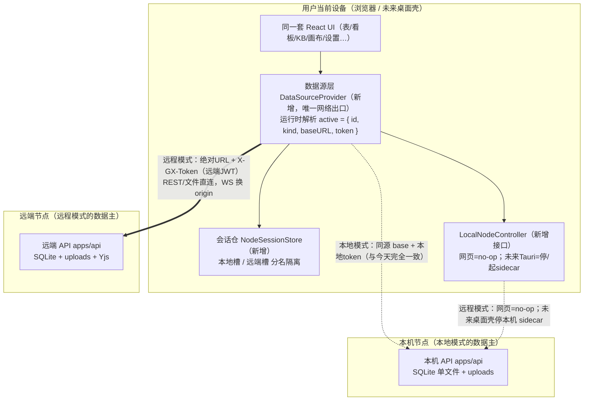
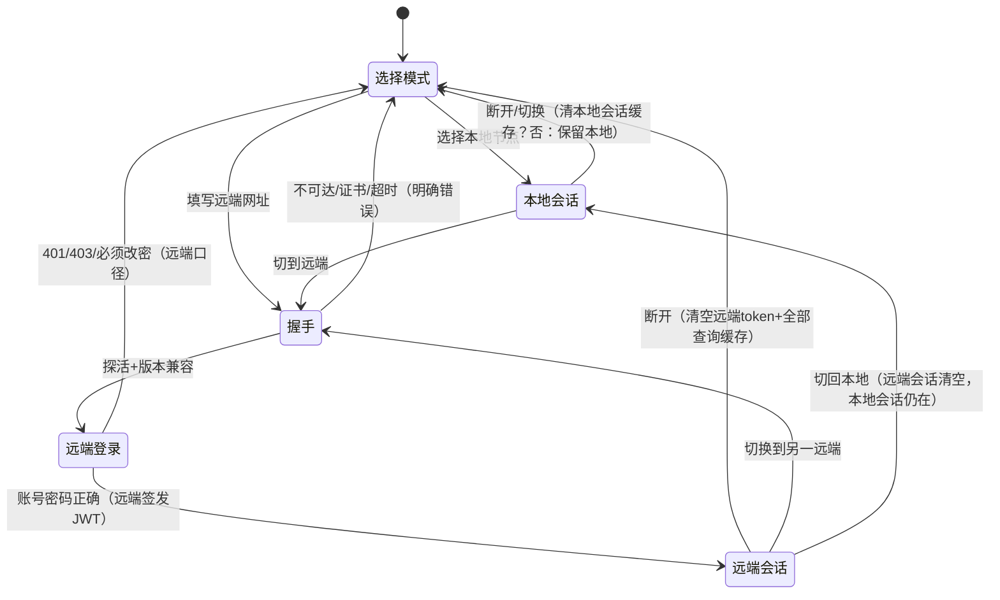
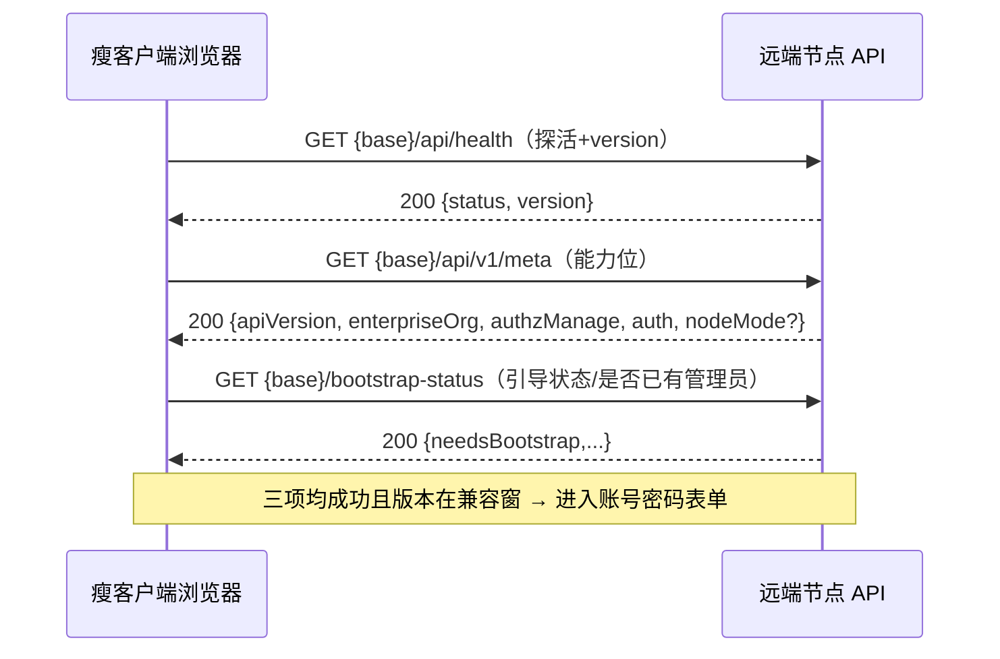
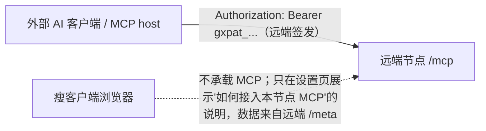
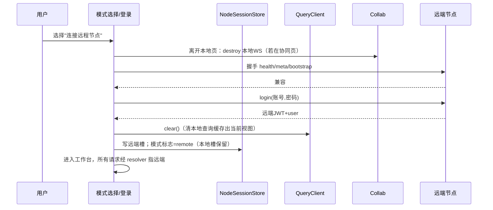

# 构想工作台（GouXiangDB）节点模式（Node Mode）设计与落地方案

- 文档日期：2026-10
- 状态：设计定稿（纯设计，不含生产代码改动）。待项目总监与产品负责人拍板第 18 章「未决问题」后按 S1–S8 实施
- 作者：高见远（架构）
- 适用版本基线：根 `package.json` 0.2.x；monorepo = `apps/api`（Hono + Prisma5 + SQLite 单文件）+ `apps/web`（React18 + Vite + TS + TanStack Query + Zustand）+ `packages/{shared-types,canvas,blocks,design-tokens}`
- 需求来源：产品负责人戴总——单机自部署产品在登录环节提供两种可选运行模式：**本地节点（服务端）** 与 **远程节点（瘦客户端）**，两模式自由切换、界面完全一致，唯一差异是数据来源
- 关联文档：`docs/design/2026-10-app-update/DESIGN.md`（同体例、同 env 门控/默认关闭/零迁移模式）、`docs/deployment/fnos-native.md`、`deploy/caddy/Caddyfile`
- 桌面承载：macOS 独立桌面 App（Tauri v2 壳，承载本设计的"壳即浏览器"+ 本地/远程切换）与一键更新方案见同目录 **`DESIGN-MACOS-APP.md`**；本主文档的路线 A、S1 数据源抽象等结论继续有效，不被改写
- 离线与同步：断网可用 + 联网双向同步 + 服务端权限裁决 + 手动冲突解决（叠加在 Mac App 侧车与节点模式之上的第三块）见同目录 **`DESIGN-OFFLINE-SYNC.md`**；该文档 **§20「长期演进框架纪律」为戴总 2026-10-15 拍板的项目级硬约束，以后所有模块/多端开发都必须遵守**（注册表式扩展、壳薄内核厚、新实体先定轨、统一权限裁决闸、默认旁路只增不毁、多端同源、四门质量门）

---

## 0. 给产品负责人的大白话总览

戴总，先用不涉及技术的话说清楚这套方案要做什么、不做什么。

**现在的产品长什么样**：您在一台 NAS（或服务器）上装好「构想工作台」，这台机器既当"仓库"又当"门面"——数据存在它肚子里，网页也由它端出来。大家用浏览器打开它的网址来用。

**您想要的两种用法**：

1. **本地节点（服务端）**：就是现在的样子，一个字都不变。登录后在「工作区设置」里多一个菜单，告诉用户"本机节点的访问网址是什么"。这台机器就是数据的主人。
2. **远程节点（瘦客户端）**：用户在登录时不登本机，而是填**另一台**已经装好构想工作台的机器的网址，再填那台机器上的账号密码。连上以后，他眼前的界面和平时一模一样，但看到的每一张表、每一篇文档、每一块画板、每一个附件，全都来自他填写的那台**远端机器**；他自己这台设备此刻只是一个"显示器 + 键盘"，不存任何业务数据，本机的数据服务被"晾在一边"不工作。

**两种用法可以随时来回切，界面看不出差别，差别只有一个：数据从哪台机器来。**

**这套方案怎么做到"不伤筋动骨"**（您最关心的）：

- 我们**不重写任何现有功能**。现在的界面、表、看板、搜索、文档、画板、协同、权限，全部原样保留。
- 我们只在浏览器程序里加一个"**数据来源开关**"：就像电视机的"信号源"键，同一台电视，切到 HDMI-1 看本机、切到 HDMI-2 看远端，电视本身一个零件都不换。
- 这个开关**默认是关的、默认行为和今天完全一致**；不升级、不开启，谁也感知不到它存在。
- 远端模式下，连"文件原件"（附件、头像、登录页大图）也都是从远端机器现取现显示，本设备不留底。
- **不改动数据库结构**（不加表、不加字段），现有用户的数据零风险。

**需要您知道的一个客观限制**：当用户只用一个**普通网页浏览器**打开产品时，他自己的电脑/手机上本来就没有跑"数据进程"，所以"暂停本机数据进程"在纯网页里的真实含义是"**本机数据一概不连、一概不取**"；真正"把本机后台服务关停"这个动作，只有将来我们出**桌面客户端（Tauri 壳，当前仓库里尚不存在）**时才做得到。本方案把两种形态都设计好，但桌面壳的进程开关列为**后续阶段**，不影响现在纯网页先上线。

**分期上线**：我们切成 S1–S8 八个小阶段，每个阶段都能单独测试、单独发版、单独回滚，先做"只读地看远端数据"，再做"实时协同"，最后才碰"文件上传"，把风险摊薄。

---

## 1. 背景与现状摸底（只读勘察结论，均带证据）

本章所有结论均来自对当前仓库的只读勘察，未改动任何生产代码。每条关键结论给 `文件:行号` 证据，作为后续设计的事实基线。

### 1.1 一个必须先纠正的前提：当前没有桌面壳（Tauri）

任务背景提到 `apps/desktop`（Tauri 壳）。全仓检索 `tauri` / `apps/desktop` 证实：

- `apps/` 目录下**只有** `api` 与 `web` 两个应用，**不存在任何 Tauri / desktop 工程**。
- 因此"暂停本地数据进程"在当前可交付形态里**没有一个本地 OS 进程可供暂停**（纯网页形态下，浏览器里只跑前端 JS，数据进程在被访问的那台服务器上）。

这一条直接决定第 4 章路线裁决与第 11 章"暂停语义"的分层定义。

### 1.2 后端装配与"进程"的真实边界

| 事实 | 证据 | 对本设计的意义 |
| --- | --- | --- |
| API 同时支持 TCP 与 Unix socket 两种监听，两处都挂载协同 WS | `apps/api/src/index.ts:41`（`startTcp`）、`:85`（`startUnixSocket`），两处 `createServer` 都 `attachCollab(server)` | 未来桌面壳要"停本地数据服务"，关停点就是这两个 server；现在纯网页无需触碰 |
| 可彻底不监听（`GX_NO_LISTEN=1`） | `apps/api/src/index.ts:147` | 证明"数据进程可被关闭/旁路"在装配层已存在先例 |
| 优雅关闭先 `flushAllAndClose()` 再退出 | `apps/api/src/index.ts`（shutdown 序列） | 未来桌面壳停 sidecar 时复用同一收尾，避免 SQLite/WAL 损坏 |
| 默认端口 3001 | `apps/api/src/config.ts:38`（`DEFAULT_PORT`） | 节点网址默认值与占位提示来源 |
| CORS 走正则白名单，允许头含 `X-GX-Token` | `apps/api/src/config.ts:191`；`apps/api/src/app.ts:121-134`（`allowHeaders:["Content-Type","Authorization","X-GX-Token"]`） | 瘦客户端跨域直连远端时，**远端必须把瘦客户端页面来源加入允许名单**，否则浏览器拦截 |
| body 三档上限（JSON 1MB / upload 6MB / 附件整包 40MB、单文件 20MB / MCP 11MB） | `apps/api/src/config.ts`（body limit 段） | 远端模式文件上传受**远端**上限约束，错误提示须以远端 413 为准 |
| env 三态特性门控范式（如企业功能默认 on、`GX_M5_SEARCH` 默认 off） | `apps/api/src/config.ts:361-365` | 新增节点能力门控照此纯函数 + 默认值范式，保证旧行为零变化 |
| basePath / socketPath / webDist 可配 | `apps/api/src/config.ts:291-293`；`apps/api/src/app.ts:264-265`（basePath 副本先挂、根副本后挂） | 远端节点可能挂在子路径（飞牛 `/app/gouxiangdb`），节点网址必须允许带 basePath |

### 1.3 鉴权链路与令牌

| 事实 | 证据 | 意义 |
| --- | --- | --- |
| JWT HS256，claims = userId/tv/iat/exp，7 天 TTL | `apps/api/src/domain/org/authState.ts:45-48`（`issueToken`） | 远端登录拿到的是**远端签发**的 JWT，瘦客户端只持有、不解析、不复用本地密钥 |
| 后端同时接受 `Authorization: Bearer` 与 `X-GX-Token` | `authState.ts:59-65`（`readBearerToken`） | 浏览器瘦客户端统一走 `X-GX-Token`，外部 AI/MCP 客户端仍走 Authorization |
| 每次请求验签 + 查库校验用户状态/tokenVersion，默认零缓存 | `authState.ts:74-115`（`resolveActiveAuth`） | 远端改密/停用/tv 递增对瘦客户端**即时生效**，无需额外推拉 |
| 免鉴权引导/健康探针已存在 | `apps/api/src/auth.ts:40`（`GET /bootstrap-status`）、`:45` signup、`:91` login；`apps/api/src/routes/health.ts`、`version.ts` | 节点可达性/引导状态探测可直接复用，无需新建免鉴权面 |
| 登录对 INVITED/DISABLED 的拒绝口径 | `apps/api/src/auth.ts:91`（403/401） | 瘦客户端登录错误态直接呈现远端语义，不二次包装 |
| PAT 仅用于 MCP，`gxpat_` 前缀，sha256 查库，五态 401 | `apps/api/src/mcp/transport/authenticate.ts` | MCP 是**外部 AI 客户端直连服务端节点**，不经瘦客户端浏览器（见 9.3） |

### 1.4 为什么浏览器必须用 X-GX-Token（远端模式同样受此约束）

`apps/web/src/api/authHeader.ts:1-19` 记录了飞牛 fnOS 1.2.0604 的实测事实：第三方应用 CGI 网关（`/usr/trim/bin/trim_http_cgi`）会把 `Authorization` 头当作 **fnOS 自己的令牌**校验，非 fnOS 令牌一律 `HTTP 200 + "invalid token"` 并吞掉请求。因此：

- 浏览器端统一用 `authHeaders(token) => { "X-GX-Token": token }`（`authHeader.ts:17-19`）。
- **远端节点若也是飞牛部署，瘦客户端浏览器到远端的请求同样不能用 Authorization**，必须沿用 X-GX-Token。本设计全程遵守，不为节点模式引入新的鉴权头。

### 1.5 前端请求出口与可切换 baseURL 的天然挂点

| 事实 | 证据 | 意义 |
| --- | --- | --- |
| 所有端点集中在一个 fetch 包装层 | `apps/web/src/api/client.ts`（约 91KB，全端点一一对应）；`:89` 引 `resolveApiBase/withBase`；`:103` `export const API_BASE_URL`；`:110` `export const withBase`；`:113` `LOGIN_PATH=withBase("/login")` | **数据源抽象的主落点**：把"模块级常量 `API_BASE_URL`"升级为"可在运行时按当前会话取值的数据源"，即可让同一套 UI 改连远端 |
| baseURL 解析已是纯函数，显式 URL 优先、否则回落同源 | `apps/web/src/lib/base.ts:17`（`resolveApiBase`）、`:42`（`withBase`，绝对 URL/data/blob 原样返回） | 远端节点网址天然就是"显式绝对 URL"，`withBase` 已能正确处理跨域绝对地址 |
| 鉴权态用 Zustand + persist，localStorage 键 `gx-auth`，仅存 `{token,user}` | `apps/web/src/store/auth.ts:27` | **会话隔离关键点**：本地会话与远端会话必须分名存储，避免 token 串用（第 8、10 章） |
| 路由守卫只判"本地有没有 token" | `apps/web/src/App.tsx:66-70`（`RequireAuth`）、`:122`（路由表） | 需让守卫识别"当前会话归属哪个节点"，但不改变本地模式判定结果 |
| 登录成功后 `setAuth(token,user)` 再跳转 | `apps/web/src/features/auth/LoginPage.tsx` | 远程登录表单与本地登录复用同一收口，但写入不同会话槽 |

### 1.6 必须收口的"裸 fetch / XHR"漏网点（数据源抽象若漏掉这些就会串数据）

当前除 `client.ts` 外仍有少量绕过统一层的网络调用。节点模式下它们**必须**改走数据源抽象，否则会出现"列表来自远端、附件却打到本机"的串源事故：

| 漏网点 | 证据 | 通道 |
| --- | --- | --- |
| 附件 XHR 上传 | `apps/web/src/features/attachments/api.ts:82`（XHR POST `/api/attachments`） | 文件上传 |
| 附件下载 | `apps/web/src/features/attachments/api.ts:171`（裸 fetch） | 文件下载 |
| 附件删除 | `apps/web/src/features/attachments/api.ts:218`（裸 fetch/DELETE） | REST |
| 文档正文保存 | `apps/web/src/features/kb/useDocPersistence.ts:208`（`fetch(\`${API_BASE_URL}/api/kb/docs/${id}/content\`)`） | REST 写 |
| 文档读取 | `apps/web/src/features/kb/WysiwygEditor.tsx:2558`（`fetch(withBase(.../api/kb/docs/${docId}))`） | REST 读 |
| 文档 ACL 探测 | `apps/web/src/features/kb/hooks/useLinkResolve.ts:74`（`fetch(withBase(.../acl))`） | REST 读 |
| 头像展示 | `apps/web/src/features/.../PersonalCenterDrawer.tsx:529`（`withBase(user.avatarUrl)`） | 静态/鉴权图片 |
| 协同 WebSocket | `apps/web/src/features/collab/collab-provider.ts:78-93`（origin 取 `window.location.origin`，http→ws/https→wss） | WS |

### 1.7 实时协同（WS + Yjs）的短票机制

| 事实 | 证据 |
| --- | --- |
| WS 路径前缀 `/ws/collab/`，upgrade 时剥 basePath，先握手后以 4401 关闭，30s ping | `apps/api/src/collab/attach.ts:30`、`:61-63`、`:73`；私有关闭码 4400–4499 |
| 浏览器 WS 无法带自定义头，先用 REST 换 60s 一次性短票，再以 `?t=` 连接 | `apps/api/src/collab/tickets.ts`（60s 单次核销内存票）；`apps/api/src/routes/collab.ts:83`（wsPath 拼 basePath） |
| 前端 origin 默认 `window.location.origin`，重连每次换新票、退避 1s→30s | `collab-provider.ts:78-93` |

远端模式要点：协同 origin 必须从"页面同源"改为"**远端节点 origin**"，短票也必须向**远端 REST** 换取（见 9.2）。

### 1.8 MCP 传输现状（无状态 JSON，非 SSE）

- `apps/api/src/mcp/transport/streamableHttp.ts:68-71`：`sessionIdGenerator: undefined` + `enableJsonResponse: true`——当前**不开 SSE 长连**，是纯 HTTP 请求/响应。挂载点 `/mcp`（`apps/api/src/app.ts:221-237`，受企业门控，`:228`）。
- `/mcp` 仅认 `Authorization: Bearer <PAT>` + IP/PAT 两段限流（`apps/api/src/mcp/transport/mcpApp.ts`）。
- 结论：任务书提到的"SSE(MCP)"在当前实现里**尚不存在 SSE 流**；节点模式只需明确"MCP 由谁连谁"（外部 AI 客户端 → 服务端节点，见 9.3），无需为瘦客户端代理 MCP。

### 1.9 文件、静态资源与品牌

| 事实 | 证据 |
| --- | --- |
| 上传根 `<dataDir>/uploads`，子目录 `avatars/`、`branding/`，附件 sha256 内容寻址 | `apps/api/src/domain/attachmentStore.ts`；`config.uploadRoot` |
| 头像/品牌图静态托管路由 | `apps/api/src/app.ts:79-96`（`/uploads/avatars/:filename`）、`:100-117`（`/uploads/branding/:filename`） |
| 附件正文走鉴权端点，URL 恒为相对路径 | `apps/api/src/routes/attachments.ts:63`（`/api/attachments/:id/content`）、`:84`（POST multipart）、`:181`（GET content 鉴权） |
| 品牌三键存 `app_settings` KV，hero 落 branding 目录，匿名读、管理员写 | `apps/api/src/domain/branding/store.ts`、`apps/api/src/routes/branding.ts` |
| 登录页品牌图随 API base 取用 | 品牌匿名读 + hero URL 相对路径 |
| 文档/画布"内容"存数据库文本（Markdown / Drawnix PlaitElement JSON），协同另有 Yjs doc 落盘 | `apps/api/prisma/schema.prisma:393`（`KbDoc.content`） |

**重要事实修正（回应任务书"文档/画布原始文件存档"）**：当前实现里文档与画布并**没有独立的"原件文件"**，其内容就是数据库里的文本（`KbDoc.content`），实时协同再叠加一份 Yjs doc 落盘。因此远端模式下，文档/画布内容天然随 REST + WS 通道来自远端，**不需要额外的"原件文件传输"通道**；真正以二进制文件流存在、需要专门路由的，只有**附件、头像、品牌图**三类。

### 1.10 节点能力/版本/健康的现成探针

- `GET /api/v1/meta`（`apps/api/src/routes/v1/index.ts:75-88`）：返回 `apiVersion`、`enterpriseOrg`、`authzManage`、`auth` 等能力位。
- `GET /api/health`（`routes/health.ts`）：含 `version`（根 package.json 单源，`version.ts`）。
- `GET /readyz`：dbPing/dbWritable/migrations/uploadsWritable/disk 五探针（`ops/readiness.ts`）。

节点发现、可达性、版本/能力握手**优先复用**这些只读端点（第 7 章）。

### 1.11 部署形态与两条已知网络坑

- 裸机：systemd + Caddy 回环反代（TLS）。`deploy/caddy/Caddyfile:21-26` 的 `@api` matcher 显式含 `/api/* /healthz /readyz /mcp /mcp/*`，`/uploads/*` 另反代，`request_body max_size 48MB`——**但未显式包含 `/ws/*`**。远端模式下若服务端经 Caddy 暴露，需补 `/ws/*` 反代并放行 Upgrade（第 18 章未决问题 U6）。
- 飞牛 fnOS：Unix socket + CGI 反代 + basePath `/app/gouxiangdb`，前缀+根双挂载，严禁 Authorization（见 `docs/deployment/fnos-native.md`）。

---

## 2. 目标与非目标

### 2.1 目标（本设计必须交付的能力）

1. 登录环节提供两种模式选择：**本地节点（服务端）** 与 **远程节点（瘦客户端）**；默认、且升级后不开启时，行为与今天**逐字节一致**。
2. 本地节点模式：登录后标识"自身节点"，在【工作区设置】新增一个只读菜单，展示本机节点访问网址（含局域网/反代网址与 basePath）。功能与现状完全一致。
3. 远程节点模式：登录表单接收"目标节点网址 + 账号（或邮箱）+ 密码"，成功后浏览器内**全部**数据能力（表/记录/视图/看板/搜索/知识库/文档/画布/协同/权限/分享/审计/品牌/附件/头像）都从所连服务端获取，本端仅作操作终端。
4. 两模式自由切换；切换时彻底隔离会话与缓存，**不串数据、不留残 token**。
5. 远端模式下附件/头像/品牌图的上传与读取也都指向服务端，**文件原件不在本端落业务库**（浏览器缓存/下载属用户主动行为，不在此列）。
6. 全程**零数据库迁移**优先；连接档案默认只存浏览器本地（可选），不进业务库。
7. 节点发现、可达性探测、版本/能力握手、TLS/自签/混合内容/超时/离线给出确定的错误态与文案。
8. 前端不新增运行时依赖、不新增裸 fetch（全部收口到统一数据源层）、不自创图标体系（沿用项目自建内联 SVG）、样式只用 `gx-*` 令牌。
9. 方案对**纯网页（当前唯一形态）**与**未来桌面壳 Tauri（尚不存在）**同时成立；后者的"进程开关"作为后续阶段，不改本阶段接口。

### 2.2 非目标（明确不做，防范围蔓延）

| 不做项 | 说明 | 预留方式 |
| --- | --- | --- |
| 不在本阶段新建 Tauri/desktop 工程 | 仓库当前不存在；强行引入违背"增量旁路、不影响原框架" | 第 11 章定义抽象 `LocalNodeController` 接口，桌面壳未来实现之，网页形态实现为 no-op |
| 不在瘦客户端本端落任何业务数据库/SQLite | 瘦客户端即"无数据终端" | 不引入本地持久化数据面；仅存连接档案与内存会话 |
| 不做瘦客户端代远端转发的服务端代理隧道（本阶段否决） | 浏览器直连远端即可满足，引入本端反代只会双写数据面、放大 CORS/fnOS 问题 | 第 4 章记录为路线 B 并说明否决理由 |
| 不做节点集群/多活/数据同步 | 任一时刻一个会话只连一个节点，节点间不互相同步 | 连接档案可保存多个，但会话是单选 |
| 不做 MCP 经瘦客户端浏览器代理 | MCP 是外部 AI 客户端持 PAT 直连服务端节点 | 第 9.3 给出连接矩阵，瘦客户端不实现 MCP 转发 |
| 不改数据库结构（不加表/不加列） | 连接档案存浏览器 | 若未来要"多设备同步节点档案"，再单独立项加表（第 12 章给可选表草案，不实施） |
| 不做远端账号体系的本地镜像/离线登录 | 远端不可达即进入明确离线态，不允许用本地缓存冒充实数据 | 只缓存"上次连接的节点档案（不含密码）"，不缓存业务数据用于离线展示 |
| 不改现有 JWT 签发/校验逻辑、不引入新鉴权头 | 复用远端 JWT + X-GX-Token | —— |
| 不做自动重连后的静默写补偿 | 断线期间编辑按各通道既有冲突/离线策略处理（协同走 Yjs、普通写给出失败态） | —— |

**一句话边界（给产品）**：这套方案只在浏览器里加一个"信号源开关"和一层"统一数据出口"，不碰数据库、不改服务端鉴权、不替任何机器同步数据；桌面客户端的"真·关停本机服务"留到将来出壳时再做。

---

## 3. 关键设计约束清单（技术硬约束）

1. 默认关闭：新增能力由前端构建/配置与用户显式选择双重控制，不选择即本地模式、行为零变化。
2. 零迁移优先：不加 Prisma model/字段；复用 `app_settings` 类 KV 与既有探针。
3. 前端零新依赖：不引入 http 库、状态库、图标库；图标沿用项目**自建内联 SVG 图标**（全项目统一，不混用第三方图标集，不使用 emoji 充当功能图标）；颜色/间距/圆角只用 `packages/design-tokens` 的 `gx-*` 令牌，不使用紫到粉渐变。
4. 唯一网络出口：所有运行时网络调用（REST/上传/下载/图片/WS 取票）必须经过数据源层动态解析 `{baseURL, token}`，消灭 1.6 列出的全部裸点；**禁止新增裸 fetch/XHR**。
5. 鉴权头纪律：浏览器一律 `X-GX-Token`；不使用 Authorization（规避 fnOS 吞头）；MCP/PAT 例外仅存在于外部 AI 客户端直连。
6. 单文件 ≤ 300 行、单一职责、入口只装配、按资源分包（沿用 `references/01-standards/code-organization.md`）。
7. 每个阶段独立过四门质量门（typecheck / lint+行数 / vitest / build），可独立发版与回滚。
8. 远端 URL 必须支持 http/https + 主机:端口 + 子路径 basePath（飞牛形态），连接前规范化。
9. 远端能力不可假设：一切能力以握手 `meta`/`version` 为准，能力缺失给降级/提示，不让页面白屏。
10. 安全默认 fail-closed：连不上、握手不符、证书异常、跨域被拒，一律停在登录/离线态，绝不静默回落到本机数据冒充远端。

---

## 4. 三条技术路线对比与裁决

### 4.1 候选路线

- **路线 A：前端数据源抽象层（运行时可切换 `{baseURL, token}`）**。同一套 React UI，在统一请求出口把"同源 + 本地 token"换成"远端绝对 URL + 远端 token"；WS origin 同步切换。浏览器**直连远端 API**。
- **路线 B：本地后端反向代理隧道**。瘦客户端仍连本机 API，由本机 API 把请求反代/隧道转发到远端，再把远端响应回吐给浏览器；同时本机暂停自己的数据读写。
- **路线 C：Tauri 进程开关（桌面壳 sidecar 编排）**。桌面客户端内置 API sidecar，本地模式启动 sidecar，远程模式关闭 sidecar 并让前端直连远端。

### 4.2 对比矩阵（评分：5 最好；权重见架构基线）

| 维度（权重） | A 前端数据源抽象 | B 本地反代隧道 | C Tauri 进程开关 |
| --- | --- | --- | --- |
| 学习/实现成本（高） | 4：改动集中在前端出口与会话，无新组件 | 2：需在 Hono 内实现通用反代（头透传、multipart 流式、WS 升级、SSE、错误码透传），复杂且易漏 | 2：当前无 Tauri 工程，需从零搭壳 + sidecar 生命周期 |
| 生态成熟/贴合现状（高） | 5：`resolveApiBase/withBase/client.ts` 已天然支持绝对 URL | 2：自己造反代，和既有 Caddy/fnOS 网关职责重叠 | 1：仓库零资产 |
| 部署/运行成本（高） | 5：纯网页即可，服务端只需正确 CORS + 暴露路由 | 3：仍要在本端跑 API 进程（与"瘦客户端/暂停本机"自相矛盾） | 2：每端要装桌面应用 |
| 对原框架侵入（高） | 4：收敛裸点 + 会话隔离，后端基本零改动 | 2：后端要加一整条代理数据面，风险扩散到成熟功能 | 3：前端接 sidecar 开关，但壳本身是全新工程 |
| fnOS/CORS/Authorization 兼容（高） | 4：直连远端，沿用 X-GX-Token；需远端放行瘦客户端来源 CORS | 2：浏览器→本机虽同源，但本机→远端转发时容易错误地带/丢 Authorization，且飞牛上本机也在 CGI 后，隧道穿两层网关 | 4：壳内可豁免浏览器 CORS，但仍需处理远端 fnOS 的 Authorization 吞头 |
| 文件/WS 全通道正确性（高） | 4：WS 换 origin + 远端取票；文件直传远端，需收口算子 | 2：multipart/WS/SSE 全要在代理里无损透传，最易出字节级 bug | 4：直连远端，同 A |
| "暂停本地数据进程"语义（中） | 3：纯网页本就无本地进程，天然"不连即停"；真停进程需等 Tauri | 3：本机 API 仍在运行（只是转发），并未真正暂停 | 5：能真正停 sidecar、释放 SQLite |
| 扩展性（低） | 4：未来桌面壳复用同一抽象 | 3：被代理实现绑死 | 4：桌面形态最佳，但覆盖面只有桌面 |
| 零回归/可回滚（高） | 5：默认关闭，按阶段收口，回滚等于关开关 | 2：代理处在数据主路径，回滚面大 | 3：壳独立，但出壳前对网页用户无价值 |

### 4.3 裁决：以路线 A 为主体，路线 C 作为未来桌面形态的增强，路线 B 否决

**推荐：路线 A（前端可切换 baseURL + token 的数据源抽象层）为主，分阶段落地；用一个 `LocalNodeController` 接口为路线 C 预留"真停进程"的未来位；本阶段不做路线 B。**

理由：

1. **事实驱动**：当前没有 Tauri 壳（1.1），纯网页下本就没有"本地数据进程"可停，路线 C 在本阶段无处落地；而路线 A 对网页与未来桌面**同时成立**——桌面壳里前端依旧直连远端，只是额外把本机 sidecar 关掉。
2. **最小侵入、默认关闭、零迁移**全部最契合路线 A：改动集中在前端请求出口与会话存储，后端几乎零改动，符合"独立旁路、不影响成熟功能"。
3. 路线 B 与产品诉求**自相矛盾**：瘦客户端的定义是"本端无数据、仅终端"，而反代隧道要求本端仍运行一个 API 进程；它还会把 CORS、fnOS 吞 Authorization、multipart/WS/SSE 透传全部复杂化，并在数据主路径上新增高风险组件，回滚面大。否决。
4. 路线 A 的代价明确可控：需收口算子（1.6）、远端 CORS 放行（1.2）、Caddy 补 `/ws/*`（1.11）、严格会话隔离（第 10 章）。这些都是可枚举、可测试的有限工作量。

---

## 5. 总体架构

### 5.1 两种模式的组件关系



### 5.2 分层与依赖方向（单向）

```
features/*（UI，只依赖 hooks 与 DataSource 选择器，绝不拼 URL）
      │
hooks（TanStack Query；queryKey 带 nodeId 前缀，避免两源缓存碰撞）
      │
api/client.ts（端点函数；改为从 DataSourceResolver 取 baseURL/token，不再读模块常量）
      │
node/（新增子域，纯函数优先，全部 ≤300 行）
   ├─ resolve.ts      normalizeNodeUrl / matchSameNode（纯函数）
   ├─ datasource.ts   DataSourceResolver：当前会话 → { kind, baseURL, token, wsOrigin }
   ├─ session.ts      NodeSessionStore：local/remote 双槽 + 内存远端会话
   ├─ handshake.ts    探活/版本/能力握手（经 health/meta/bootstrap-status）
   ├─ connect.ts      远端登录编排（握手→login→建会话→清缓存）
   └─ controller.ts   LocalNodeController 接口（web no-op / 未来 tauri）
```

`node/` 不 import Hono、不 import db；远端登录复用 `client.ts` 现有 `login` 端点函数，仅以"显式 baseURL"调用，不新造鉴权协议。

### 5.3 模式定义（状态机）



关键：**切换不是"换一个变量值"，而是"结束一个会话、清空其全部缓存，再进入另一个相互隔离的会话"**（第 10 章）。

---

## 6. 核心设计：数据源抽象层（路线 A 的主体）

### 6.1 设计要点：把"常量"变"当前会话的解析结果"

现状 `client.ts:103` 的 `API_BASE_URL` 是模块加载时确定的常量，无法运行时切换。改造为一个**同步可读的解析器**（会话信息在连接成功后已就位，解析必须纯同步，避免给上千个调用点加 async）：

```ts
// node/datasource.ts（示意，最终以实施为准；不新增依赖）
export type NodeKind = "local" | "remote";

export interface ActiveDataSource {
  nodeId: string;            // "local" 或远端节点稳定 id（由规范化URL哈希得到）
  kind: NodeKind;
  baseURL: string;           // local：同源 base（""或"/app/gouxiangdb"）；remote：去尾斜杠绝对URL
  token: string | null;      // 当前会话对应槽位的 JWT
  wsOrigin: string;          // 由 baseURL 派生：http→ws、https→wss（复用 collab 现有换算）
}

export interface DataSourceResolver {
  current(): ActiveDataSource;
  baseFor(path: string): string;   // = withBase(current().baseURL, path)
  headers(): Record<string,string>;// = authHeaders(current().token)
  subscribe(fn: () => void): () => void; // 会话切换时通知 client/Query 失效
}
```

- `local` 槽的 `baseURL` 由今天的 `resolveApiBase(VITE_API_URL, BASE_URL)` 计算，**取值与现状完全相同**，保证本地模式逐字节不变。
- `remote` 槽的 `baseURL` 是规范化后的远端绝对 URL；`withBase`（`base.ts:42`）已支持绝对 URL 原样拼接。
- `client.ts` 内部把对 `API_BASE_URL` 的引用替换为 `resolver.baseFor(...)`，把 `authHeaders(本地token)` 替换为 `resolver.headers()`。`API_BASE_URL` 导出可保留为 `resolver.current().baseURL` 的兼容读口，避免一次性改动爆炸。

### 6.2 让 TanStack Query 缓存按节点隔离

切换节点后绝不能看到上一个节点的缓存。两道保险：

1. **queryKey 加 nodeId 前缀**：在统一 Query 层为所有 key 包一层 `[ds.nodeId, ...key]`。本地模式 nodeId 恒为 `"local"`，本地 key 形状变化通过适配层集中处理，不散落到各 hook。
2. **切换即清库**：`connect.ts` 在建立新会话前调用 `queryClient.clear()`（或按 nodeId 移除），并重置所有未完成 mutation。宁可重新拉取，也不展示跨源陈旧数据。

### 6.3 裸点收口（对应 1.6，逐个改走解析器）

| 现状裸点 | 收口方式 |
| --- | --- |
| 附件 XHR 上传 `attachments/api.ts:82` | XHR 打开地址改为 `resolver.baseFor("/api/attachments")`；setRequestHeader 用 `resolver.headers()`（XHR 可设 X-GX-Token）；上传进度逻辑不变 |
| 附件下载 `:171` | 改为经解析器取 URL + 头；**注意跨域下载不能直接 `<a href>`（带不了自定义头）**，用 `fetch(...,headers)` 拿 `blob()` 再 `URL.createObjectURL` 触发下载（远端 CORS 需放行，第 7、13 章） |
| 附件删除 `:218` | 走 `client.ts` 既有删除端点函数（已是统一层） |
| 文档保存/读取/ACL | 三处裸 fetch 改为调用 `client.ts` 对应端点（其中读取/ACL 已有封装则复用；保存走统一层，带 `If-Match`/409 语义不改变） |
| 头像 `PersonalCenterDrawer.tsx:529` | 头像是 `/uploads/avatars/:file` **静态路由**（cookie 无关、token 无关），远端模式直接 `withBase(远端baseURL, avatarUrl)` 指向远端即可，无需头（见 9.4） |
| 协同 WS | origin 用 `resolver.current().wsOrigin`，短票向 `resolver.baseFor("/api/...ticket")` 取（见 9.2） |

收口后在仓库加一条**静态守卫**（lint 规则或测试脚本）：除 `api/client.ts` 与 `node/` 子域外，`features/**` 不得出现 `fetch(`/`new XMLHttpRequest`/`new WebSocket`/`EventSource`。这是"禁止新增裸 fetch"的可执行保障。

### 6.4 本地节点访问网址菜单（模式一的唯一新增 UI）

- 在 `WorkspaceSettingsPage.tsx:47` 的 `Section` 联合类型新增一个 section（如 `node`），在 `:49-107` 的 `SECTIONS` 数组追加一项，门控沿用现有 `ownerOnly/manageOnly/enterpriseOnly` 机制（本菜单建议所有可进入设置的成员可见只读网址，是否仅管理员见 U3）。
- 页面内容只读展示：节点访问网址。来源优先级（纯展示，不改后端）：
  1. 运维显式配置的对外网址（建议新增可选 env `GX_PUBLIC_BASE_URL`，仅用于展示/自报家门，缺省回落）；
  2. 否则用请求 Host + basePath 现场拼出（`x-forwarded-host`/host + `config.basePath`）；
  3. 同时给一句"局域网/内网地址可能因网络而异"的说明文案。
- 该菜单在远端模式下也出现，但展示的是"**你当前连接的远端节点网址**"（只读、带"远程"标识），不展示本机任何信息。

---

## 7. 节点发现、可达性与版本/能力握手

### 7.1 节点网址规范化（纯函数 `node/resolve.ts`）

- 输入允许：`host:3001`、`http://host:3001`、`https://host/app/gouxiangdb`、带尾斜杠/多余空格。
- 规范化：补协议（默认 `http://`，但 https 页面下输入 http 会触发混合内容，见 7.4）、去尾斜杠、保留子路径、拒绝非法 host、去重后生成稳定 `nodeId = sha256(normalizedOrigin+basePath)` 前 12 位（前端用 SubtleCrypto，无新依赖）。
- `matchSameNode(a,b)` 用于"已保存档案"去重与"当前是否连的就是它"判定。

### 7.2 握手三步（全部只读、匿名或用尚未登录的连接）



- 复用现成端点（1.10），**本阶段不强制要求远端新增字段**；`meta` 里的 `nodeMode`/`nodeId` 作为**前向兼容可选字段**——老版本节点不返回时，瘦客户端按"能力未知但版本兼容"放行（是否强制要求节点 advertised 支持见 U1）。
- 版本兼容判定（纯函数）：以 `apiVersion`/`version` 做同一 major 且不低于瘦客户端所测最低节点版本的比较；不兼容给明确文案（"远端版本 x 过低，请升级节点"），**不进入登录**。

### 7.3 超时、不可达、CORS、离线错误态（fail-closed，文案确定）

| 现象 | 浏览器表现 | 文案（示意，最终以产品文案为准） |
| --- | --- | --- |
| DNS/连接拒绝/超时（建议 5s 探活、10s 登录） | 停在登录页 | "无法连接到该节点，请检查网址与网络后重试" |
| CORS 被拒（远端未放行本端来源） | 控制台 CORS 错，响应不可读 | 与不可达合并提示，附管理员排查项（见 13.2） |
| 502/503/非构想工作台响应（meta 形态不符） | 阻止登录 | "该地址不是可用的构想工作台节点" |
| 版本不兼容 | 阻止登录 | "节点版本不受支持，请联系节点管理员升级" |
| 远端需先初始化（无管理员） | 阻止登录 | "该节点尚未完成初始化，请先在节点本机创建管理员"（瘦客户端**不承接**远端自举，避免在终端上初始化别人的库） |

### 7.4 TLS / 自签证书 / 混合内容（硬约束，需说清边界）

- **混合内容**：若瘦客户端页面是 `https://`（如经 HTTPS 反代托管），浏览器**禁止**请求 `http://` 远端（被强制阻断或升级）。此时只允许填 `https://` 节点；在输入校验阶段即提示，而不是等网络失败。
- **自签证书**：浏览器对 `fetch`/`WebSocket` **不提供**"仅本次信任"的编程开关。自签节点的唯一正解是用户在该浏览器/系统层先信任证书（或由节点管理员换成受信证书）。瘦客户端检测到证书错误时，给出"证书不受信任，如何在本机信任"的指引文案，**不提供**弱化 TLS 的开关。
- **桌面壳未来形态**：Tauri 的 HTTP/WS 可在壳层配置自签 CA 白名单，届时 `LocalNodeController`/壳网络层可承载"按节点固定信任证书"；本阶段网页不承诺。
- WebSocket 同规则：`wss://` 对应 https 远端，`ws://` 只能在 http 页面/局域网使用。

### 7.5 远端 CORS 放行（服务端需要的最小配套）

浏览器直连远端属于跨域，远端 `config.ts:191` 的 CORS 正则白名单需要能放行瘦客户端页面来源。两种落地（U2 拍板）：

- 方案 a（推荐）：新增可选 env `GX_NODE_CLIENT_ORIGINS`（正则/逗号分隔域名白名单，**默认空 = 不放行任何跨域页面**，旧行为不变）；节点管理员显式允许其瘦客户端页面来源。
- 方案 b：节点就是被瘦客户端直接以其 URL 打开（页面也由该节点提供），天然同源，无需 CORS——但这与"本端只作终端"的部分自部署场景冲突，作为可选而非唯一。

注意 `Access-Control-Allow-Headers` 已含 `X-GX-Token`（`app.ts:121-134`）；还需确认 `Access-Control-Allow-Headers` 放行上传所需头、跨域 `fetch` 带凭据不依赖 cookie（本方案不用 cookie，故 `Allow-Credentials` 非必需）。暴露给 blob 下载不需要额外 `Expose-Headers`（内容经 JS 读取）。

---

## 8. 鉴权与会话/凭据存储设计

### 8.1 远端登录就是"向远端换取远端 JWT"

- 瘦客户端不持有、不信任、不复用本地 `JWT_SECRET`；它只是远端 JWT 的**搬运工**。
- 复用 `client.ts` 的 login 请求，但 `baseURL` 临时指向远端：`POST {remoteBase}/api/auth/login`，返回远端 JWT + 远端 UserDTO。所有后续请求带 `X-GX-Token: <远端JWT>`。
- 远端 `resolveActiveAuth` 每请求查库校验状态/tv（`authState.ts:74-115`），因此远端停用用户、改密、踢人（tv 递增）对瘦客户端**即时生效**，下一个请求即 401。
- `mustChangePassword` 闸门（`app.ts:146`）语义在远端模式保留：远端要求改密则在瘦客户端进入改密流程（复用现有页，数据源指向远端），不跳过。

### 8.2 双槽会话存储，杜绝串 token

现状只有一个 localStorage 键 `gx-auth`（`auth.ts:27`）。新增 `node/session.ts`：

| 槽位 | 持久化 | 内容 | 生命周期 |
| --- | --- | --- | --- |
| 本地会话 `gx-auth`（沿用，键名/形状不变） | localStorage | `{token,user}` | 与今天完全一致；切到远端**不清空**（切回本地免重登） |
| 远端会话 `gx-node-session` | **默认仅内存**（可选"记住此连接"持久化，见下） | `{nodeId, baseURL, token, user}` | 断开/切换/关闭标签页（内存态）即失效 |
| 节点档案 `gx-node-profiles`（可选） | localStorage | `[{nodeId, baseURL, label, lastConnectedAt}]`，**绝不存密码、不存 token** | 用户可手动删除；仅用于免重输网址 |

- 不把远端 token 长期落盘是更安全默认；若产品要"刷新页面免重连远端"，再开"记住此节点（7 天）"把远端 token 存 localStorage，标签与到期均由远端 JWT exp 控制（U4 拍板持久化强度）。
- `current()` 依据一个独立的**运行时模式标志**（内存，初始 `local`）决定当前读哪个槽；刷新页面后内存标志复位为 `local`——即默认回到本地模式，避免"上次远程、这次自动连远端"的意外。

### 8.3 token 清理清单（断开/切换/401 时逐项执行）

1. 关闭所有 WS/Yjs 连接（协同 provider destroy）。
2. `queryClient.clear()` 清掉该 nodeId 全部查询/突变缓存。
3. 释放附件 blob objectURL（避免远端文件残留在内存/临时）。
4. 远端会话槽置空（内存态直接丢弃；持久态则移除 token）。
5. 模式标志复位 `local`；跳转登录/模式选择。
6. 本地会话槽 `gx-auth` 与本地缓存**保留不动**（两源互不污染）。

---

## 9. 全通道路由矩阵（两模式下每一种流量从哪到哪）

| 通道 | 本地模式（现状） | 远程模式（路线 A） | 关键处理 |
| --- | --- | --- | --- |
| 业务 REST（表/记录/视图/搜索/KB/权限/分享/审计/品牌读等） | 同源 `/api/...` + X-GX-Token（本地 JWT） | 直连 `{remoteBase}/api/...` + X-GX-Token（远端 JWT） | 全部经 client.ts→resolver |
| 文档正文读写/ACL | 同源（含 1.6 三个裸点） | 直连远端同路径 | 裸点收口后天然随源 |
| 协同 WebSocket | `ws(s)://页面同源/ws/collab/<room>?t=<短票>` | `ws(s)://{remoteOrigin}{basePath}/ws/collab/<room>?t=<远端短票>` | origin 与取票都指远端（9.2） |
| 协同短票 REST | 同源换取 | **向远端换取**（浏览器无 WS 自定义头，短票机制不变） | tickets 仍 60s 单次 |
| MCP | 外部 AI 客户端 → 本机 `/mcp`，Authorization + PAT | 外部 AI 客户端 → **远端节点 `/mcp`**，PAT 由远端签发 | 不经瘦客户端（9.3） |
| 附件上传 multipart | 同源 POST `/api/attachments` | 直连远端 POST，受**远端** body 上限约束 | XHR 收口；413 显示远端口径 |
| 附件下载/预览 | 鉴权 GET `/api/attachments/:id/content` | 直连远端鉴权 GET → blob | 带 X-GX-Token，不能用裸 `<a>`（6.3） |
| 附件删除 | 同源 DELETE | 直连远端 DELETE | 统一层 |
| 头像静态图 | `/uploads/avatars/:file`（匿名静态） | 直接指向远端同路径（绝对 URL 拼到 ``） | 无 token、无 CORS 数据读取（图片可跨域展示，除非要画到 canvas 再读像素，本产品不做） |
| 品牌登录大图/静态 | `/uploads/branding/:file`（匿名） | 登录页在握手后用远端 base 取品牌图与 `/branding` 配置 | 登录页品牌天然随远端（9.4） |
| 健康/meta 握手 | —（本地不握） | 直连远端匿名探针 | 第 7 章 |

### 9.1 登录页品牌在远端模式下的来源时序

登录页在用户填完远端网址、握手成功后：用远端 base 拉匿名品牌配置（`/api/...branding` 公开读）与 hero 图，使登录页呈现的是**所连远端节点**的产品名/版权/大图（符合"界面完全一致、唯一差异是数据源"，品牌也属于该节点的数据）。未握手前仍显示本机/默认品牌。

### 9.2 协同（Yjs）切源细节

- `collab-provider.ts:78-93` 的 `defaultOrigin()` 现在取 `window.location.origin`；改为 `resolver.current().wsOrigin`，并保留 `http→ws / https→wss` 与 basePath 拼接（远端可能挂子路径）。
- 换票接口走 `resolver.baseFor(collab ticket path)`，保证房间权限由**远端**判定、短票由**远端**签发核销。
- 重连退避（1s→30s）与关闭码（4400–4499）逻辑不变；新增"会话已切走"为**正常关闭**而非异常重连，避免切回本地后还在偷偷重连远端房间。
- 文档/画布内容即 DB + Yjs（1.9），切到远端后编辑的是远端 Yjs doc，落盘在远端，本端无独立文件通道。

### 9.3 MCP 连接归属（澄清，不在瘦客户端实现代理）



- AI 客户端直连它要用数据的那个节点：本地模式连本机，远程模式的用户若要接 MCP，应让 AI 直连**远端节点**并使用**远端签发的 PAT**。
- 瘦客户端**不转发、不代持** PAT；它在"工作区设置-MCP"页展示的接入地址/文档自然来自远端（数据源随源），PAT 的创建仍走远端鉴权 UI。
- 当前 MCP 无 SSE（1.8），故任务书"SSE(MCP)"暂无长连需要路由；若未来开启 SSE，遵循与 REST 相同的"AI 客户端直连节点"原则，不经瘦客户端。

### 9.4 静态资源（头像/品牌）为何不需要 token 通道

头像与品牌图由匿名静态路由提供（`app.ts:79-117`），本就不依赖 Authorization/cookie。远端模式只需把 URL 的 host/base 换成远端，浏览器即可加载，规避了"图片标签无法携带 X-GX-Token"的问题。附件正文不同——它是**鉴权**端点（`attachments.ts:181`），必须走带自定义头的 `fetch→blob`。

---

## 10. 模式切换与会话隔离（防串数据的核心保证）

### 10.1 切换时序（本地 → 远端）



### 10.2 隔离不变量（以测试固化）

1. 远端会话存续期间，**不存在**任何指向本地 base 的业务请求（静态守卫 + 运行时断言：resolver.kind=remote 时，client 拼出的 URL host 必须等于远端 host）。
2. 切回本地后，内存/持久化中**不存在**远端 token（若未选"记住"），且 Query 缓存无远端残留。
3. 本地 token 在远端模式下不被读取、不被作为远端请求头（resolver 只取当前槽）。
4. 同一标签页内两个节点的 queryKey 不相交（nodeId 前缀）。
5. 远端 401 只触发远端会话登出/回模式选择，**不**清本地 `gx-auth`。

### 10.3 多标签页行为

- 模式标志保存在内存（每标签独立），不同标签可分别连不同节点；但共享 localStorage 的 `gx-node-profiles`（只读档案，不含 token）。
- 本地槽 `gx-auth` 被多标签共享（现状如此）；远端会话默认内存，标签间不共享。避免一个标签切源影响另一个标签。

---

## 11. "暂停本地数据进程"在两种形态下的语义

### 11.1 纯网页形态（当前唯一可交付）

本端设备上**没有**应用数据进程（只有浏览器 JS 与被访问的服务器）。因此"暂停本地数据进程"在本形态的可实现、可验证语义是：

- 进入远端会话后，本端**不发起任何到本地数据源的请求**（第 10.2 不变量 1），不读写本地业务库（网页本来也不直接碰 SQLite），本地节点即便在运行也被完全旁路。
- UI 明确标识"远程节点：{label/url}"，避免用户误以为在操作本机。

### 11.2 未来桌面壳（Tauri，尚不存在）形态

预留接口，本阶段只定义不实现（web 端实现为 no-op，保证类型与调用点就位）：

```ts
// node/controller.ts
export interface LocalNodeController {
  getStatus(): Promise<"running"|"stopped"|"unavailable">;
  /** 进入远程模式：优雅停本机 sidecar（复用 index.ts 优雅关闭：flushAllAndClose） */
  stopForRemote(): Promise<void>;
  /** 切回本地：启动 sidecar（复用 startTcp/startUnixSocket 装配），等待 /readyz */
  startForLocal(): Promise<void>;
}
```

- 网页实现：全部返回 `unavailable`/no-op，UI 不展示"已关停本机进程"字样，只说"当前连接远程节点"。
- Tauri 实现（未来）：sidecar 停止时释放 SQLite/WAL（复用 `index.ts` 已有优雅关闭序列），切回时重启并以 `/readyz` 五探针确认就绪（1.10）。
- 这样路线 A 的前端数据面与路线 C 的进程开关**正交解耦**：先上 A，桌面壳到来时只补 controller 的真实实现，不返工数据源层。

---

## 12. 数据与配置存储（零迁移优先）

### 12.1 本阶段：不碰数据库

- 节点档案存浏览器 `gx-node-profiles`（不含密码/token），远端会话默认内存。
- 服务端唯一可能的新增是**配置而非数据结构**：可选 env（`GX_NODE_MODE` 特性总闸默认关、`GX_NODE_CLIENT_ORIGINS` CORS 白名单、`GX_PUBLIC_BASE_URL` 自报家门网址）。全部走 `config.ts` 纯函数 + 默认值范式，默认值保证旧行为零变化。
- 品牌三键已示范"零迁移加能力"（`app_settings` KV）。节点模式不需要新增 KV 业务键；自报家门网址用 env 而非 KV，避免把"部署拓扑"写进可被管理员误改的业务表。

### 12.2 未来可选：多设备同步节点档案（明确不在本期）

若将来要"在 A 设备保存的节点档案在 B 设备也看得到"，再单独立项加表（此处仅登记，不实施）：`node_profiles(id, user_id, label, base_url_canonical, created_at, updated_at, deleted_at)`——仍**不存密码/token**。这需要走正式迁移与四门，不属于本期。

### 12.3 特性门控（默认关闭范式）

- 前端：构建期可选 `VITE_NODE_MODE_ENABLED`（默认关）。关闭时登录页不出现模式选择、`node/` 不被任何入口引用（tree-shake 掉），产物行为 = 今天。
- 后端：是否需要节点能力门控取决于 CORS 方案（7.5）。若采用显式白名单 env，默认空即"不允许任何跨域瘦客户端"，等价于关闭，无需独立总闸也安全；是否再加 `GX_NODE_MODE` 总闸由 U2 决定。

---

## 13. 安全模型

### 13.1 凭据安全

- 瘦客户端只存远端 JWT（默认内存），不存密码；登录是远端一次性校验，密码不落盘、不入档案、不入 URL（不用 query 传 token；短票仅 WS 一次性 60s）。
- 复用远端全部既有鉴权：RBAC、库/表/字段/行权限、KB 七守卫、分享总闸、PAT 五态、tokenVersion 即时失效。瘦客户端**不引入任何新的信任路径**，远端怎么鉴本机浏览器就怎么鉴瘦客户端。
- 远端 JWT 仅对远端有效；本地 JWT 与远端 JWT 分槽，绝无交叉使用（不同 HS256 密钥，互不可验，也不尝试互验）。

### 13.2 远端节点管理员视角的安全与 CORS

- 默认不放行跨域瘦客户端（`GX_NODE_CLIENT_ORIGINS` 默认空），需要管理员显式登记允许的页面来源，防止任意网页脚本携 token 调用节点 API。
- CORS 已允许的自定义头仅 `Content-Type/Authorization/X-GX-Token`（`app.ts:121-134`），不扩大。
- 提供 runbook：节点如何配置允许来源、为何必须 HTTPS/受信证书、瘦客户端页面应只从受信地址托管。

### 13.3 监听面与网络位置

- 节点模式不改变服务端监听范围；是否对局域网/公网暴露仍由现有 Caddy/fnOS 部署决定。瘦客户端只是一个跨域浏览器客户端。
- 不新增"免鉴权代理"或"开放中继"，因此不会把一个内网节点通过某个瘦客户端暴露给公网。

### 13.4 审计

- 远端模式下的登录、改密、数据写、附件、分享、PAT 等事件全部由**远端**既有审计 JSONL 记录（`apps/api/src/audit/`），来源 IP 为瘦客户端到远端的连接来源，事件语义与本地一致。
- 是否额外标注"来自节点模式瘦客户端"（如在登录审计加 `client_mode:"remote-node"` 字段）为可选项；这属于只增字段的小改动，列入 U5。瘦客户端本身不产生服务端审计。

### 13.5 不上传本机文件、不回传

瘦客户端不把本端任何文件/数据上传到远端（除用户在远端工作区里**主动**发起的附件上传，那属于远端业务写）。模式二"文件原件存服务端"的准确含义是：**用户在该工作区产生/上传的附件直接进入远端 uploads**，本端没有一份平行的数据副本。

---

## 14. 异常与离线处理

| 场景 | 处理 |
| --- | --- |
| 远端会话中断网 | 请求失败进入统一错误条（"与节点连接中断，正在重试/请重试"）；协同按 Yjs 既有离线/重连（本地暂存由 Yjs 承担，重连后由远端合并/冲突逻辑处理）；普通写不静默排队冒充成功 |
| 远端重启 | JWT 在 tv 未变且未过期时仍有效（每请求查库）；重连后重拉；401 回登录 |
| 远端改密/停用/踢人 | 下请求即 401（tv/状态校验），按 8.3 清远端会话 |
| 握手通过但某个能力端点 404（老节点） | 该能力降级/隐藏（以 meta 能力位为准），不白屏 |
| 远端返回 413（超大附件） | 直接呈现远端大小上限文案（40MB 整包/20MB 单文件，可能随远端配置不同） |
| 自签/混合内容 | 按 7.4 阻断并给指引，不提供弱化开关 |
| 同时开两个标签连不同节点 | 各自内存会话独立（10.3） |
| 远端节点时钟严重偏差导致 JWT exp 误判 | 登录失败时提示"节点时间异常"，不在瘦客户端绕过 exp |
| 切源时存在未保存文档 | 切换前弹确认（复用现有未保存拦截），确认后先做一次保存尝试或丢弃，再切 |

---

## 15. 最小侵入点清单（逐文件/逐新增）

> 原则：能新增独立文件就不改老文件；必须改老文件时只做"接线"，不重写。全部文件遵守 ≤300 行/单一职责。

### 15.1 新增文件（前端 `apps/web/src/node/`）

| 文件 | 职责 |
| --- | --- |
| `node/resolve.ts` | URL 规范化、nodeId 哈希、sameNode 判定（纯函数 + 单测） |
| `node/datasource.ts` | `DataSourceResolver` 实现与订阅（会话切换通知） |
| `node/session.ts` | 双槽会话 + 节点档案 localStorage（不含密码/token 入档案） |
| `node/handshake.ts` | health/meta/bootstrap 三探活 + 版本兼容纯函数 |
| `node/connect.ts` | 远端连接编排（握手→login→clear cache→建会话）与断开清理（8.3） |
| `node/controller.ts` | `LocalNodeController` 接口 + web no-op 实现（为 Tauri 预留） |
| `node/NodeModeGate.tsx` | 登录页模式选择/远端表单/错误态（受 `VITE_NODE_MODE_ENABLED` 门控） |
| `node/NodeBadge.tsx` | 顶栏"本地/远程节点"标识（自建内联 SVG，gx-* 令牌） |
| `node/useNodeSession.ts` | 供 UI 订阅当前数据源/状态的 hook |

### 15.2 修改的既有前端文件（仅接线）

| 文件 | 改动 |
| --- | --- |
| `api/client.ts:103,110,113` | `API_BASE_URL`/`withBase`/登录跳转改读 resolver；请求头改 `resolver.headers()`；保留兼容导出 |
| `lib/base.ts` | 不改（已支持绝对 URL）；必要时仅导出复用 |
| `store/auth.ts:27` | 保持 `gx-auth` 本地槽原样；新增的远端槽在 `node/session.ts`，**不改本文件形状** |
| `App.tsx:66-70,122` | `RequireAuth` 识别当前会话槽（local/remote）；模式选择路由 |
| `features/auth/LoginPage.tsx` | 在门控开启时接入 `NodeModeGate`（本地登录路径与今天一致） |
| `features/workspace/WorkspaceSettingsPage.tsx:47,49-107` | 新增 `node` section（节点网址，只读） |
| `features/collab/collab-provider.ts:78-93` | origin 取 `resolver.wsOrigin`；取票走 resolver；切源正常关闭 |
| `features/attachments/api.ts:82,171,218` | 上传/下载/删除收口到 resolver（下载改 fetch→blob） |
| `features/kb/useDocPersistence.ts:208` | 裸 fetch 改统一层 |
| `features/kb/WysiwygEditor.tsx:2558` | 裸 fetch 改统一层 |
| `features/kb/hooks/useLinkResolve.ts:74` | 裸 fetch 改统一层 |
| `features/.../PersonalCenterDrawer.tsx:529` | 头像 src 用当前数据源 base 拼（local 时与现状等价） |
| QueryClient 初始化处 | 统一 queryKey nodeId 前缀包装 + 切换 `clear()` |
| 品牌取用处（登录页/页眉） | 支持握手后用远端 base 取品牌 |

### 15.3 后端改动（本阶段尽量为零；仅在选定 CORS/env 方案时小改）

| 文件 | 可能改动 | 默认姿态 |
| --- | --- | --- |
| `apps/api/src/config.ts` | 增 `nodeClientOrigins`/`publicBaseUrl`/可选 `nodeMode` 纯函数读取 | 默认空/关，旧行为不变 |
| `apps/api/src/app.ts:121-134` | CORS 允许来源读 env 白名单（头清单不变） | 默认不放行跨域 |
| `apps/api/src/routes/v1/index.ts:75-88` | 可选：meta 增 `nodeMode`/`nodeId` 广告字段（additive，老客户端忽略） | 老节点不返回也能连 |
| `deploy/caddy/Caddyfile:21-26` | **部署文档/配置**补 `/ws/*` 反代与 Upgrade（非代码） | 仅影响要对外提供远程协同的节点 |

后端**不**新增数据表、**不**改鉴权、**不**写反代隧道。

### 15.4 测试与守卫新增

- `node/*.test.ts`：URL 规范化、nodeId 稳定、版本兼容、会话隔离纯函数。
- 静态守卫脚本/ESLint 规则：`features/**` 禁裸 `fetch/XHR/WebSocket/EventSource`（白名单仅 client.ts/node）。
- e2e（vitest 现有 harness 风格）：本地模式逐字节回归（模式关闭时所有快照不变）；远端模式起两个 app 实例（local+remote）对拍表/KB/附件/协同全通道与 401 清理。

---

## 16. 既有能力在两模式下的数据源路径零回归核对

| 能力 | 数据来源（本地） | 数据来源（远程） | 零回归要点 |
| --- | --- | --- | --- |
| 数据表/记录/视图 | 同源 `/api` | 远端 `/api` | 走 client.ts，权限/字段掩码/行条件全由远端按既有 M4 引擎裁决 |
| 看板/画廊/月历/甘特/树 | 同源记录 API | 远端记录 API | 有界分页/游标随源，无本地特殊分支 |
| 统一检索（M5 sqlite-vec） | 本机 search.db | **远端 search.db**（查询请求到远端，向量索引/embedding 全在远端） | 瘦客户端不跑 embedding、不持有 search.db；降级/三态语义沿用远端 |
| 知识库/文档 | DB content（同源 REST） | 远端 DB content | 三个裸点收口 |
| 画布 | DB Plait JSON + Yjs | 远端同样 | WS origin/短票切源；六不变量仍由远端校验 |
| 实时协同 | 同源 WS | 远端 WS + 远端短票 | 9.2 |
| MCP | AI→本机 PAT | AI→远端 PAT | 瘦客户端不代理（9.3） |
| 分享链接 | 本机签发/校验 | 远端签发/校验，公开页由远端提供 | 瘦客户端不托管公开分享页；分享总闸/KB 门由远端执行 |
| 审计 | 本机 JSONL | 远端 JSONL | 瘦客户端不产生服务端审计（13.4） |
| 品牌 | 本机匿名配置/图 | 远端匿名配置/图 | 登录页握手后随源（9.1） |
| 附件/头像 | 本机 uploads | 远端 uploads | 鉴权附件 fetch→blob；静态头像直拼 URL |
| 评论/@/附件回复 | 同源 API | 远端 API | 统一层随源 |
| 组织/通讯录/RBAC | 同源 | 远端 | 远端管理自身组织，瘦客户端只呈现远端授权结果 |

**零回归总断言**：模式关闭（默认）时，第 15 章所有前端接线在 local 槽算出的 `baseURL/token/wsOrigin` 必须等于改造前的常量取值——以一组"改造前后 URL/头相等"的 golden 测试锁死，确保本地模式零变化。

---

## 17. 分阶段实施计划（S1–S8，每阶段独立过门、可发版、可回滚）

> 顺序遵循"先只读、后实时、最后文件"，每阶段四门（typecheck / lint+≤300 行 / vitest / build）全绿方可发版；每阶段默认关闭，发版后不开开关用户无感。

### S1 地基：节点 URL 规范化 + 数据源解析器骨架（纯前端，不接线 UI）

- 侵入点（新增）：`node/resolve.ts`、`node/datasource.ts`（resolver 先固定返回 local，取值=今天常量）、`node/session.ts`（双槽，远端暂空）。
- 不做：不改 client.ts 调用点、不加 UI。
- 验收：纯函数单测；`resolver.current()` 在 local 下 `baseURL/wsOrigin` 与现有 `resolveApiBase/withBase` 结果逐项相等的 golden 测试；四门绿。
- 回滚：删除新增 `node/` 目录（无引用）。

### S2 会话双槽隔离 + client.ts 切换接线（本地模式零变化）

- 侵入点（改）：`client.ts` 改读 resolver（保留导出）；QueryClient key 加 nodeId 前缀；`store/auth.ts` 不改形状。
- 不做：远端登录 UI。
- 验收：**本地全量回归字节级不变**（URL/头/queryKey 适配后快照等价）；隔离纯函数测试（remote 槽 token 绝不进入 local 请求）。
- 回滚：client.ts 还原读常量（resolver 仅 local），Query 前缀包装移除。

### S3 节点握手 + 模式选择/远端登录 UI（只读连通，先能"看"远端）

- 侵入点（新增/改）：`node/handshake.ts`、`node/connect.ts`、`NodeModeGate.tsx`、`NodeBadge.tsx`；`LoginPage.tsx`/`App.tsx` 门控接线；后端可选 env（CORS 白名单）。
- 能力：握手三探针、版本兼容判定、远端 login、进入后只读浏览远端表/KB（经已接线 client）。
- 验收：双实例 e2e（local/remote）：远端登录成功拉到远端数据；不可达/版本不符/坏证书（用 http/https 组合模拟混合内容阻断）/401/403/必须改密各错误态正确；local 默认路径无 UI 变化。
- 回滚：关 `VITE_NODE_MODE_ENABLED`（UI 与入口 tree-shake），后端白名单清空。

### S4 裸网络点收口（附件之外）

- 侵入点（改）：文档三处裸 fetch（`useDocPersistence/WysiwygEditor/useLinkResolve`）、头像 URL、附件删除；加静态守卫。
- 验收：静态守卫通过（features 无裸 fetch/XHR/WS/EventSource 白名单例外）；文档读写/ACL/头像双模式对拍。
- 回滚：逐文件还原（端点函数仍在）；守卫可单独保留。

### S5 实时协同切源（WS + 短票）

- 侵入点（改）：`collab-provider.ts` origin/取票走 resolver；切源正常关闭不重连。部署：Caddy `/ws/*` 反代文档/配置。
- 验收：双实例画布/文档协同 e2e（两个浏览器会话协同远端房间，落盘在远端）；切源后无到旧节点的 WS 残留（断言连接关闭）；断网重连退避不变。
- 回滚：origin 回落 `window.location.origin`（本地模式）；远程模式在门控下隐藏协同入口作为临时降级。

### S6 文件通道：附件上传/下载/预览 + 头像/品牌随源

- 侵入点（改）：`attachments/api.ts:82/171`（XHR 上传改 resolver、下载 fetch→blob）；登录页品牌握手后随源；413 远端口径。
- 验收：远端模式上传附件进远端 uploads、本端 uploads 无新增（双实例磁盘对拍）；鉴权下载带 X-GX-Token 成功、跨域被 CORS 正确管控；头像/品牌图来自远端；大小边界 40MB/20MB 对远端生效。
- 回滚：上传/下载回同源（远程模式禁用附件按钮作为降级），其余不受影响。

### S7 节点菜单 + 断开/切换清理 + 离线态打磨

- 侵入点（改/增）：`WorkspaceSettingsPage` 增 node section（只读网址）；断开执行 8.3 全清理；离线/重连错误条；未保存切换确认。
- 验收：10.2 五条隔离不变量逐条 e2e；切回本地后无远端 token/缓存/blob 残留；本地 `gx-auth` 保留、免重登；多标签独立。
- 回滚：移除设置 section 与入口（底层会话能力保留）。

### S8 出口收口：runbook + 安全对抗 + 基线/ADR + 桌面位封板

- 产出：节点模式 runbook（节点管理员配 CORS/HTTPS/受信证书/Caddy `/ws/*`）；对抗测试（越权矩阵沿用远端 M4、跨域白名单绕过、token 槽交叉、401 五态、自签/混合内容）；ADR（第 19 章）；RC 回归节点小节；本地零变化 golden 基线。
- 验收：对抗全绿；四门 + 双实例 e2e；默认关闭安装包在飞牛/裸机冒烟无感。
- 回滚：整体功能由前端开关 + 后端白名单默认空双重关闭。

> 里程碑映射建议：S1–S4 为"远程只读浏览器"内测可用；S5–S6 为"远程完整工作台"（协同+文件）；S7–S8 为可对外灰度（经 Feature 思路：先内测白名单，再小流量）。每阶段都能在不影响本地模式的前提下单独回滚。

---

## 18. 风险与未决问题（需主程/产品拍板）

### 18.1 主要风险与缓解

| 风险 | 等级 | 缓解 |
| --- | --- | --- |
| 裸点漏收口导致"列表远端、附件本机"串源 | 高 | S4 静态守卫 + 双实例磁盘/请求对拍；第 10.2 运行时 URL host 断言 |
| 远端节点 CORS 未配置导致用户连不上、体验像"产品坏了" | 中高 | 登录错误态给管理员排查指引；提供 runbook；评估"由目标节点托管瘦客户端页面"同源备选（U2） |
| Caddy 未反代 `/ws/*` 致远程协同失败（裸机部署） | 中 | S5 部署配置前置；握手 meta 可探协同可达性，不可达则降级隐藏协同入口 |
| https 页面连 http 节点 / 自签证书被浏览器硬阻断 | 中 | 属于浏览器安全边界，不可代码绕过；前置校验 + 信任证书指引文档（7.4） |
| 远端 token 持久化策略争议（安全 vs 免重连体验） | 中 | 默认内存；"记住节点"是否落 localStorage 由 U4 拍板 |
| 改造 client.ts 影响面大，可能波及成熟功能 | 中高 | S2 单独成阶段，先固定 local 等价 golden，再让 remote 可切；分批小改、保留兼容导出 |
| 用户误以为远程模式在操作本机数据 | 中 | 顶栏 NodeBadge 常驻"远程节点 {label}"，设置页显示当前源；断开文案明确 |

### 18.2 待拍板未决问题（请项目总监/产品决策）

- **U1（兼容策略）**：是否要求所连远端节点必须显式 advertising 支持节点模式（meta 返回 `nodeMode:true`/`nodeId`）？推荐：**不强制**，同一大版本且健康即可连，未知能力按 meta 降级，以兼容存量 0.2.x 节点。
- **U2（CORS/托管形态）**：远端放行瘦客户端用"显式来源白名单 env（推荐，默认空）"还是支持"由目标节点自己托管瘦客户端页面（同源免 CORS）"，或两者都做？这决定后端是否必须改动与发版节点版本。
- **U3（节点网址菜单可见范围）**：本地节点访问网址菜单是所有成员可见只读，还是仅 owner/admin？推荐所有成员可见只读（方便连接），但涉及内网拓扑披露，请产品定。
- **U4（远端会话持久化强度）**：远端 token 默认仅内存（关标签即失效，最安全）；是否提供"记住此节点 7 天"把 token 存 localStorage？请在安全与体验间取舍。
- **U5（审计标注）**：是否在远端登录审计中加 `client_mode:"remote-node"` 标记以便区分终端类型？这是只增字段的小改动，但牵涉审计台账口径。
- **U6（部署基线）**：是否把"Caddy 补 `/ws/*` 反代 + Upgrade"作为本特性上线的**部署前置条件**（否则远程协同在裸机 Caddy 后不可用）？建议写入发版检查单。
- **U7（桌面壳排期）**：`LocalNodeController` 的真实 Tauri 实现（真停本机 sidecar）是否立项及排期？本方案不依赖它，但产品宣传中"暂停本机数据进程"的"真关停"承诺需以此为界，建议对客文案先按"纯网页=数据完全取自远端、本机不参与"表述。

---

## 19. ADR 候选与铁律遵守说明

实施阶段归档以下 ADR（MADR 格式，入 `docs/decisions/`）：

- ADR-N1：节点模式采用前端数据源抽象（路线 A），否决本地反代隧道（B），Tauri 进程开关（C）延后为接口预留。
- ADR-N2：浏览器节点访问统一 X-GX-Token（沿用 fnOS 约束），MCP/PAT 保持 Authorization 且仅外部客户端直连。
- ADR-N3：会话双槽隔离 + 远端 token 默认内存 + queryKey nodeId 前缀 + 切换清缓存。
- ADR-N4：零数据库迁移；节点档案仅存浏览器；未来多设备同步另立项。
- ADR-N5：纯网页形态下"暂停本地进程"定义为"完全不发起本地数据请求"，真进程关停以 `LocalNodeController` 留待 Tauri。

**团队 P0 铁律遵守自查**：

1. 不使用 emoji 充当功能图标；图标沿用项目**自建内联 SVG 图标集**（本设计不引入任何第三方图标库，前后端依赖不新增，全项目图标体系统一不混用）。
2. 不采用紫到粉渐变等被禁止的视觉方案；UI 一律使用 `packages/design-tokens` 的 `gx-*` 颜色/间距/圆角令牌。
3. 不写空洞占位文案；第 7、14 章给出每个错误态的确定语义，第 17 章给出可照做的文件级侵入点、验收与回滚。
4. 零迁移优先、默认关闭、增量旁路、不重写成熟功能、前端禁新依赖/禁裸 fetch，均在第 3、12、15、17 章落实为可执行约束与守卫。
