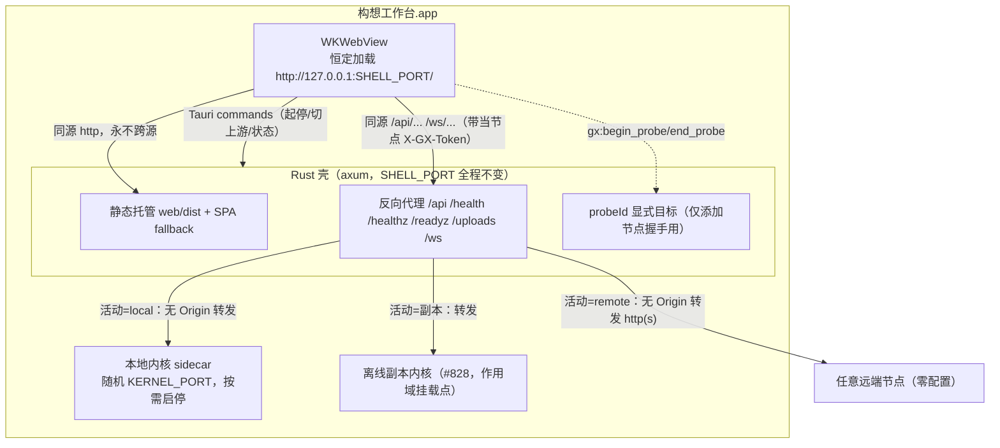

# 0.2.5-beta 桌面成品 + 零配置跨域 + 离线内测 · 文件级实施清单

- 日期：2026-10-16
- 状态：**施工权威（lead 综合定稿，worker 按单施工，不得擅自改架构）**
- 上游设计（结论继续有效，本文件只做产品化落地，不重开架构）：
  - `DESIGN-MACOS-APP.md`（Tauri v2、随包 Node sidecar、D0–D6、§8.5 启动器模型）
  - `DESIGN-OFFLINE-SYNC.md`（YN0–YN10、操作级同步、§18 加密磁盘匣、§20 框架纪律）
  - `DESIGN.md`（节点模式路线 A）
- 对应台账：#824（本文件）→ #825/#826（Rust 壳）→ #827（web 成品接线）→ #828（离线侧车内测）→ #829（Mac 打包真机）→ #830（飞牛 fpk）→ #831（封版发布）。

---

## 0. 本期一句话目标（戴总拍板）

把 Mac 客户端做成**双击即用的成品**：打开先见"节点启动器"（本机/网络节点单活切换），**被连的任何服务器都零配置（不用任何人去填 CORS 白名单）**；并在这版以**内测形态**交付"断网能改、联网自动对账、冲突弹窗手选、本地副本加密"。最终发 `v0.2.5-beta.1`，Gitea Release **同时挂 Mac dmg 与飞牛 fpk**。

已定边界：仅 Apple Silicon（arm64）；免签名 ad-hoc（首次右键打开）；B 先内测；现在开工。

---

## 1. 与设计稿的两处正式偏差（lead 记录，按此执行）

1. **推翻 `DESIGN-MACOS-APP.md` U6 / §7.4「本期不做壳内出口转发、要求被连节点加 loopback CORS 白名单」。**
   戴总 2026-10-16 明确"不留尾巴、不能依赖人为设置白名单"。本期改走**壳内回环出口反向代理（同源化）**：浏览器视角全程同源，被连服务器收到的是不带 `Origin` 的服务端转发 → 内网 / 公网 / 硬配 CORS 的节点全部零配置可连。
2. **bundle identifier 沿用代码现状 `cc.gouxiang.desktop`，不采用设计 U7 写的 `cc.gouxiang.workbench`。**
   理由：尚未发布、无历史 Keychain 归属负担，stage/PoC/tauri.conf 已统一用 desktop，改名零收益。显示名仍「构想工作台」，启动台/包名按产品名。

其余设计结论（选型 Tauri v2、随包 Node、Keychain 存 JWT、关窗驻留菜单栏 + 显式彻底退出、updater minisign、加密匣路线 A、§20 框架纪律）全部沿用。

---

## 2. 冻结：进程 / 端口 / 上游模型（所有 worker 以此为唯一基线）

铁律：

- **一个壳口 `SHELL_PORT`**（启动时 OS 分配随机回环口，App 生命周期内不变）。WebView 自始至终只在 `http://127.0.0.1:SHELL_PORT/`，切换节点**不整页跳转、不改端口**。
- **本地内核口 `KERNEL_PORT` 动态**：仅当注册表本地节点处于 running 才存在；可独立 stop/start。
- 壳口同时承担：① 静态托管 `web/dist`（含 SPA history fallback）；② 反向代理业务前缀到**当前活动上游**（单活）。
- **当前活动上游** = 壳内 `Mutex<Upstream>`，取值 `None | Local{port} | Remote{baseURL} | Replica{port}`，仅由命令 `gx:set_active_upstream` 原子替换。
- **浏览器永远同源**：web 侧所有数据源（含远端）在桌面壳内都呈现为"壳口同源相对地址"。client.ts / collab / 附件一行不改地把请求发到同源，代理按当前上游转发。远端 JWT 由 web 照常放 `X-GX-Token`，**代理只透传、不持有令牌**（令牌不落壳，符合 DESIGN §20.2 壳薄）。
- 转发到上游的请求**剥离 `Origin`/`Referer`**、重写 `Host`，使对端把它当服务端调用（无 Origin → 现网 `app.ts` 无 Origin 放行 `*`，硬配 CORS 的节点也无从拦起）。
- 本地内核仍以 `GX_BIND_HOST=127.0.0.1` 启动；新模型下 WebView 不直连内核口，内核 `CORS_ORIGIN` 回环通配可保留作 fail-safe，但不再是功能依赖。

---

## 3. 冻结：Tauri 命令契约（Rust 与 web 据此并行，签名不得漂移）

Web 侧**不引任何 npm 依赖**调用命令：`tauri.conf.json` 设 `app.withGlobalTauri=true`，业务代码经薄桥检测 `window.__TAURI_INTERNALS__?.invoke`（Tauri v2 全局命令通道）；浏览器 / fnOS 下该对象不存在即 fail-closed（门控已关，零影响）。

| 命令 | 入参 | 返回 | 语义 |
|---|---|---|---|
| `gx:get_shell_info` | — | `{shellVersion:string, platform:"darwin", arch:"arm64", shellPort:number, launcher:true}` | web 判定"在成品壳内"并拿壳口；浏览器无此通道 |
| `gx:local_status` | — | `{added:boolean, initialized:boolean, running:boolean, ready:boolean, kernelPort:number\|null}` | added=本地节点是否曾添加（数据目录是否已初始化过）；running=进程在；ready=/readyz 绿 |
| `gx:start_local` | — | `{ok:true, kernelPort:number, initialized:boolean}` 或 `{ok:false,error:string}` | 首次=冷备→Keychain 取/建 JWT→migrate deploy→nav-reconcile→spawn→readyz；已初始化=仅起进程沿用原库，**不再要求建管理员**（首管理员走 web 现有注册引导，U5） |
| `gx:stop_local` | — | `{ok:true}` | SIGTERM 进程组优雅停（≤8s 后 SIGKILL），**不删数据**；停后上游不得再指向 Local |
| `gx:set_active_upstream` | `{kind:"local"|"remote"|"none", target?:string}` | `{ok:true}` | remote 的 target=规范化 baseURL（http/https）；local 无 target（读当前 kernelPort）；none=无上游（API 回 503 引导回启动器） |
| `gx:begin_probe` | `{baseURL:string}` | `{probeId:string}` | 添加节点握手用：注册短期 probeId→baseURL（校验 http/https），**不改变当前活动上游** |
| `gx:end_probe` | `{probeId:string}` | `{ok:true}` | 立即注销 probeId |

约定与边界：

- 自定义 `#[tauri::command]` 经 invoke 调用；`capabilities/default.json` 在 `core:default` 基础上按 Tauri v2 实际要求补最小权限（实现时以 `cargo tauri dev` 实测被拒项为准，最小授予）。
- probe 转发路径：WebView 同源请求 `GET/POST /__gx/probe/<probeId>/<api 路径...>`，壳把方法/头/体原样转发到 `baseURL/<api 路径>`，回包原样回，结束即注销。**业务握手仍从 WebView 发出**（受 `NSAllowsArbitraryLoadsInWebContent` 放宽，明文 http 局域网可达），Rust 只盲转发——这样不必给壳原生网络开全局 ATS（见 §4.4）。probeId 随机、TTL ≤120s、仅 loopback 可达。
- 命令错误统一 `{ok:false,error}` 或 reject，中文 error 直接可展示；不得 panic 到前端。

---

## 4. 分阶段工作项（文件级、顺序、每步可验证）

### 阶段 R1 — 壳口静态 + 零配置反向代理（#826，地基，最先做）

**位置**：`apps/desktop/src-tauri/`。把 PoC 单文件拆成模块（`main.rs` 只装配）：

- 新增 `src/shell_server.rs`：axum 壳口服务。
- 新增 `src/upstream.rs`：`enum Upstream` + `State(Mutex<Upstream>)` + probeId 表（TTL）。
- 新增 `src/proxy.rs`：HTTP 反代处理器；`src/proxy_ws.rs`：WebSocket 隧道。
- 新增 `src/commands.rs`：§3 命令（本阶段先 `get_shell_info / set_active_upstream / begin_probe / end_probe`，local 起停在 R2）。
- 改 `main.rs`：setup 里绑定 SHELL_PORT、起 axum（用 Tauri 自带 tokio `tauri::async_runtime`）、把主窗口导航到 `http://127.0.0.1:SHELL_PORT/`（替换 PoC 的 `window.location.replace` 内核口逻辑；保留 PoC env 门控分支直到验收后删）。
- 改 `tauri.conf.json`：`app.withGlobalTauri=true`；`bundle.targets` 增 `"dmg"`；前端仍由壳口运行时承载（`frontendDist` 给壳口静态根，见 R3 stage 调整；窗口 url 用运行时导航壳口的既有可行姿势）。

**依赖增量（Cargo.toml，唯一较重的一块）**：`axum` + `tower`/`hyper-util`（只取必要 features）、`reqwest`（已在 updater 依赖树，开 `stream`，rustls，**不启用默认 OpenSSL**）、`tokio`（Tauri 已带，补 `rt-multi-thread/net/sync` 视实测）、`tokio-tungstenite`（rustls，用于 WS 客户端隧道）、`futures-util`。`default-features=false` 精剪；首次新增依赖编译在本机**插电、`CARGO_BUILD_JOBS=2`、戴总在场**下一次性完成，之后增量轻。

**代理规格（proxy.rs）**：
- 前缀：`/api`、`/health`、`/healthz`、`/readyz`、`/uploads`（精确前缀匹配，注意别吞静态）；其余路径先查静态文件，命中返回，未命中 SPA fallback `index.html`。
- 上游无活动（None）→ 回 `503` JSON `{code:503,message:"NODE_NOT_ACTIVE"}`，前端据以回启动器。
- 请求：剥 `Origin/Referer`；`Host` 设为上游 host；透传 `X-GX-Token/Authorization/Content-Type/Accept` 与 multipart body（**body 流式**，禁全量缓冲）；显式发 `Accept-Encoding: identity` 或关闭 reqwest 自动解压以避免 Content-Length 失真（二选一，写注释）。
- 响应：状态码透传；剥上游 `Access-Control-Allow-*`（已同源，无需 CORS）；若有 `Location` 指回上游 origin，重写成壳同源（防跳转跨源）；`Set-Cookie` 域抹除（我方 Bearer-only，实测若有则重写）。
- OPTIONS：同源不发预检；收到任意 OPTIONS 直接 `204` 兜底。
- probe 路径 `/__gx/probe/<id>/...`：查 probeId 表取 baseURL，同样剥 Origin 转发；未知/过期 probeId → 404。

**WS 隧道（proxy_ws.rs）**：
- `/ws` 路径且头含 `Upgrade: websocket`：接受客户端升级，作为客户端连上游：
  - Local → `ws://127.0.0.1:<KERNEL_PORT>`；Remote → 由 target baseURL `http→ws / https→wss` 换算（wss 用 rustls，SNI=目标 host）。
  - 透传 query（含协同票据 `?t=`）与必要子协议头；双向 `copy_bidirectional`，任一关闭即收尾。
- 仅转发，不解读 WS 帧（协同二进制 4403 原样往返，符合 DESIGN：不把无 clientOpId 的协同帧塞进 sync_incoming）。

**ATS（已定，勿改坏）**：`Info.plist` 维持仅 `NSAppTransportSecurity → NSAllowsArbitraryLoadsInWebContent=true`（键名无尾缀 s）。业务远端流量全出自 WebView，故明文 http 局域网可达；**不为代理便利给壳原生网络开 `NSAllowsArbitraryLoads`**。注意 Rust reqwest 作为"本地转发器"对外连明文 http 时同样受 ATS 约束——若实测 Rust 侧直连 http 远端被 ATS 拦截（预期会），代理对远端的明文连接改用：reqwest 不走系统 ATS（Rust 的 reqwest/rustls **不经过 Apple ATS**，ATS 只约束 URLSession/WKWebView）。实现时以实测为准并在文件头注释结论；WS wss 用 rustls 直连无 ATS 问题。

**验收 R1**：
1. 壳口加载 web/dist；`curl -H` 模拟同源 API 经代理到一个 local 上游 CRUD 成功；到一个**硬配 CORS_ORIGIN 的 http 远端**（VM15 造一个）也成功，且对端日志显示请求无 Origin。
2. multipart 上传/下载经代理字节一致；WS 经代理升级收首帧、坏票 4401（复用 PoC-4 探针语义）。
3. `set_active_upstream` 原子切换 local↔remote 后新请求走新上游；None 回 503。
4. probeId 握手路径通且过期 404；目录穿越静态防护保留（沿用 PoC `serve_one` 校验）。
5. `cargo clippy --all-targets` 0 warning、`cargo fmt --check` 过；不新增任何 web/api 行为变化。

### 阶段 R2 — 本地内核可启停托管 + Keychain + 首 boot（#825）

- 新增 `src/sidecar.rs`：把现 `boot_local_kernel()`（main.rs:473-640）重构为**可命令式 start/stop/status 的托管结构**（State 持 `Option<ChildHandle>`，不再无条件 spawn、不只管启动）。
  - `start`：数据目录不存在→首 boot（冷备 dev.db → 取/建 JWT → `prisma migrate deploy` → `nav-reconcile --apply` → spawn `dist/index.js` → 轮询 `/readyz` 五探针）；已存在→只 spawn 沿用原库。
  - `stop`：进程组 SIGTERM（复用现 `graceful_stop`，≤8s→SIGKILL）。
  - status：`added`（数据目录/dev.db 是否已初始化）、进程存活、readyz。
- 新增 `src/secret.rs`：JWT_SECRET 入 macOS Keychain，`service=cc.gouxiang.desktop, account=jwt-secret`，首启生成 ≥32 字节随机；**删除现 `.jwt-secret` 文件方案**。优先用 `security-framework` crate（密码不进 `ps`）；若链接成本过高再降级 `/usr/bin/security` CLI 并确保口令不经命令行参数。
- 命令接入：`gx:start_local / gx:stop_local / gx:local_status`（§3）。
- `common_env` 保持 `NODE_ENV=production / GX_BIND_HOST=127.0.0.1`；CORS 回环通配保留。
- 新增菜单栏（`src/tray.rs`，`tauri::tray`，最小图标自建非 emoji）：「显示主窗口」「检查更新」「彻底退出 GouXiangDB」。关窗默认隐藏驻留（RunEvent::CloseRequested prevent + hide），「彻底退出」走优雅停 sidecar 再 exit（沿用现 ExitRequested/Exit 收尸与 updater RESTART 分支，#829 复用）。
- 跨重启：下次打开若注册表本地节点上次为 running（web 侧在 start/stop 成功后回调本命令或由 web 启动时据注册表调 `gx:start_local`），web 启动器编排负责决定是否拉起（见 W2）；Rust 不自行猜测。
- **加密磁盘匣的 Keychain 命名空间预留**：`service=cc.gouxiang.desktop.vault, account=local | node:<nodeId>`（#828 用，本阶段只在注释/常量登记，不实现）。

**验收 R2**：干净数据目录首启建库→Web 走完现有首个管理员注册（U5，无原生表单）；退出 App 进程组无残留；再次打开"连接本地"秒起、不重建、不要重注册；`stop_local` 后端口释放、dev.db 完好，再 start 数据仍在；Keychain 项存在且**首访授权弹窗形态由戴总在场观察记录**（对应 PoC-4 组1 项5）；clippy/fmt 0。

### 阶段 W1 — web 成品接线：壳桥 + 同源数据源路由（#827 上半）

- 新增 `apps/web/src/node/shellBridge.ts`（无 npm 依赖）：`hasShell()`（`window.__TAURI_INTERNALS__?.invoke` 存在）+ 类型化 `invokeGx(cmd, args)` 包装；`getShellInfo()`。浏览器面 import 无副作用、调用即抛错（仅门控后触达）。
- 新增 `apps/web/src/node/shellRouting.ts`（纯函数，可单测）：桌面成品模式下，把活动数据源"同源化"——
  - 产出的 `ActiveDataSource`：local 与 remote **都给壳口同源相对 baseURL（`""`）**，保留真实 `nodeId`/`token`/`kind`；`wsHostOrigin()` 回落到页面 origin（=壳口）。
  - 切 remote 前后由编排层调 `gx:set_active_upstream({kind:"remote",target:entry.baseURL})`；切 local 前先确保 `gx:start_local` 就绪再 `{kind:"local"}`；全部断开 `{kind:"none"}`。
  - 复用现有 `dataSourceResolver` 单例与 `launcherStore`，**不改 client.ts / collab 一行**（它们读 resolver，同源后天然正确）。
- 改 `launcherStore` / `useLauncher` 生产装配：`browserDefaultDeps` 在"成品壳模式"下用 shellRouting 的同源构建器替换 `getLocalBase`/远端 baseURL，并把 connect/disconnect 动作包一层壳命令副作用（start/stop/set_upstream/begin_probe）；非壳模式（浏览器/fnOS）走现状，逐字节不变。
- 添加远端节点的握手：`AddRemoteNodeForm/ConnectNodeForm` 在壳模式经 `begin_probe` 拿 probeId，使 `handshake.loginRemoteNode` 的 baseURL 在该会话内指向同源 `/__gx/probe/<id>`（登录拿 JWT 后 end_probe）；浏览器模式沿用直连。
- 切换节点成功后保留现有 `queryClient.clear()`（`queryClientBridge.ts`）语义；401 分流（`unauthorizedBridge`）不变。

**验收 W1**：新增纯函数单测（同源化 baseURL/wsOrigin、probeId 路径、非壳模式回落）；`pnpm --filter @gx/web tsc` 0、定向 vitest 绿；浏览器面（不注入壳通道）golden 不变。

### 阶段 W2 — 启动器横屏成品体验 + 构建注入（#827 下半）

- `LauncherPanel.tsx`：现在是 `max-w-[420px]` 窄卡（戴总觉得像竖屏手机）。成品壳窗口 1280×820，改为**全屏浅灰底 + 居中卡片（≤560px）**，顶部产品名/图标，底部版本号；列表/添加/连接三视图在卡片内，不再像手机页。沿用 UI-SPEC token，不新增样式体系、不加依赖、图标自建。
- 本地节点行四态接 `gx:local_status`：未添加 / 已添加已停止（可"启动"）/ 启动中 / 运行中（可"停止"、"使用中"）；首次"添加并连接本地"触发首 boot，期间卡片显示内核启动进度（命令返回前 loading，失败显示中文 error）。
- 进业务壳：连接成功 `navigate("/")`；`LauncherBubble` 在壳模式显示当前源，点开可回启动器切节点；无活动节点时受保护路由引导回 `/launcher`（复用 RequireAuth 对远端会话放行的现有逻辑，补"壳内无活动上游"态）。
- 构建：新增桌面专用前端构建姿势（不影响飞牛/浏览器构建）——`VITE_NODE_LAUNCHER=1 VITE_BASE_PATH=/` 产出 web/dist，供 stage 打进壳静态根。
- stage 脚本 `stage-node-sidecar.mjs`：现状把 web 产物放 `server/public`（内核同源托管）。新模型改为**壳口托管 web/dist**：产物同时（或改为）放到壳静态资源根（由 R1 的静态服务读取），`server/public` 不再作为主承载（可保留兜底）。`tauri.conf.json` 的 `frontendDist` 与壳静态根对齐。
- 排查并登记"所有依赖远端绝对 URL 的点"（avatar/branding 直链、a[download]、window.open、分享链接复制），确保壳模式下都走同源代理或改为由当前节点源派生；列出清单逐条处理，不允许漏网跨源。

**验收 W2**：门控开的桌面构建里，新增装首屏=启动器；添加本地→首 boot→注册管理员→进业务；添加一个 http 局域网远端 + 一个硬配 CORS 远端，均无需对端配置即可登录、CRUD、上传、协同、头像；切换不整页刷新；门控关的普通构建无启动器、行为与现网一致；web tsc/定向测试/eslint 0。

### 阶段 O — 离线双向同步侧车（B，内测形态，#828）

> 服务端 YN0–YN9 已就位（`apps/api/src/routes/v1/sync/`、`domain/sync/`，总门 `GX_SYNC_SERVER` 默认 off）。本阶段只做**桌面消费侧**，并把内测范围诚实收窄。

**内测最小闭环（本期必须打通）：**
1. **副本作用域与加密匣编排（Rust，`src/vault.rs`，路线 A）**：为某远端节点建 `vaults/node-<nodeId>.sparsebundle`（AES-256，hdiutil，密码入 Keychain `.vault` 命名空间），挂载 `mounts/node-<nodeId>`；以 `GX_DATA_DIR=<挂载点>` 起一个**副本内核**（新 KERNEL 口或同一 sidecar 二进制不同 dataDir/port）；退出/失权 detach。纯本地 base 用 `vaults/local.sparsebundle`（本地是否加密：内测默认也加密，与设计一致）。**PoC-4 组1 项5 的签名 App 内 Keychain 自动挂载授权弹窗，必须戴总在场首验。**
2. **首次订阅 + 快照 + 增量拉取（web/副本内核侧）**：对当前远端 base `POST /sync/subscribe` → `/snapshot`（按当前权限裁剪）写入副本 → `/pull` 游标增量；`replica_state` 记账（拉游标/snapshotDone/authzVersion）。
3. **离线写 outbox**：副本内核里记录的增删改在同一写事务登记 `local_outbox`（复用服务端 oplog 词表/payload 形状）；断网时活动上游切到副本内核（`Upstream::Replica`），web 照常读写副本。
4. **联网 push + 裁决回执**：恢复后 `POST /sync/push`（一批一 base、clientOpId 幂等、BigInt 字符串），按回执把 outbox 置 accepted/conflict/rejected/quarantined；再 pull。
5. **冲突弹窗（web，同步中心）**：复用 YN6 服务端 `/sync/resolve`（mine/theirs/custom）；做"我的版本 vs 服务端版本"双栏手选面板（绝不静默覆盖）；同步中心列 rejected/quarantined（retry/discard，接 `/sync/incoming/*`）。
6. **失权擦除**：`/sync/visibility` 对账，整节点失权→Rust detach + 销毁该节点 sparsebundle（最干净）；部分字段降权→匣内受限重快照擦除；纯本地 base 永不因远端权限被清。

**内测明确收窄（写进 RELEASE/测试说明，不偷偷砍）：**
- 记录（Record/LinkRow）离线增删改 + 冲突手选 + 失权隔离/擦除 + 副本加密：**内测必做**。
- 文档/画布离线（Yjs 累积联网合并）：依赖侧车消费协同帧，内测**作为第二项**，时间不够则在内测说明里标注"文档离线随下一 beta"，但在线协同不受影响。
- 结构/导航离线（服务端 YN7/YN8 已就绪）：侧车登记结构 op 工作量大，内测**第三优先级**；至少保证"离线期间不主动产生结构分叉"的安全姿态（可先禁用离线结构编辑入口或仅允许记录编辑），不做半成品。
- 附件：仅"已看缓存占位 + 离线新增随 op 先传文件再提交"（§10.2 v1），不做全量双向。
- 审批：只保留 `pending_approval`/`reviewBaseId` 占位，不建 UI/表。

**铁律**：侧车/outbox 一切面默认旁路（`GX_SYNC_OFFLINE` 仅在成品壳订阅副本时 on）；服务端 `GX_SYNC_SERVER` 随飞牛包但**默认 off**；不动存量数据、只增新表；首同步前本地冷备 + 服务端备份提示（复用 online-backup）。

**验收 O**：断网改记录本地生效→联网 push 自动 accepted；制造服务端并发改动→冲突弹窗三选一不丢数据；离线降权→rejected/quarantined 明确告知且失权副本被擦、兄弟节点不受影响；落盘为密文（detach 后挂载点空、镜像 grep 无明文，对应 PoC-4 项3/4）；不开开关的现网安装零行为变化。

### 阶段 P — Mac 打包真机（#829）

- 新增 `apps/desktop/package.json`（仅壳 TS 用，若 R/W 阶段确有 TS；`build` 不挂 `-r` 重活）、`scripts/build-desktop.mjs`（校验根版本→确认 web/api dist 新→stage→`tauri build --target aarch64-apple-darwin`，`CARGO_BUILD_JOBS=2`→出 `.app/.dmg/.app.tar.gz`→整包 ad-hoc `codesign --force --deep -s -`）、`scripts/make-latest-json.mjs`（读 `.sig` 生成 Tauri latest.json，URL 固定公网域名模板）。
- updater 接成品：`tauri signer generate` 产 minisign 钥（私钥不入仓）；conf 注入 pubkey + Gitea 公网 endpoint；每次开 App 自动查一次（只查不装，U4）+ 手动菜单；安装前优雅停 sidecar（PoC-3 已验证时序，复用 `run_poc3_update` 结论：download 校验通过后才停内核）。
- 冒烟（戴总在场、插电、本机一次性）：干净目录首启建库；加远端零配置切换；起停；上传/协同；冲突弹窗；dmg 拖装→**首次右键打开**；updater 旧→新闭环并记录替换后 quarantine 状态（PoC-3 项3）；Keychain/加密匣授权弹窗。

### 阶段 F/X — 飞牛包 + 封版（#830/#831）

- **所有 web/api 代码定稿后**，在 **VM15 Linux** 跑全量四门（本机不跑），再 `node deploy/fnos/build-fpk.mjs --arch x86` 重打 0.2.5 x86 fpk（同步服务端随包、`GX_SYNC_SERVER` 默认 off）；核 manifest.version、零软链、产物落盘（复用 #804 流程，但树要更新到最终 HEAD）。
- 封版：根版本＝0.2.5（beta tag `v0.2.5-beta.1`）、刷新根 README（版本/阶段/部署形态矩阵加 macOS 行/四门基线/RELEASE 指引）、RELEASE.md（含 Mac 右键打开、数据目录、updater 源、**内测范围诚实清单**、飞牛后台账号口径）。
- **本地提交全部完成、Mac 与飞牛双包真机/基线验证都过后**，经戴总"彻底完成后推送测试版"的条件授权：push `feat/macos-desktop-d0`（或并入主线，封版时定）→ 打 tag → Gitea Release 同传 `构想工作台_0.2.5_aarch64.dmg`、`*.app.tar.gz(+sig)`、`latest.json`、飞牛 `*.fpk`、`update-manifest.json`；latest.json URL 用 `https://gitea0.hn.takin.cc/...` 公网域名（不用 API 返回的旧内网地址）。汇报附飞牛后台账号 + 密码（以目标机 .env 为准）。

---

## 5. 顺序与并行（守 16GB 本机资源纪律）

1. R1→R2（同一 Rust worker 连贯做，文件集都在 src-tauri；本机 cargo 限并发 2，插电在场）。
2. W1 契约已在 §3 冻结，可在 R1 起步后错峰开工（TS 纯逻辑 + 单测为主，避开 cargo 链接峰值）；W2 待 R1/R2 能联调再做。
3. O 依赖 R2（侧车/多作用域）与 W1（壳路由），最后做，按内测范围切三刀。
4. P 在 R+W+O 收口后本机一次完成；F/X 在 VM15 四门 + 双包齐了最后做。
5. 任一阶段失败不影响已上线形态：桌面是隔离工作区、web 门控默认关、服务端同步默认 off。

## 6. 全局红线（每阶段自检）

- 不破坏真实数据：迁移只增、列名 camelCase、无物理 FK、先冷备、可回滚；新增 Prisma 迁移后部署必 `prisma generate`。
- 默认旁路、现网（浏览器/fnOS/裸机）逐字节不变；golden 计数变化只在引入变更里一次性登记。
- 壳薄（DESIGN §20.2）：Rust 只做窗口/进程/密钥/挂载/转发/更新，不写业务/SQL/权限/冲突逻辑。
- web 不加 npm 依赖、不裸 fetch、图标自建、走 gx-* 令牌；Tauri 调用只走 `__TAURI_INTERNALS__` 薄桥。
- 重活只在 VM15；本机只 tsc/lint/定向 vitest/必要的 cargo 增量与最终组装，随跑随清。
- 提交只本地不 push，直到双包成品过验且戴总授权。
